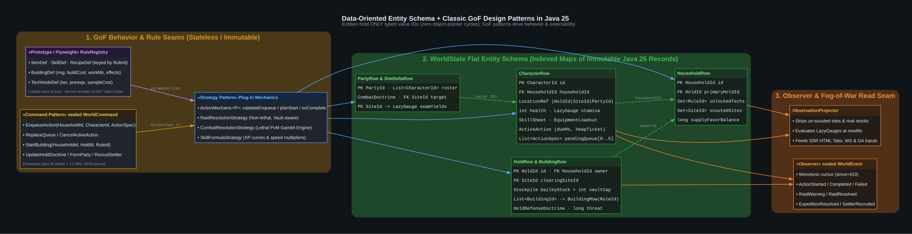

# 01 — Server Architecture, Entity Schemas & Design Patterns

You mentioned that you are very comfortable with **Object-Oriented Design Patterns** (Command, Strategy, Prototype, etc.) and also considered C, so you want to *see* how a modern, modular simulation server is structured—whether it uses GoF patterns, an Entity Schema, or both.

The short answer—and the secret weapon of **Java 25 LTS**—is **you use both, each for the half of the problem it was born for**:
1. **Entity Schemas (Data-Oriented Java)** store *what the world IS* (state: characters, holds, stockpiles, ore veins).
2. **Classic Design Patterns (Command, Strategy, Prototype/Flyweight, Ports & Adapters)** govern *how the world CHANGES and EXTENDS* (behavior: commands, action resolvers, tech unlocks, combat doctrines, network/DB adapters).

Below is the concrete blueprint of how they fit together cleanly without framework magic.



> *Graphviz artifacts:* [`02-entity-schema-and-patterns.dot`](diagrams/02-entity-schema-and-patterns.dot) · [`SVG`](diagrams/02-entity-schema-and-patterns.svg) · [`PNG`](diagrams/02-entity-schema-and-patterns.png)  
> *Full server topology:* [`01-system-architecture.dot`](diagrams/01-system-architecture.dot) · [`SVG`](diagrams/01-system-architecture.svg) · [`PNG`](diagrams/01-system-architecture.png)

---

## 1. Why Classic OOP Object Graphs Hurt Simulations (And What Replaces Them)

In textbook OOP, your instinct is to model the domain as a web of mutable objects pointing directly at each other:

```java
// ❌ CLASSIC MUTABLE OOP WEB — Looks nice on day 1, hurts by Friday #5
public class Character {
    private Household household;           // pointer cycle!
    private Hold currentHold;              // shared mutable pointer!
    private Site targetSite;               // what if site depletes mid-reference?
    private Building assignedStation;      // what if a raid ruins this building?
    private List<Item> inventory;
    
    public void tick() {
        // Mutates currentHold.getStockpile(), assignedStation.setCondition(...), etc.
    }
}
```

### Four Reasons This Breaks Down in Ironwood Wilds
1. **Save / Snapshot Pain:** Serializing a cyclic graph of 5,000 objects to Postgres (or cloning a world mid-run to test a Genetic Algorithm branch!) requires fragile graph-traversal mappers, weak references, or heavy ORMs like Hibernate.
2. **Dangling State & Aliasing Bugs:** When a Party wipes in a Monster Lair or a Building is demolished, tracking down every object still holding a Java reference to it causes subtle state corruption.
3. **Fog-of-War Leaks:** Passing a `Site` or `Household` domain object toward a JSON serializer risks accidentally leaking hidden enemy stats or another Household's private stockpile unless you carefully copy everything anyway.
4. **Concurrency Locks Everywhere:** If HTTP/WebSocket threads read `character.getCurrentHold().getStockpile()` while the simulation thread mutates it, you get `ConcurrentModificationException` or deadlocks.

---

## 2. The Replacement: Flat Entity Schemas in Java 25 ("In-Memory Relational Tables")

Since you already designed C libraries (`samvillage`, `samvm`) around structs and integer indices, **Data-Oriented Java 25** will immediately feel like home. Think of `WorldState` as an **in-memory relational database** made of strongly-typed `record` rows and tiny value-ID wrappers:

### 2.1 Typed Value IDs (Zero-Overhead Safety)
Never pass raw `long` or `int` where you could accidentally pass a `buildingId` into a parameter expecting a `characterId`. Wrap IDs in 1-line Java `record`s (with `-XX:+UseCompactObjectHeaders` in `kotharworks`, these are tiny and crystal clear):

```java
package com.kotharworks.wilds.id;

public record HouseholdId(long value) {}
public record CharacterId(long value) {}
public record HoldId(long value) {}
public record BuildingId(long value) {}
public record SiteId(long value) {}
public record PartyId(long value) {}
public record RuleId(String slug) {} // e.g., RuleId("iron_pickaxe"), RuleId("mine_ore")
```

### 2.2 Entity Rows (Pure Data, Zero Object Pointers)
Each entity is a flat record referencing other entities **strictly by ID**, never by direct object pointer:

```java
package com.kotharworks.wilds.state;

public record CharacterRow(
    CharacterId id,
    HouseholdId householdId,
    String name,
    LocationRef location,          // sealed: AtHold(HoldId) | AtSite(SiteId) | InParty(PartyId)
    int health,                    // 0..100
    int maxHealth,
    StaminaGauge stamina,          // lazy gauge! (see Doc 02)
    SkillSheet skills,             // compact int[] of XP indexed by Skill enum ordinal
    EquipmentLoadout equipment,    // RuleId slots + durability
    ActiveAction activeAction,     // nullable: startedMs, dueMs, heapTicket, ActionSpec
    List<ActionSpec> pendingQueue  // immutable list, max length 5
) {}

public record HoldRow(
    HoldId id,
    HouseholdId ownerId,
    SiteId tileSiteId,
    String name,
    Stockpile baileyStock,         // exposed to raid pillage beyond vault floor
    int vaultProtectedCap,         // derived or cached from Vault building tier
    List<BuildingId> buildings,
    HoldDefenseDoctrine defenseDoctrine,
    long threatPoints
) {}
```

### 2.3 `WorldState` — The Complete Simulation Universe in One Struct
```java
public final class WorldState {
    private final WorldSeed seed;
    private long nowMs;
    private long nextEntitySeq;
    private long nextEventSeq;

    // Flat indexed tables — O(1) lookup, trivial to snapshot, diff, or clone!
    private final Map<HouseholdId, HouseholdRow> households = new HashMap<>();
    private final Map<CharacterId, CharacterRow> characters = new HashMap<>();
    private final Map<HoldId, HoldRow> holds = new HashMap<>();
    private final Map<BuildingId, BuildingRow> buildings = new HashMap<>();
    private final Map<PartyId, PartyRow> parties = new HashMap<>();
    
    // Procedural world delta table! Unvisited/untouched procedural sites take ZERO RAM;
    // we only store SiteDeltaRow once someone depletes ore or clears a lair there.
    private final Map<SiteId, SiteDeltaRow> siteDeltas = new HashMap<>();

    // Deterministic event scheduler (see Doc 02)
    private final DueEventHeap dueEvents = new DueEventHeap();
}
```

> **Look at that `siteDeltas` trick:**  
> Because `libs/procgen` can deterministically compute the baseline terrain, ore capacity, and monster lair of any `(x, y)` coordinate from `WorldSeed` in microseconds, an entire continent of 1,000,000 tiles uses **zero bytes of memory** until a character actually mines a seam or loots a ruin there!

---

## 3. Layering Classic Design Patterns for Maximum Extensibility

Flat entity rows give you clean *data*, but you explicitly want **extensibility**—adding 30 new actions, 50 tech nodes, new raid mechanics, and new monster behaviors without turning `WildsEngine.java` into a 6,000-line switch statement.

Here are the **five classic Design Patterns** that power `libs/wilds` and `apps/wilds-server`:

### Pattern 1: Prototype / Flyweight Pattern -> `RuleRegistry` (Spec-as-Data)
Instead of creating subclasses like `class IronOre extends Item` or `class StoneWall extends Building` (inheritance explosion!), static game definitions live as immutable **Flyweight/Prototype records** inside a central `RuleRegistry`:

```java
public record ItemDef(
    RuleId id,
    String singular,
    String plural,
    ItemCategory category,
    int unitWeight,
    int homeworldSupplyFavorValue
) {}

public record BuildingDef(
    RuleId id,
    String name,
    HoldRing ring,                      // OUTER_WORKS | BAILEY | KEEP
    RuleId requiredTech,                // null if available at start
    Map<RuleId, Integer> buildCost,     // e.g., timber -> 20, stone -> 10
    long requiredWorkMs,
    int maxCondition,
    List<BuildingEffect> passiveEffects // e.g., GrantsStation("forge", slots=1), AddsVaultCap(50)
) {}

public record TechNodeDef(
    RuleId id,
    int tier,
    String title,
    List<RuleId> prerequisites,
    Map<RuleId, Integer> sampleCost,
    long researchWorkMs
) {}
```
* **Extensibility Win:** Adding 20 new Tier III items, buildings, or recipes requires **zero new Java classes**—you add entries to the data catalog (loaded from classpath TOML/JSON/YAML at startup and validated once: no missing `RuleId` references, no cycles in the tech tree!), and `GET /api/v1/rules` automatically serves them to both the Web UI and every bot!

---

### Pattern 2: Command Pattern -> `sealed interface WorldCommand`
Every mutation a human or bot can ever ask the simulation to perform is reified as an immutable Java 25 `record` implementing a `sealed interface`:

```java
public sealed interface WorldCommand {
    record RegisterHousehold(HouseholdId id, String name, SiteId landingSite) implements WorldCommand {}
    record EnqueueAction(HouseholdId actor, CharacterId characterId, ActionSpec action) implements WorldCommand {}
    record ReplaceQueue(HouseholdId actor, CharacterId characterId, List<ActionSpec> queue) implements WorldCommand {}
    record ClearPendingQueue(HouseholdId actor, CharacterId characterId) implements WorldCommand {}
    record CancelActiveAction(HouseholdId actor, CharacterId characterId) implements WorldCommand {}
    record StartBuilding(HouseholdId actor, HoldId holdId, RuleId buildingDefId) implements WorldCommand {}
    record UpdateHoldDoctrine(HouseholdId actor, HoldId holdId, HoldDefenseDoctrine doctrine) implements WorldCommand {}
    record FormParty(HouseholdId actor, HoldId musterHold, String name, List<PartyMemberSpec> roster, CombatDoctrine doctrine) implements WorldCommand {}
    record DispatchSupplyConvoy(HouseholdId actor, HoldId holdId, Map<RuleId, Integer> manifest) implements WorldCommand {}
    record RecruitSettler(HouseholdId actor, HoldId holdId) implements WorldCommand {}
}
```
* **Why `sealed` + `record` Beats Classic OOP Command Classes:**
  1. In classic Java, `Command.execute(World)` scatters world-mutation logic across 20 files and couples wire DTOs to internal engine state.
  2. With `sealed interface`, the Command is pure **serializable data** (you can write it straight to the Postgres Write-Ahead Log for crash replay!), and the compiler **refuses to compile** (`-Werror`) if you add a new `WorldCommand` and forget to handle it in `CommandDispatcher`!

---

### Pattern 3: Strategy Pattern -> `ActionMechanic` & `DoctrineEvaluator`
Here is where extensibility really shines. You will have many *kinds* of timed actions (`GATHER_SEAM`, `CRAFT_RECIPE`, `CONSTRUCT_BUILDING`, `REPAIR_BUILDING`, `RESEARCH_TECH`, `REST_AT_HOLD`, `TRAVEL_TO_SITE`, `EXPEDITION_DELVE`), and you do **not** want one giant hard-coded loop knowing the details of every mechanic.

Each `ActionKind` delegates to a clean **Strategy interface** (`ActionMechanic`):

```java
public interface ActionMechanic<P extends ActionParams> {

    /** Phase 1 (Enqueue-time): Fast check when player clicks button / sends POST. */
    ValidationResult validateEnqueue(WorldReadView world, HouseholdId actor, CharacterRow ch, P params);

    /** Phase 2 (Start-time): Full precondition + duration calculation when action pops off queue. */
    ActionStartPlan planStart(WorldContext ctx, CharacterRow ch, P params);

    /** Phase 3 (Completion-time): Mutates world state via ctx, grants XP, emits events. */
    void onComplete(WorldContext ctx, CharacterId characterId, P params);

    /** Optional hook if player explicitly cancels mid-progress. */
    default void onCancel(WorldContext ctx, CharacterId characterId, P params, long elapsedMs) {}
}
```

Look how easy it is to add a brand-new action family later (say, *Animal Trapping* or *Siege Engine Calibration*):
1. Define `record TrapLineParams(SiteId siteId, RuleId baitItem) implements ActionParams {}`.
2. Implement `TrapLineMechanic implements ActionMechanic<TrapLineParams>`.
3. Register it in `ActionMechanicRegistry`.  
The queue manager, lazy progress bar UI, event heap, persistence layer, and fail-soft queue advancement **do not change by a single line**.

We use the exact same **Strategy Pattern** for:
- **`SkillFormulaStrategy`:** Plug-replaceable XP curves, speed scaling, and bonus yield rolls (letting you tweak population math for stats/emergence experiments!).
- **`CombatResolutionStrategy` & `RaidResolutionStrategy`:** Self-contained pure functions `(Attackers, Defenders, Doctrine, SeededRng) -> BattleReport` so you can iterate on PvM/Raid balance in unit tests in milliseconds.

---

### Pattern 4: Observer / Cursor Pattern -> `WorldEvent` & `ObservationProjector`
Inside `libs/wilds`, state transitions emit typed immutable `WorldEvent` records into an append-only ring/log with a monotonic `long cursor`:

```java
public sealed interface WorldEvent {
    long cursor();
    long occurredAtMs();
    Optional<HouseholdId> visibilityScope(); // empty = public chronicle event; present = private to Household

    record ActionStarted(long cursor, long occurredAtMs, Optional<HouseholdId> visibilityScope,
                         CharacterId characterId, ActionSpec spec, long dueAtMs) implements WorldEvent {}
    record ActionCompleted(long cursor, long occurredAtMs, Optional<HouseholdId> visibilityScope,
                           CharacterId characterId, ActionSummary summary) implements WorldEvent {}
    record ActionFailed(long cursor, long occurredAtMs, Optional<HouseholdId> visibilityScope,
                        CharacterId characterId, FailureCode code, String reason) implements WorldEvent {}
    record RaidWarningSighted(long cursor, long occurredAtMs, Optional<HouseholdId> visibilityScope,
                              HoldId holdId, String factionName, long strikesAtMs) implements WorldEvent {}
    record RaidResolved(long cursor, long occurredAtMs, Optional<HouseholdId> visibilityScope,
                        HoldId holdId, RaidReport report) implements WorldEvent {}
    record ExpeditionResolved(long cursor, long occurredAtMs, Optional<HouseholdId> visibilityScope,
                              PartyId partyId, BattleReport report) implements WorldEvent {}
}
```
* **Why This Matters:**
  - **WebSocket & TCP Bots** subscribe to live `WorldEvent`s filtered by their `HouseholdId`!
  - **REST Polling Bots** simply call `GET /api/v1/events?since=1042`!
  - **Fog-of-War Security** is enforced in *one* place (`ObservationProjector`), never trusting transport handlers to strip secret fields.

---

### Pattern 5: Hexagonal Architecture (Ports & Adapters) in `apps/wilds-server`
Per `AGENTS.md`, `libs/wilds` stays plain, cohesive, and 100% pure (no ports needed inside the engine). Hexagonal architecture lives in **`apps/wilds-server`**, isolating infrastructure behind tiny interfaces:

```text
apps/wilds-server/src/main/java/com/kotharworks/wilds/server/
├── Main.java                      # Composition root: wires ports, boots engine & listeners
├── domain/
│   └── WorldShardService.java     # Single-writer mailbox + snapshot/WAL coordinator
├── ports/
│   ├── AuthPort.java              # verifySessionCookie(), verifyBearerToken()
│   ├── WorldPersistencePort.java  # appendWal(), saveCheckpoint(), loadLatestWorld()
│   ├── ChronicleMetaPort.java     # recordSupplyFavor(), archiveChronicle()
│   └── ClientPushPort.java        # broadcastToHousehold(HouseholdId, ServerPushFrame)
└── adapters/
    ├── http/                      # JDK HttpServer (Virtual Threads): REST + SSR HTML Tabs
    ├── ws/                        # WebSocket frame adapter -> ClientPushPort + commands
    ├── tcp/                       # Raw ServerSocket NDJSON bot adapter (:8124)
    ├── postgres/                  # JDBI / JDBC adapters for `auth`, `wilds_meta`, `wilds_world`
    └── memory/                    # Zero-DB in-memory adapters for `--dev` and integration tests!
```
Notice `adapters/memory/`: because Postgres sits behind `AuthPort` and `WorldPersistencePort`, you can boot the entire server on a Friday afternoon with `--storage=memory` (zero Docker/Postgres setup needed while iterating on UI or bot logic) and run full-stack HTTP/TCP integration tests in `< 200ms` in `mvnd test`!

---

## 4. Concurrency Model: Virtual Threads + Single-Writer Simulation Mailbox

How do 200 human browser tabs, 150 Python/C bots over TCP, a background raid timer, and a Postgres checkpoint writer all interact **without a single `synchronized` lock or race condition inside `libs/wilds`**?

We use the **LMAX Disruptor / Actor Mailbox Pattern** powered by **Java 25 Virtual Threads**:

```text
  [Virtual Thread 1: HTTP POST /queue] ──┐
  [Virtual Thread 2: WS Frame In     ] ──┼──► BlockingQueue<ShardMessage> (Bounded Mailbox)
  [Virtual Thread 3: TCP Bot Socket  ] ──┤                  │
  [Virtual Thread 4: 250ms Heartbeat ] ──┘                  ▼
                                            ┌───────────────────────────────────┐
                                            │ Dedicated Simulation Thread       │
                                            │                                   │
                                            │ 1. nowMs = clock.millis()         │
                                            │ 2. engine.advanceTo(nowMs)        │
                                            │ 3. result = engine.apply(cmd)     │
                                            │ 4. walBuffer.append(cmd, events)  │
                                            │ 5. Complete caller's reply box    │
                                            │ 6. Publish immutable SnapshotRef  │
                                            └───────────────┬───────────────────┘
                                                            │
  [Virtual Thread 5: HTTP GET /hold  ] ◄────────────────────┘
   Reads immutable Snapshot / AtomicReference (ZERO LOCK CONTENTION WITH WRITER!)
```

### Why This Architecture Is So Fast & Simple
1. **Zero Locks in Simulation Logic:** Only the single Simulation Thread ever mutates `WorldState`. Every `ActionMechanic`, `CombatResolutionStrategy`, and `DueEventHeap` runs sequentially on plain `HashMap`s and arrays at raw CPU cache speed (hundreds of thousands of operations per second).
2. **Lock-Free Reads (`GET` Requests & Browser Tab Switches):** Because `CharacterRow`, `HoldRow`, and `Stockpile` are immutable Java `record`s, whenever a row updates we publish an updated immutable read-view (or copy-on-write persistent map / cached `HouseholdObservation` DTO) via an `AtomicReference`. Ten thousand `GET` requests from polling bots read straight from RAM without ever blocking the simulation loop!
3. **Trivial Genetic Algorithm Parallelism Later:** Because `WildsEngine` has **zero `static` mutable state**, when you build `wilds-arena` in Phase 2 to evolve 500 `SamVM` genomes at once, you simply instantiate **500 independent `WildsEngine` instances on 500 Virtual Threads**—zero code changes required.
