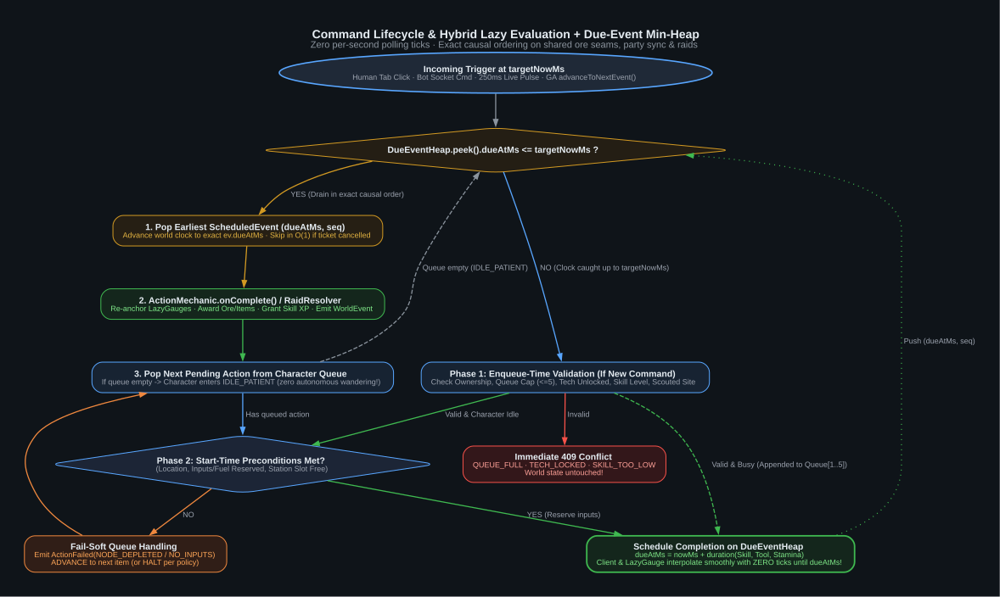

# 02 — Command Handling, Action Queues & Lazy Evaluation

You highlighted two closely connected requirements:
1. *"Actions have a time that ticks down. So if I wanted to get somewhere, I'd need to mine some ore that might take 3 minutes and you can queue a few actions that can be done. I think this should be lazily evaluated."*
2. *"How do people do commands, and how they are handled by the simulation."*

Let's examine **lazy evaluation** carefully first—because your intuition is spot-on, *and* there is one classic trap in multiplayer/multi-agent lazy evaluation that is easy to solve cleanly upfront if you see it coming.

---

## 1. How Lazy Evaluation Works (And the Shared-State Trap)

### Why Naive Tick Loops Are Wasteful
In a naive tick-based game (`1 tick = 100ms` or `1s`), the server loops over *every* character, *every* building, and *every* site on *every* tick:
- `Aldric` is mining iron ore for 3 minutes (`180,000 ms`). On ticks `1..1799`, nothing changes except `remainingTicks--`.
- Worse, if you want to run a Genetic Algorithm later across 7 simulated days (`604,800,000 ms`), a 1-second tick loop forces the CPU to execute **604,800 empty loops** just to wait for timers to count down!

### What Pure Read-Time Lazy Evaluation Looks Like—And Where It Traps You
With **pure read-time lazy evaluation**, you store `{ action: MINE_ORE, startedAtMs: 100_000, dueAtMs: 280_000 }` and do *nothing* until a player or bot queries `Aldric` at `t = 500_000`:
- At `t = 500_000`, you see `500_000 >= 280_000`, say *"Oh, Aldric finished mining 220 seconds ago, and also finished queued Action #2 40 seconds ago!"* and compute the result on the fly.

**That works great for single-character idle games—until TWO entities touch shared world state:**
1. **The Last Ore Race:** Suppose an Iron Seam has `1 ore` remaining.
   - `Aldric` starts mining at `t = 0`, finishing at `t = 180_000`.
   - `Brenna` starts mining the same seam at `t = 10_000`, finishing at `t = 190_000`.
   - Nobody looks at `Aldric`'s tab until `t = 300_000`, **but** someone queries `Brenna` at `t = 200_000`!
   - If you lazily evaluate *only Brenna* on read at `t = 200_000`, Brenna takes the last ore—even though **Aldric actually finished 10 seconds earlier (`t = 180_000`)**! Causality broke because visitation order leaked into world state.
2. **The Unvaulted Raid Collision:**
   - `Brenna` finishes hauling 50 Iron Ingots into the Protected Vault at `t = 14:00:00`.
   - A Marauder Raid strikes the Hold at `t = 14:02:00`.
   - If `Brenna` wasn't evaluated before the Raid ran at `t = 14:02:00`, the raiders steal ingots that were already safely inside the Vault two minutes earlier!

---

## 2. The Exact Solution: Hybrid Lazy Interpolation + Deterministic Due-Event Min-Heap



> *Graphviz artifacts:* [`03-command-and-lazy-heap-flow.dot`](diagrams/03-command-and-lazy-heap-flow.dot) · [`SVG`](diagrams/03-command-and-lazy-heap-flow.svg) · [`PNG`](diagrams/03-command-and-lazy-heap-flow.png)

We get **100% of the CPU/fast-forward benefits of lazy evaluation** *plus* **100% exact causal ordering** by splitting continuous values from discrete state transitions:

### Half A: Continuous Values Are Purely Lazy (Zero Ticks, Pure Math!)
Anything that changes smoothly while an action runs—**Action Progress %**, **Stamina recovery/drain**, **Resource Seam regrowth**, **Building passive condition wear**—is **never ticked**. It is stored as an anchor value + timestamp:

```java
/**
 * Lazy linear gauge: zero CPU updates while untouched!
 * Current value is computed purely on demand at any `nowMs`.
 */
public record LazyGauge(
    double anchorValue,
    long anchorTimeMs,
    double ratePerSecond,   // positive = regenerating, negative = draining
    double min,
    double max
) {
    public double valueAt(long nowMs) {
        if (nowMs <= anchorTimeMs) return anchorValue;
        double deltaSec = (nowMs - anchorTimeMs) / 1000.0;
        return Math.clamp(anchorValue + (ratePerSecond * deltaSec), min, max);
    }

    /** Re-anchors the gauge ONLY when a discrete event changes the rate or adds/subtracts a lump sum. */
    public LazyGauge reanchor(long nowMs, double deltaValue, double newRatePerSecond) {
        double current = Math.clamp(valueAt(nowMs) + deltaValue, min, max);
        return new LazyGauge(current, nowMs, newRatePerSecond, min, max);
    }
}
```
And for an `ActiveAction(startedAtMs, dueAtMs, spec)`:
- At any `nowMs` between `startedAtMs` and `dueAtMs`, progress is simply `(nowMs - startedAtMs) / (double)(dueAtMs - startedAtMs)`.
- In fact, the **Web UI doesn't even ask the server for progress updates**—the server sends `{startedAtMs, dueAtMs}` *once*, and the browser tab animates the countdown bar locally!

### Half B: Discrete Completions Sit in a Deterministic Due-Event Min-Heap
Whenever an action starts (say at `t = 100_000` with duration `180_000 ms`), the engine pushes **one lightweight record** onto a binary min-heap ordered by **`(dueAtMs, monotonicSeq)`**:

```java
public record ScheduledEvent(
    long dueAtMs,          // Primary sort key: exact millisecond the state transition occurs
    long seq,              // Tie-breaker: strictly monotonic counter -> 100% deterministic!
    long cancellationToken,// Matches CharacterRow.activeAction.heapTicket (lazy O(1) cancel!)
    DuePayload payload     // sealed: CompleteAction(CharacterId) | TriggerRaid(HoldId) | PartyPhase(PartyId)
) implements Comparable<ScheduledEvent> {

    @Override
    public int compareTo(ScheduledEvent o) {
        int cmp = Long.compare(this.dueAtMs, o.dueAtMs);
        return (cmp != 0) ? cmp : Long.compare(this.seq, o.seq);
    }
}
```

### How `engine.advanceTo(targetNowMs)` Works
Whenever **either** a player/bot command arrives at `targetNowMs` **or** the live server's lightweight background pulse wakes up:

```java
public void advanceTo(long targetNowMs) {
    while (!dueEvents.isEmpty() && dueEvents.peek().dueAtMs() <= targetNowMs) {
        ScheduledEvent ev = dueEvents.poll();
        
        // Advance world clock to the EXACT millisecond of this event!
        this.nowMs = ev.dueAtMs();
        
        // Ignore stale cancelled tickets (O(1) lazy cancellation!)
        if (isCancelled(ev)) {
            continue;
        }
        
        // Resolve state change -> e.g. award ore, grant XP, pop next queued action,
        // push next action's completion onto dueEvents!
        resolveDueEvent(ev);
    }
    this.nowMs = Math.max(this.nowMs, targetNowMs);
}
```

### Look What This Gives You!
1. **Aldric vs. Brenna Race Solved:** Even if nobody touches the server until `t = 300_000`, `advanceTo(300_000)` pops `Aldric (180_000)` *first*, gives Aldric the last ore, and then pops `Brenna (190_000)` ten logical seconds later—who cleanly receives `ActionFailed(NODE_DEPLETED)` and advances to her next queued item!
2. **Chained Queues Catch Up Automatically:** Suppose you queue 4 mining batches (`4 × 3 mins = 12 mins`) and close your laptop for an hour. Even if the server ran purely on-demand, `advanceTo` pops `t = 3m` -> starts batch 2 (`due = 6m`) -> pops `t = 6m` -> starts batch 3 (`due = 9m`) -> pops `t = 9m` -> starts batch 4 (`due = 12m`) -> pops `t = 12m` -> character becomes `IDLE_PATIENT`!
3. **Zero-Cost Idle Worlds & Instant GA Fast-Forward:** In a headless GA run, you don't even call `advanceTo(now + 1000)`—you call `engine.advanceToNextEvent()`, jumping straight from `t = 0` to `t = 180_000` in **one heap pop (~150 nanoseconds)**!

---

## 3. End-to-End Life of a Command

How does a human clicking **"Queue: Mine Crag Iron (×3)"** on Tab 1—or a Python bot sending JSON over a TCP socket—actually execute?

```text
Client (Browser Tab / REST / WS / Raw TCP)
  │
  │  POST /api/v1/characters/chr_101/queue
  │  Authorization: Bearer iw_live_9f8a...
  │  { "requestId": "req-77", "actions": [
  │      { "kind": "TRAVEL", "siteId": "site_crag_04" },
  │      { "kind": "GATHER", "siteId": "site_crag_04", "node": "hematite_seam", "batches": 3 },
  │      { "kind": "TRAVEL_HOLD", "holdId": "hld_1" },
  │      { "kind": "DEPOSIT_ALL", "holdId": "hld_1" }
  │    ] }
  ▼
1. Transport Adapter (Virtual Thread)
   • Authenticates session cookie or Bearer API token via AuthPort -> resolves (AccountId, HouseholdId)
   • Checks per-Household token-bucket rate limiter (e.g., 20 req/s burst, prevents runaway bot while(true) loops)
   • Parses JSON into typed `WorldCommand.EnqueueActions` record
  ▼
2. WorldShardService Mailbox
   • Enqueues Message(receivedWallClockMs, authenticatedHouseholdId, command, replySlot)
  ▼
3. Simulation Single-Writer Loop (`libs/wilds`)
   • Step A: `engine.advanceTo(receivedLogicalMs)` -> drains any events that completed up to this exact ms!
   • Step B: Ownership & Enqueue-Time Validation (Phase 1)
   • Step C: Mutate CharacterRow's queue; if Character was `IDLE_PATIENT`, immediately trigger Start-Time Validation (Phase 2) & schedule completion on `DueEventHeap`!
   • Step D: Emit `WorldEvent`s -> append Command to WAL buffer -> return `CommandResult`
  ▼
4. Response + Live Push
   • Caller gets HTTP 200 (or 409 on validation error) with updated `CharacterObservation`
   • Any open WebSocket / TCP stream for that Household receives `ActionStarted` delta frame
```

---

## 4. Two-Phase Validation & Fail-Soft Queues

Because actions sit in a queue for minutes before starting, the world **will** change between when an action is *queued* and when it *starts* (e.g., another character used the last lump of charcoal in the Bailey, or a Raid damaged the Bloomery).

Borrowing and refining the proven `samvillage` rule, every action passes **Two-Phase Validation**:

### Phase 1: Enqueue-Time Validation (Strict on Static Rules, Optimistic on Future Stock)
Checked **immediately** when the command arrives. If it fails, **nothing is modified** and the client gets an immediate `409 Conflict` with a machine-readable error code:

| Check | Example Rejection (`409` Code) | Why Checked Now? |
| :--- | :--- | :--- |
| Ownership | `NOT_YOUR_CHARACTER` | Prevents cross-household tampering. |
| Character Alive & Un-partied | `CHARACTER_DEAD` / `LOCKED_IN_PARTY` | Characters marching in a Party cannot take solo tab queues until the Party disbands. |
| Queue Capacity | `QUEUE_FULL` | Queue capped at `1 active + 5 pending` (forces active scheduling rather than 18-hour autopilot queues). |
| Tech & Skill Gate | `TECH_LOCKED` / `SKILL_TOO_LOW` | Trying to smelt Steel before unlocking *Blast Furnace*, or mine Lv.20 Hematite at Mining Lv.4. |
| Static Target Validity | `UNKNOWN_TARGET` / `UNDISCOVERED_SITE` | Fog-of-war check: Household hasn't scouted `site_crag_04` yet. |

> **Crucial Ergonomic Detail — Optimistic Chain Queuing:**  
> Suppose `Aldric` is currently at the Hold, and you queue `[TRAVEL(Crag), MINE(Crag), TRAVEL(Hold), SMELT(Hold)]`. At *enqueue time*, Aldric isn't at the Crag yet and doesn't hold Iron Ore yet! Phase 1 **allows** queuing `MINE(Crag)` and `SMELT(Hold)` because *location* and *consumable inputs* are dynamic world preconditions checked in **Phase 2**!

### Phase 2: Start-Time Validation (Checked at the Exact `ms` the Action Pops Off Queue)
When the previous action finishes (or immediately if the character was `IDLE_PATIENT`):
1. Check **Location** (`character.location == Crag`), **Inputs/Fuel** (`2 Iron Ore + 1 Charcoal` in stock, **reserved/deducted at start** so two smiths can't consume the same charcoal!), **Workstation Slot & Condition** (`Bloomery condition > 0` and slot free), and **Carry Capacity**.
2. **Calculate Exact Duration:**
   $$\text{durationMs} = \text{round}\Big(\text{baseDurationMs} \times \text{skillSpeedFactor}(L) \times \text{toolTierFactor} \times \text{staminaPenalty}\Big)$$
3. **What If Phase 2 Fails? (`QueueFailurePolicy`):**
   - Inputs are untouched, an `ActionFailed(code, reason)` event is logged to the character's feed, and we check the Household/Character's **Queue Failure Policy** (a tiny toggle that bots & humans both love!):
     - **`ADVANCE` (Fail-Soft Default):** Drop the failed step and try the next item in the queue (great when `[MINE, TRAVEL_HOLD, DEPOSIT]` hits a depleted seam—the miner automatically walks home and deposits what they already mined!).
     - **`HALT_ON_FAIL`:** Pause/clear remaining dependent steps and leave the character `IDLE_PATIENT` so they don't walk to a dangerous site empty-handed when `EQUIP_SPEAR` failed.

---

## 5. Multi-Batch Actions, Cancellations & Multi-Character Party Sync

Three practical details that make timed queues feel crisp rather than clunky:

### 5.1 Batch Count (`batches: 1..10`) Within a Single Queue Slot
In an OSRS-like grind, nobody wants all 5 queue slots eaten up by 5 individual logs!
- An `ActionSpec` carries `int batches` (e.g., `CHOP_TIMBER × 10`, where each batch is `45s`).
- Internally, **each batch schedules as one `45s` step**! After `45s`, `Aldric` gets `1 Timber + Woodcutting XP`, `batchesRemaining` decrements from `10 -> 9`, and batch #2 schedules for `now + 45s` (re-Evaluating duration in case Aldric just leveled up Woodcutting on batch #1!).
- If you cancel `Aldric` at minute 4, **he keeps the 5 Timber and XP he already completed**, rather than losing 7 minutes of work!

### 5.2 Cancelling an Active Action (`O(1)` Without Heap Removal)
Removing an arbitrary node from the middle of a binary min-heap is annoying. Instead:
- Every `ActiveAction` has a unique `long heapTicket`.
- When the player clicks **[Cancel Current Action]**, `CharacterRow.activeAction` is cleared (refunding reserved crafting inputs if a craft hadn't finished, or dropping partial gather progress for the current incomplete batch) and the character immediately starts their next pending action.
- Later, when the old `ScheduledEvent` reaches the top of `DueEventHeap`, `ev.cancellationToken() != character.currentTicket()` sees it is stale and discards it in `O(1)`!

### 5.3 How Multi-Character Parties Synchronize Lazily
When you form a Party (`Aldric`, `Brenna`, `Cedric`) to clear a Wolf Den:
1. `FormParty` creates `PartyRow(status = MUSTERING, holdId)` and appends a `MUSTER_FOR_PARTY(partyId)` action to each chosen character's queue (or starts immediately if they are already idle at the Hold).
2. As each character finishes their current chore (e.g., `Aldric` finishes smelting `40s` later; `Brenna` was already idle), they transition into `LocationRef.InParty(partyId)`.
3. The moment the **last** member arrives (`arrivedCount == roster.size()`), the Party automatically transitions `MUSTERING -> MARCHING_OUT`, deducts expedition rations from the Hold, and pushes `PartyPhase(partyId, DELVE_COMBAT)` onto `DueEventHeap` at `nowMs + marchDurationMs`!
4. Zero busy-waiting, zero autonomous Sims wandering, and complete multi-character coordination.
