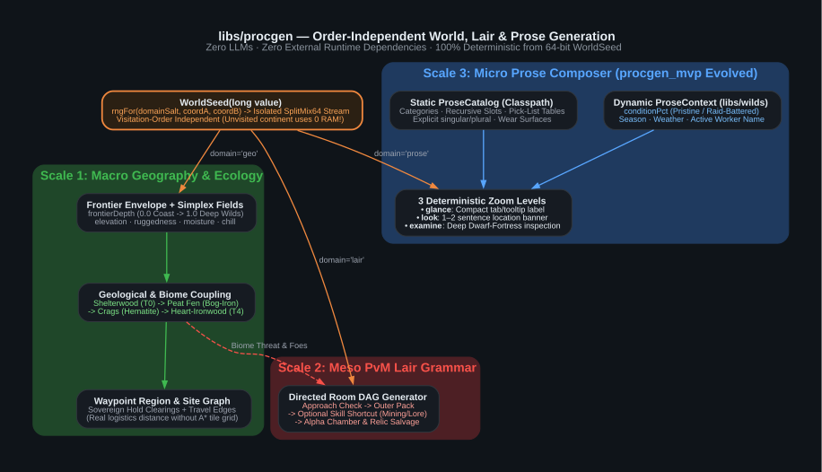

# 03 — Procedural Generation: Worlds, Lairs & Low-Fantasy Prose

In `planning/olderplanning/procgen_mvp.md`, you already nailed a core insight: **Dwarf-Fortress-style richness comes from compositional rules, relational categories, material properties, and wear—not from calling an LLM.**

In **Ironwood Wilds**, `libs/procgen` (`com.kotharworks.procgen`, **zero external runtime dependencies**) expands that foundation across **three scales**, all driven deterministically from a single 64-bit `WorldSeed`:

1. **Macro Scale (Geography & Resource Ecology):** Generating a coherent continent where geology, rivers, biomes, danger tiers, and resource veins make physical sense.
2. **Meso Scale (Sites, Ruins & PvM Lairs):** Generating multi-room monster dens, abandoned watchtowers, and resource clearings via small graph grammars.
3. **Micro Scale (Hierarchical Prose Composer):** Turning raw simulation state + seeded detail trees into crisp, grounded *Game of Thrones*-toned text at three zoom levels (`glance`, `look`, `examine`).



> *Graphviz artifacts:* [`05-procgen-pipeline.dot`](diagrams/05-procgen-pipeline.dot) · [`SVG`](diagrams/05-procgen-pipeline.svg) · [`PNG`](diagrams/05-procgen-pipeline.png)

---

## 1. The Mathematical Backbone: Domain-Separated Coordinate Hashing

The #1 bug in amateur procedural generators is **visitation-order dependence**: pulling numbers sequentially from a single mutable `java.util.Random` means Tile `(10, 4)` generates as a forest if a player walks east first, or a swamp if a player walks north first!

Instead, building directly on your existing `WorldSeed.java` scaffold, **every coordinate, entity, delve, and text slot derives its own isolated SplitMix64 stream** by mixing `(worldSeed, domainTagHash, id1, id2)`:

```java
public record WorldSeed(long value) {

    /** Produces an independent, deterministic RNG for any named domain and coordinates. */
    public SeededRng rngFor(String domain, long a, long b) {
        long domainSalt = mix64(domain.hashCode() * 0x9E3779B97F4A7C15L);
        long seed = mix64(value ^ domainSalt)
                  ^ mix64(a * 0xBF58476D1CE4E5B9L)
                  ^ mix64(b * 0x94D049BB133111EBL);
        return new SeededRng(mix64(seed));
    }

    public static long mix64(long z) {
        z = (z ^ (z >>> 30)) * 0xBF58476D1CE4E5B9L;
        z = (z ^ (z >>> 27)) * 0x94D049BB133111EBL;
        return z ^ (z >>> 31);
    }
}
```

### Why This Is Magic in Practice
- **Zero RAM for Unchanged World:** You never have to "pre-generate and store" 500,000 tiles in Postgres when starting a Chronicle. `WorldGenerator.tileAt(seed, x, y)` is a pure function taking `< 2 microseconds`.
- **Safe Content Tweaks:** Because `"biome"`, `"ore_vein"`, `"lair_rooms"`, and `"prose_detail"` use distinct `domain` salts, adding a new prose adjective table in `prose_detail` **never shifts the world's iron veins or biomes**!

---

## 2. Macro Generation: Coherent Frontier Geography & Resource Ecology

Random Perlin noise alone creates "fruit-salad maps" where deserts touch glaciers and high-tier iron spawns two steps from a player's bed. Instead, we generate geography as a **4-step causal pipeline**:

```text
  (x, y, WorldSeed)
         │
         ▼
  1. Frontier Envelope ──► Radial distance from Landing Coast sets `frontierDepth` (0.0 -> 1.0)
         │                 Guarantees safe coastal/riverine Landing Ring & lethal Deep Wilds core.
         ▼
  2. Physical Fields   ──► 3-octave OpenSimplex2S fields:
         │                 • elevation(x,y)  • ruggedness(x,y)  • moisture(x,y)  • chill(x,y)
         ▼
  3. Biome Resolver    ──► Deterministic Whittaker-style lookup table:
         │                 Salt-Marsh, Shelterwood, Peat Fen, Wind-Scoured Crags,
         │                 Grey-Pine Taiga, Sunken Barrow-Downs, Heart-Ironwood Canopy
         ▼
  4. Geological &      ──► Biomes + Geology spawn plausible Resource Seams & PvM Sites!
     Ecological Rules
```

### 2.1 Geological & Ecological Resource Coupling
Because resources follow physical rules rather than flat random rolls, **players and bots can actually read the landscape**:

| Biome / Geology Condition | Natural Gather Nodes | Typical PvM Hazards |
| :--- | :--- | :--- |
| **Landing Shelterwood** (`depth < 0.20`, mod moisture) | *Softwood Coppice* (Lv.1), *Fieldstone Outcrop* (Lv.1), *Bramble Game-Trail* (Lv.1) | None (Threat Tier 0 — safe early onboarding) |
| **Peat & Reed Fens** (`low elevation`, `high moisture`) | *Bog-Iron Pan* (Lv.1 Mining, low yield), *Peat Cutting* (fuel), *marsh herbs*, *Flax/Reeds* | *Fen-Hounds*, *Bog-Wights* in deeper mires |
| **Wind-Scoured Crags** (`high ruggedness`, `depth 0.25–0.65`) | *Rich Hematite Seam* (Lv.20 Mining), *Granite Quarry* (Lv.15 Quarrying), *Coal Vein* (Lv.30) | *Crag-Wolves*, *Outlaw Deserter Camps* |
| **Sunken Barrow-Downs** (`rolling hills`, `depth 0.45–0.80`) | *Weathered Cut-Stone*, *Grave-Moss* (Apothecary), *Ancient Scrap* | *First-Age Barrows*, *Brigand Warbands* |
| **Heart-Ironwood Deep** (`sheltered basin`, `depth > 0.65`) | *True Ironwood Stand* (Lv.50 Woodcutting), *Black-Ore Fissure* (Lv.55 Mining) | *Great Boars / Shadow-Cats*, *Rival Homeland Vanguard Forts* |

### 2.2 Spatial Model Without Pathfinding Headaches (Region Graph)
Rather than forcing players or bots to micro-manage tile-by-tile `(x, y)` footsteps and A* collision pathfinding on Day 1, the procedural generator groups coordinates into **Named Regions & Connected Sites** (a planar waypoint graph generated via Poisson-disk sampling + Delaunay/RNG roads):
- Every Household's **Hold** sits in a sovereign clearing anchored to a **Landing Ward** (`0` PvP, `0` neighbor griefing).
- Surrounding the Ward is a procedural web of discoverable **Sites** (`2m` walk to *Alder Coppice*, `4m` climb to *hook-ridge Crag*, `9m` march to *The Split Barrow*).
- **Travel Duration** is simply edge distance $\times$ terrain roughness $\times$ load/skill modifier—giving you real spatial geography, scouting fog-of-war, and logistics hauling distance **without tile-collision complexity**!

---

## 3. Meso Generation: Procedural PvM Lairs & Expeditions

When a Party marches to a PvM Site (say, *The Split Barrow* or *Red-Pine Wolf Den*), `libs/procgen` generates the delve instance using a **Small Directed Room Grammar** seeded by `(worldSeed, siteId, delveCycle)`:

```text
  [1. Threshold / Approach]  ──► Scouting / Ranging check (spot ambush or trap!)
              │
              ▼
  [2. Outer Guard Encounter] ──► Skirmish pack (e.g., 3× Young Crag-Wolves) + Common Salvage
              │
              ├──► (Optional Side Branch: Collapsed Shaft — Mining Lv.25 shortcut or bonus ore!)
              ▼
  [3. Heart / Boss Chamber]  ──► Alpha Threat + Rare Tech Catalyst / Relic Cache
```
Notice that **non-combat skills matter inside PvM Expeditions too**: bringing a character with `Mining Lv.25` or `Lore Lv.20` in your Party lets the expedition breach sealed stone doors or decipher rune-locked chests during the `SALVAGE` phase!

---

## 4. Micro Generation: Hierarchical Low-Fantasy Prose (`procgen_mvp` Evolved)

Now let's bring your `procgen_mvp.md` specification to life in Java 25 and connect it directly to live simulation state.

### 4.1 Retaining Everything Great from `procgen_mvp.md`
We keep your exact declarative building blocks:
1. **Categories (`categories`):** Loose relational coupling—a `bailey_yard` asks for `1..3` items of category `workshop_exterior`, never hardcoding `"forge"`.
2. **Recursive Slots (`slots`):** `Hold -> Ring -> Building -> Fixture -> Surface Detail -> Wear`.
3. **Global + Entity-Local Pick-Lists (`tables` + `useGlobalLists`):** Shared material/weather/timber vocabularies merged or overridden locally.
4. **Explicit `singular` / `plural` Nouns & `{slot_list}` / `{slot_desc}` Aggregators:** Proper English grammar (`"an iron anvil, two oak water-barrels, and a cracked grindstone"`) with zero AI hallucinations.

### 4.2 The Upgrade: Mixing Seeded Static Traits with Live Simulation Context
In a purely static text generator, a building's description never changes. In **Ironwood Wilds**, prose templates resolve against **two inputs**:
1. **`SeededRng` (Immutable Identity):** Fixes permanent flavor choices at creation so your Hold's forge is *always* built from `"dark river-slate"` with `"a crooked boar's-head windvane"` every time you look at it.
2. **`ProseContext` (Live Simulation State):** Injects dynamic tags from `libs/wilds`—current `season`, `weather`, `conditionPct` (`pristine` / `soot-streaked` / `raid-battered`), and active workers (`"Brenna is working the bellows"`).

### 4.3 Concrete Schema Example (Zero-Dep Classpath Data)
To honor `PROJECTS.md`'s **zero external runtime dependencies** rule in `libs/procgen` (no SnakeYAML security CVEs or Jackson bloat!), `libs/procgen` includes a ~180-line strict indentation/key-value loader (or JSON reader) for clean `.proc` / `.yml`-subset resource files:

```yaml
# resources/procgen/buildings/bloomery.yml
id: bloomery
type: building
categories: [workshop, smelting_station]
singular: clay-and-stone bloomery
plural: clay-and-stone bloomeries

slots:
  - name: hearth_fixture
    category: bellows_rig
    min: 1
    max: 1
  - name: yard_clutter
    category:fuel_clutter
    min: 1
    max: 2

tables:
  masonry_stone: [dark river-slate, split grey fieldstone, mortared crag-granite]
  smoke_character: [thin blue, acrid charcoal, spark-flecked]

wear:
  surfaces: [chimney throat, tuyere arch, tapping lip]
  levels:
    - condition: pristine     # conditionPct >= 80
      text: "The {surfaces} are freshly parged in pale fire-clay."
    - condition: weathered    # 40 <= conditionPct < 80
      text: "Glazed slag and soot crust the {surfaces}."
    - condition: damaged      # conditionPct < 40 (e.g., after a Raid!)
      text: "Deep fractures spiderweb across the {surfaces}, leaking heat."

description:
  glance: "{masonry_stone} bloomery ({condition_label})"
  look: "A squat {masonry_stone} bloomery breathes {smoke_character} smoke into the {weather_air}."
  examine: >
    Built of {masonry_stone}, the furnace shaft rises chest-high above a stamped-earth
    casting pit. {hearth_fixture_desc} Nearby rest {yard_clutter_list}. {wear_text}
```

### 4.4 Three Zoom Levels = Clean UI + Deep Immersion
Text-based games fail when they dump a 400-word wall of purple prose every time you click a button—*or* when they feel like a sterile Excel spreadsheet. Supporting **three explicit template keys** solves that tension completely:

| Zoom Level | Where It Appears | Example Output from the Same Seed + Context |
| :--- | :--- | :--- |
| **`glance`** | Tab badges, hover tooltips, compact inventory/building lists | *"dark river-slate bloomery (weathered)"* |
| **`look`** | Main location banner when switching to a Character or Hold tab | *"A squat dark river-slate bloomery breathes acrid charcoal smoke into the cold drizzle. Brenna tends the hearth."* |
| **`examine`** | Clicked on-demand when inspecting a building, character, scar, or relic | *"Built of dark river-slate, the furnace shaft rises chest-high above a stamped-earth casting pit. Double ox-hide bellows creak on oiled ash-wood frames. Nearby rest two woven charcoal-baskets and a rusted slag-hook. Glazed slag and soot crust the chimney throat and tapping lip."* |

---

## 5. Package Layout Inside `libs/procgen`

```text
libs/procgen/src/main/java/com/kotharworks/procgen/
├── WorldSeed.java                 # Coordinate & domain SplitMix64 seeding
├── SeededRng.java                 # Deterministic ints, floats, weighted table picks, shuffles
├── noise/
│   └── OpenSimplex2S.java         # Pure Java 2D/3D gradient noise (~250 LOC, zero deps)
├── geography/
│   ├── BiomeType.java             # Shelterwood, PeatFen, Crag, BarrowDowns, HeartIronwood...
│   ├── FrontierMapGenerator.java  # Elevation/moisture/depth -> Regions, Sites & Travel edges
│   └── ResourceDistribution.java  # Geological rules mapping Biome + Depth -> Gather seams
├── delves/
│   └── LairGraphGenerator.java    # Seeded room-DAG generator for PvM expeditions
└── prose/
    ├── ProseCatalog.java          # Immutable category/slot/table registry loaded once
    ├── ProseContext.java          # Live state map (conditionPct, weather, season, workerName)
    ├── Grammar.java               # Articles (a/an), cardinal counts, Oxford-comma list joiner
    └── ProseComposer.java         # Resolves `glance`, `look`, `examine` deterministically
```
