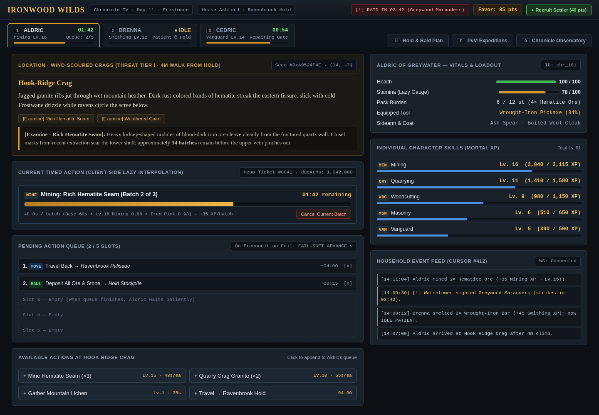
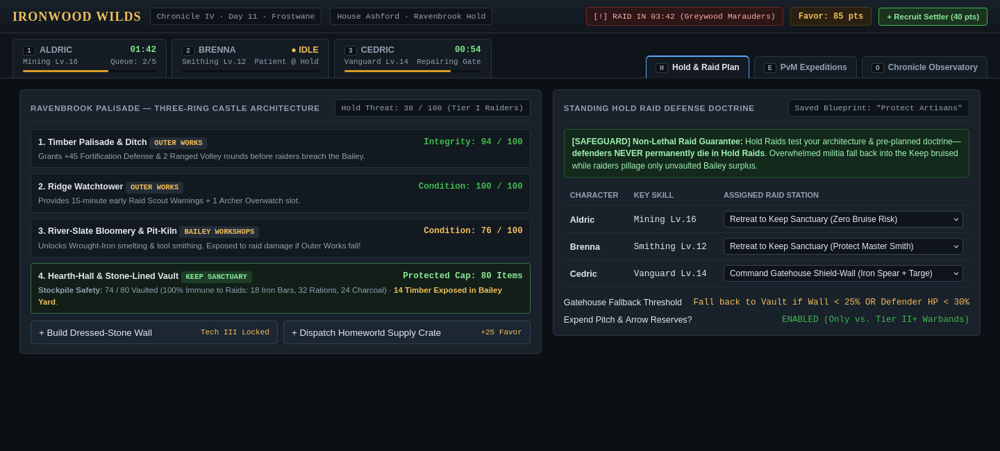
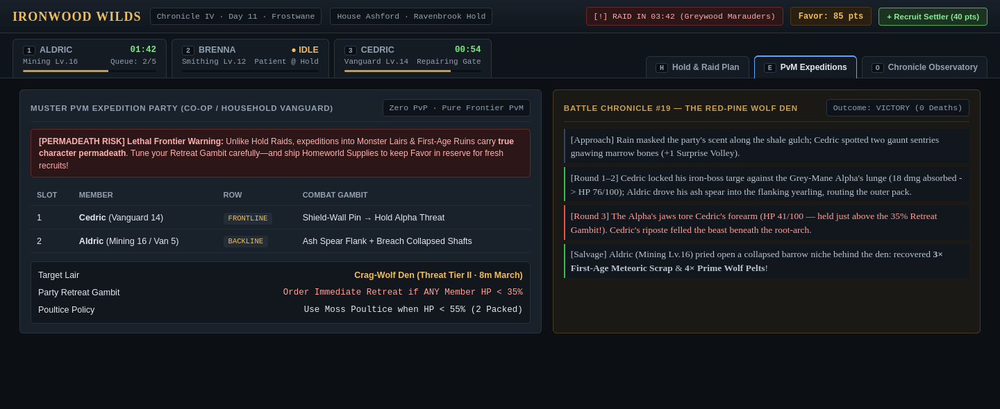
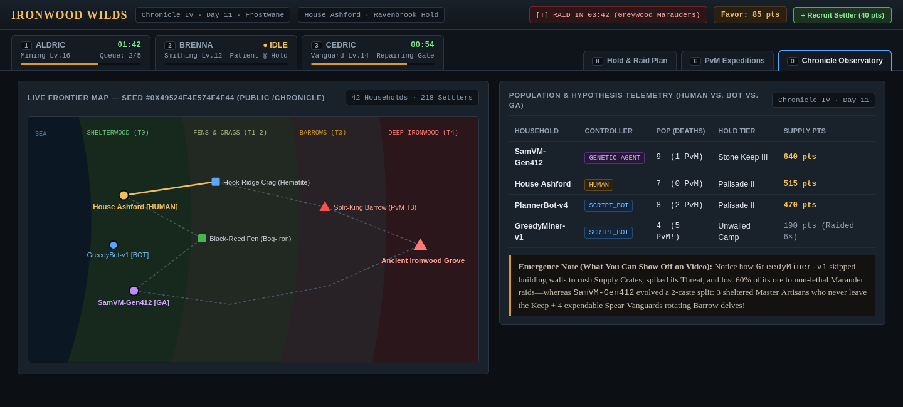

# 04 — Web Interface, Multi-Tab UX & Bot Protocols

You have two distinct audiences connecting to **Ironwood Wilds** simultaneously:
1. **Humans in a Web Browser**, managing their Household by clicking across character tabs, inspecting Hold fortifications, and watching timers count down.
2. **Bots & Future Genetic Agents**, written in whatever language you feel like (Java, C, Python, Rust), connecting over REST, WebSocket, or a raw socket.

Plus, there is a silent **third audience—You as Creator & Experimenter**, wanting to *watch* bots and populations make decisions so you can test hypotheses and record compelling content.

Here is how one lightweight server (`apps/wilds-server`) serves all three cleanly **without a bloated JavaScript SPA toolchain**.

---

## 1. Three Network Doors, One Shared Vocabulary

Every network adapter inside `apps/wilds-server` decodes into the exact same `WorldCommand` records and encodes from the exact same `Observation` and `WorldEvent` DTOs:

| Door | Endpoint / Port | Best For | Framing & Auth |
| :--- | :--- | :--- | :--- |
| **1. REST + HTML** | `http://host:8080/` & `/api/v1/*` | Human Web UI, `curl` testing, stateless polling bots, fetching `/api/v1/rules` | Session Cookie (`HttpOnly`, `SameSite=Lax`) for browsers; `Authorization: Bearer iw_...` for bots. |
| **2. WebSocket** | `ws://host:8080/ws/v1` | Live browser tab updates (action completions, raid alerts) + event-driven web bots | Cookie on upgrade (browser) or Bearer header/first-frame `AUTH` message. JSON frames. |
| **3. Raw TCP Socket** | `tcp://host:8124` | C / Python / GA bots with **zero HTTP/WS library dependencies!** | **NDJSON** (Newline-Delimited UTF-8 JSON: one JSON object per `\n` line). First line authenticates: `{"op":"AUTH","token":"iw_..."}`. |

### Why Raw NDJSON TCP Socket (`:8124`) Is a Joy for Bot & GA Work
Writing a bot in C or Python against raw TCP NDJSON takes ~20 lines of standard-library socket code—no `libcurl`, no WebSocket handshake framing, no TLS proxy headaches locally:

```json
-> {"op":"AUTH","token":"iw_bot_71ac9e..."}
<- {"type":"WELCOME","householdId":"hh_12","nowMs":1840200,"cursor":410}
<- {"type":"SNAPSHOT","hold":{...},"characters":[...]}
-> {"op":"CMD","reqId":"1","cmd":{"type":"EnqueueAction","characterId":"chr_3","action":{"kind":"GATHER","siteId":"site_coppice_1","node":"ash_timber","batches":4}}}
<- {"type":"ACK","reqId":"1","ok":true,"activeDueAtMs":2020200}
... (3 minutes pass with ZERO polling traffic!) ...
<- {"type":"EVENT","cursor":411,"event":{"type":"ActionCompleted","characterId":"chr_3","gained":{"ash_timber":4},"xp":{"WOODCUTTING":60}}}
```

---

## 2. The Human Web Interface: Multi-Tab Character Deck (Zero SPA Bloat)

### Why NOT React / Next.js / npm?
Setting up Vite/Webpack, TypeScript build steps, client-side state stores, and dual-repo DTO syncing burns precious Fridays on front-end plumbing. Because Ironwood Wilds is **text-and-layout driven**, we use:
- **Server-Side Rendered HTML** directly in Java 25 (clean typed HTML component functions—fast, compile-time checked, zero template-engine reflection).
- **One ~200-line Vanilla JS file (`wilds-ui.js`)** that does exactly three things:
  1. Opens `/ws/v1` to receive delta events and swap updated HTML panels seamlessly (or toggle instant preloaded Character Tabs).
  2. Animates **smooth 60fps progress bars & countdown clocks** locally in the browser using `{startedAtMs, dueAtMs, serverNowMs}`.
  3. Binds crisp keyboard shortcuts (`1–9` to jump across Character Tabs, `H` for Hold, `T` for Tech Tree, `E` for Expeditions—OSRS F-key muscle memory!).
- **Aesthetic:** Dark parchment / slate-and-amber low-fantasy terminal aesthetic (readable serif for `look`/`examine` prose, crisp monospace tabular numbers for timers, XP bars, and stockpiles).

---

### Rendered Interactive Prototype Views (`prototype/index.html`)

An interactive, zero-dependency HTML prototype lives at **[`prototype/index.html`](prototype/index.html)** (open in any browser and press `1`, `2`, `3`, `H`, `E`, `O` to cycle tabs and append actions). Below are the rendered screenshots across all four core views:

#### 1. Character Tab (`[1] Aldric` — Active Mining, Lazy Countdown, Queue & Skills)


#### 2. Hold & Non-Lethal Raid Defense Plan (`[H]` — 3-Ring Castle & Doctrine Matrix)


#### 3. PvM Expeditions & Battle Chronicle (`[E]` — Lethal Gambit Rules & Prose Report)


#### 4. Public Chronicle Observatory (`[O]` — Show-Off Frontier Map & Bot/Human/GA Telemetry)


> *Vector Frontier Map Asset:* [`prototype/ui-frontier-map.svg`](prototype/ui-frontier-map.svg)

### ASCII Layout Reference: The Household Command Deck

```text
┌──────────────────────────────────────────────────────────────────────────────────────────┐
│ IRONWOOD WILDS · Chronicle IV (Day 11 · Frostwane · Cold Drizzle)    Homeworld Favor: 85 │
│ House Ashford  |  Hold: Ravenbrook Palisade (Threat: LOW 22/100 · Next Scout Check 18m)  │
├──────────────────────────────────────────────────────────────────────────────────────────┤
│ CHARACTERS:                                                                              │
│ ┌─────────────────────────┐ ┌─────────────────────────┐ ┌──────────────────────────────┐ │
│ │[1] ALDRIC (Active Tab)  │ │[2] BRENNA  ● IDLE!      │ │[3] CEDRIC                    │ │
│ │ ⛏ Mining Lv.16 · 01:42 │ │ 🔨 Smithing Lv.12       │ │ 🛡 Vanguard Lv.14 · Guarding │ │
│ └───────────┬─────────────┘ └─────────────────────────┘ └──────────────────────────────┘ │
│             │               MACRO: [H: Hold & Raid Plan] [T: Tech Tree] [E: Expeditions] │
├─────────────┴───────────────────────────────────────────┬────────────────────────────────┤
│ LOCATION: Hook-Ridge Crag (4m walk from Hold)           │ ALDRIC — Vitals & Gear         │
│ "Jagged granite ribs jut through wet heather. Dark      │ Health:  [██████████] 100/100  │
│  rust-colored bands of hematite streak the eastern      │ Stamina: [████████░░]  78/100  │
│  fissure."  [Examine Crag]  [Examine Hematite Seam]     │ Pack:    6 / 12 stones weight  │
│                                                         │ Tool:    Wrought-Iron Pick (84%)│
│ ── CURRENT ACTION ───────────────────────────────────── │ Weapon:  Ash-Shaft Spear       │
│ Mining: Rich Hematite Seam (Batch 2 of 3)               │                                │
│ [██████████████░░░░░░░░░░]  01:42 left (48s / batch)    │ ── CHARACTER SKILLS ────────── │
│                                        [Cancel Action]  │ Mining       Lv.16  (2,840 XP) │
│                                                         │ Woodcutting  Lv. 9    (980 XP) │
│ ── PENDING QUEUE (2 / 5 slots)  [Policy: Fail-Soft ▼] ─ │ Quarrying    Lv.11  (1,410 XP) │
│ 1. [🚶 Travel -> Ravenbrook Palisade]      (~04:00) [×] │ Masonry      Lv. 6    (510 XP) │
│ 2. [📦 Deposit All -> Hold Stockpile]      (~00:15) [×] │ Vanguard     Lv. 5    (390 XP) │
│                                      [Clear All Queued] │                                │
│ ── AVAILABLE ACTIONS AT HOOK-RIDGE CRAG ─────────────── │ ── RECENT LOG (Aldric) ─────── │
│ [+ Mine Hematite Seam (48s · Lv.15)]  [Batches: 1 3 5]  │ 14:11 Gained 2× Hematite Ore   │
│ [+ Quarry Crag Granite (55s · Lv.10)] [Batches: 1 3 5]  │       (+35 Mining XP -> Lv.16!)│
│ [+ Forage Mountain Lichen (35s · Lv.1)]                 │ 14:07 Arrived at Hook-Ridge.   │
│ [+ Travel Back to Ravenbrook Palisade (04:00)]          │ 14:03 Departed Ravenbrook.     │
└─────────────────────────────────────────────────────────┴────────────────────────────────┘
```

### How Client-Side Lazy Timers Keep Bandwidth Near Zero
When `Aldric` begins mining Batch 2, the server sends **one** JSON/HTML update containing:
```json
{
  "serverNowMs": 1000000,
  "startedAtMs": 980000,
  "dueAtMs": 1042000
}
```
On arrival, `wilds-ui.js` records `clockSkewMs = performance.now() - serverNowMs`. Every animation frame, the browser computes `remainingMs = dueAtMs - (performance.now() - clockSkewMs)` and updates every character's tab badge (`01:42 -> 01:41 -> ...`) with **zero network traffic**. Only when `t = 1042000` fires on the server's `DueEventHeap` does `/ws/v1` push the `ActionCompleted` + `Batch 3 Started` update!

---

## 3. Macro Tabs: Making Hold Defense & Party Doctrines Intuitive

Because **Hold Raid Defense** and **PvM Party Expeditions** are pre-planned rather than twitch-controlled, their tabs are clean, visual rule-builders that compile directly to the same JSON DTOs bots send:

### The `[H: Hold & Raid Plan]` Tab
- **Three-Ring Architectural View:** Shows Outer Works (`Timber Palisade: 100/100 HP`, `Watchtower: Active`), Bailey Workshops (`Bloomery`, `Sawpit`, `Granary`), and Keep/Vault (`Protected Vault Floor: 80 items safe from pillage; Currently Exposed in Bailey: 14 Timber, 6 Ore`).
- **Standing Raid Doctrine Matrix:**  
  Simple per-character dropdowns + Hold rules:
  - `Aldric`: `[Retreat to Keep (Protect Skilled Miner)]`
  - `Brenna`: `[Retreat to Keep (Protect Skilled Smith)]`
  - `Cedric`: `[Muster to Gatehouse (Frontline Shield)]`
  - `Militia Engagement Stance`: `[Hold Outer Palisade until 30% Wall Integrity, then Fall Back to Vault]`

### The `[E: Expeditions]` Tab
- **Party Composer:** Checkboxes for `2–5` characters, Frontline/Backline toggle, ration pack slider, target Lair selector, and **Gambit Rules** (e.g., *Retreat if any member HP < 35%*), plus an expandable **Battle Chronicle Archive** rendering past delves in crisp low-fantasy prose.

---

## 4. Built-In "Show-Off" & Hypothesis Lab UI (`/chronicle` & `/lab`)

Remember your Motivation #1 and #2: **making content to show off** and **watching bots/populations test hypotheses**. If all activity is hidden behind private player logins, you have nothing visual to record for YouTube/devlogs or inspect during experiments!

We build a public, read-only **Chronicle Observatory (`/chronicle`)** right into `apps/wilds-server`:
1. **Live Frontier Map (SVG):** Clean procedural parchment-style SVG generated directly from `WorldSeed` showing Biomes, Regions, discovered Ruins, and anonymous/named Household Holds glowing brighter as their Fortification Tier rises, with animated dashed lines when Supply Convoys or PvM Parties march!
2. **Population & Economy Telemetry Charts:**
   - Workforce allocation across the whole server right now (*"38% Gathering, 24% Artisanry, 19% Building, 11% Marching in PvM, 8% Idle"*).
   - Skill distribution histograms & Household comparison tables tagged by **`HUMAN` vs `SCRIPT_BOT` vs `GENETIC_AGENT`**.
   - Homeworld War Supply Progress Bar & Hall of Chronicles leaderboard.
3. **Shareable Battle & Raid Chronicles (`/chronicle/battles/{id}`):** Public permalinks to dramatic PvM delves (especially heroic narrow retreats or tragic high-level party wipes!) formatted like pages out of a medieval chronicle.

---

## 5. REST API Surface Summary (`/api/v1`)

Self-describing, SpaceTraders-inspired endpoints so any external bot can play without reading engine source code:

| Method & Path | Description |
| :--- | :--- |
| `GET  /api/v1/rules` | Complete `RuleRegistry` (skills, items, recipes, buildings, tech tree, action specs, error codes) + `rulesVersion`. |
| `GET  /api/v1/chronicle` | Public world clock, season, weather, Homeworld War requisitions, leaderboard summary. |
| `GET  /api/v1/household` | Full Fog-of-War snapshot of caller's Household, Hold, Stockpile, Tech unlocks, Characters, and Parties. |
| `GET  /api/v1/sites` | All sites discovered by caller's Household, travel edges, known gather seams, and scouted lair tiers. |
| `POST /api/v1/examine` | `{ "targetType": "SITE\|BUILDING\|CHARACTER\|ITEM", "targetId": "..." }` -> returns `look` + `examine` procedural prose! |
| `POST /api/v1/characters/{id}/queue` | Append 1..5 `ActionSpec`s (Phase 1 validated). |
| `PUT  /api/v1/characters/{id}/queue` | Atomically replace pending queue without cancelling active action. |
| `DELETE /api/v1/characters/{id}/queue` | Clear pending queue (`?cancelActive=true` also cancels running action). |
| `POST /api/v1/hold/buildings` | Commence new building construction in Outer Works / Bailey / Keep. |
| `PUT  /api/v1/hold/doctrine` | Update standing non-lethal Hold Raid Defense Doctrine. |
| `POST /api/v1/hold/supply` | Dispatch Homeworld Supply Convoy -> returns earned Supply Favor. |
| `POST /api/v1/hold/recruit` | Spend Supply Favor to recruit a new Household character at Landing Pier. |
| `POST /api/v1/parties` | Form a Party from Household characters with formation & `CombatDoctrine`. |
| `GET  /api/v1/events?since={cursor}` | Monotonic event feed for polling bots (identical payloads to `/ws/v1` and `:8124`). |
