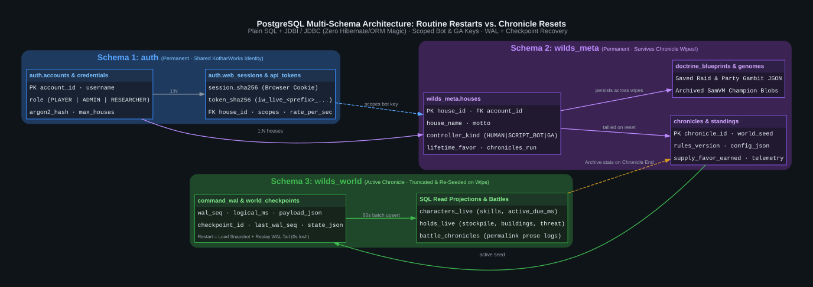

# 05 — Accounts, Bot Keys & Multi-Schema Persistence

You asked how we handle **accounts** and **persistent storage under schemas**—especially given two very different kinds of "restarts" in Ironwood Wilds:
1. **Routine Server Restarts** (deploying a patch on Friday night, rebooting the VPS): players' holds, inventories, character skills, and half-finished 3-minute mining timers must survive **seamlessly**.
2. **Planned Chronicle Resets** (starting a new 2-to-4-week expedition campaign on a fresh `WorldSeed`): the physical frontier wipes clean, **without** wiping player accounts, bot API tokens, House names, saved Combat/Raid Doctrines, or historical Homeworld Supply rankings!

Isolating PostgreSQL into **three purpose-built SQL schemas** inside a single database solves both lifecycles cleanly and sets up reusable auth for every future KotharWorks project.

---

## 1. The Three-Schema PostgreSQL Layout



> *Graphviz artifacts:* [`06-postgres-three-schemas.dot`](diagrams/06-postgres-three-schemas.dot) · [`SVG`](diagrams/06-postgres-three-schemas.svg) · [`PNG`](diagrams/06-postgres-three-schemas.png)

```text
PostgreSQL Database: `kotharworks`
│
├── Schema 1: `auth`          (Game-Agnostic Identity — NEVER wiped)
│   ├── accounts              Human / developer / researcher login identities
│   ├── password_credentials  Argon2id hashes
│   ├── web_sessions          Browser cookie sessions (SHA-256 token digests)
│   └── api_tokens            Scoped Bearer tokens for Bots, CLIs & Genetic Agents
│
├── Schema 2: `wilds_meta`    (Cross-Chronicle Hall of Records — NEVER wiped)
│   ├── chronicles            Seed, rules_version, start/end timestamps, War Outcome
│   ├── houses                Permanent Household identity, heraldry & controller_kind
│   ├── chronicle_standings   Final Supply Favor, Hold tier & stats per House per Chronicle
│   ├── doctrine_blueprints   Saved Raid & Party Gambit presets carried across resets!
│   └── champion_genomes      (Phase 2) Archived SamVM LGP genomes & fitness lineage
│
└── Schema 3: `wilds_world`   (Active Chronicle State — Archived & Reset each Chronicle)
    ├── world_checkpoints     Periodic consistent snapshots of flat `WorldState`
    ├── command_wal           Append-only journal of commands since last checkpoint
    ├── households_live       SQL-queryable read projection of active Households
    ├── characters_live       SQL-queryable read projection of active/fallen Characters
    ├── holds_live            SQL-queryable read projection of Holds & Fortifications
    └── battle_chronicles     Immutable PvM & Raid reports (powers `/chronicle/battles/{id}`)
```

> **Why Pure JDBC / JDBI 3 Instead of Hibernate / JPA?**  
> Per `AGENTS.md`, we avoid annotation-processor and ORM magic. Hibernate wants mutable Java classes with lazy-loading proxies—the exact opposite of flat immutable Java 25 `record`s. With **JDBI 3** (or a thin 200-line `DataSource` + `PreparedStatement` mapper over HikariCP), SQL stays explicit, fast, and 100% predictable.

---

## 2. Schema 1: `auth` — Humans, Multiple Bot Agents & Rate Safety

A key insight for your project: **one human (especially you!) will want to run multiple bots or genetic populations alongside your own human Household** so you can compare strategies on the live server.

Instead of forcing fake email signups per bot, **one `auth.accounts` row can own multiple `wilds_meta.houses`**, each bound to its own **scoped `api_tokens` key** and tagged with an explicit `controller_kind`:
- `HUMAN` — Played via the multi-tab web UI (or personal CLI helper).
- `SCRIPT_BOT` — Hand-coded heuristic/planning bot (`python`, `C`, `Java`).
- `GENETIC_AGENT` — Evolved `SamVM` / `SamGenAI` genome.

Tagging `controller_kind` at the schema level means your `/lab` dashboard and SQL queries can immediately compare *Human vs. Hand-Coded Bot vs. Genetic Agent* survival and supply efficiency!

### Concrete DDL: `auth` Schema

```sql
CREATE SCHEMA IF NOT EXISTS auth;

CREATE TABLE auth.accounts (
    account_id      BIGINT GENERATED ALWAYS AS IDENTITY PRIMARY KEY,
    username        TEXT NOT NULL UNIQUE CHECK (username ~ '^[a-zA-Z0-9_-]{3,32}$'),
    email           TEXT UNIQUE,                         -- optional in local/self-hosted mode
    role            TEXT NOT NULL DEFAULT 'PLAYER'       -- PLAYER | ADMIN | RESEARCHER
                    CHECK (role IN ('PLAYER', 'ADMIN', 'RESEARCHER')),
    max_houses      INT  NOT NULL DEFAULT 3,             -- e.g. 1 human house + 2 bot houses
    created_at      TIMESTAMPTZ NOT NULL DEFAULT now(),
    disabled_at     TIMESTAMPTZ
);

CREATE TABLE auth.password_credentials (
    account_id      BIGINT PRIMARY KEY REFERENCES auth.accounts(account_id) ON DELETE CASCADE,
    argon2_hash     TEXT NOT NULL,                       -- Argon2id PHC string
    updated_at      TIMESTAMPTZ NOT NULL DEFAULT now()
);

-- Browser sessions: raw random 256-bit token lives ONLY in HttpOnly cookie; DB stores SHA-256!
CREATE TABLE auth.web_sessions (
    session_sha256  BYTEA PRIMARY KEY CHECK (octet_length(session_sha256) = 32),
    account_id      BIGINT NOT NULL REFERENCES auth.accounts(account_id) ON DELETE CASCADE,
    active_house_id BIGINT,                              -- which House their browser deck views
    created_at      TIMESTAMPTZ NOT NULL DEFAULT now(),
    expires_at      TIMESTAMPTZ NOT NULL,
    last_seen_at    TIMESTAMPTZ NOT NULL DEFAULT now()
);
CREATE INDEX idx_web_sessions_account ON auth.web_sessions(account_id);

-- Bot / CLI / Socket API Keys: format `iw_live_<prefix8>_<secret32>`
CREATE TABLE auth.api_tokens (
    token_id        BIGINT GENERATED ALWAYS AS IDENTITY PRIMARY KEY,
    account_id      BIGINT NOT NULL REFERENCES auth.accounts(account_id) ON DELETE CASCADE,
    house_id        BIGINT NOT NULL,                     -- scopes this key to ONE Household!
    token_prefix    CHAR(8) NOT NULL,                    -- shown in UI so user knows which key to revoke
    token_sha256    BYTEA NOT NULL UNIQUE CHECK (octet_length(token_sha256) = 32),
    label           TEXT NOT NULL,                       -- e.g. "Friday Greedy Miner Bot v2"
    scopes          TEXT[] NOT NULL DEFAULT '{READ,COMMAND}',
    rate_per_sec    INT NOT NULL DEFAULT 10,
    created_at      TIMESTAMPTZ NOT NULL DEFAULT now(),
    revoked_at      TIMESTAMPTZ
);
CREATE INDEX idx_api_tokens_account ON auth.api_tokens(account_id);
```

---

## 3. Schema 2: `wilds_meta` — Permanent Identity & Chronicle History

When a Chronicle ends after 2–4 weeks, players shouldn't feel like their efforts vanished into `/dev/null`. `wilds_meta` preserves everything meaningful across resets **without** carrying power-crept items or lvl-99 stats into Day 1 of the new world:

1. **Permanent House Charter:** House name (*"House Ashford"*), banner colors, and `controller_kind`.
2. **Saved Doctrine Blueprints:** Players and bots invest real thought configuring Hold Raid Defense matrices and PvM Party Gambits—saving those blueprints in `wilds_meta` lets them apply their favorite doctrine with one click in Chronicle V!
3. **Hall of Chronicles & Research Data:** Every Chronicle records its exact `world_seed`, `rules_version`, tuned experiment parameters (`config_overrides_json`), and every Household's final telemetry.

### Concrete DDL: `wilds_meta` Schema

```sql
CREATE SCHEMA IF NOT EXISTS wilds_meta;

CREATE TABLE wilds_meta.houses (
    house_id        BIGINT GENERATED ALWAYS AS IDENTITY PRIMARY KEY,
    account_id      BIGINT NOT NULL REFERENCES auth.accounts(account_id) ON DELETE CASCADE,
    house_name      TEXT NOT NULL UNIQUE CHECK (char_length(house_name) BETWEEN 3 AND 40),
    motto           TEXT NOT NULL DEFAULT '',
    controller_kind TEXT NOT NULL DEFAULT 'HUMAN'
                    CHECK (controller_kind IN ('HUMAN', 'SCRIPT_BOT', 'GENETIC_AGENT')),
    lifetime_favor  BIGINT NOT NULL DEFAULT 0,
    chronicles_run  INT NOT NULL DEFAULT 0,
    created_at      TIMESTAMPTZ NOT NULL DEFAULT now()
);

CREATE TABLE wilds_meta.chronicles (
    chronicle_id    INT GENERATED ALWAYS AS IDENTITY PRIMARY KEY,
    title           TEXT NOT NULL,                       -- e.g. "Chronicle I: The Grey Landing"
    world_seed      BIGINT NOT NULL,
    rules_version   INT NOT NULL,
    config_json     JSONB NOT NULL DEFAULT '{}'::jsonb,  -- records hypothesis tweaks!
    status          TEXT NOT NULL CHECK (status IN ('ACTIVE', 'COMPLETED', 'ABORTED')),
    war_outcome     TEXT,                                -- e.g. 'HOMEWORLD_HELD', 'FRONT_COLLAPSED'
    started_at      TIMESTAMPTZ NOT NULL DEFAULT now(),
    ended_at        TIMESTAMPTZ
);

CREATE TABLE wilds_meta.chronicle_standings (
    chronicle_id        INT NOT NULL REFERENCES wilds_meta.chronicles(chronicle_id),
    house_id            BIGINT NOT NULL REFERENCES wilds_meta.houses(house_id),
    supply_favor_earned BIGINT NOT NULL,
    peak_population     INT NOT NULL,
    deaths_in_pvm       INT NOT NULL,
    raids_repelled      INT NOT NULL,
    highest_tech_tier   INT NOT NULL,
    summary_stats_json  JSONB NOT NULL,                  -- skill distribution & economy telemetry
    PRIMARY KEY (chronicle_id, house_id)
);

CREATE TABLE wilds_meta.doctrine_blueprints (
    blueprint_id    BIGINT GENERATED ALWAYS AS IDENTITY PRIMARY KEY,
    house_id        BIGINT NOT NULL REFERENCES wilds_meta.houses(house_id) ON DELETE CASCADE,
    kind            TEXT NOT NULL CHECK (kind IN ('HOLD_RAID', 'PARTY_COMBAT')),
    name            TEXT NOT NULL,
    spec_json       JSONB NOT NULL,
    updated_at      TIMESTAMPTZ NOT NULL DEFAULT now()
);
```

---

## 4. Schema 3: `wilds_world` — Why Snapshot + Command WAL Beats Row-Per-Tick SQL

### The Persistence Trap to Avoid
If you store active simulation state *only* in normalized SQL tables (`character_inventory_items`, `character_queued_actions`, `building_construction_progress`) and update Postgres on every completed action:
1. Every 45-second woodcutting completion triggers 5 SQL `UPDATE`/`INSERT`/`DELETE` statements.
2. Loading the world requires 15 multi-table joins and complex reconstruction of `DueEventHeap` tickets.
3. Worst of all, if a subtle simulation bug occurs on Friday afternoon, you only have the *corrupted end state*—no way to replay the last 5 minutes in a JUnit test to see what caused it!

### The Better Pattern: Checkpoint Snapshot + Command WAL + Read Projections

```text
  Simulation Loop (In-Memory `WorldState` is Source of Truth)
         │
         ├──► On EVERY Command (ms latency):
         │    Append 1 row to `wilds_world.command_wal` (batched group-commit every 100ms)
         │
         └──► Every 60s + On Clean SIGTERM Shutdown:
              Single DB Transaction:
              1. Write `WorldState` canonical snapshot -> `wilds_world.world_checkpoints`
              2. Upsert `households_live`, `characters_live`, `holds_live` (for SQL inspection!)
              3. Prune `command_wal` older than N checkpoints (or keep full Chronicle replay!)
```

### Concrete DDL: `wilds_world` Schema

```sql
CREATE SCHEMA IF NOT EXISTS wilds_world;

-- 1. Append-Only Command & Clock-Advance Journal (Fast crash recovery + deterministic bug replay!)
CREATE TABLE wilds_world.command_wal (
    wal_seq         BIGINT GENERATED ALWAYS AS IDENTITY PRIMARY KEY,
    chronicle_id    INT NOT NULL,
    logical_ms      BIGINT NOT NULL,                     -- exact simulation `nowMs` when applied!
    house_id        BIGINT,                              -- NULL for pure clock-advance / system pulses
    command_type    TEXT NOT NULL,                       -- e.g. 'EnqueueAction', 'AdvanceClock'
    payload_json    JSONB NOT NULL,
    recorded_at     TIMESTAMPTZ NOT NULL DEFAULT now()
);
CREATE INDEX idx_command_wal_seq ON wilds_world.command_wal(chronicle_id, wal_seq);

-- 2. Periodic Canonical World Checkpoints (Fast O(1) boot!)
CREATE TABLE wilds_world.world_checkpoints (
    checkpoint_id   BIGINT GENERATED ALWAYS AS IDENTITY PRIMARY KEY,
    chronicle_id    INT NOT NULL,
    last_wal_seq    BIGINT NOT NULL,                     -- exact WAL cursor included in this snapshot
    logical_ms      BIGINT NOT NULL,
    world_seed      BIGINT NOT NULL,
    rules_version   INT NOT NULL,
    state_json      JSONB NOT NULL,                      -- or Zstd-compressed canonical JSON bytea
    created_at      TIMESTAMPTZ NOT NULL DEFAULT now()
);

-- 3. Inspectable SQL Read Projections (Updated at each 60s checkpoint so you can run ad-hoc SQL!)
CREATE TABLE wilds_world.characters_live (
    character_id    BIGINT PRIMARY KEY,
    house_id        BIGINT NOT NULL,
    name            TEXT NOT NULL,
    alive           BOOLEAN NOT NULL,
    location_desc   TEXT NOT NULL,
    active_action   TEXT,
    active_due_ms   BIGINT,
    skills_json     JSONB NOT NULL,
    equipment_json  JSONB NOT NULL,
    updated_at      TIMESTAMPTZ NOT NULL DEFAULT now()
);
CREATE INDEX idx_characters_live_house ON wilds_world.characters_live(house_id);

CREATE TABLE wilds_world.holds_live (
    hold_id         BIGINT PRIMARY KEY,
    house_id        BIGINT NOT NULL UNIQUE,
    hold_name       TEXT NOT NULL,
    site_id         TEXT NOT NULL,
    threat_points   BIGINT NOT NULL,
    vault_cap       INT NOT NULL,
    stockpile_json  JSONB NOT NULL,
    buildings_json  JSONB NOT NULL,
    updated_at      TIMESTAMPTZ NOT NULL DEFAULT now()
);

-- 4. Permanent Permalink Battle & Raid Logs for Current Chronicle
CREATE TABLE wilds_world.battle_chronicles (
    battle_id       BIGINT PRIMARY KEY,
    house_id        BIGINT NOT NULL,
    kind            TEXT NOT NULL CHECK (kind IN ('PVM_EXPEDITION', 'HOLD_RAID')),
    occurred_ms     BIGINT NOT NULL,
    title           TEXT NOT NULL,
    outcome         TEXT NOT NULL,
    prose_report    TEXT NOT NULL,
    structured_json JSONB NOT NULL,
    created_at      TIMESTAMPTZ NOT NULL DEFAULT now()
);
```

---

## 5. How Both Restart Modes Work Step-by-Step

### Mode A: Routine Server Restart (Patch Deploy / Machine Reboot)
1. **Graceful `SIGTERM` Hook:** `WorldShardService` stops accepting new HTTP/TCP commands, advances `engine.advanceTo(currentLogicalMs)`, writes one final `world_checkpoints` row (`last_wal_seq = K`), and exits in `< 150ms`.
2. **Even After a Hard Power-Plug Crash (`kill -9`):**
   - On startup, `WorldPersistencePort.loadLatestWorld()` loads the most recent `world_checkpoints` row (at `last_wal_seq = K - 18`) into `WildsEngine`.
   - It then queries `SELECT * FROM wilds_world.command_wal WHERE wal_seq > (K - 18) ORDER BY wal_seq ASC`.
   - For each WAL entry, it calls `engine.advanceTo(entry.logicalMs)` and `engine.apply(entry.command)`!
3. **Handling Downtime Clock Policy (Explicit Config Knob!):**
   - `downtimeClockMode = PAUSE_WHILE_DOWN` *(Recommended Default)*: `logical_ms` resumes from the exact moment the server went down! If `Aldric` had `01:42` left on mining before a 10-minute server deploy, he still has `01:42` left when the server comes back up, and nobody suffered an unmonitored Raid while the server was offline!
   - `downtimeClockMode = CATCH_UP`: `engine.advanceTo(logicalMs + downtimeDuration)` fast-forwards through downtime if you ever want wall-clock parity.

### Mode B: Planned Chronicle Reset (End of Expedition Cycle)
1. Server transitions Chronicle status to `COMPLETED` and computes final Homeworld War outcome.
2. Every Household's final Supply Favor, peak population, PvM casualties, and skill telemetry are inserted into `wilds_meta.chronicle_standings`, and `wilds_meta.houses.lifetime_favor` increments.
3. `TRUNCATE wilds_world.command_wal, wilds_world.world_checkpoints, wilds_world.characters_live, wilds_world.holds_live, wilds_world.battle_chronicles;`
4. A new `wilds_meta.chronicles` row is inserted with a fresh `WorldSeed`, and accounts logging in on Saturday morning click **[Land Household on New Frontier]** with their permanent House name, API tokens, and saved Raid/Combat Doctrines ready to go!
