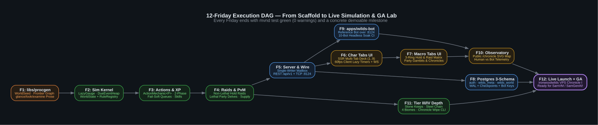

# 06 — Prototype Vertical Slice, Friday Roadmap & Genetic Algorithm Bridge

Mr. Stansfield's advice only works if the plan narrows down into **a concrete, playable slice** small enough that you aren't stuck laying unplayable foundation stones until November, yet **structurally complete** so you never have to throw it away and rewrite it.

This document defines **Slice 0 ("Hearth, Iron, and the Palisade")**, traces an exact 15-minute session through the engine, lays out the Java 25 package map, gives you a realistic **Friday-by-Friday execution schedule**, and shows how **Genetic Algorithms (`SamVM` + `SamGenAI`)** snap straight onto the finished engine.

---

## 1. Prototype Scope: Slice 0 — *"Hearth, Iron, and the Palisade"*

Slice 0 intentionally limits **horizontal content breadth** (only 5 skills, 8 items, 5 buildings, 1 Raid type, 1 PvM Lair) while exercising **every single vertical architectural seam** end-to-end:

| Seam Exercised | Exact Slice 0 Content |
| :--- | :--- |
| **Household & Characters** | Start with **3 Characters** (*Aldric*, *Brenna*, *Cedric*) at a Landing Clearing Hold; idle characters wait patiently (`IDLE_PATIENT`). |
| **5 Core Skills** | `Woodcutting`, `Mining`, `Carpentry`, `Smithing`, `Vanguard` (Levels 1–99, exponential XP). |
| **Procedural Frontier Ring** | Seeded Landing Clearing + **4 Procedural Neighboring Sites**: *Shelterwood Coppice* (Timber + Berries), *Peat Fen* (Bog-Iron), *Hook-Ridge Crag* (Rich Iron Seam, Lv.5 Mining), and *Crag-Wolf Den* (PvM Lair). Plus `glance`/`look`/`examine` prose! |
| **Resource & Craft Chain** | `Ash Timber` + `Fieldstone` · `Charcoal` (Pit-Kiln) + `Iron Ore` -> `Iron Bar` (Bloomery) -> `Iron Pickaxe / Axe` (speeds gathering!) **or** `Iron Spear & Shield` (for PvM/Defense) **or** `War Supply Crate`. |
| **Mini Tech Tree (5 Nodes)** | `Charcoal Burning` -> `Peat Bloomery` -> `Timber Palisade` & `Wrought-Iron Arms` -> `Signal Beacon` (unlocks Homeworld Supply!). |
| **Hold Construction & Non-Lethal Raid** | Build `Pit-Kiln`, `Bloomery`, `Vaulted Cellar` (+40 protected stock), `Timber Palisade` (Outer Works). At Threat threshold (or scheduled Day 2 dusk), **Greywood Marauders** raid: tests standing `HoldDefenseDoctrine`, **zero permadeath**, unvaulted surplus at risk! |
| **Lethal PvM Expedition** | Form a 2–3 character **Party** with Frontline/Backline + `CombatDoctrine` (Retreat HP threshold) -> march to *Crag-Wolf Den* -> resolve turn-based autobattler -> earn *Wolf Pelts & First-Age Iron Scrap* (or suffer real character permadeath if reckless!). |
| **Homeworld Supply Payoff** | Pack `War Supply Crates` at the `Signal Beacon` -> earn **Supply Favor** -> click **[Recruit Settler]** to welcome **Character #4 (*Doran*)** onto a brand-new tab in the Web UI! |
| **Clients & Persistence** | Multi-tab Browser UI + REST `/api/v1` + Raw NDJSON TCP Socket (`:8124`) + Postgres 3-schema persistence + a 250-line **Reference Heuristic Bot (`apps/wilds-bot`)** that plays Slice 0 unattended! |

---

## 2. Walkthrough: How a 15-Minute Slice 0 Session Actually Plays & Executes

*(Note: With `--time-scale=6` in dev/demo mode, 3-minute actions run in 30 real seconds so you can test or record an entire arc in 15 minutes; on the live server `--time-scale=1` gives the relaxed OSRS multi-tab pace.)*

### Minute 0–3: Landing & Splitting the Tabs
1. You log into `http://localhost:8080`, name **House Ashford**, and land at *Ravenbrook Clearing* (`nowMs = 0`).
2. Your Character Tab Strip shows **[1: Aldric · IDLE]**, **[2: Brenna · IDLE]**, **[3: Cedric · IDLE]**. Nobody wanders off; all three stand quietly by the supply cart.
3. You press `1` (*Aldric*), queue `[Travel -> Shelterwood Coppice (30s), Chop Ash Timber ×5 (45s/batch), Travel -> Hold (30s), Deposit All (10s)]`.
   - `WildsEngine` validates Phase 1, starts `Travel`, and pushes `(dueAtMs = 30_000, seq = 1, CompleteAction(Aldric))` onto `DueEventHeap`.
   - Browser Tab 1 immediately begins counting down `00:30 -> 00:29...` locally with zero HTTP polling.
4. You press `2` (*Brenna*), queueBog-Iron panning in the *Peat Fen*; press `3` (*Cedric*), assign him to research `Charcoal Burning` at the camp drafting stump.

### Minute 4–8: Tech Unlock, Bloomery & Lazy Contention
1. At `logicalMs = 180_000`, `Cedric` finishes researching `Charcoal Burning` -> WebSocket pushes a toast banner: *"Tech Unlocked: Charcoal Burning & Pit-Kiln!"*
2. You start construction of a `Pit-Kiln` (`HoldCommand.StartBuilding`) and queue *Brenna* + *Cedric* on `[Construct Pit-Kiln]` in parallel—their construction work-milliseconds sum cleanly into the building's progress gauge!
3. Once `Bloomery` and `Iron Spears` come online, your Hold's forge activity raises `threatPoints` from `0 -> 35`. A scout warning fires:
   > *"⚠ RAID SIGHTED: Greywood Marauders (4 Raiders) spotted on the eastern ridge. Strike expected in 04:00!"*

### Minute 9–11: Pre-Planning the Non-Lethal Hold Raid
1. You press `H` (**Hold & Raid Plan** tab):
   - Your `Vaulted Cellar` protects `40` goods; you currently have `52` goods in the Hold (`12` exposed in the Bailey!).
   - You finish your `Timber Palisade` with 40 seconds to spare and set your **Hold Defense Doctrine**:
     - *Cedric* (equipped with *Iron Spear*, `Vanguard Lv.6`) -> `MUSTER_TO_PALISADE`.
     - *Aldric* & *Brenna* (unarmored gatherer/smith) -> `RETREAT_TO_KEEP`.
2. At `dueAtMs` of the Raid event, `RaidResolutionStrategy` runs deterministically:
   - *Cedric* holds the palisade for 3 volleys, dropping 2 Marauders before falling back bruised (`Health 100 -> 45`, **alive!**); Palisade takes `28/100` condition damage; Marauders snatch only `3 Ash Timber` from the exposed Bailey while every `Iron Bar` in the Cellar stays 100% untouched!

### Minute 12–15: Lethal PvM Delve & Recruiting Character #4
1. Armed with two *Iron Spears* and leather jerkins, you form **Party "Crag-Watch"** (*Cedric* Frontline, *Aldric* Backline) with Doctrine: `Retreat if any member Health < 35%`, and march to *Crag-Wolf Den*.
2. They clear the outer pack, slay the *Grey-Mane Alpha* (`Cedric` drops to `41% HP`—just above retreat threshold!), and haul home *First-Age Iron Scrap + Wolf Pelts*.
3. Meanwhile, *Brenna* packs two `War Supply Crates` at the `Signal Beacon` and ships them to the Homeworld (`+50 Supply Favor`).
4. You click **[Recruit Settler (40 Favor)]** -> **Tab [4: Doran · Lv.1 IDLE]** appears in your Character Tab Strip! Your workforce just grew by 33%, and the core Ironwood Wilds engine is proven from top to bottom.

---

## 3. Exact Monorepo Package Layout (Zero-Bloat Java 25)

Every package below follows `kotharworks/AGENTS.md` strictly: `libs/procgen` and `libs/wilds` have **zero I/O and zero external runtime dependencies**, while `apps/wilds-server` holds only minimal infrastructure drivers (JDK built-in Virtual-Thread `HttpServer`, raw `ServerSocket`, HikariCP + PostgreSQL JDBC + JDBI, and a tiny JSON codec or ~300-line zero-reflection record JSON reader/writer):

```text
kotharworks/
├── libs/
│   ├── procgen/                             (Zero external deps)
│   │   └── com.kotharworks.procgen
│   │       ├── WorldSeed, SeededRng
│   │       ├── geography/                   (BiomeType, FrontierMapGenerator, SiteBlueprint)
│   │       ├── delves/                      (LairGraphGenerator)
│   │       └── prose/                       (ProseCatalog, ProseContext, ProseComposer, Grammar)
│   │
│   └── wilds/                               (Depends ONLY on procgen; zero I/O, zero wall-clock)
│       └── com.kotharworks.wilds
│           ├── WildsEngine                  (Public facade: apply(cmd), advanceTo(ms), observe(...))
│           ├── id/                          (HouseholdId, CharacterId, HoldId, SiteId, PartyId, RuleId)
│           ├── rules/                       (RuleRegistry + immutable *Def records)
│           ├── sim/                         (Reusable discrete-event kernel -> future `libs/samsim`)
│           │   ├── LazyGauge
│           │   ├── ScheduledEvent
│           │   └── DueEventHeap
│           ├── state/                       (WorldState, CharacterRow, HoldRow, BuildingRow, PartyRow)
│           ├── command/                     (sealed WorldCommand, CommandResult, FailureCode)
│           ├── action/                      (ActionSpec, ActionMechanic<P> Strategy + implementations)
│           ├── combat/                      (CombatDoctrine, HoldDefenseDoctrine, BattleResolver)
│           ├── event/                       (sealed WorldEvent, EventRingLog)
│           └── observe/                     (ObservationProjector -> Fog-of-war safe DTO records)
│
└── apps/
    ├── wilds-server/                        (Hexagonal host)
    │   └── com.kotharworks.wilds.server
    │       ├── Main                         (CLI flags: --port, --tcp-port, --storage=memory|postgres)
    │       ├── domain/                      (WorldShardService: single-writer mailbox + pulse + snapshots)
    │       ├── ports/                       (AuthPort, WorldPersistencePort, ChronicleMetaPort, PushPort)
    │       └── adapters/
    │           ├── http/                    (REST /api/v1/* + Server-Rendered Multi-Tab HTML UI)
    │           ├── ws/                      (Live Household event push)
    │           ├── tcp/                     (NDJSON bot socket :8124)
    │           ├── memory/                  (Fast in-memory ports for dev & JUnit integration tests)
    │           └── postgres/                (auth, wilds_meta, wilds_world migrations & SQL mappers)
    │
    └── wilds-bot/                           (Pure wire client — zero `libs/wilds` engine link!)
        └── com.kotharworks.wilds.bot
            ├── BotMain                      (Connects via :8124 NDJSON or REST, runs heuristic household)
            └── GreedyFrontierPolicy         (Living acceptance test & baseline benchmark for GAs!)
```

> **Note on `apps/wilds-bot`:** Just like `samvillage-bot` in your C planning docs, `wilds-bot` deliberately **does not link `libs/wilds`**. Forcing the reference bot to play purely over `:8124` / `/api/v1/rules` guarantees your bot API is genuinely self-describing from Day 1—and gives future Genetic Agents a concrete baseline opponent to beat!

---

## 4. The Friday-by-Friday Build Plan (12 Fridays to Full Playable Slice + Live Lab)



> *Graphviz artifacts:* [`07-friday-roadmap.dot`](diagrams/07-friday-roadmap.dot) · [`SVG`](diagrams/07-friday-roadmap.svg) · [`PNG`](diagrams/07-friday-roadmap.png)  
> *UI Prototype target for F6–F10:* [`prototype/index.html`](prototype/index.html)

Each Friday below is scoped to ~6–8 hours of focused solo work, ends with **`mvnd test` green (`0` warnings)**, and produces something tangible you can run, see, or show off:

| Friday | Module | Deliverable | "End-of-Friday Show-Off" |
| :---: | :--- | :--- | :--- |
| **F1** | `libs/procgen` | `SeededRng`, `FrontierMapGenerator` (Landing Clearing + Neighbor Sites), and `ProseComposer` (`glance`/`look`/`examine` + singular/plural + wear). | CLI snippet prints a seeded frontier ward + inspects a pristine vs. raid-battered bloomery in crisp GoT prose. |
| **F2** | `libs/wilds` | `sim/` kernel (`LazyGauge`, `DueEventHeap`), `WorldState` flat tables, typed IDs, and `RuleRegistry` with Slice 0's 5 skills, 8 items, 5 buildings, 5 tech nodes. | JUnit test fast-forwards 10 simulated hours of timers in `< 5ms` and proves bitwise determinism across two runs. |
| **F3** | `libs/wilds` | `ActionMechanic` Strategy seam + `Travel`, `Gather`, `Deposit`, `Craft`, `Construct`, `Research` mechanics + Two-Phase fail-soft queues & OSRS XP curve. | Headless JUnit test scripts *Aldric, Brenna & Cedric* from bare camp to smelting their first `Iron Bar`! |
| **F4** | `libs/wilds` | `HoldDefenseDoctrine` + non-lethal **Hold Raid Resolver**, `CombatDoctrine` + lethal **PvM Party Delve Resolver**, and Homeworld `Supply` -> `RecruitSettler`. | Headless full-loop golden test: survive Marauder raid (0 deaths), clear Wolf Den, ship crates, recruit *Doran*! |
| **F5** | `apps/wilds-server` | `WorldShardService` single-writer Virtual-Thread mailbox + in-memory ports + **Raw NDJSON TCP Socket (`:8124`)** & **REST `/api/v1/*`**. | Connect to `:8124` with `nc localhost 8124` (netcat!) or `curl`, send JSON commands, watch live completion events stream back! |
| **F6** | `apps/wilds-server` | **Multi-Tab Character Web UI** (SSR HTML + Character Tab Strip + keyboard `1–9` switching + smooth client-side lazy countdown bars + WebSocket delta push). | Play your Household comfortably in Firefox across 4 character tabs! |
| **F7** | `apps/wilds-server` | Macro UI tabs: **Hold & Raid Doctrine Matrix**, **Interactive Tech Tree**, **Party Expedition Composer**, and expandable **Battle Chronicles**. | Configure doctrines visually in browser and read formatted medieval battle reports. |
| **F8** | `apps/wilds-server` | **PostgreSQL 3-Schema Adapter** (`auth`, `wilds_meta`, `wilds_world` Checkpoint + Command WAL), Argon2id login, and Scoped Bot API Token minting UI. | Kill the server mid-smelt (`kill -9`), restart it, and watch *Brenna*'s progress bar resume without losing 1 second! |
| **F9** | `apps/wilds-bot` | **Reference Heuristic Bot** over `:8124` NDJSON + automated **Bot Soak Test** (10 bots playing concurrently at `20×` speed in CI). | Watch 10 autonomous bot Households settle a continent simultaneously! |
| **F10** | `apps/wilds-server` | **Chronicle Observatory (`/chronicle` & `/lab`)**: procedural SVG frontier map, population skill/activity charts, and `HUMAN` vs `SCRIPT_BOT` leaderboards. | Screen-recordable "ant-farm" dashboard ready for your first devlog / showcase video! |
| **F11** | `libs/wilds` + `procgen` | **Content Expansion Pass**: Tier III Stone Keeps, Coal/Steel chain, 4 biomes, 4 Lair archetypes, Urgent Homeworld Requisitions, and Chronicle Wipe/Archive CLI. | Full multi-week Chronicle campaign depth. |
| **F12** | Deploy + Tune | Deploy `ironwoodwilds` on a cheap Linux VPS, run **Chronicle I** with humans + bots, and tune rule tables from real telemetry! | Live public simulation world on your domain! |

---

## 5. The Phase 2 Bridge: How Genetic Algorithms (`SamVM` + `SamGenAI`) Plug Right In

Once Slice 0 is running, look at how effortlessly your third dream—**evolving Genetic Algorithm families**—snaps onto this exact architecture without rewriting a single class in `libs/wilds`:

### 5.1 Porting `SamVM` & `SamGenAI` into `libs/samvm` and `libs/samgenai`
Your C specification in `planning/olderplanning/samvm.md` (fixed 8-byte instructions `{op, dst, src1, src2, aux}`, sanitized `f32` registers, `JMP/JZ/JNZ` + instruction budget) ports into ~600 lines of blazing-fast, zero-allocation Java 25 (`float[] regs` on stack/thread-local, packed `long[] code` instructions).

### 5.2 Two Clean Ways a Genome Controls an Ironwood Wilds Household

1. **Utility-Brain LGP (Fastest to Evolve Meaningful Behavior):**  
   Whenever any character in the Household becomes `IDLE_PATIENT` (an event driven directly by `DueEventHeap`!), the harness runs the Household's `SamVMProgram` across each candidate task (`Chop Timber`, `Mine Ore`, `Smelt Iron`, `Build Palisade`, `Research Next Tech`, `Pack Supply Crate`, `Muster Wolf-Den Party`):
   - **Input Registers (`i0..i11`):** Character's normalized skill levels, character stamina/health, Hold stock ratios (`timber/cap`, `iron/cap`, `rations/cap`), current `threatPoints`, `unvaultedGoodsRatio`, `supplyFavor / nextRecruitCost`.
   - **Output Registers (`o0..o2`):** Task utility score (`argmax` selects the queued action!), plus continuous genes tuning `HoldDefenseDoctrine` and `CombatDoctrine.retreatHpPct`!

2. **Why `DueEventHeap` Makes Evolution 10,000× Faster Than Real Time:**  
   In `apps/wilds-arena`, evaluating a population of `200` Household genomes across a **full 7-day simulated Chronicle** doesn't touch sockets, JSON, HTTP, or Postgres:
   ```java
   // Runs 200 independent worlds concurrently across Java 25 Virtual Threads!
   double evaluateGenome(SamVMProgram genome, WorldSeed trainingSeed) {
       var engine = new WildsEngine(trainingSeed, rules);
       HouseholdId hh = engine.registerHousehold("GA-Trial");
       long sevenDaysMs = 7L * 24 * 3600 * 1000;

       while (engine.nowMs() < sevenDaysMs) {
           engine.advanceToNextEvent(); // Jumps straight from completion to completion in ns!
           for (CharacterView idleChar : engine.idleCharacters(hh)) {
               WorldCommand decision = evaluateVmChoice(genome, engine.observe(hh), idleChar);
               engine.apply(decision);
           }
       }
       // Fitness = Supply Favor shipped + Hold Fortification value + Surviving Skill XP!
       return computeFitness(engine.summary(hh));
   }
   ```
   A 7-day Chronicle has ~3,000 discrete action completions for a Household—meaning **one entire week of simulated frontier life evaluates in ~2–5 milliseconds** on a single CPU core!

3. **Deploying Evolved Champions Live:**  
   Once `wilds-arena` evolves a fascinating Generation-500 champion (say, a genome that discovered a clever "rush two recruits early, keep one specialized master smith inside a stone vault, and rotate vanguard twins through Barrow delves" strategy), you wrap that exact `.samvm` genome in `apps/wilds-bot`, give it an `auth.api_tokens` key (`controller_kind = 'GENETIC_AGENT'`), and connect it over `:8124` to your live `ironwoodwilds` server—where you and your viewers can watch it build its castle right alongside human players!
