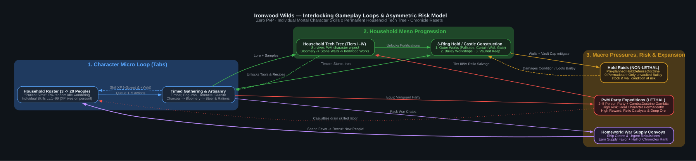

# Ironwood Wilds — Game & Simulation Brief

## 1. High Concept & Setting

**Ironwood Wilds** is a persistent, online, text-based frontier simulation and colony-craft game set in a **grounded, quasi-low-fantasy world**—think *Game of Thrones* on an untamed continent rather than high-fantasy wizardry. Mud, cold rain, timber palisades, charcoal kilns, bog-iron, scarred men-at-arms, and ancient, half-buried stoneworks left by something older in the deep woods.

### The Premise: The Homeworld War & Frontier Chronicles
Across the sea (or across a rare, costly passage), your **Homeworld** is locked in a grinding war of survival against a rival power—one that is stripping frontier lands for war materiel just as desperately as your homeland is.

Your **Household**—a minor noble house, chartered guild-family, or sworn company—has been deposited onto the **Ironwood Wilds** with a handful of retainers, basic provisions, and a royal writ:
1. **Carve a Hold out of the wilderness** (from a mud-and-timber camp up to a stone-walled keep).
2. **Climb the Tech Tree and train specialist masters** across gathering, artisanry, and arms.
3. **Ship war supplies and refined goods back to the Homeworld** to earn **Supply Favor**—which funds fresh recruits to grow your Household and replace those who fall in the wilds.
4. **Venture into hostile ruins and beast lairs (PvM)** as organized Parties for rare catalysts and salvage, while **fortifying your Hold against periodic Raids**.

### Why Chronicles (Server Resets) Fit Naturally
Online simulation and API-driven games inevitably suffer from runaway stockpile inflation if left running forever. Ironwood Wilds embraces **planned server cycles ("Chronicles")**:
- **Routine Maintenance Restarts** happen transparently—timers, queues, Holds, and characters resume right where they left off.
- **Chronicle Resets** (e.g., every 2–4 weeks, or when a server-wide Homeworld War Campaign concludes) represent the end of an expedition season. The Homeworld front shifts, the Chronicle's outcome and Household Supply Ledgers are permanently inscribed into the **Hall of Chronicles**, and the next expedition lands on a **freshly seeded continent**.

---

## 2. Core Design Pillars

| Pillar | What It Means in Practice |
| :--- | :--- |
| **1. Multi-Character "Patient" Control** | You control an entire **Household** (starting with 3–4 people, growing to 12–20+). Unlike *The Sims*, idle characters **never wander off or do random chores**. They stand patiently awaiting orders. Every action in your Household happens because *you* (or your bot/GA) queued it. |
| **2. Timed Actions & Plate-Spinning** | Actions take real/logical time—chopping ironwood (90s), trekking to a crag seam (120s), smelting blooms (180s). Each character holds a short **Action Queue** (`1 active + 5 queued`). Human gameplay feels like cycling across character tabs in a satisfying rhythm; bot gameplay feels like scheduling a living workshop. |
| **3. OSRS-Style Character Skills × Household Tech Tree** | **Characters** own individual XP and Skill Levels (1–99) that speed up actions, raise yields, and gate masterwork recipes. **Households** own permanent Tech Tree unlocks and Buildings. Losing a veteran in combat hurts *because* their skills lived in their head, not in a magic global bar. |
| **4. Strictly Cooperative / Solo Frontier — Zero PvP** | Players **never** attack, raid, or steal from other players. Every Household's Hold sits on sovereign land, and wilderness sites avoid direct node-sniping griefing. Other players are neighbors on the Supply Ledger and optional co-contributors to server-wide Homeworld War Orders. |
| **5. Asymmetric Risk: Lethal PvM vs. Non-Lethal Hold Raids** | Stepping **outside** into Monster Lairs / Deep Ruins is opt-in and **lethal**—characters can permanently die, making Supply Favor recruits vital. Staying **inside** your Hold faces periodic **Raids**, where pre-planned Defense Doctrines and walls are tested: **zero defenders ever die in a Hold raid**, though raiders can smash structures and loot unvaulted stockpiles. |
| **6. Equal Citizenship for Humans, Bots & Genetic Agents** | Everything a human sees in their browser tabs is prose + structured data projected from the exact same engine state that REST, WebSocket, and TCP bot clients consume. |

---

## 3. The Interlocking Gameplay Loops

Ironwood Wilds is built around **four nested loops** operating at different timescales. Together, they ensure there is always an immediate tab to check, a 30-minute production chain to balance, and a multi-day architectural goal to chase.



> *Graphviz artifacts:* [`04-gameplay-loops-and-risk.dot`](diagrams/04-gameplay-loops-and-risk.dot) · [`SVG`](diagrams/04-gameplay-loops-and-risk.svg) · [`PNG`](diagrams/04-gameplay-loops-and-risk.png)

```text
   ┌──────────────────────────────────────────────────────────────────────┐
   │  MICRO LOOP (1–10 mins): Character Queues & Skill Grinding           │
   │  Tab through characters -> queue gather/refine/craft -> gain Skill XP │
   └───────────────────────────────────┬──────────────────────────────────┘
                                       ▼
   ┌──────────────────────────────────────────────────────────────────────┐
   │  MESO LOOP (30 mins – hours): Tech Tree & Hold Construction          │
   │  Refine tiers -> unlock Tech Nodes -> build Workshops, Vaults, Walls │
   └───────────────┬───────────────────────────────────┬──────────────────┘
                   ▼                                   ▼
   ┌───────────────────────────────┐   ┌──────────────────────────────────┐
   │  EXPEDITION LOOP (High Risk)  │   │  SUPPLY & RAID LOOP (Macro)      │
   │  Form Party -> equip gear ->  │   │  Pack Supply Crates -> ship Home │
   │  clear PvM Lair -> rare loot  │   │  -> earn Favor -> recruit people │
   │  (Risk: Character Permadeath) │   │  & survive escalating Hold Raids │
   └───────────────┬───────────────┘   └───────────────┬──────────────────┘
                   └─────────────────┬─────────────────┘
                                     ▼
            [ Deeper Tech Tiers, Larger Castle, Stronger Household ]
```

---

## 4. Characters, Skills & "Patient Sims" Ergonomics

### 4.1 Anatomy of a Character
Every person in your Household is a distinct mortal individual with:
- **Identity & Prose Traits:** Procedurally generated name, background origin, age, physical traits, and accumulated scars/titles (which feed `procgen` descriptions when examined).
- **Vitals & Stamina:**
  - `Health (0–100)`: Damaged in PvM expeditions (or temporarily bruised during Hold raids). Recovers at the Hold's Hearth or Infirmary. `Health == 0` in PvM = **permanent death**.
  - `Stamina / Rest (0–100)`: Heavy labor and marches slowly drain stamina; resting at a bunk or eating cooked rations restores it. Low stamina slows work speed (`×1.35` duration) rather than killing the character—keeping idle neglect forgiving when a human steps away from the keyboard!
- **Equipment Loadout:** Tool slot (e.g., *Fell-Iron Pickaxe*), Weapon slot, Armor slot, Cloak/Pack slot (carries haul capacity for distant sites).
- **Action Queue:** `1 active action` (with exact start and completion timestamps) + up to `5 pending actions`. When the queue empties, the character simply waits at their current location (`IDLE_PATIENT`).

### 4.2 Individual Skills (The OSRS Grind)
Characters level individual skills from **Level 1 to 99** using a classic exponential XP curve (fast early levels 1–20 in the first hour so fresh recruits rapidly become useful; steep prestige grind past 50+ so veteran masters feel treasured).

| Category | Skills | Core Payoff of Higher Levels |
| :--- | :--- | :--- |
| **Gathering** | **Woodcutting**, **Mining**, **Quarrying**, **Foraging / Trapping** | Unlocks harder seams/trees (e.g., *Bog Iron* Lv.1 -> *Crag Hematite* Lv.20 -> *Deep Black-Ore* Lv.45), reduces action duration, increases bonus yield chance. |
| **Artisanry** | **Carpentry**, **Masonry**, **Smithing**, **Tailoring / Leatherworking**, **Cooking / Herbalism** | Unlocks higher-grade gear/building components, reduces fuel/material waste, crafts higher durability/quality tools and weapons. |
| **Scholarship** | **Lore & Engineering** | Researches Household Tech Tree nodes, deciphers salvage from ancient ruins, designs advanced Hold siege-works/traps. |
| **Martial** | **Vanguard (Melee/Shield)**, **Ranging**, **Command / Tactics** | Raises hit/defense ratings in PvM & Hold defense; *Command* increases max Party size and unlocks extra Combat Doctrine gambit slots. |

> **Why Character Skills + Permadeath Create Natural Emergence:**  
> You *could* send your Level 42 Master Smith into a Dire-Wolf cavern because she swings a heavy hammer—but if she dies, your Household loses weeks of Smithing XP even though you still own the Forge! Players (and smart GAs) naturally evolve a **caste/role structure**: sheltered artisans inside the Hold, rugged haulers/miners on the mid-frontier, and armored expendable/veteran levies in the Vanguard.

---

## 5. The Household Tech Tree

While Skills belong to *mortal characters*, the **Tech Tree** belongs to the *Household* for the duration of the Chronicle. Even if a disastrous PvM wipe kills your entire expedition party, your Household never forgets how to smelt steel.

### Structure: Four Eras of Frontier Mastery
Tech nodes require **Lore work-minutes** at a Study/Drafting Table plus **physical research samples** (forcing gathering, crafting, and PvM to feed each other):

1. **Tier I — Camp & Timber (Landing Hour):**  
   *Lean-To Shelters, Stone Axes, Charcoal Pit-Kilns, Sharpened Stakes, Basic Rations, Signal Beacon (enables Homeworld Supply).*
2. **Tier II — Hearth & Bloomery (Early Settlement):**  
   *Timber Palisade, Peat/Charcoal Bloomery, Wrought-Iron Tools, Hide Brigandines, Granary Cellar, Watchtower, Militia Drill.*
3. **Tier III — Stone & Crucible (Fortified Manor):**  
   *Dressed Stone Curtain Walls, Gatehouse & Murder-Holes, Blast Furnace & High-Carbon Steel, Crossbows, Apothecary Salves, Deep-Shaft Shoring, Heavy Supply Wagons.*
4. **Tier IV — Ironwood & Ancient Salvage (The Great Hold):**  
   *Seasoned Ironwood Beams (rot-proof, fire-resistant), Relic-Tempered Arms (requires PvM ruin catalysts), Vaulted Keep, Counterweight Engines, Grand War Convoy.*

---

## 6. Supplying the Homeworld & Population Growth

The Homeworld War is the economic sink that gives your factory purpose. Once you build a **Signal Beacon / Supply Depot**, characters can pack **Supply Crates** and dispatch convoys home.

### How Supply Favor Works
- **Dynamic Homeworld War Demands:** Every game-day, the Homeworld Quartermaster posts standard rates (Timber, Iron Bars, Rations, Bandages, Weapons) *plus* 2–3 **Urgent War Requisitions** paying `1.5×–2×` Supply Favor (e.g., *"The Northern Marches need 40 Iron Spearheads and 60 Salted Rations"*).
- **Recruiting New People (Escalating Cost):**  
  Spending Supply Favor summons a new settler from the Homeworld transport ships to your Landing Pier:
  - **Replacement Recruits** up to your current Hold's *Base Charter Size* (e.g., 4 people) are **cheap**, preventing a death-spiral after a bad PvM wipe.
  - **Expansion Recruits** (growing from 4 -> 5 -> 6 -> ... -> 20 people) require both **free Beds in your Hold** and an **escalating Favor cost**, turning population expansion into a rewarding mid/late-game milestone.
- **Chronicle Prestige:** Every point of Supply Favor earned is also permanently tallied on your Household's record even after you spend the recruitable budget.

---

## 7. PvM Expeditions (Coordinated Parties, Lethal Stakes)

Beyond the safe Landing Ring lie **Monster Lairs, Blighted Groves, Bandit Camps, and First-Age Ruins**. Solo gatherers cannot survive them; they require a **Party**.

### Forming & Running an Expedition
1. **Mustering:** You form a Party of `2–5` characters from your Household at your Hold's Gate, assign their **Formation Row** (`Frontline` or `Backline`), pack rations/poultices, and attach a **Combat Doctrine**.
2. **Pre-Planned Combat Doctrine (Deterministic Autobattler):**  
   Because Ironwood Wilds is an API/tab-driven timed simulation, combat does not require frantic twitch clicking. Instead, before marching, you configure prioritized **Gambit Rules** (Dragon Age: Origins / OSRS prayer-script style):
   - *Retreat Threshold:* e.g., `"Order full party retreat if ANY party member falls below 30% Health OR Frontline collapses."` *(Retreating takes 1 round of parting blows—greedy doctrines risk deaths; cautious doctrines come home bruised but alive!)*
   - *Target Priority:* e.g., `"Focus lowest-HP foe"` / `"Pin largest beast"` / `"Protect Backline"`.
   - *Consumable Rule:* e.g., `"Use Herbal Poultice when Health < 50%"`.
3. **March -> Encounter -> Loot -> Return:**  
   The expedition executes as timed phases (`MARCH_OUT -> DELVE_COMBAT -> SALVAGE -> MARCH_HOME`). Each delve produces a rich, turn-by-turn low-fantasy **Battle Chronicle** showing every shield-wall clash, wound, morale check, and recovered relic.

---

## 8. Hold / Castle Construction & Non-Lethal Raid Defense

Your **Hold** is your Household's permanent seat on the map. Constructing it from a muddy clearing into an ironwood-and-granite castle is the centerpiece visual-in-text achievement of the game.

### 8.1 Hold Architecture That Actually Matters
Buildings in your Hold aren't just passive stat buffs—they split into three functional rings:
1. **Outer Works (Defense):** *Ditch & Stakes -> Timber Palisade -> Stone Curtain Wall -> Gatehouse -> Watchtowers.* Determines **Fortification Integrity** and ranged volley rounds before raiders breach the yard.
2. **Bailey & Workshops (Industry):** *Sawpit, Bloomery, Forge, Loom, Kitchen, Study, Granary.* Vulnerable to raid damage and pillage if the Outer Works are breached!
3. **The Keep & Vault (Sanctuary):** *Hearth-Hall / Stone Keep + Reinforced Vault.* Protects a **guaranteed floor of stockpiled goods** that raiders can *never* breach, and serves as the fallback sanctuary for your people.

### 8.2 How Raids Work (High Tension, Zero Permadeath)
As your Household grows wealthier, noisy with forges, and deeper into the Tech Tree, frontier threats take notice:
- **Per-Household Threat Scaling (Anti-Newcomer-Gank):** Taking a key lesson from *Biofabrica*, raid intensity scales primarily with **your Household's own Wealth + Tech Tier + Activity** (with only a gentle late-Chronicle ambient modifier), so someone starting on Friday #3 isn't crushed by endgame raiders on hour one!
- **Advance Warning:** Watchtowers and Rangers give you **advance scout warnings** (e.g., *"Smoke on the eastern ridge—a Crag-Orc foraging band will strike in 45 minutes"*), giving online players/bots time to finish smelt batches or haul bars into the Vault, while offline players rely on their standing setup.
- **Standing Hold Defense Doctrine:**  
  You pre-configure your Hold's standing defense plan at any time:
  - *Militia Muster Rule:* Which characters drop their tools to man the walls vs. retreat immediately into the Keep (e.g., keep your unarmed Master Tailor inside the Keep; put your Vanguard guards on the Gatehouse, archers on the Watchtower).
  - *Trap & Oil Reserves:* Whether to expend pitch/arrows on Tier 2+ raids.
  - *Sally vs. Hold-the-Vault:* Fight hard at the palisade to protect outer workshops, or cede the yard to preserve defender stamina/health while locking valuables in the Vault.
- **Strict Raid Stakes Rule — Stuff, Never Lives:**  
  Hold raids are **strictly raids, never massacres**. If raiders overwhelm your militia or smash the gate:
  - Defenders retreat into the Keep with temporary **Bruised / Exhausted** status (slowing work briefly until rested), **never dying**.
  - Raiders pillage up to `X%` of **unvaulted** resources in the Bailey and damage workshop/wall `Condition` (requiring `REPAIR` actions afterward), then withdraw into the wilds.

---

## 9. Why This Design Is Secretly a Dream Laboratory for Emergence & GAs

Notice what happens once all six pieces above run in one deterministic engine:

1. **No Single Trivial Optimum:** A greedy bot that puts 100% of characters on Woodcutting + Supply Crates gets rich fast, spikes its Raid Threat with zero walls, and gets looted clean every night. A turtle bot that builds massive walls never unlocks Tier IV relics locked behind PvM lairs.
2. **Measurable Multi-Axis Hypotheses (Your "Stats Course" Goal):** Because the server controls world parameters via clean Rule Tables, you can spin up test worlds tweaking *raid frequency*, *skill XP steepness*, *winter harshness*, or *PvM lethality*, and plot how 50 bot/GA Households shift their workforce allocation, castle layouts, and risk tolerances!
3. **Clean Genetic Genome Mapping:** A Household's entire strategic brain can be expressed cleanly as **workforce allocation weights + tech priority order + Hold build order + Combat/Raid Doctrine parameters** (or an LGP `SamVM` program evaluating character/stockpile registers every time a character goes `IDLE_PATIENT`). You get genuine, watchable, emergent societies—without writing complex Sims-style autonomous AI inside the server!
