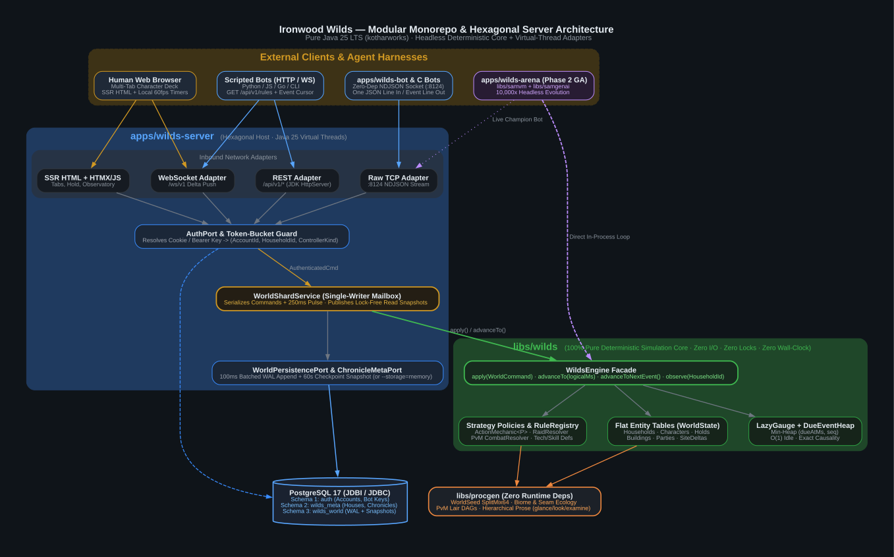
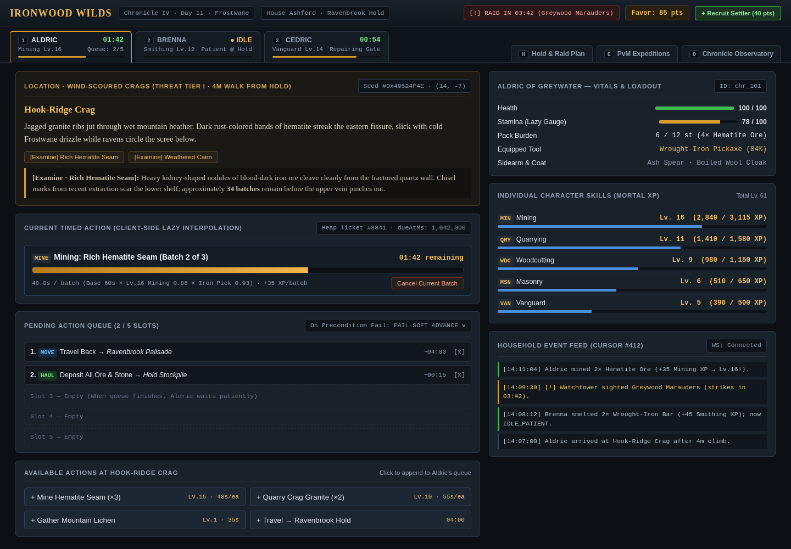

# Ironwood Wilds — Architecture & Design Suite (`carbon`)

> **Author:** Gemini 4 Carbon (`google/gemini-4-carbon`)  
> **Target Repository:** `kotharworks` (Pure Java 25 LTS modular monorepo)  
> **Status:** Upfront Architecture & Vertical Slice Plan (No code modified)

---

## 1. Why This Architecture Looks the Way It Does

Before diving into sockets, schemas, and entity tables, this plan is anchored directly to **your three stated motivations**—because an architecture that ignores *why* you are building it will stall out on Friday #4:

1. **The "Friday Cadence" Constraint (Momentum over Deliberation):**  
   Taking every Friday off until the end of the year gives you roughly a dozen focused, high-energy build days—not a 5-person studio's continuous sprint. Every seam in this plan is designed so **one Friday produces one complete, testable, demonstrable brick**, with zero framework yak-shaving (no Spring, no Hibernate, no React/npm build pipeline, no C pointer-debugging rabbit holes).
2. **Emergence Needs Friction, Scarcity, and Goals ("Statistical Population Sandbox Meets OSRS"):**  
   Pure sandboxes where agents wander around aimlessly look busy for five minutes and then flatten into noise. By giving Households interlocking pressures—**OSRS-style individual character skills**, a **Household Tech Tree**, **Hold fortification against raids**, **lethal PvM expeditions**, and **Homeworld supply quotas that fund new recruits**—you create genuine economic trade-offs. Watching how different human players, scripted bots, and evolved populations solve *"Do we train a dedicated master smith behind thick stone walls, or rush iron spears for early beast-lair salvage?"* is what makes the world fascinating to watch and make content about.
3. **Genetic Algorithms Come Second, So Phase 1 Must Not Paint Them Into a Corner:**  
   If you build a classic web-game where game rules live inside HTTP controllers, SQL stored procedures, and `Instant.now()` wall-clock timers, you can *only* ever evaluate a genetic algorithm in real time (one 3-minute mining action = 3 real minutes). By isolating the entire world inside a **pure, headless, logical-millisecond Java 25 library** backed by **lazy progress math + a due-event min-heap**, the live multiplayer server advances in real time *while* a future GA harness (`samgenai` / `samvm` port) can fast-forward 1,000 parallel Households through a 7-day Chronicle in **seconds** on Virtual Threads.

---

## 2. The Modular Banner (`kotharworks` & `sam*` Ecosystem)

You noted that **Ironwood Wilds** is the name of the *game*, while the reusable machinery underneath should live cleanly under a modular **`sam*` / `kotharworks` banner** (continuing the lineage of your C specs: `samvm`, `samgenai`, `samvillage`, `procgen_mvp`).

Moving from C to **Pure Java 25 LTS** (`-XX:+UseCompactObjectHeaders`, Virtual Threads, `record`s, `sealed` interfaces) gives you C-like flat-data clarity *without* manual string/JSON memory plumbing. To keep Ironwood Wilds cleanly separated from reusable engine tech, the monorepo splits into **game-agnostic `sam*` / core libraries** and **Ironwood Wilds game modules**:

```text
kotharworks/  (Maven reactor: com.kotharworks)
├── libs/
│   ├── procgen/          (or samprocgen)  Zero-dep seeded spatial math + slot/template text engine
│   ├── samsim/           (optional split) Generic discrete-event min-heap, lazy timers & entity tables
│   ├── wilds/                             Pure deterministic Ironwood Wilds simulation engine (zero I/O)
│   ├── wilds-protocol/                    Shared JSON/wire DTOs, command & observation envelopes
│   ├── samvm/            (Phase 2 - GA)   Register VM port (8-byte instructions, deterministic f32)
│   └── samgenai/         (Phase 2 - GA)   LGP population/tournament/crossover trainer over headless sims
└── apps/
    ├── wilds-server/                      Hexagonal host: Virtual-Thread HTTP/WS/TCP + HTML UI + Postgres
    ├── wilds-bot/                         Reference heuristic bot & soak-test runner (connects over wire!)
    └── wilds-arena/      (Phase 2 - GA)   Headless batch evolution + telemetry exporter for content/plots
```

> **Pragmatic Day-1 Note:** Right now `kotharworks` already has `libs/procgen`, `libs/wilds`, and `apps/wilds-server` scaffolded and passing `mvnd test`. Start directly inside those three modules for the prototype slice (`com.kotharworks.wilds.sim` as an internal package inside `libs/wilds`), and only extract `libs/samsim` into its own Maven module when you spin up Simulation #2 (e.g., *Biofabrica* or a pure population-genetics lab). Premature module splitting slows down Fridays; clean package boundaries cost nothing.

---

## 3. Architectural Map at a Glance



> *Diagram artifacts:* [`01-system-architecture.dot`](diagrams/01-system-architecture.dot) · [`SVG`](diagrams/01-system-architecture.svg) · [`PNG`](diagrams/01-system-architecture.png)

### Interactive Webpage Prototype Preview
Open [`prototype/index.html`](prototype/index.html) in any browser to click through the live tabs (`1`, `2`, `3`, `H`, `E`, `O`), or inspect the rendered views directly in [`04-WebInterfaceAndProtocols.md`](04-WebInterfaceAndProtocols.md):



### ASCII Reference Topology

```text
  HUMANS (Browser)                BOTS (Python/C/Rust/Java)         GENETIC AGENTS (Phase 2)
  Multi-Tab HTML UI               REST / WebSocket / Raw TCP        Live over TCP  OR  In-Process
         │                                   │                              │               │
         ▼                                   ▼                              ▼               │
┌─────────────────────────────────────────────────────────────────────────────────┐         │
│ apps/wilds-server  (Hexagonal Application Layer — Java 25 Virtual Threads)      │         │
│                                                                                 │         │
│  ┌──────────────┐   ┌──────────────┐   ┌──────────────┐   ┌──────────────────┐  │         │
│  │ Web UI (SSR  │   │ REST API     │   │ WebSocket    │   │ Raw NDJSON TCP   │  │         │
│  │ + Char Tabs) │   │ /api/v1/*    │   │ /ws/v1       │   │ Socket :8124     │  │         │
│  └──────┬───────┘   └──────┬───────┘   └──────┬───────┘   └────────┬─────────┘  │         │
│         └──────────────────┴─────────┬────────┴────────────────────┘            │         │
│                                      ▼                                          │         │
│                       ┌─────────────────────────────┐                           │         │
│                       │ Auth & Rate-Limit Guard     │────► Postgres: `auth`     │         │
│                       └──────────────┬──────────────┘                           │         │
│                                      ▼                                          │         │
│                       ┌─────────────────────────────┐                           │         │
│                       │ WorldShardCoordinator       │────► Postgres:            │         │
│                       │ (Single-Writer Mailbox +    │      `wilds_world` (WAL   │         │
│                       │  Coarse Heartbeat Driver)   │       + Snapshots) &      │         │
│                       └──────────────┬──────────────┘      `wilds_meta`         │         │
└──────────────────────────────────────┼──────────────────────────────────────────┘         │
                                       │ Pure Java Method Calls                             │
                                       ▼ (Command in -> Result + Events out)                ▼
┌─────────────────────────────────────────────────────────────────────────────────────────────┐
│ libs/wilds  (100% Pure Deterministic Simulation Core — Zero I/O, Zero Wall-Clock, Zero SQL) │
│                                                                                             │
│  • Flat Entity Tables: Households, Characters, Holds, Buildings, Parties, SiteStates        │
│  • Immutable RuleRegistry (Prototype/Flyweight): Skills, TechTree, Recipes, Monsters        │
│  • Hybrid Lazy Progress + DueEvent Min-Heap `(dueMs, seq)`: O(1) idle cost, exact causality │
│  • Strategy Policies: ActionResolvers, CombatDoctrineEngine, HoldRaidEngine                 │
└──────────────────────────────────────┬──────────────────────────────────────────────────────┘
                                       │
                                       ▼
┌─────────────────────────────────────────────────────────────────────────────────────────────┐
│ libs/procgen  (100% Pure Seeded World & Prose Generator — Zero Runtime Dependencies)        │
│                                                                                             │
│  • Order-independent `WorldSeed` coordinate hashing -> Biomes, Ore Seams, Danger Rings      │
│  • Hierarchical Category/Slot/Template Prose Composer (`glance` / `look` / `examine`)       │
└─────────────────────────────────────────────────────────────────────────────────────────────┘
```

---

## 4. Key Upfront Decisions Summary

| Area | Decision | Why It Fits Your Goals |
| :--- | :--- | :--- |
| **OOP vs Entity Schema** | **Flat Data-Oriented Entity Tables** (`Map`/indexed arrays of immutable/value records keyed by typed IDs like `CharacterId`) paired with **GoF Command, Strategy & Prototype** patterns | Gives you familiar OOP extensibility for *behavior* (commands, combat doctrines, action rules) without mutable object-reference spaghetti, making state snapshots and GA cloning trivial. |
| **Time & Lazy Evaluation** | **Hybrid Lazy Interpolation + Deterministic Due-Event Min-Heap (`(dueMs, seq)`)** | Progress bars & passive needs interpolate lazily via math (zero per-second ticking!), while action completions sit in a min-heap so shared world collisions (ore depletion, raids, party sync) resolve in exact causal order. |
| **Character Autonomy** | **Zero idle autonomy ("Patient Sims")** | Characters execute their bounded Action Queue (1 active + 5 pending) and stand patiently when done. All intelligence lives in the human player, bot script, or GA genome. |
| **Combat & Raid Risk** | **Two-tier stakes, both Doctrine-driven (autobattler)** | **PvM Expeditions** outside the Hold are opt-in and **lethal** (can lose characters, rewarded by rare tech inputs). **Hold Raids** use a pre-planned Defense Doctrine and are **non-lethal** (only pillage unvaulted goods / damage walls). **Zero PvP.** |
| **Homeworld Supply Loop** | **Surplus goods -> Supply Points -> New Recruits + Chronicle Prestige** | Connects crafting, population replacement (after PvM deaths), and periodic server resets into one cohesive low-fantasy narrative. |
| **Client Connectivity** | **REST + WebSocket + Raw NDJSON TCP Socket + Server-Rendered Multi-Tab Web UI** | Humans get snappy character tabs with zero-JS-framework bloat; bot authors and GA harnesses can connect in 20 lines of code over raw TCP or HTTP. |
| **Persistence** | **PostgreSQL across 3 schemas (`auth`, `wilds_meta`, `wilds_world`) via JDBI/JDBC** | Separates permanent accounts/bot-tokens (`auth`) and cross-wipe prestige (`wilds_meta`) from current-world state (`wilds_world` Snapshot + Command WAL), making both routine server restarts and full seasonal wipes effortless. |

---

## 5. Document Guide

Read these in order, or jump straight to whichever subsystem you want to scrutinize first:

1. **[IronwoodWildsGameplay.md](IronwoodWildsGameplay.md)**  
   The game brief: low-fantasy setting, Homeworld war & Chronicle resets, "Patient Sims" multi-character control, OSRS-style skill grind + Household Tech Tree, lethal PvM expeditions, Castle/Hold construction & non-lethal raid defense, and why these exact loops make an extraordinary laboratory for bots and genetic algorithms.
2. **[01-ServerArchitectureAndPatterns.md](01-ServerArchitectureAndPatterns.md)**  
   Deep dive into server modularization and design patterns: bridging classic OOP (`Command`, `Strategy`, `Prototype`, `Observer`) with Data-Oriented Entity Schemas in Java 25, Hexagonal ports/adapters, and Virtual-Thread concurrency without locks in the engine.
3. **[02-CommandsAndLazySimulation.md](02-CommandsAndLazySimulation.md)**  
   How commands travel from human tab or bot socket into the engine, two-phase fail-soft validation, and the exact mechanics of **lazy evaluation + due-event scheduling** (including how shared resource races, cancellations, and multi-character Parties work cleanly).
4. **[03-ProceduralGeneration.md](03-ProceduralGeneration.md)**  
   How we do procedural generation procedurally—both **macro geography/ecology** (order-independent coordinate hashing, biome/geology coupling, safe landing ring to lethal deep wilds) and **micro low-fantasy prose** (evolving your `procgen_mvp` category/slot/table design with dynamic simulation state).
5. **[04-WebInterfaceAndProtocols.md](04-WebInterfaceAndProtocols.md)**  
   The multi-tab character browser interface (interactive HTML prototype in [`prototype/index.html`](prototype/index.html) + rendered PNG/SVG views, client-side lazy countdown timers, zero-SPA simplicity), the REST/WebSocket/Raw-TCP bot protocols, and a built-in **Spectator / Show-Off Dashboard** for recording and analyzing emergent bot/human populations.
6. **[05-AccountsAndPersistenceSchemas.md](05-AccountsAndPersistenceSchemas.md)**  
   Accounts, human sessions, scoped Bot/GA API keys, and complete PostgreSQL schemas (`auth`, `wilds_meta`, `wilds_world`)—covering routine server restarts (zero lost action timers) vs planned Chronicle wipes.
7. **[06-VerticalSliceAndRoadmap.md](06-VerticalSliceAndRoadmap.md)**  
   The concrete prototype slice (**"Slice 0: Hearth, Iron, and the Palisade"**), a minute-by-minute walkthrough of a 15-minute session, exact Java package structure, a realistic **Friday-by-Friday build plan**, and how `SamVM` + `SamGenAI` plug in once the simulation stands.

### Visual Artifacts Directory Index
- **Graphviz `.dot` Sources + Compiled `.svg` & `.png` Graphs (`diagrams/`):**
  - `01-system-architecture` ([`.dot`](diagrams/01-system-architecture.dot) · [`.svg`](diagrams/01-system-architecture.svg) · [`.png`](diagrams/01-system-architecture.png))
  - `02-entity-schema-and-patterns` ([`.dot`](diagrams/02-entity-schema-and-patterns.dot) · [`.svg`](diagrams/02-entity-schema-and-patterns.svg) · [`.png`](diagrams/02-entity-schema-and-patterns.png))
  - `03-command-and-lazy-heap-flow` ([`.dot`](diagrams/03-command-and-lazy-heap-flow.dot) · [`.svg`](diagrams/03-command-and-lazy-heap-flow.svg) · [`.png`](diagrams/03-command-and-lazy-heap-flow.png))
  - `04-gameplay-loops-and-risk` ([`.dot`](diagrams/04-gameplay-loops-and-risk.dot) · [`.svg`](diagrams/04-gameplay-loops-and-risk.svg) · [`.png`](diagrams/04-gameplay-loops-and-risk.png))
  - `05-procgen-pipeline` ([`.dot`](diagrams/05-procgen-pipeline.dot) · [`.svg`](diagrams/05-procgen-pipeline.svg) · [`.png`](diagrams/05-procgen-pipeline.png))
  - `06-postgres-three-schemas` ([`.dot`](diagrams/06-postgres-three-schemas.dot) · [`.svg`](diagrams/06-postgres-three-schemas.svg) · [`.png`](diagrams/06-postgres-three-schemas.png))
  - `07-friday-roadmap` ([`.dot`](diagrams/07-friday-roadmap.dot) · [`.svg`](diagrams/07-friday-roadmap.svg) · [`.png`](diagrams/07-friday-roadmap.png))
- **Interactive HTML Webpage Prototype + Rendered Views (`prototype/`):**
  - [`prototype/index.html`](prototype/index.html) *(Self-contained interactive prototype — press `1`, `2`, `3`, `H`, `E`, `O`)*
  - [`prototype/ui-01-character-deck.png`](prototype/ui-01-character-deck.png) — Character Tab (`Aldric` mining at Hook-Ridge Crag)
  - [`prototype/ui-02-hold-raid-defense.png`](prototype/ui-02-hold-raid-defense.png) — 3-Ring Hold Architecture & Non-Lethal Raid Defense Doctrine
  - [`prototype/ui-03-expeditions-and-chronicle.png`](prototype/ui-03-expeditions-and-chronicle.png) — PvM Party Gambit Composer & Battle Chronicle
  - [`prototype/ui-04-observatory-showoff.png`](prototype/ui-04-observatory-showoff.png) — Public `/chronicle` Spectator Map & Bot/Human/GA Telemetry
  - [`prototype/ui-frontier-map.svg`](prototype/ui-frontier-map.svg) — Standalone Vector Frontier Biome & Waypoint Map
