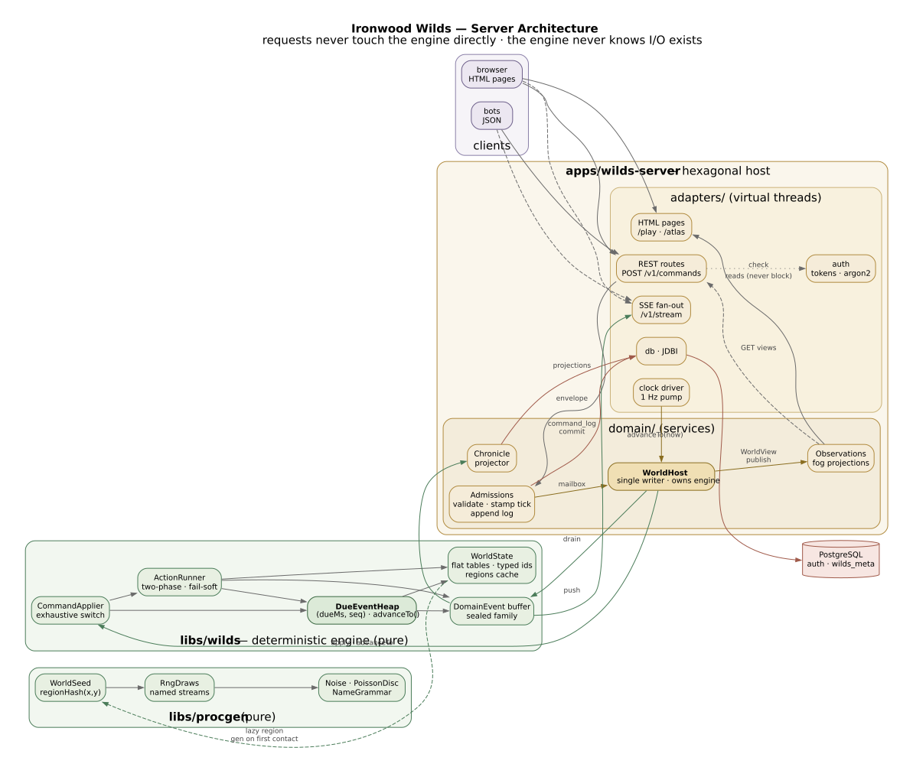
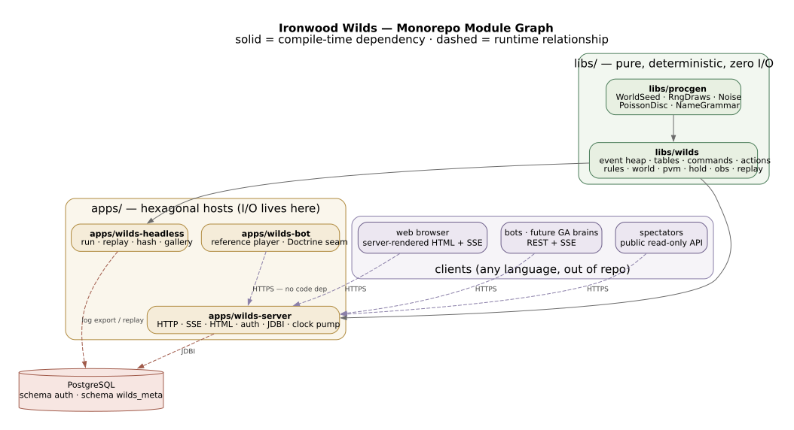

# Ironwood Wilds — Server Architecture

> **Status:** planning document. Extends the existing scaffolds
> (`libs/procgen` `WorldSeed`, `libs/wilds` `WildsEngine`, `apps/wilds-server`)
> rather than replacing them. House rules (AGENTS.md) are treated as
> normative: pure Java 25, data-oriented records/sealed interfaces, flat
> entity tables with typed IDs, pure deterministic libs, virtual threads,
> hexagonal apps.

## 1. Principles

| # | Principle | Consequence |
|---|---|---|
| A1 | **Determinism is the product** | Replay, audit, bot fairness, A/B world experiments, and future GA fitness all reduce to: same seed + same command log → identical world. Every design decision below is checked against this. |
| A2 | **Pure core, thin shell** | All rules live in `libs/*` with zero I/O. Apps only adapt (HTTP, SQL, wall clock). If a file imports `java.net` or JDBC outside `apps/`, it is in the wrong place. |
| A3 | **Data-oriented state, pattern-rich behaviour** | *State* is flat tables (no object-reference webs, per AGENTS). *Behaviour* is where classic patterns earn their keep (Command, Strategy, Prototype, Observer). See §5. |
| A4 | **Boring concurrency** | One single-writer simulation thread. Everything else (HTTP, SSE fan-out, DB writes) runs on virtual threads talking to it through one mailbox. No reactive, no locks soup. |
| A5 | **Rules as data** | Content (actions, recipes, tech tree, creature stats) is immutable record tables in code, versioned, served verbatim over the API. The samvillage §4.0 lesson, kept. |
| A6 | **The wire is the game** | REST + SSE protocol is the only client contract. Web UI, CLI, bots, and future GA brains are all just clients. |

## 2. The big picture

```text
┌───────────────────────── clients (out of repo's concern, except the web one) ──────────┐
│  web browser (server-rendered HTML, tabs per character)   bots (any language)   spectate │
└──────────────────────────────────────────┬──────────────────────────────────────────────┘
                                           │  HTTPS: REST/JSON  +  SSE stream
┌──────────────────────────────────────────▼──────────────────────────────────────────────┐
│  apps/wilds-server  (hexagonal host)                                                     │
│                                                                                          │
│  adapters/                       domain/ (services, single-writer world host)             │
│  ├─ http/   REST routes  (VT per request)      ├─ Admissions      validate + stamp cmds   │
│  ├─ sse/    event fan-out  (VT per stream)     ├─ WorldHost       owns the engine mailbox │
│  ├─ web/    HTML pages + static assets         ├─ Chronicle       events → read models    │
│  ├─ auth/   tokens, argon2, sessions           └─ Seasons         lifecycle, archive      │
│  ├─ db/     JDBI → PostgreSQL (auth, wilds_meta)                                        │
│  └─ clock/  wall-clock driver (1 Hz pump)                                                │
│                                                                                          │
│  ports/  Clock · WorldStore · CommandSink · EventBus · Ids                               │
└──────────────────────────────────────────┬──────────────────────────────────────────────┘
                                           │  plain Java calls (no I/O below this line)
┌──────────────────────────────────────────▼──────────────────────────────────────────────┐
│  libs/wilds — the deterministic simulation engine                                        │
│  time/  tables/  command/  action/  rules/  world/  pvm/  hold/  economy/  event/  obs/   │
│  replay/                                                                                 │
└──────────────────────────────────────────┬──────────────────────────────────────────────┘
                                           │
┌──────────────────────────────────────────▼──────────────────────────────────────────────┐
│  libs/procgen — WorldSeed hashing · noise · biome pass · names · slot/template text       │
└─────────────────────────────────────────────────────────────────────────────────────────┘
```

Two hard rules visible in that diagram:

1. **Requests never touch the engine directly.** They go through the
   `WorldHost` mailbox and read published immutable `WorldView` snapshots.
2. **The engine never knows HTTP, SQL, or wall time exist.** It receives
   commands already stamped with a logical admission tick.

Rendered versions of this diagram and the module map (SVG sources:
[architecture](diagrams/wilds-architecture.dot) ·
[modules](diagrams/wilds-module-graph.dot)):





## 3. Module map (monorepo)

| Module | Artifact | Purity | Purpose |
|---|---|---|---|
| `libs/procgen` *(exists)* | `com.kotharworks:procgen` | pure | `WorldSeed` coordinate hashing (exists), + simplex/fBm noise, Poisson-disc spacing, name grammars, slot/template description text. Zero deps. |
| `libs/wilds` *(exists)* | `com.kotharworks:wilds` | pure | The simulation engine: clock, due-event heap, entity tables, command applier, action system, rules tables, world/region state, PvM resolution, hold/raid resolution, economy, fog observations, replay/hash. Depends only on `procgen`. |
| `apps/wilds-server` *(exists)* | `com.kotharworks:wilds-server` | app | The online host: adapters (HTTP, SSE, HTML, auth, JDBI/Postgres, clock), domain services, composition root in `Main`. |
| `apps/wilds-headless` *(new)* | `com.kotharworks:wilds-headless` | app | CLI workhorse: run a world fast-forward from a seed + command script, replay a season's command log to any tick, dump hashes, render ASCII map galleries. This is the determinism test rig *and* the future GA fitness runner. |
| `apps/wilds-bot` *(new, after the slice)* | `com.kotharworks:wilds-bot` | app | Reference bot client playing over HTTP only (never links `wilds`). Carries the `Doctrine` strategy interface — the future GA brain slot. |

**Package cohesion before module splits.** `libs/wilds` starts as one module
with the packages listed above. Splitting (e.g. `wilds-pvm` out) is cheap
later because packages already have no cycles; splitting *now* would just
add POMs. AGENTS.md's "no invented ports inside libs" applies: the engine is
plain cohesive code; hexagonal seams live in `apps/wilds-server`.

## 4. The simulation kernel

This is the heart of the architecture and the part the rest of the docs
assume. It implements the lazily-evaluated timed actions from the gameplay
brief (GP-D5).

### 4.1 Time model — decision

| Option | How it works | Verdict |
|---|---|---|
| A. Fixed tick loop | Every tick, iterate all entities, decrement timers | Simple, but O(entities) every second even when 95% of the world is idle; rewards busywork, punishes the "patient world" fantasy |
| B. Pure lazy discrete-event | Priority queue of scheduled continuations; world materialises to time T only when asked | Cheapest possible idle world; offline progress free; *but* live pushes (SSE) and scheduled raids still need someone to ask |
| **C. Lazy event heap + 1 Hz pump (chosen)** | Same heap as B; a wall-clock driver pumps `advanceTo(now)` once per second and on every admitted command | Lazy economics *and* live liveness. In live mode the pump costs almost nothing when idle (one peek at the heap head). |

**AR-D1: logical time in integer milliseconds since season start; 1 tick =
1000 ms; engine advances on demand (`advanceTo`) — never sleeps, never reads
a clock.** The `WildsEngine` scaffold already carries `logicalTimeMs`; this
formalises it.

### 4.2 The due-event heap

```java
/** Deterministic ordering: (dueMs, seq). seq is a global monotone counter. */
public record Scheduled(long dueMs, long seq, Continuation kind) {}

public sealed interface Continuation {
    record ActionProgress(long characterId, long actionSeq) implements Continuation {}
    record WorldHeartbeat(HeartbeatKind kind) implements Continuation {}
    record ExpeditionBeat(long expeditionId) implements Continuation {}
    record RaidResolution(long raidId) implements Continuation {}
    record ShipmentArrival(long householdId) implements Continuation {}
}
```

Rules that make laziness deterministic:

1. **Every scheduled event carries a globally unique `seq`** assigned when
   scheduled, so pops are totally ordered even at equal `dueMs`.
2. **`advanceTo(targetMs)`** pops and applies events in `(dueMs, seq)` order
   until the heap head exceeds `targetMs`; then sets `now = targetMs`.
3. **Commands are admitted at a tick**: the server stamps each accepted
   command with the current logical tick *at admission time*, appends it to
   the command log (its log position breaks any remaining ambiguity), and
   applies it after advancing to that tick. **The persisted command log
   order is the definition of the timeline** — replay is unambiguous.
4. **Recurring systems re-schedule themselves.** The daily needs check, crop
   growth, deposit regen, awareness recompute, ship cadence are all
   `WorldHeartbeat` entries that run and schedule their next occurrence.
   There is no "every entity ticks" loop anywhere.

### 4.3 Worked example (why this is cheap)

Mara queues `CHOP` (60 ticks) at t=0; Pell queues `MINE` (150 ticks) at
t=30; nobody logs in for an hour.

- t=0: heap = [(60, s1: Mara-chop)]
- t=30 (command admitted): heap = [(60, s1), (180, s2: Pell-mine)]
- t=3600 (a bot polls): `advanceTo(3600)` pops two events → Mara has 4 wood
  and is idle; Pell has 3 ore and is idle → two completion events; total
  work: ~a dozen operations for an hour of world time.

Cost is proportional to **events that actually happened**, not to elapsed
time × entities. A season with 200 mostly-idle households stays trivially
cheap; the same code fast-forwards a whole season in seconds in
`apps/wilds-headless`.

### 4.4 Entity state — flat tables with typed IDs

Per AGENTS.md standard 3. No entity holds a reference to another entity;
everything is addressed by value IDs with generation counters (stale-handle
detection):

```java
public record CharacterId(int index, int generation) {}
public record SiteId(int index, int generation) {}
public record BuildingId(int index, int generation) {}
public record PartyId(int index, int generation) {}

public final class WorldState {
    // flat tables: dense arrays indexed by id.index; null slot = free
    private CharacterRow[] characters;
    private BuildingRow[] buildings;
    private SiteRow[] sites;
    private PartyRow[] parties;
    private final LongObjectHashMap<RegionMaterialised> regions; // keyed by (x,y) packed
    private final DueEventHeap heap;
    private final SeqCounter seqs;
    private long nowMs;
    // ... plus inventories, tech states, favor ledgers — all keyed by typed ids
}
```

Rows are mutable records-in-arrays (fast, serialisable, immune to aliasing);
everything crossing a module or wire boundary is an immutable record. This
is "entity schema" shaped like ECS **without adopting an ECS framework** —
systems are just classes of pure functions over `WorldState`. See §5.4 for
the honest comparison.

### 4.5 Commands inside the engine

The engine's front door is one method, mirroring the scaffold's
`apply(Command)`:

```java
public sealed interface Command {
    record EnqueueAction(CharacterId who, long admissionTick, ActionRequest request, long logSeq) implements Command {}
    record ReplaceQueue(CharacterId who, long admissionTick, List<ActionRequest> pending, long logSeq) implements Command {}
    record CancelPending(CharacterId who, long admissionTick, int upTo, long logSeq) implements Command {}
    record FormParty(long admissionTick, List<CharacterId> members, Loadout loadout, StandingOrder orders, long logSeq) implements Command {}
    record WriteDefensePlan(long admissionTick, DefensePlan plan, long logSeq) implements Command {}
    // ... admission/authority happen in the app; the engine trusts its caller
}
```

`CommandApplier` is a single exhaustive `switch` over this sealed hierarchy
(§5.1). The engine is **trusting**: auth, rate limits, and shape validation
belong to the server; replay depends on only *admissible* commands ever
reaching `apply`, and the log only ever contains those.

### 4.6 Domain events out

Every state change of spectator interest emits an immutable
`sealed interface DomainEvent` (`ActionCompleted`, `XpGained`, `LevelUp`,
`ShipmentDeparted`, `RaidResolved`, `ColonistDied`, `RumorHeard`, …) into an
in-engine append-only buffer. The server drains it after every
`advanceTo`/admission batch → SSE fan-out, chronicle projection, durable
event-log rows. The engine never knows who is listening (Observer, §5.5).

## 5. Pattern catalogue — where each design pattern earns its keep

The explicit ask: how Command/Strategy/Prototype and/or entity schema fit.
Answer: **all of them, each at a different layer, and none of them
everywhere.** State is tables; behaviour is patterns; the wire is records.

### 5.1 Command (+ exhaustive switch = the pattern Java 25 was born for)

- **Where:** wire protocol (`Commands` doc §2) and engine mutations.
- **Shape:** sealed interface of immutable records (above). The
  `CommandApplier` switch is exhaustive → **adding a command type is a
  compile error everywhere it must be handled**. This is the GoF Command
  pattern with the pattern's classic downside (class explosion) designed
  out: no `Command` interface with 40 anonymous impls, just record cases.
- **Not used for:** internal engine steps (events/continuations are data,
  not command objects — they don't need undo/queue/inspection).

### 5.2 Strategy — every tunable formula and every evolvable brain

```java
@FunctionalInterface public interface XpCurve { long xpForLevel(int level); }
@FunctionalInterface public interface DurationModel { int ticks(ActionDef a, CharacterRow c); }
@FunctionalInterface public interface YieldModel { int yieldOf(ActionDef a, CharacterRow c, RngDraws rng); }
@FunctionalInterface public interface AwarenessModel { Severity raidSeverity(HouseholdStats own, RegionStats region); }
@FunctionalInterface public interface RaidResolver { RaidOutcome resolve(DefensePlan p, HoldState h, Severity s, RngDraws rng); }
// apps/wilds-bot:
@FunctionalInterface public interface Doctrine { List<ActionRequest> decide(Observation o); }
```

- **Where:** every formula a designer (or a season ruleset, or a future GA)
  might want to swap. Rules tables (A5) carry *numbers*; strategies carry
  *shapes*. Rules v2 may change numbers freely; changing a shape is a code
  change and a rules-version bump.
- **Why it matters here:** `Doctrine` is the exact seam a genetic algorithm
  plugs into later — evolve a `Doctrine`, run it headless against a season
  seed, score by Favor. Zero engine changes required.

### 5.3 Prototype — content templates cloned with seeded variation

- **Where:** `procgen` (biome archetypes, site blueprints, ruin layouts are
  prototype records stamped with `WorldSeed`-derived variation), building
  blueprints, gear loadout presets, standing-order templates in the web UI.
- **Shape:** immutable `record Blueprint(...)` + a pure
  `Blueprint.instantiate(RngDraws rng)` returning a concrete instance. No
  `Cloneable`, no reflection — records copy themselves by construction.
- **Why:** content volume. 200 building variants are 200 records and one
  interpreter, not 200 classes.

### 5.4 Entity schema (flat tables) vs classic OOP — the honest comparison

| Concern | Classic OOP object graph | ECS framework | **Flat tables + typed IDs (chosen)** |
|---|---|---|---|
| Serialisation (snapshots) | Deep object graph, aliasing hell | Component arrays, framework-locked | **Trivial: tables → records → JSON** |
| Determinism | Hidden mutation order in references | Iteration order managed by framework | **Explicit: IDs and `seq` order everything** |
| Cross-entity queries ("all idle miners near region 3,2") | N/A without walking the graph | Great | **Great: scans/filters over dense arrays** |
| Adding a component-ish field | Class surgery | Add a component, no touch | Add a column to a row record (one file) |
| Type safety of relations | Compile-time (too much: aliasing) | Runtime entity handles | **Typed IDs + generation counters** |
| Framework risk | — | Artemis/ashley lock-in, allocation patterns | **None — it's just arrays and records** |

Chosen form is AGENTS.md standard 3, which is already ECS-shaped. The lesson
from ECS retained: *systems are functions over data*. The lesson rejected:
*a framework owns your state*. Classic OOP survives at the edges where
behaviour, not state, is the product (handlers, strategies, adapters).

### 5.5 Observer / pub-sub — events to the edges

`DomainEvent` buffer (§4.6) → server-side `EventBus` (virtual-thread
listeners) → SSE publishers, chronicle projector, persistence WAL writer.
Rationale: the engine stays pure; N listeners cost the engine zero. The
anti-pattern avoided: listeners mutating world state (all listeners are
read-only consumers).

### 5.6 Ports & adapters — in `apps/wilds-server` only

| Port | Adapter(s) | Notes |
|---|---|---|
| `Clock` | `SystemClock` (live) / `FixedClock` (tests) | The **only** file allowed to call `System.currentTimeMillis()` |
| `WorldStore` | `JdbiWorldStore` (Postgres) / `InMemoryWorldStore` (tests, slice M3) | Snapshot + command-log persistence (Persistence doc §4) |
| `CommandSink` | HTTP routes → mailbox | Rate limiting lives here, not in the engine |
| `EventBus` | in-process VT fan-out | |
| `Ids` | UUID v7 / monotone counter | For wire-side ids (accounts, sessions, cmdId) |

### 5.7 Registry + Factory — wire decoding

Polymorphic JSON → sealed `Command`: one `CommandCodec` with a
`Map<String, Decoder>` built from a static registry (type tag string →
record decoder). Adding a command: one registry entry + the sealed case.
(With only ~10 wire commands, a plain switch is equally defensible; the
registry earns its keep when actions/observations grow.)

### 5.8 Snapshot / Memento — world persistence

`WorldState.toSnapshot()` → immutable `WorldSnapshot` record tree → JSON →
Postgres `bytea`/`jsonb`. Load = inverse. Used by: crash recovery, season
archive, `WorldView` publication (§6), and the headless replay tool.

### 5.9 Patterns deliberately *not* used

| Pattern | Why not |
|---|---|
| GoF `State` for action lifecycle | An action's lifecycle is three fields on a row (`startedMs`, `ticksTotal`, `state`) + the heap. A State class per state would bury the determinism story in polymorphism. |
| `Observer` between *entities* | Entity-to-entity notification = hidden mutation order = determinism death. Events flow outward only (§5.5). |
| Builders for records | Records have canonical constructors; staging builders hide invalid states. Static factories where needed (`of`, `parse`). |
| Inheritance for entity kinds | `CharacterRow` with a sealed `Role` field, never `class Miner extends Character`. Flat tables (§5.4). |
| Singleton service locator | Composition root in `Main` wires everything explicitly. |

## 6. Concurrency model (AR-D4: boring)

```text
                          ┌──────────────────────────────┐
 HTTP/SSE (VT per conn) → │ mailbox: ConcurrentLinkedQueue │ → ┌──────────────────┐
                          └──────────────────────────────┘   │ WorldHost thread │
 clock pump (1 Hz) ───────► posts advanceTo(now)              │  (single writer) │
                          ┌──────────────────────────────┐ ← │  owns WildsEngine │
 readers (VT) ←───────────│ volatile WorldView latest     │  └──────────────────┘
                          └──────────────────────────────┘
```

1. **One single-writer thread** (a platform thread; it's the only hot one)
   drains the mailbox: for each batch → admit commands (append to log) →
   `advanceTo(batch tick)` → drain events → publish new immutable
   `WorldView` (a fog-free internal snapshot) → notify listeners.
2. **Reads never block on the engine**: HTTP reads and SSE streams are
   served from the latest published `WorldView` + per-household fog
   projection (pure function, cacheable).
3. **Virtual threads everywhere else**: each HTTP request, each SSE stream,
   each DB write, the clock pump. Synchronous code, no `CompletableFuture`
   chains (AGENTS standard 5).
4. **Crash safety**: command log rows are committed before admission
   (Persistence doc §5); snapshots checkpoint every N ticks. Recovery =
   load snapshot + replay log tail.

### 6.1 Liveness vs laziness — resolved

The clock pump makes the world *feel* live (events push out within ~1s of
their tick) while preserving lazy economics: when the world is idle the pump
peeks at a heap head and does nothing. Headless mode simply omits the pump
and calls `advanceTo` with huge targets — same engine, different driver.
**The engine has no mode flag**; drivers are just callers.

## 7. Determinism discipline (A1 made enforceable)

| Rule | Enforcement |
|---|---|
| No wall clock, no `Math.random`, no `ThreadLocalRandom` in `libs/*` | Code review + a reflection-based arch test that fails the build on those symbols in `libs/` source sets |
| All randomness from `WorldSeed`-derived streams (`procgen.RngDraws`), never stored, always re-derivable | Single `Rng` entry point; lint rule: only `procgen` may construct `SplittableRandom` |
| No floating point in `WorldState` | Durations int ticks; probabilities as `rng.nextLong(10_000)` permille-style draws; fixed-point `long` if a ratio is ever needed. (The samvm D8 float-determinism trap, avoided by ban.) |
| Total order on events: `(dueMs, seq)`; commands ordered by log position | Heap design (§4.2); `seq` never resets |
| No iteration over hash-order collections in mutation paths | Dense arrays and sorted/insertion-ordered maps only, enforced in review |
| Same JVM version assumption | Season archive records JVM + engine version; replays run under the recorded version |

**Golden replay test** (the enforcement centrepiece): fixed seed + a
committed command script (same JSON the API would deliver) → run 3 game days
→ compare `WorldState.hash()` (a structural hash over all tables) against a
committed golden. `mvnd test -Plibs/wilds -DblessGolden=true` regenerates —
any intentional rules change shows up as a deliberate golden bump +
`WILDS_RULES_VERSION` increment. (Direct port of the samvillage §9.2
discipline.)

## 8. Extensibility playbooks (the "slot it together" promise)

**Add a new action** (e.g. `CHARCOAL_BURN`):
1. `rules/Actions.java`: one `ActionDef` row (durations, inputs, outputs, xp).
2. `action/` handler: only if it has novel mechanics — most actions are data
   rows interpreted by the generic gather/craft handler (Strategy: `Kind`).
3. Wire codec registry entry (if new params) + one JSON test fixture.
4. Golden bless + rules version bump. *Typical: 2 files, 1 hour.*

**Add a skill:** rules row + `XpTable` entry + gates in action defs.
**Add a building:** blueprint record + build/decay row + (optional) one
effect hook. **Add a creature:** stats row + lair template + `ArmsCurve`
check. **Add a client:** nothing — read
[IronwoodWildsCommands.md](IronwoodWildsCommands.md) and talk.
**Plug in a GA later:** implement `Doctrine` in `wilds-bot`, or run
`wilds-headless` fitness loops over season seeds. Engine untouched.

## 9. Testing strategy

| Layer | Tests | Home |
|---|---|---|
| Kernel | Time math, heap ordering (equal-dueMs tiebreak), table generation counters | `libs/wilds` unit |
| Actions | Two-phase validation table, fail-soft, XP/yield/duration formulas per strategy | `libs/wilds` unit |
| Determinism | Golden replay; double-run equality; JVM-restart equality | `libs/wilds` + `apps/wilds-headless` |
| Property | Invariants: inventory conservation, no negative ticks, roster/bed consistency, heap drains clean to any T | `libs/wilds` property (jqwik optional — or plain randomized loops, zero deps) |
| API integration | Boot server on ephemeral port; auth, endpoints, error codes, SSE cursor replay | `apps/wilds-server` |
| Soak | Reference bot keeps a household alive 3 game days at 10× scale; asserts goals achieved | `apps/wilds-bot` |
| Procgen | Golden region hashes, distribution assertions, name grammar validity | `libs/procgen` + gallery tool |

## 10. Performance envelope (why none of this needs scaling work yet)

Season-one envelope: ~200 households × ~8 characters × ~1 event/90s active →
~2k events/min at full engagement; heap ops are O(log n); `advanceTo` for an
idle hour is ~zero. Snapshot JSON ≈ low MBs. Postgres writes ≈ command rows
+ event rows ≈ hundreds/min. **A single small VM runs this for years.**
Escapes when needed (recorded, not built): region-shard the engine by claim
geography; move SSE fan-out to a sidecar; read models are already separate.

## 11. Decision digest (architecture-level)

| # | Decision | Where |
|---|---|---|
| AR-D1 | Logical ms time; lazy event heap; 1 Hz live pump; headless fast-forward | §4.1–4.3 |
| AR-D2 | Command log order defines the timeline; commands admitted at a tick | §4.2 |
| AR-D3 | Flat entity tables + typed IDs; no ECS framework; no object graphs | §4.4, §5.4 |
| AR-D4 | Single-writer world thread; virtual threads elsewhere; no reactive | §6 |
| AR-D5 | Sealed Command + exhaustive switch; trusting engine; auth at the edge | §4.5, §5.1 |
| AR-D6 | Strategies for every formula; `Doctrine` is the GA seam | §5.2 |
| AR-D7 | Domain events outward only; Observer at the edge, never between entities | §5.5 |
| AR-D8 | Ports/adapters only in `apps/`; libs stay plain | §5.6, §3 |
| AR-D9 | Integer/fixed math only in state; no floats in determinism paths | §7 |
| AR-D10 | Golden replay + rules versioning as the change-discipline mechanism | §7, §8 |
| AR-D11 | Modular monolith; sharding deferred with recorded escapes | §10 |
