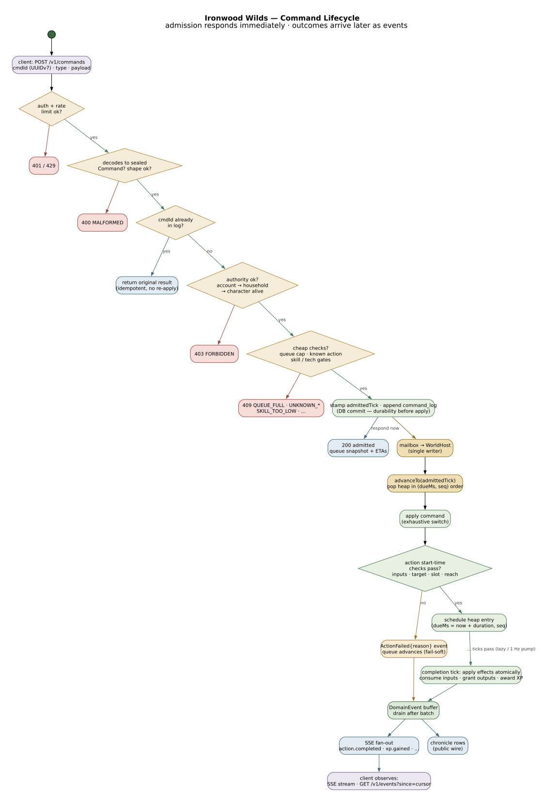
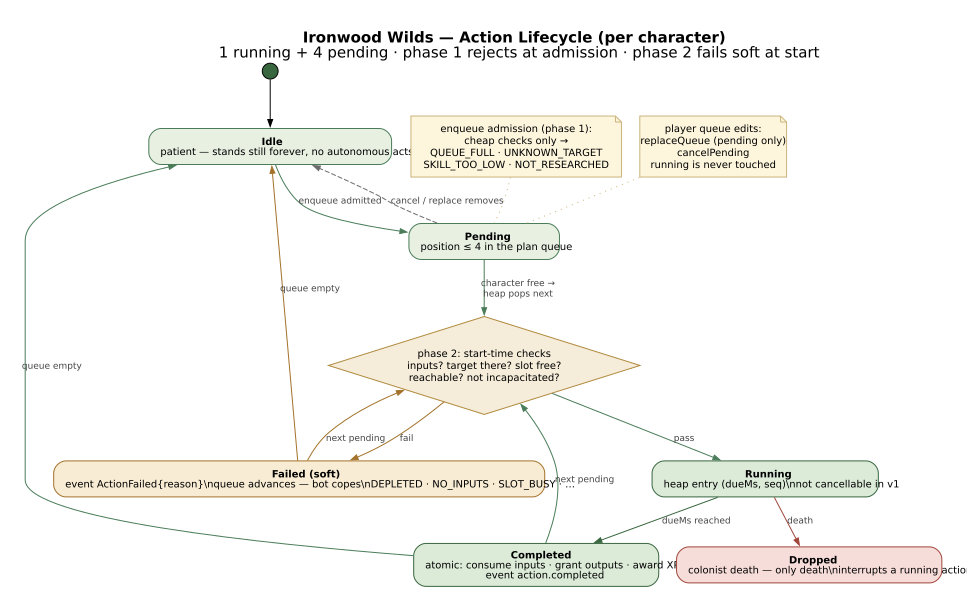

# Ironwood Wilds — Commands: How Players Drive the Simulation

> **Status:** planning document. Defines the wire protocol shape, the
> admission pipeline, and the time semantics of commands. Read after
> [Architecture](IronwoodWildsArchitecture.md) §4–6; this doc is the
> player-facing contract those sections imply.

## 1. Principles

| # | Principle |
|---|---|
| C1 | **API-first** — every decision a client needs is readable via GET, including the full rules tables. A client that hardcodes nothing but endpoints is the acceptance bar. |
| C2 | **Idempotent by construction** — every mutation carries a client-chosen `cmdId`; a replayed submission returns the original result instead of double-applying. |
| C3 | **Two-phase validation** — cheap checks reject immediately with a code at enqueue; full world checks at action start fail *soft* (event logged, queue advances). Bots cope; nobody rage-quits over a race. |
| C4 | **Commands land at a tick** — each accepted command is stamped with the logical tick at admission and appended to the season command log. Log order is the world's timeline (AR-D2). |
| C5 | **Offline is not a mode** — characters progress identically whether anyone is connected; commands take effect at the next admission after they arrive. |

## 2. The wire envelope

Every mutation is one JSON envelope POSTed to `/v1/commands`:

```json
{
  "cmdId": "0192f3c1-8a4e-7c2b-9d1e-3f4a5b6c7d8e",
  "type": "enqueue",
  "character": "chr:17:3",
  "actions": [
    { "action": "travel", "to": "reg:3:-2/tile:12/40" },
    { "action": "mine",  "target": "site:reg:3:-2:88", "count": 3 }
  ]
}
```

| Field | Meaning |
|---|---|
| `cmdId` | UUID v7 (client-chosen). Idempotency key; stored with the log row. |
| `type` | One of the command family below (sealed in the engine: `Enqueue`, `ReplaceQueue`, `CancelPending`, `FormParty`, `DispatchExpedition`, `WriteDefensePlan`, `StageShipment`, `ClaimLand`, …). |
| `character` / `household` | Target entity, typed-ID string form (`kind:index:generation`). |
| payload fields | Per type; validated against the rules tables served at `GET /v1/rules`. |

**Response (immediate — this is *admission*, not execution):**

```json
{
  "cmdId": "0192f3c1-…",
  "status": "admitted",
  "admittedTick": 482913,
  "queue": {
    "running":  { "action": "chop", "remainingTicks": 41 },
    "pending":  [ { "action": "travel", "etaTicks": 612 },
                  { "action": "mine",   "etaTicks": null } ]
  }
}
```

Rejection uses one error envelope (samvillage §5.1 heritage):

```json
{ "error": { "code": "QUEUE_FULL", "message": "queue already has 4 pending actions", "cmdId": "0192f3c1-…" } }
```

## 3. Lifecycle end-to-end

```text
 client        HTTP adapter        Admissions (VT)         WorldHost (single writer)      listeners (VT)
   │  POST /v1/commands  │                          │                                  │
   ├────────────────────►│  auth + rate limit       │                                  │
   │                     │  decode → sealed Command │                                  │
   │                     │  shape-validate vs rules │                                  │
   │                     │  idempotency check (cmdId seen?) ── yes → return prior    │
   │                     │  authority: account→household→character alive?            │
   │                     │  cheap checks (queue cap, known action, sane params)      │
   │                     │  stamp admittedTick = engine.nowMs() (volatile read)     │
   │                     │  append to command log (DB commit) ──┐                    │
   │◄────────────────────┤  200 admitted                        │                    │
   │                     │                          mailbox ───┴─► advanceTo(admittedTick)
   │                     │                          apply command (switch)            │
   │                     │                          ActionStart checks (fail-soft)    │
   │                     │                          schedule heap entries             │
   │                     │                          drain DomainEvents ──────────────►│ SSE fan-out,
   │                     │                          publish WorldView                 │ chronicle rows,
   │                     │                                                             │ WAL batch
   │◄───────────────────────────────── SSE: action.started / action.completed ───────┤
   │  GET /v1/characters/chr:17:3  (fogged projection of published WorldView)        │
```

Note the split-second gap: the HTTP response says *admitted*; outcomes arrive
later via SSE or polling `GET /v1/characters/{id}/queue` and
`GET /v1/events?since=cursor`. This matches the timed-action fantasy —
submit, walk away, read the chronicle later.



### 3.1 Why admission commits before the engine applies

The command log row is durability; the engine application is determinism.
Between commit and application the server could crash — recovery replays the
log, and the command applies exactly once with its stamped tick. Idempotent
re-submission during that window returns "admitted" with the original tick
(the cmdId row exists), so clients can retry safely on timeouts.

## 4. Queue semantics (per character)

- **1 running + 4 pending** (GP-D4). Enqueue beyond cap → `QUEUE_FULL`.
- `enqueue` appends; `replaceQueue` swaps all pending (running untouched);
  `cancelPending` drops pending entries (by position or predicate).
- **Running actions are not cancellable in v1** (samvillage §4.4.2 heritage
  — keeps determinism and save/load trivial; an `interruptible` flag on
  action defs is the sanctioned later extension).
- Start-time validation, when the heap pops the next action for a character:
  inputs present? target still there and reachable? building usable, slot
  free? colonist not incapacitated? Fail → `ActionFailed {reason}` event,
  queue advances (fail-soft, C3).
- Completion is atomic at the completing tick: inputs consumed, outputs
  granted (or overflow fails start-time check earlier), XP awarded, event
  emitted.



### 4.1 Worked example — "Mara mines iron ore"

Setup: Mara (`chr:17:3`), Mining level 12, stands next to a hematite
outcropping `site:reg:3:-2:88`. Rules row: `mine(hematite)` base 120 ticks,
input: pickaxe (worn by Mara), output 3 ore + 34 Mining xp.

1. t=482913 — POST enqueue `[travel(2 ticks to be adjacent-ok), mine ×3]`.
   Admission: shape OK, authority OK, cap OK → 200, `admittedTick 482913`,
   log seq #55123.
2. WorldHost advances to 482913, applies: travel starts (2 ticks).
3. t=482915 — travel completes; `mine` start-checks: pickaxe ✓, site ore ≥ 3 ✓,
   adjacency ✓ → duration = 120 × (1 − 0.008×(12−1)) ≈ 110 ticks; heap entry
   `(483025, seq)`.
4. t=483025 — completion #1: −0 site ore? no, −3 ore; +3 iron ore to Mara's
   carry; +34 xp; event `action.completed`. Next `mine` start-checks…
   suppose the outcropping only had 5 ore left: completion #2 drains it,
   completion #3 **fails soft**: `ActionFailed{reason: DEPLETED}` — event
   fires, queue empties, Mara stands patient.
5. Client sees all of this via SSE or `GET /v1/events?since=…` — never by
   re-deriving it.

The same five steps are exactly what a bot implements, and exactly what the
golden replay test scripts (Architecture §7).

## 5. Command family (v1, sealed)

| Type | Payload | Effect |
|---|---|---|
| `enqueue` | character, actions[] | append ≤4 pending |
| `replaceQueue` | character, actions[] | swap pending |
| `cancelPending` | character, upTo | drop pending |
| `claimLand` | household, region, tile, radius | establish/extend hold (once per household region; rules-gated) |
| `construct` | household, blueprint, tile | stage build site (materials deducted at start) |
| `formParty` | household, members[], name | create persistent party |
| `dispatchExpedition` | party, lair, loadout, standingOrder | the PvM command (Gameplay §6) |
| `writeDefensePlan` | household, plan | set the hold's raid response |
| `stageShipment` | household, goods{} | move goods to beacon stockpile for next ship |
| `research` | household, techId | spend resources toward a tech node |

Wire additions within a season are **additive only** (new types/fields);
breaking changes bump `/v2` and happen at season boundaries (GP-D10).

## 6. Error codes (complete v1 taxonomy)

| Code | Phase | Meaning |
|---|---|---|
| `UNAUTHENTICATED` / `FORBIDDEN` | admission | token missing/wrong; character not yours |
| `MALFORMED` | admission | JSON/shape violation |
| `UNKNOWN_ACTION` / `UNKNOWN_TARGET` | admission | not in rules; stale typed-ID (generation mismatch) |
| `QUEUE_FULL` | admission | >4 pending |
| `NOT_RESEARCHED` / `SKILL_TOO_LOW` | admission | gates (from rules — cheap) |
| `BAD_STATE` | start | world changed: building ruined, field state, party disbanded… |
| `NO_INPUTS` / `NO_CAPACITY` / `OUT_OF_REACH` / `DEPLETED` / `SLOT_BUSY` / `INCAPACITATED` | start | fail-soft; event + queue advance |

Codes are part of the *protocol contract* — bots may branch on them; the
`message` is human garnish and may change freely.

## 7. Ordering, concurrency, and time (the fine print)

- **Per-character serialization:** commands for the same character apply in
  admission order (log seq). Commands for *different* characters commute —
  the engine's deterministic order is (tick, log seq) regardless of sender.
- **Simultaneous submissions racing for one deposit** resolve by log
  position — the loser's later `mine` fails soft with `DEPLETED`. No locks
  exposed to clients; no "first requester wins" API promises beyond log
  order.
- **Clock skew:** clients never state a time. ETAs returned are in ticks;
  the client renders them against `GET /v1/meta` (`nowTick`), which it
  should poll ~1 Hz (bots) or refresh on SSE `world.heartbeat`.
- **Offline submission is not possible by definition** — but arriving 8
  hours later to a finished queue and staging the next batch *is* the
  intended session shape (Gameplay P3).

## 8. Bots: the first-class citizen contract

A conforming bot:

1. `GET /v1/rules` at startup; re-fetch when `meta.rulesVersion` changes.
2. `GET /v1/meta` ~1 Hz; keep an SSE stream (preferred) or poll
   `GET /v1/events?since=cursor`.
3. Submits commands with fresh UUIDv7 `cmdId`s; retries unknown-outcome
   posts (idempotency makes it safe); branches only on error *codes*.
4. Stays under rate limits (default: 10 req/s burst 30 per token — generous
   by design; the game is slow and the API is the product).

`apps/wilds-bot` implements exactly this and doubles as the living API
integration test (Architecture §9) — the samvillage D15 pattern, promoted
from "test harness" to "reference implementation", because in Wilds the bot
*is* a legitimate player archetype.

## 9. Versioning

- `WILDS_PROTOCOL` (server, `/v1/meta`) vs `WildsEngine.API_VERSION`
  (engine, exists in the scaffold) vs `WILDS_RULES_VERSION` (rules tables).
- Protocol and rules are frozen within a season. The triple is recorded in
  the season archive; replays refuse to run under a mismatched triple.

## 10. Decision digest

| # | Decision |
|---|---|
| CM-D1 | Single POST endpoint for all mutations, sealed type family, JSON |
| CM-D2 | Idempotency via UUIDv7 `cmdId`; log row before engine application |
| CM-D3 | Admission responds immediately; outcomes via SSE/poll events |
| CM-D4 | Two-phase validation; fail-soft starts; running actions uncancellable in v1 |
| CM-D5 | Queue 1+4; enqueue/replace/cancel semantics fixed |
| CM-D6 | Error codes are protocol; messages are garnish |
| CM-D7 | (tick, log seq) total order; clients never state time |
| CM-D8 | Additive-only within a season; version triple pins replays |
