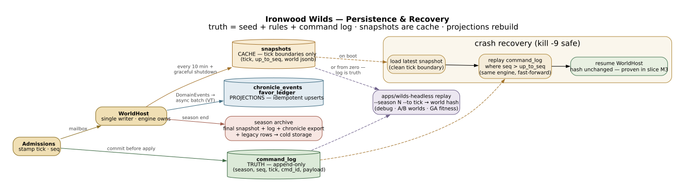

# Ironwood Wilds — Accounts & Persistence

> **Status:** planning document. Covers the two persistence planes —
> service data (accounts, sessions, seasons) and world data (command log,
> snapshots, projections) — with concrete PostgreSQL schemas. Aligns with
> PROJECTS.md's stated adapter plan: "PostgreSQL `auth`/`wilds_meta`/`wilds`
> adapters" via JDBI.

## 1. The two planes

| Plane | Data | Consistency need | Owner |
|---|---|---|---|
| **Service** | accounts, sessions, season registry, legacy | ordinary OLTP | `apps/wilds-server` adapters, JDBI |
| **World** | command log, snapshots, chronicle projections | append-mostly, replay-grade | `WorldHost` via `WorldStore` port |

The load-bearing idea: **the command log is the source of truth for the
world; everything else is a cache or a projection.** (Decision PS-D1; option
analysis in §4.)

## 2. Schema `auth` — accounts & sessions

```sql
create schema auth;

create table auth.accounts (
    account_id     bigserial primary key,
    email          text not null unique,          -- lower-cased on write
    display_name   text not null,                 -- chronicle-visible, unique per season? no: global unique
    password_hash  text not null,                 -- argon2id, $argon2id$v=19$m=65536,t=3,p=1$…
    status         text not null default 'active',-- active|deleted
    created_at     timestamptz not null default now(),
    deleted_at     timestamptz
);

create table auth.sessions (
    token_hash     bytea primary key,             -- sha256(opaque token); token only ever lives client-side
    account_id     bigint not null references auth.accounts(account_id),
    created_at     timestamptz not null default now(),
    expires_at     timestamptz not null,
    last_seen_at   timestamptz
);
create index on auth.sessions (account_id);

-- household registry: who is playing this season (service-plane fact)
create table auth.households (
    household_id   bigserial primary key,
    account_id     bigint not null references auth.accounts(account_id),
    season_id      int    not null references wilds_meta.seasons(season_id),
    name           text not null,
    created_at     timestamptz not null default now(),
    unique (account_id, season_id)                -- GP: one household per account per season
);
```

Notes: no email verification tables in the slice (Web doc §6); account
deletion is soft (`status=deleted`) with a hard-purge job that nulls email
(GDPR-lite, §8).

## 3. Schema `wilds_meta` — seasons, command log, snapshots, projections

```sql
create schema wilds_meta;

create table wilds_meta.seasons (
    season_id       serial primary key,
    seed            bigint not null,
    rules_version   int    not null,
    engine_version  int    not null,
    protocol_version int   not null,               -- the replay triple (Commands §9)
    jvm_version     text  not null,
    started_at      timestamptz not null,
    ends_at         timestamptz not null,          -- planned end (calendar trigger)
    ended_at        timestamptz,
    state           text not null default 'running' -- running|archived
);

-- THE source of truth (PS-D1)
create table wilds_meta.command_log (
    season_id      int    not null references wilds_meta.seasons(season_id),
    seq            bigint not null,                 -- global per season; order = timeline (AR-D2)
    admitted_tick  bigint not null,
    household_id   bigint not null,
    cmd_id         uuid   not null,                 -- idempotency key
    cmd_type       text   not null,
    payload        jsonb  not null,                 -- the exact envelope the client sent
    received_at    timestamptz not null default now(),
    primary key (season_id, seq),
    unique (season_id, cmd_id)                      -- idempotent replay rejection
);

create table wilds_meta.snapshots (                 -- cache for fast start; NOT truth
    season_id      int    not null references wilds_meta.seasons(season_id),
    tick           bigint not null,
    up_to_seq      bigint not null,                 -- log position this snapshot subsumes
    world          jsonb   not null,                -- WorldSnapshot record tree
    created_at     timestamptz not null default now(),
    primary key (season_id, tick)
);

-- projection: the chronicle wire (also feeds public spectate)
create table wilds_meta.chronicle_events (
    season_id      int    not null,
    event_seq      bigint not null,                 -- engine seq
    tick           bigint not null,
    kind           text   not null,                 -- shipment.departed | raid.resolved | colonist.died | rumor.heard | …
    household_id   bigint,                          -- null = world event
    fogged_text    text    not null,                -- spectator version
    payload        jsonb,
    primary key (season_id, event_seq)
);

-- projection: household summary / favor ledger (leaderboards, legacy)
create table wilds_meta.favor_ledger (
    season_id      int    not null,
    household_id   bigint not null,
    tick           bigint not null,
    delta          int    not null,
    reason         text   not null,                 -- shipment|recruit|tech|raid-loss|…
    primary key (season_id, household_id, tick, reason)
);

-- per-season archive record
create table wilds_meta.legacy (
    season_id      int    not null,
    household_id   bigint not null,
    final_favor    int    not null,
    colonists_lost int    not null,
    monuments      jsonb,
    epitaph        text,                            -- one generated line (Gameplay §9)
    primary key (season_id, household_id)
);
```

**Why no `wilds` schema on day one?** PROJECTS.md names three adapter areas
(`auth`/`wilds_meta`/`wilds`). The plan here keeps live world state
*in-memory* (single-writer engine) and persists via log + snapshots + a
small set of projections — all `wilds_meta`. A `wilds` schema (normalised
entity tables queried by SQL) is **deferred until a feature needs relational
access to entity state** (e.g. market searches); when it arrives it is
another projection, not a second source of truth. Recorded as PS-D6.

## 4. Source of truth — option analysis

| Option | Description | Verdict |
|---|---|---|
| A. Snapshot only | Periodic full-state writes; crash = lose interval | Simple; loses auditability; replay/bug-repro weak; wastes the determinism asset |
| B. Full event sourcing | Every `DomainEvent` stored; state = fold(events) | Pure, but doubles storage and couples truth to event *shape* churn (events evolve faster than commands) |
| **C. Command log + snapshot checkpoints** | Truth = (seed, rules, command log); snapshots = fast-start cache; events projected for reads | Replay-grade determinism with modest storage; snapshots rebuildable at any time; the replay tool falls out for free |

Chosen: **C**. The engine is a pure function of (seed, rules, command
sequence) — Architecture A1 — so the log *is* the world. Storage estimate:
~300 commands/household/day × 200 households × 42 days ≈ 2.5M rows/season of
small jsonb — trivial for Postgres.

## 5. Write paths & crash recovery

```text
admission:  begin → insert command_log row → commit          (before engine apply — Commands §3.1)
world host: after each batch → drain DomainEvents
              ├─ append chronicle_events / favor_ledger rows (batched, async VT)
              ├─ SSE fan-out (no DB)
              └─ every 10 min tick-boundary, and at graceful shutdown:
                   write snapshot row (tick, up_to_seq, world jsonb)
recovery:   load latest snapshot → replay command_log where seq > up_to_seq → resume
            (no snapshot? replay whole season from tick 0 — the same code path, slower)
archive:    season end → final snapshot + legacy rows + chronicle export → freeze season
```



- Snapshots are written on the WorldHost thread at a *tick boundary* (after
  `advanceTo` drains), so they always correspond to a clean log position —
  no half-applied states, ever.
- Chronicle/favor writes are async (virtual thread, batched inserts); losing
  the last second of projections in a crash is acceptable — they rebuild
  from the log via the projector (idempotent upsert by event_seq).
- Backups: nightly `pg_dump` + WAL archiving. The *actual* crown jewel
  (command log) is append-only and compresses well; seasons older than N
  archive to cold storage (object store or a dump file — PS-D7).

## 6. Migrations

- Plain forward-only SQL files: `apps/wilds-server/src/main/db/V001__auth.sql`,
  `V002__wilds_meta.sql`, …
- Hand-rolled runner (~100 lines): a `schema_migrations` table, applied at
  boot inside a transaction, refuses to run against a DB with unknown
  applied versions. No Flyway/Liquibase dependency (house rule: no framework
  creep; the runner is smaller than the config a tool would add).
- Rule changes to *rules tables* are NOT migrations — they're the
  `WILDS_RULES_VERSION` and only ever apply at season start (GP-D10).

## 7. Accounts & sessions design notes

- **Tokens:** 256-bit random, `sha256` stored, sent as opaque bearer.
  Logout = row delete. 30-day expiry, sliding `last_seen_at`.
- **One household per account per season** is a DB constraint (`unique
  (account_id, season_id)`) — the schema enforces gameplay law GP §2.
- **`display_name` vs household name:** account-level `display_name` is the
  persistent identity across seasons (chronicle: "Ashford's household" —
  households get season-fresh names; *players* persist).
- Rate limiting is in-app (token bucket per session), not DB-backed.
- No payment tables. If monetisation ever arrives (the brief says content,
  not subscriptions), it arrives as its own schema and cannot touch
  gameplay-relevant state — recorded here so it's a decision, not a drift.

## 8. Privacy & deletion

- Delete account = soft-delete + session purge + email null-out; household
  chronicle entries are anonymised to "a household" (keep world history
  coherent — it's shared narrative).
- Emails are never exposed in any projection; chronicle uses display names.
- Logs (server request logs) scrub tokens by default.

## 9. Decision digest

| # | Decision |
|---|---|
| PS-D1 | Command log + snapshots = truth+cache (option C), not event sourcing |
| PS-D2 | Two schemas day one (`auth`, `wilds_meta`); `wilds` relational schema deferred, arrives only as another projection |
| PS-D3 | Snapshots at tick boundaries only; recovery = snapshot + log tail replay |
| PS-D4 | Chronicle/favor are rebuildable projections (idempotent upserts), not truth |
| PS-D5 | Hand-rolled forward-only migrations; rules changes are version bumps, never migrations |
| PS-D6 | One-household-per-account-per-season enforced by unique constraint |
| PS-D7 | Season archive: frozen snapshot + log + chronicle export → cold storage after N seasons |
| PS-D8 | Opaque bearer tokens, sha256 at rest, argon2id passwords |
