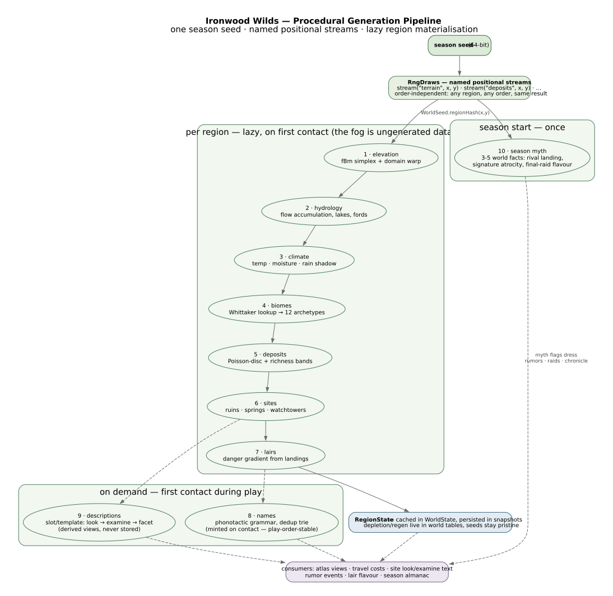

# Ironwood Wilds — Procedural Generation

> **Status:** planning document for `libs/procgen` (spatial/text generation)
> and the world-gen portions of `libs/wilds`. Builds on the existing
> `WorldSeed` scaffold (order-independent coordinate hashing) and inherits
> the slot/template description system designed in
> `planning/olderplanning/procgen_mvp.md`.

## 1. Philosophy

| # | Principle |
|---|---|
| PG1 | **Deterministic from the seed, order-independent.** Any region, site, or name can be regenerated at any time, in any visitation order, with identical results. `WorldSeed.regionHash(x, y)` is the primitive this hangs from — it already exists in the repo. |
| PG2 | **Layered passes.** World generation is a pipeline of small pure passes; each pass consumes the previous pass's output and is independently testable. |
| PG3 | **Lazy materialisation.** Nothing exists until touched. The fog of war is not hidden data — it is *ungenerated* data. A season's live footprint is only the regions players have walked. |
| PG4 | **Text is first-class.** Descriptions are generated with the same rigour as terrain: layered detail, look → examine grammar (the procgen_mvp dream, now with a game to live in). |
| PG5 | **Tunables as data.** Every density, curve, and table lives in rules tables (Architecture A5) so a season can tune the world's character, and the Stat-course fantasy — "tweak the population, test the hypothesis" — falls out for free: change rules, re-run the same seed, diff the worlds. |

## 2. Seed hierarchy — the determinism spine

One 64-bit **season seed**. Everything derives through named, positional
streams — never a shared mutable RNG:

```java
// libs/procgen
public record WorldSeed(long value) {                    // exists
    public long regionHash(int x, int y) { … }           // exists
}

// new, pure derivation helpers:
public final class RngDraws {
    public SplittableRandom stream(String purpose, int rx, int ry) { … }
    // stream("terrain", 3, -2) ≠ stream("deposits", 3, -2) ≠ stream("names", 3, -2)
    public SplittableRandom entityStream(String purpose, long entitySeq) { … }
}
```

- `purpose` strings are compile-time constants listed in one registry file —
  adding one is a code change (and shows up in the golden diff).
- **Engine draws** (combat rolls, event checks) use
  `entityStream("combat", expeditionSeq)` style streams keyed by the global
  `seq` counter (Architecture §4.2) — replay-stable regardless of heap
  interleaving.
- No stream result is ever *stored* as a substitute for re-derivation;
  materialised outcomes (a mined-out deposit) live in world tables as
  normal state.

## 3. The pipeline

```text
season seed
  └─ pass 1  landmass & elevation      (fBm simplex + domain warp)        ── per region tile
        └─ pass 2  hydrology           (downhill flow, wetlands, fords)
              └─ pass 3  climate       (temperature/moisture by latitude + elevation)
                    └─ pass 4  biomes  (Whittaker-style lookup table → 12 launch biomes)
                          └─ pass 5   deposits  (Poisson-disc spacing per biome; richness bands)
                                └─ pass 6  sites    (ruins, springs, watchtowers; suitability + spacing)
                                      └─ pass 7  lairs    (danger gradient from each landing)
                                            └─ pass 8  names   (grammar; see §5)
                                                  └─ pass 9  descriptions (slot/template; see §6)
                                                        └─ pass 10 season myth (§7)
```

Passes 1–4 run per region on materialisation; passes 5–7 run per region at
materialisation but consult *neighbourhood* windows (a deposit can straddle
a border — resolved deterministically by always assigning it to the
lower-packed region); passes 8–10 are world-level but lazy (names minted on
first contact, myth facts fixed at season start).



### 3.1 Launch technique per pass

| Pass | Technique | Why this one |
|---|---|---|
| Elevation | Simplex fBm (5–6 octaves) + domain warping for ridge character | Cheap, tileable-free, warp kills the "obviously Perlin" look in text too (descriptions sample it) |
| Hydrology | steepest-descent flow accumulation on the elevation grid; lakes where flow stalls | Gives *rivers you can forage and ford*, which feed names (`-ford`, `-mere`) and travel costs |
| Climate | Latitude band + elevation lapse + rain shadow from prevailing wind | Produces believable ironwood habitat bands (wet, temperate, old) — scarcity is *geographic*, so it's mappable and trade-off-y |
| Biomes | Lookup (temp × moisture) → 12 archetypes (Old Forest, Ironwood Grove [rare], Fen, Barrens, …) | Deterministic table, instantly tunable (PG5) |
| Deposits | Poisson-disc sampling (seeded) per biome; richness = depth band × bonus draw | Blue-noise spacing feels natural ("deposits are 8–15 tiles apart") and is statistically testable |
| Sites | Suitability scoring (flat, near water, near old roads) + minimum spacing | Ruins cluster where civilisation *would have been* — feeds the myth pass |
| Lairs | Danger gradient: distance from each household landing × biome hostility | The awareness dial (Gameplay §8) modulates *severity*, lair placement stays fixed — fair and plannable |
| Roads (later) | A* between generated sites on travel-cost grid | v2; gives caravans and ambush poetry |

### 3.2 Region materialisation contract

```java
public record Region(int x, int y) {}
public sealed interface RegionPass { RegionState run(Region r, RngDraws rng, Neighbourhood n); }
// engine side:
public record RegionState(byte[] elevation, byte[] biome, List<DepositSeed> deposits,
                          List<SiteSeed> sites, List<LairSeed> lairs, NameBlock names) {}
```

- A region is materialised **once**, on first contact (a character enters, a
  scout glimpses across a border, a rumor names it), then cached in
  `WorldState` and persisted in snapshots. Re-derivation must equal the
  cache (golden test).
- **Depletion is not re-generation**: mining out a deposit writes a row in
  world tables; the region's `DepositSeed` stays pristine underneath (so
  regen/replay stays pure). Regen timers are heap heartbeats over those
  rows, never re-rolls.

## 4. Numbers (defaults, all tunable — PG5)

| Knob | Default |
|---|---|
| Region size | 48×48 tiles |
| Tile travel cost | 1 tick baseline; ×2 fen, ×3 slope-up, road ×0.5 (later) |
| Deposit density | ~1 per 180 tiles (biome-weighted) |
| Ironwood groves | ≤2 per *world*, wet-temperate only, ≥6 regions from every landing |
| Sites | ~1 per 90 tiles (ruins weighted toward old-road + river tiles) |
| Lairs | ~1 per 4 regions, danger scaling with distance from nearest landing |
| Names per region | minted on demand, deduplicated against a world-wide used-set (deterministic walk order) |

Ironwood scarcity is a *launch rule*, not folklore: the rare-tree economy
(GP-D7's absurd Favor rate) needs geography players can discover, argue
about, and chronicle.

## 5. Name grammar

Layered, phonotactically constrained, low-fantasy register:

```text
given names   → syllable grammar (onset/nucleus/coda tables, hard consonant clusters allowed, no apostrophes — house style)
place names   → [root] + [suffix | compound]  e.g.  Harrow + ford, Dun + mere, Ash + cot, Iron + holt
households    → trade-noun compounds (Ashford, Elmswell, Harlow) — surnames for births (samvillage lineage)
lairs/creatures → dread-register roots (Barrow-, Gnarl-, Grimm-, -maw, -holt)
```

- Tables live in rules (PG5); the grammar engine is ~200 lines of pure Java
  (trie for the used-set, weighted draws from `stream("names", rx, ry)`).
- Determinism subtlety: names minted *on demand* depend on contact order —
  which is replay-stable (the command log defines contact order, AR-D2) but
  not seed-stable across different playthroughs. That is acceptable and
  documented: **seed defines the world; play defines its names.** Sites the
  myth pass names at season start are the seed-stable exceptions.

## 6. Descriptions — the slot/template system (procgen_mvp, ported)

The old plan's rooms→items→details hierarchy becomes
sites→objects→facets, same engine:

```yaml
# conceptually (in Java: record templates in rules, not YAML — see note)
site.old_watchtower:
  look:     "A {condition} watchtower of {stone} leans over the {feature}."
  slots:
    - category: rubble        # 0..2 objects
    - category: marker        # 0..1  (scratched tally, weathered sign)
  tables:
    condition: [leaning, half-fallen, moss-eaten]
    stone:     [grey granite, iron-flecked slate, soft sandstone]
  examine:
    marker: "{marker_desc} Beneath the lichen, {tally_note}."   # facet recursion
```

**Note on format:** the old plan used YAML files; in this Java repo the same
data lives as immutable record tables in `libs/wilds/rules/Descriptions.java`
(code-as-data, Architecture A5) so libs stay I/O-free. The *shape* — slots,
categories, global tables, wear levels, `_list`/`_desc` composition,
singular/plural — is ported wholesale from procgen_mvp §3, which already
solved the relational-composition problem.

- Detail is layered (PG4): **glance** (map/log line) → **look** (room/site)
  → **examine** (object) → **facet** (recursion depth ≤2 at launch).
- Descriptions are *derived views*, generated on demand from region state +
  world state (wear = depletion/usage rows) and never stored — the same
  seed + same state must produce the same paragraph (golden text tests with
  bounded variety assertions: ≥N distinct renders per site over 1k draws).

## 7. Season myth (the enemy's shape)

At season start, one draw from `stream("myth", 0, 0)` fixes 3–5 **world
facts** (data flags + a paragraph each):

- which region the rival expedition landed; whether they are desperate,
  brazen, or dying;
- the signature atrocity/artefact the chronicle will slowly uncover
  (a burned ironwood, a mass grave, a rival beacon still burning);
- the season's final-raid flavour (Gameplay §9's narrative climax).

Facts feed: rumor events (awareness dial, GP-D9), lair flavour text, ruin
descriptions (the description system reads myth flags like any other
table), and the season almanac (Gameplay P7). This is how "kept fairly open
ended" (the brief) becomes *mechanically real*: the mystery is 3–5 seeded
flags with strong text dressing, not a branching narrative system to
maintain.

## 8. Testing & tooling

| Tool | What it does |
|---|---|
| `apps/wilds-headless gallery --seed S` | renders ASCII biome/elevation/site maps to the terminal (and PNG later); the eyeball pass for every rules change |
| Golden region hashes | materialise region (x,y) for a fixed seed set → hash `RegionState`; any pipeline change bumps goldens deliberately |
| Distribution assertions | over 10k regions: biome frequencies within bounds, deposit spacing stats (Poisson chi-square-ish), ironwood cap respected |
| Name grammar tests | phonotactic validity, used-set dedup, register sanity (no apostrophes!) |
| Description variety | bounded-variety renders; no identical paragraph within a site's 1k renders |
| Myth coherence | facts → rumor events wiring fires at expected cadence in a scripted season soak |

## 9. Deferred (recorded, not built)

Wave-function-collapse ruin interiors (when expeditions get *inside*
lairs); A* roads & caravans; DF-style deep-history simulation; region-level
ecosystem simulation (predator/prey drift); player-facing map *rendering*
beyond ASCII. Each has a seam already (passes are additive; descriptions
recurse; rules are data).

## 10. Decision digest

| # | Decision |
|---|---|
| PG-D1 | One season seed; named positional `RngDraws` streams; no stored randomness |
| PG-D2 | Ten-pass pipeline, pure per pass, lazy per region |
| PG-D3 | Depletion = world-table rows over pristine seeds (regen = heartbeats, never re-rolls) |
| PG-D4 | Names: on-demand minting is play-order-stable, not seed-stable; myth names are seed-stable |
| PG-D5 | Descriptions: procgen_mvp slot/template system ported to record tables; derived, never stored |
| PG-D6 | Myth = 3–5 seeded flags dressing the awareness/raid machinery |
| PG-D7 | All knobs in rules tables → same-seed/different-rules world diffs (the hypothesis-testing tool) |
