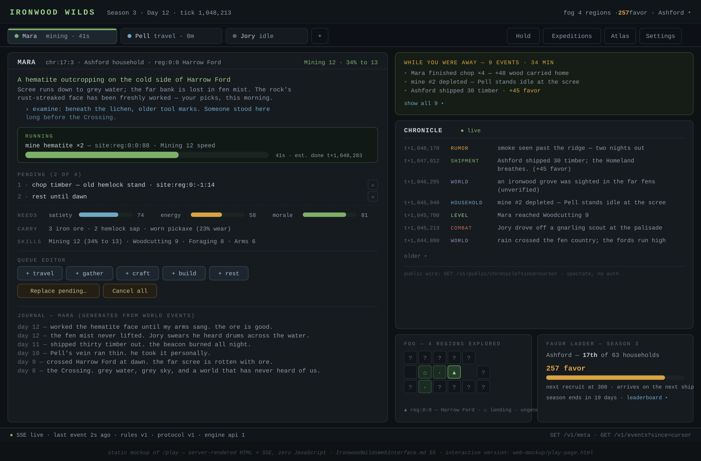

# Ironwood Wilds — Web Interface & Client API Surface

> **Status:** planning document. Covers (a) the HTTP/SSE API surface every
> client shares, (b) the fog-of-war observation model, and (c) the
> server-rendered web UI with its tabs-per-character shape. Aligns with
> PROJECTS.md's stated intent for `apps/wilds-server`: "server-rendered
> multi-tab HTML UI".

## 1. One protocol, three audiences

| Audience | Uses | Needs |
|---|---|---|
| **Human (browser)** | HTML pages + SSE + form posts (all backed by the same JSON API) | Tabs per character, queue editing, event feed, readable text — and nothing to install |
| **Bot** | REST + SSE JSON | Complete read surface, documented error codes, idempotent writes (see [Commands](IronwoodWildsCommands.md) §8) |
| **Spectator** | Public read-only subset | Fogged world views, chronicle wire, leaderboards — the show-off surface (Gameplay P7) |

The web UI is *a client*, not the game. It holds no rules and no state
beyond the session token; every number it renders comes from the API. This
is what keeps bots permanently first-class and the UI permanently cheap.

## 2. API surface (v1)

### 2.1 Session & account

| Method & path | Purpose |
|---|---|
| `POST /v1/account/register` | email + password → account (argon2id hash) |
| `POST /v1/account/login` | → bearer token (opaque, sha256-at-rest, 30-day expiry) |
| `POST /v1/account/logout` · `GET /v1/account/me` | session hygiene |
| `POST /v1/household` | found the season household (name, crest choice, landing pick from 3 offered sites) |

### 2.2 Reading the world (auth-scoped)

| Method & path | Purpose |
|---|---|
| `GET /v1/meta` | nowTick, season id/ends-at, rulesVersion, protocol versions |
| `GET /v1/rules` | every rules table verbatim (actions, skills, tech tree, rates, biome tables) |
| `GET /v1/household` | roster, favor, tech state, awareness level, beds/cap |
| `GET /v1/characters` · `GET /v1/characters/{id}` | full colonist view incl. queue, journal tail |
| `GET /v1/characters/{id}/queue` | running + pending with ETAs |
| `GET /v1/world/atlas?region=x,y` | fogged region view (explored tiles, known sites, travel costs) |
| `GET /v1/sites/{id}` | site detail + generated look/examine text |
| `GET /v1/hold` | buildings, defense plan, stockpiles, beacon manifest |
| `GET /v1/expeditions` · `GET /v1/expeditions/{id}` | party, loadout, standing order, event log |
| `GET /v1/events?since=cursor` | household event log tail (monotonic cursor — the samvillage §5.2 heritage) |
| `GET /v1/stream` (SSE) | live push of the same events + queue ETA ticks |

### 2.3 Spectator (public, no auth)

| Method & path | Purpose |
|---|---|
| `GET /v1/public/chronicle?since=cursor` | world wire: rumors, shipments, raids, deaths, ironwood sightings |
| `GET /v1/public/leaderboard` | favor ladder for the season |
| `GET /v1/public/world` | heavily fogged world summary (region-level: which are contested, which burn) |

### 2.4 Mutations

All through `POST /v1/commands` (Commands doc §2) — one endpoint, sealed
type family. The web UI posts the same envelopes via small forms/fetch
calls; there are **no UI-only endpoints** to drift out of sync.

## 3. Fog of war & observations

Clients never receive `WorldState`. They receive **projections**:

```java
public record HouseholdObservation(             // built from published WorldView (Architecture §6)
    long asOfTick,
    List<ObservedCharacter> roster,             // own characters: full detail
    List<ObservedRegion> atlas,                 // explored regions only: known tiles, sites, lairs *scouted*
    ObservedHold hold,
    List<ObservedRumor> rumors                  // chronicle-visible world events, fogged text
) {}
```

- Exploration is per household: tiles seen by any of your characters
  (± sight radius; scouting reveals region-wide summaries).
- Rumors are the leaky window into other households' drama — the chronicle
  projector emits *fogged* variants to non-participants ("a shipment of
  iron left the eastern fens" — whose? maybe yours to guess).
- Projections are pure functions of (WorldView, householdId) → cacheable,
  trivially testable, and the *only* shape clients couple to.

## 4. SSE stream

- One stream per session token: `GET /v1/stream?since=cursor`.
- Event types: `action.started/completed/failed`, `xp.gained`,
  `level.up`, `shipment.*`, `raid.warning/resolved`, `expedition.*`,
  `colonist.born/died`, `rumor.heard`, `world.heartbeat` (1 Hz nowTick).
- Server sends SSE comments as keepalives; clients treat `since` cursor +
  `GET /v1/events` as the catch-up path after any disconnect — SSE is an
  optimization over polling, never a correctness dependency.
- Why SSE and not WebSockets: unidirectional push is all the game needs
  (mutations are rare, reads are continuous); SSE auto-reconnects, proxies
  love it, and it degrades to polling without code changes. WebSockets
  revisit only if a chat-like feature ever lands (explicit non-goal v1,
  Gameplay §10).

## 5. The web UI

### 5.1 Shape — the "tabs" brief, taken literally

```text
┌─ Ironwood Wilds ── Season 3 · Day 12 ── Fog: 4 regions ─────────────────┐
│ [ Mara †mining 41s ] [ Pell †travel 8m ] [ Jory · idle ] [ + ]  ⚙  ⌂  ⚔  │ ← character tabs
├──────────────────────────────┬───────────────────────────────────────────┤
│ TAB: Mara (chr:17:3)         │ CHRONICLE (live)                          │
│                              │  ▸ smoke seen past the ridge — two nights │
│ You are at a hematite        │  ▸ Ashford shipped 40 iron; favor +212    │
│ outcropping on the cold      │  ▸ an ironwood grove was sighted…         │
│ side of Harrow Ford…         │  ▸ your mine #2 depleted                  │
│                              │                                           │
│ RUNNING  mine ×2  ▓▓▓▓░░ 41s │ QUEUE EDITOR                              │
│ PENDING  chop, rest          │  [+ travel…] [+ gather…] [+ craft…] …     │
│ Needs: ▓▓▓░ food  ▓▓░░ rest  │  [Replace pending]  [Cancel]              │
└──────────────────────────────┴───────────────────────────────────────────┘
   ⌂ Hold pane (buildings, defense plan, beacon)   ⚔ Expeditions (parties, dispatch)
```

- **One tab per character**, plus hold/expedition panes — exactly the
  "click through tabs, control that person" mental model from the brief.
  Idle characters say `idle` in the tab and never nag.
- **The log pane is the game's face**: chronicle on the right, generated
  descriptions on the left. Terminal-chic dark theme, monospace, generous
  line height. Text is the aesthetic; the UI's job is typography and
  cursors, not chrome.
- ETAs tick down via `world.heartbeat`; no polling of full state.

**Mockup** — a full static mockup of this page ships with the suite:
openable HTML at [web-mockup/play-page.html](web-mockup/play-page.html)
(zero JavaScript, exactly the delivery model above) with a raster preview
below. All numbers are fake but internally consistent with the worked
session in [Prototype](IronwoodWildsPrototype.md) §3 — Ashford, Day 12 of
Season 3, Mara mid-mining, the raid rumor already on the wire.



### 5.2 Rendering approach — decision

| Option | Pros | Cons | Verdict |
|---|---|---|---|
| **A. Server-rendered HTML + tiny vanilla JS (~300 lines) + SSE** | No build step, no node_modules, no SPA state bugs; HTML *is* the API client; matches repo's no-framework ethos end to end | Interactivity is modest (fine — the game is slow) | **Chosen** |
| B. SPA (React/Svelte) + JSON | Rich client | Second toolchain, second state model to keep in sync with a protocol that already has one; overkill for forms + feeds | No |
| C. htmx-style partial swaps | Middle ground, fun | One more dependency & mental model vs ~300 lines of fetch | Revisit if A's JS grows past ~1k lines |

Java-side: a hand-rolled `Html` builder (escape-by-default, no template
engine, no annotation processing — house rules) + static CSS/JS resources.
Every page also works with JS disabled (forms post natively; feeds fall
back to meta-refresh) — the samgenai-studio precedent of "server-side
renders everything, JS is garnish" is the house pattern already.

### 5.3 Pages

| Page | Contents |
|---|---|
| `/` landing | Season banner, chronicle preview, login/register, "what is this" |
| `/play` | The tabbed cockpit (above) |
| `/hold` | Buildings, stockpiles, defense plan editor (forms → `writeDefensePlan`) |
| `/expeditions` | Parties, loadouts, standing-order editor, dispatch |
| `/atlas` | Explored-region ASCII map (`<pre>` grid, tiles link to descriptions) |
| `/chronicle` | Full wire with filters |
| `/rules` | Human rendering of `GET /v1/rules` (also the bot documentation) |
| `/account` | Sessions, household, season legacy |

## 6. Auth model (web + bot unified)

- Bearer tokens for everyone (browser stores token in a session-scoped
  cookie set at login; bots keep it in memory/config). Same middleware,
  same rate limits.
- CSRF: web forms carry a per-session token; `POST /v1/commands` with
  `Authorization` header (bots) bypasses CSRF by construction.
- Passwords: argon2id. No email verification in the slice; email is a
  recovery handle only (Persistence doc §3).

## 7. Offline behavior & mobile

- The server keeps queuing; the UI on next load shows "while you were away"
  (events since last cursor) — a chronological digest, not a state dump.
- Tabs/panes are responsive stacks on mobile; the game is *designed* for
  check-in cadence (queue 4 actions, close tab, return in an hour), which
  is the phone-native rhythm anyway.

## 8. Decision digest

| # | Decision |
|---|---|
| WI-D1 | One REST+SSE protocol; UI is a client with zero private endpoints |
| WI-D2 | SSE for push; polling with cursor as first-class fallback; no WebSockets v1 |
| WI-D3 | Fog = projection records (`HouseholdObservation`), pure functions of WorldView |
| WI-D4 | Server-rendered HTML + ~300 lines vanilla JS; hand-rolled Html builder; no template engine, no SPA |
| WI-D5 | Tabs = characters; hold/expedition panes; chronicle always visible |
| WI-D6 | Public spectator API (chronicle/leaderboard/fogged world) from day one |
| WI-D7 | Unified bearer auth for humans and bots; argon2id |
