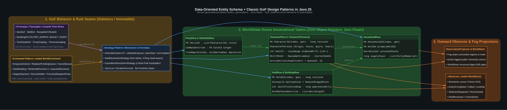

# 01 — Server Architecture, Entity Schemas & Design Patterns

> **Phase 0 reality note.** This document is the target design; the code that exists after Phase 0 is summarised in [Current Status](README.md#current-status) and the [engine noun mapping](README.md#engine-primitives-vs-gameplay-nouns). Neutral engine IDs are permanent: `OwnerId`, `ActorId` and `PlaceId` (generational `(index, generation)` records in `com.kotharworks.wilds.id`) are baked into the WAL, the wire format, `EventPayloadCodec` and SQL, and are never renamed; gameplay is layered on as state tables, `RuleRegistry` families and DTO fields keyed by those IDs. The code samples below use historical names: `CharacterId` is now `ActorId`, `HouseholdId` is `OwnerId`, `SiteId` is `PlaceId`, and `HoldId` becomes a future table keyed by `OwnerId`. **Implemented:** generational IDs, `EntityTable`, `LazyGauge` and `DueEventHeap` ([Ticket 02](../../tickets/done/02-generational-tables-gauges-and-event-heap.md)); `WorldState`, `RuleRegistry`, `WorldHash` and the codecs ([Ticket 03](../../tickets/done/03-neutral-world-state-rules-and-procgen-seams.md)); the `WorldHost` single writer with Commit-Before-Mutate ([Ticket 07](../../tickets/done/07-server-worldhost-rest-and-sse-inmemory.md), [Ticket 08](../../tickets/done/08-postgres-schemas-migrator-and-jdbi-adapters.md)). **Planned (Phase 1 onward, see the [Phase 1 index](../../tickets/README.md)):** `ActionMechanic`, combat and raid strategies, personas, holds, buildings and parties.

A simulation server that must run live for weeks **and** fast-forward 1,000× in a headless genetic-algorithm harness succeeds by pairing **Data-Oriented Java 25** with **classic GoF Design Patterns**, each strictly in the layer it was born for:

1. **Dense Flat Entity Schemas** store *what the world IS* (`WorldState`: characters, personas, holds, buildings, parties, site deltas—zero object-pointer webs, zero floats).
2. **Classic Design Patterns (`Command`, `Strategy`, `Prototype/Flyweight`, `Observer`, `Ports & Adapters`)** govern *how the world CHANGES and EXTENDS*.



> *Graphviz artifacts:* [`02-entity-schema-and-patterns.dot`](diagrams/02-entity-schema-and-patterns.dot) · [`SVG`](diagrams/02-entity-schema-and-patterns.svg) · [`PNG`](diagrams/02-entity-schema-and-patterns.png)  
> *Full server topology:* [`01-system-architecture.dot`](diagrams/01-system-architecture.dot) · [`SVG`](diagrams/01-system-architecture.svg) · [`PNG`](diagrams/01-system-architecture.png)

---

## 1. Why Classic Mutable OOP Graphs Break Simulation Engines

Modeling a colony sim as mutable objects holding direct references to each other (`Character -> Hold -> List<Building> -> Character`) creates four guaranteed headaches:
1. **Snapshot & Replay Pain:** Serializing cyclic reference graphs to Postgres JSONB checkpoints (or cloning worlds mid-run for GA rollouts) requires brittle graph mappers.
2. **Dangling Pointers & Stale Handles:** When a colonist dies in a barrow or a building is razed, stray references corrupt state.
3. **Non-Deterministic Iteration:** Mutating across `HashSet`/`HashMap` reference webs leaks JVM identity-hashcode order into simulation outcomes, breaking `WorldHash` replay equality.
4. **Read/Write Lock Contention:** HTTP/SSE Virtual Threads reading mutable domain objects while the simulation thread mutates them cause races or lock stalls.

---

## 2. Flat Entity Tables + Generational Typed IDs (`AGENTS.md` Standard #3)

Instead of object webs or heavyweight ECS frameworks, `WorldState` is structured like an **in-memory columnar/relational store** of immutable Java 25 `record` rows stored in **dense arrays** and addressed by **generational value IDs**:

### 2.1 Generational Value IDs (Type Safety + Stale-Handle Detection)
Every entity ID carries its dense table `index` and slot `generation` (serialized compactly on the wire as `"chr:17:3"`, `"hld:0:1"`, `"site:42:1"`):

```java
package com.kotharworks.wilds.id;

public record HouseholdId(int index, int generation) {}
public record CharacterId(int index, int generation) {}
public record HoldId(int index, int generation) {}
public record BuildingId(int index, int generation) {}
public record SiteId(int index, int generation) {}
public record PartyId(int index, int generation) {}
public record RuleId(String slug) {} // e.g., RuleId("wrought_iron_pickaxe")
```

Why `(int index, int generation)` over raw `long` + `HashMap`?
- **O(1) Array Indexing & Zero Boxing:** Lookup is `characters[id.index()]` followed by `row != null && row.id().generation() == id.generation()`.
- **Deterministic Scans:** Scanning `0 .. characters.length - 1` always runs in exact slot-index order—never `HashMap` bucket order.
- **Automatic Stale-Handle Safety:** If slot `17` is ever recycled in `generation 4`, a bot submitting an old command for `chr:17:3` fails cleanly at Phase 1 with `UNKNOWN_TARGET`.

### 2.2 Pure Data Entity Rows (Including Procedural `CharacterPersona`)
Every row is an immutable `record` holding **only integer/enum scalars, value records, and typed IDs**:

```java
package com.kotharworks.wilds.state;

public record CharacterPersona(
    String givenName,
    String surnameOrOrigin,        // e.g., "Ashford" or "of Greywater"
    RuleId originId,               // e.g., "disgraced_watch_sergeant"
    Temperament voice,             // STOIC | WRY | GRIM | SUPERSTITIOUS | EARNEST | METICULOUS
    RuleId habitQuirkId,           // e.g., "notches_tally_marks"
    List<LifeMark> lifeMarks       // scars, masterworks, fallen-comrade bonds
) {}

public record CharacterRow(
    CharacterId id,
    HouseholdId householdId,
    long revision,                 // monotonic state/queue revision -> optimistic expectedRevision (409 STALE_STATE)
    CharacterPersona persona,      // seeded procedural character & history!
    LocationRef location,          // sealed: AtHold(HoldId) | AtSite(SiteId) | InParty(PartyId)
    boolean alive,
    int health,                    // 0..100 (0 = dead, only via PvM violence)
    int maxHealth,
    LazyGauge staminaMilli,        // integer milli-units 0..100_000 (ZERO floats!)
    SkillSheet skills,             // compact int[] of XP indexed by SkillId ordinal
    EquipmentLoadout equipment,    // RuleId slots + integer durability permille
    ActiveAction activeAction,     // nullable: startedMs, dueAtMs, heapTicket, ActionSpec, batchesLeft
    List<ActionSpec> pendingQueue, // immutable list, max length 5
    QueueFailurePolicy failPolicy, // ADVANCE (default) | HALT_ON_FAIL
    List<JournalEntrySeed> journal // bounded ring of recent event seeds -> rendered via procgen
) {}

public record HoldRow(
    HoldId id,
    HouseholdId ownerId,
    long revision,                 // monotonic hold/doctrine/staging revision -> optimistic expectedRevision
    SiteId clearingSiteId,
    String name,
    Stockpile baileyStock,         // integer item counts; exposed beyond vaultProtectedCap
    Stockpile beaconStagedStock,   // staged for next Homeland Tithe Ship heartbeat
    int vaultProtectedCap,         // derived from Keep/Vault buildings -> 100% raid-immune
    List<BuildingId> buildings,    // ordered list
    HoldDefenseDoctrine defenseDoctrine,
    long awarenessMilli            // personal raid-escalation dial (integer milli-points)
) {}
```

### 2.3 `WorldState` — The Complete Universe in One Deterministic Struct
```java
public final class WorldState {
    private final WorldSeed seed;
    private final MythFacts mythFacts;     // 3–5 seeded Chronicle mystery flags
    private final int rulesVersion;
    private long nowMs;
    private long nextEventSeq;

    // Dense generational tables — O(1) lookup, deterministic index iteration, trivial WorldHash!
    private final EntityTable<HouseholdId, HouseholdRow> households;
    private final EntityTable<CharacterId, CharacterRow> characters;
    private final EntityTable<HoldId, HoldRow> holds;
    private final EntityTable<BuildingId, BuildingRow> buildings;
    private final EntityTable<PartyId, PartyRow> parties;

    // Sparse procedural deltas (sorted/tree or deterministic array-backed map):
    // Unvisited regions/sites consume ZERO RAM until scouted or mined!
    private final TreeMap<Integer, RegionMaterialised> materialisedRegions = new TreeMap<>();
    private final TreeMap<Integer, SiteDeltaRow> siteDeltas = new TreeMap<>();

    // Deterministic (dueAtMs, seq) min-heap
    private final DueEventHeap dueEvents = new DueEventHeap();
}
```

---

## 3. Five Classic Design Patterns for Behavior & Extensibility

### Pattern 1: Prototype / Flyweight -> Compile-Time `RuleRegistry` (`WILDS_RULES_VERSION`)
Instead of subclassing `class IronPickaxe extends Item` (class explosion) or writing a custom YAML parser in `libs/` (I/O & parser bugs), static content blueprints live as **compile-time-checked immutable Java 25 record tables** inside `libs/wilds/rules` and `libs/procgen`:

```java
public record ItemDef(RuleId id, String singular, String plural, int weightStones, int baseTitheFavor) {}

public record BuildingDef(
    RuleId id, String name, HoldRing ring, // OUTER_WORKS | BAILEY | KEEP
    RuleId requiredTech, Map<RuleId, Integer> buildCost,
    long requiredWorkMs, int maxCondition, List<BuildingEffect> effects
) {}
```
- **Zero I/O Purity:** `libs/wilds` and `libs/procgen` load instantaneously with zero filesystem reads.
- **Self-Describing Wire Contract:** `GET /api/v1/rules` serializes `RuleRegistry` + `WILDS_RULES_VERSION` verbatim so the Web UI and external bots never hardcode item IDs, XP tables, or tech prerequisites.

### Pattern 2: Command Pattern -> `sealed interface WorldCommand` + Exhaustive `switch`
Every player/bot mutation is an immutable Java 25 `record` in a closed `sealed` family:

```java
public sealed interface WorldCommand {
    record FoundHousehold(HouseholdId id, String houseName, SiteId landingSite) implements WorldCommand {}
    record EnqueueActions(HouseholdId actor, CharacterId characterId, Long expectedRevision, List<ActionSpec> actions) implements WorldCommand {}
    record ReplacePendingQueue(HouseholdId actor, CharacterId characterId, Long expectedRevision, List<ActionSpec> actions) implements WorldCommand {}
    record CancelQueue(HouseholdId actor, CharacterId characterId, Long expectedRevision, boolean cancelActive) implements WorldCommand {}
    record SetQueueFailurePolicy(HouseholdId actor, CharacterId characterId, Long expectedRevision, QueueFailurePolicy policy) implements WorldCommand {}
    record StartBuilding(HouseholdId actor, HoldId holdId, RuleId buildingDefId) implements WorldCommand {}
    record WriteHoldDoctrine(HouseholdId actor, HoldId holdId, Long expectedRevision, HoldDefenseDoctrine doctrine) implements WorldCommand {}
    record StageShipment(HouseholdId actor, HoldId holdId, Long expectedRevision, Map<RuleId, Integer> manifest) implements WorldCommand {}
    record RecruitSettler(HouseholdId actor, HoldId holdId) implements WorldCommand {}
    record FormAndDispatchParty(HouseholdId actor, HoldId holdId, String partyName,
                                List<PartyMemberSpec> roster, SiteId targetLair, CombatDoctrine doctrine) implements WorldCommand {}
}
```
Because `CommandDispatcher` uses an exhaustive `switch` under `-Werror`, **adding a new command type is a compile-time error everywhere it must be handled**, and the exact command record (including optional `expectedRevision` optimistic-concurrency guards) serializes 1:1 into `wilds_world.command_wal`.

### Pattern 3: Strategy Pattern -> `ActionMechanic<P>`, Formula Curves & Bot `Doctrine`
- **`ActionMechanic<P>`:** Each action family (`TRAVEL`, `GATHER`, `CRAFT`, `CONSTRUCT`, `REPAIR`, `RESEARCH`, `REST`, `MUSTER_PARTY`) implements `validateEnqueue`, `planStart`, `onComplete`, and `onCancel`. Most new gathering/crafting content is purely a new `RuleRegistry` row using the existing `GatherMechanic` or `CraftMechanic`!
- **Tunable Formula `@FunctionalInterface`s:** `XpCurve`, `DurationFormula` (integer permille speed scaling), `YieldFormula`, `RaidResolutionStrategy`, and `CombatResolutionStrategy` swap cleanly for balance tests or statistical population experiments.
- **Bot/GA `Doctrine` Seam (`apps/wilds-bot`):**
  ```java
  @FunctionalInterface
  public interface Doctrine {
      List<CommandEnvelope> decide(HouseholdObservation obs, RulesSnapshot rules);
  }
  ```
  Ships in Slice 0 with a hand-written heuristic policy, and serves as the exact plug-in slot for evolved `SamVM` brains in Phase 2.

### Pattern 4: Observer / Cursor Pattern -> Outward-Only `WorldEvent`s
Entity-to-entity `Observer` callbacks inside a simulation are **banned** (they hide mutation order). Instead, mutations append typed `sealed interface WorldEvent` records (`ActionStarted`, `ActionCompleted`, `ActionFailed`, `LevelUp`, `ShipmentDeparted`, `RumorHeard`, `RaidWarningSighted`, `RaidResolved`, `ExpeditionResolved`, `ColonistDied`, `SettlerRecruited`) with a monotonic `cursor` to an outbox drained by `WorldHost` after each step—powering SSE streams, Character Journals, and fogged Chronicle rumors.

### Pattern 5: Hexagonal Architecture (`apps/wilds-server` + Reusable `libs/auth`)
`libs/procgen` and `libs/wilds` have zero ports/adapters and zero knowledge of users, JWTs, or HTTP. Authentication mechanisms live in the game-agnostic **`libs/auth`** module (`DevLocalJwtIssuer` on `127.0.0.1` and `OidcJwksAuthenticator` for Keycloak—see [`07-AuthAndSecurityArchitecture.md`](07-AuthAndSecurityArchitecture.md)), while hexagonal server boundaries live in `apps/wilds-server`:
- **Inbound Adapters:** JDK Virtual-Thread `HttpServer` wrapped by `AuthenticatedRouter` (`adapters/http` REST JSON, `adapters/sse` `/api/v1/stream`, `adapters/web` SSR HTML Multi-Tab UI) + `adapters/clock` (1 Hz live pump).
- **Outbound Ports & Adapters:** `AuthStorePort` (JIT `(issuer, subject) -> UserId` links, BFF sessions, and `iw_bot_...` keys), `WorldStorePort` (WAL + Snapshots + Projections), and `EventBusPort`—backed by **PostgreSQL/JDBI** in production and **`InMemory*Store`** in `< 200ms` integration tests and `--storage=memory` dev runs.

---

## 4. Concurrency Model: Single-Writer `WorldHost` + Lock-Free `WorldView` MVCC Reads

```text
  [VT: POST /api/v1/commands] ──┐
  [VT: 1 Hz Wall-Clock Pump ] ──┴──► Bounded Mailbox Queue ──► ┌─────────────────────────────────────────┐
                                                               │ WorldHost Single-Writer Thread          │
                                                               │ 1. Check cmdId idempotency              │
                                                               │ 2. Persist CLOCK_ADVANCE & advanceTo()  │
                                                               │ 3. Pure Phase-1 validate (+ revision!)  │
                                                               │ 4. Commit command_wal BEFORE mutating!  │
                                                               │ 5. Apply cmd -> mutate WorldState       │
                                                               │ 6. Persist append-only chronicle_events │
                                                               │ 7. Publish immutable WorldView + reply  │
                                                               │ 8. Drain events -> SSE EventBus         │
                                                               └────────────────────┬────────────────────┘
  [VT: GET /api/v1/household] ◄── Reads volatile immutable WorldView ───────────────┘ (IN-MEMORY MVCC · ZERO LOCKS!)
```

- **`SERIALIZABLE` Writes Without Mutexes:** Only the single `WorldHost` thread ever touches `WorldState`. One Chronicle maps to one `WorldHost` writer (scaling horizontally by sharding Chronicles if ever needed), while all CPU-heavy work—JWT verification, JSON parsing, HTML rendering, `examine` prose generation, and SSE fan-out—runs in parallel across all cores on Virtual Threads.
- **In-Memory MVCC (Zero Read Contention):** Because all entity rows are immutable `record`s (`CharacterRow`, `HoldRow`), `WorldHost` publishes an immutable `WorldView` snapshot reference after each committed step; thousands of `GET` requests read a consistent point-in-time view concurrently without locks or torn reads.
- **Strict Commit-Before-Mutate Discipline:** `WorldHost` never mutates `WorldState` or broadcasts SSE events before the corresponding `command_wal` entry (`WorldCommand` or `CLOCK_ADVANCE`) commits in Postgres—eliminating split-brain drift if the database throws `SQLException`.
- **Zero Engine Mode Flags:** Live mode pumps `advanceTo(nowMs)` at 1 Hz; `apps/wilds-headless` and Phase 2 `wilds-arena` simply call `advanceToNextEvent()` in a tight loop on 500 parallel `WildsEngine` instances across Virtual Threads.

---

## 5. Strict Determinism Discipline & Reviewable Gates

Every implementation PR/ticket in `libs/procgen` and `libs/wilds` is enforced by automated build gates:

| Determinism Rule | Automated Enforcement |
| :--- | :--- |
| **Zero wall-clock, I/O, or unseeded RNG in simulation libs (`libs/procgen`, `libs/wilds`)** | JUnit reflection architecture test scans `libs/procgen` and `libs/wilds` bytecode/imports and fails if `System.currentTimeMillis`, `System.nanoTime`, `Instant.now`, `Math.random`, `ThreadLocalRandom`, `java.io.File`, `java.nio.file`, `java.net`, `java.sql`, or `com.kotharworks.auth` appear. (`libs/auth` injects `java.time.Clock` for deterministic JWT expiry tests.) |
| **Zero `float` / `double` in `WorldState`** | Architecture test asserts all fields reachable from `WorldState` use integral types (`int`, `long`, `boolean`, `String`, enums, immutable collections/records). Speed modifiers and probabilities use permille/basis-point integer math (`1_000` = `1.0×`, `10_000` = `100%`). |
| **Zero `HashMap` / `HashSet` iteration in state logic** | Dense `EntityTable` arrays and `TreeMap` / insertion-ordered immutable lists only. |
| **Total causal ordering** | Heap ordered by `(dueAtMs, seq)`; commands stamped and logged in exact `wal_seq` order. |
| **`WorldHash` + Golden Replay Test (`M0`)** | Canonical structural SHA-256/XXH64 hash over `WorldState`. Fixed seed + multi-day command script must match the committed golden hash (`mvnd test -pl libs/wilds -DblessGolden=true` to intentionally update alongside a `WILDS_RULES_VERSION` bump). |
