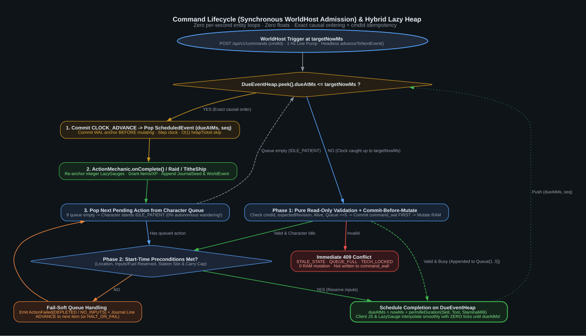

# 02 — Commands, Action Queues & Hybrid Lazy Simulation

Ironwood Wilds combines **multi-minute timed actions across short per-character queues** with **lazy evaluation** so idle worlds cost zero CPU and headless runs fast-forward in milliseconds—while guaranteeing **100% deterministic shared-world causality**.

---

## 1. Avoiding Both Naive Ticks and the Read-Time Lazy Trap

### Why Naive 1-Second Entity Loops Lose
Looping over 1,600 colonists, 200 holds, and 5,000 resource deposits every second just to execute `remainingTicks--` wastes 99% of cycles in an online game and forces a 7-day Genetic Algorithm rollout to execute `604,800` empty loops per trial.

### Why Pure Read-Time Lazy Evaluation Also Traps You
If you *only* evaluate a character when someone queries their tab (`GET /characters/aldric`), **query order corrupts shared world state**:
- Suppose an iron outcrop has **1 batch of ore left**.
- **Aldric** starts mining at `t = 0`, finishing at `t = 180_000 ms`.
- **Brenna** starts mining the same outcrop at `t = 10_000`, finishing at `t = 190_000 ms`.
- Nobody views Aldric until `t = 300_000`, **but** someone queries Brenna at `t = 200_000`!
- Pure read-time evaluation awards the last ore to Brenna even though **Aldric finished 10 seconds earlier**. The exact same causality bug hits if a settler finishes hauling iron into the Protected Vault 2 minutes before a Hold Raid strikes.

---

## 2. The Solution: Integer `LazyGauge` + Deterministic `DueEventHeap`



> *Graphviz artifacts:* [`03-command-and-lazy-heap-flow.dot`](diagrams/03-command-and-lazy-heap-flow.dot) · [`SVG`](diagrams/03-command-and-lazy-heap-flow.svg) · [`PNG`](diagrams/03-command-and-lazy-heap-flow.png)

We separate **continuous gauges** (interpolated purely by integer math, never ticked) from **discrete state transitions** (ordered in a binary min-heap):

### Half A: Continuous Values Use 100% Integer `LazyGauge` (Zero Ticks, Zero Floats!)
Stamina, satiety, awareness cooling, and passive wear are stored in **milli-units** (`0 .. 100_000` = `0.000 .. 100.000`) with integer rates per second—completely immune to IEEE-754 float drift:

```java
package com.kotharworks.wilds.sim;

/**
 * Pure integer linear gauge: 0 CPU ticks while untouched, 100% replay-deterministic.
 * Example: 100_000 milli = 100%, rateMilliPerSec = -25 means -1.5% per minute.
 */
public record LazyGauge(
    long anchorMilli,
    long anchorTimeMs,
    long rateMilliPerSec, // positive = regenerating, negative = draining
    long minMilli,
    long maxMilli
) {
    public long valueMilliAt(long nowMs) {
        if (nowMs <= anchorTimeMs || rateMilliPerSec == 0L) {
            return anchorMilli;
        }
        long elapsedMs = nowMs - anchorTimeMs;
        long deltaMilli = (elapsedMs * rateMilliPerSec) / 1_000L;
        return Math.clamp(anchorMilli + deltaMilli, minMilli, maxMilli);
    }

    /** Re-anchored ONLY when a discrete event modifies lump value or rate. */
    public LazyGauge reanchor(long nowMs, long lumpDeltaMilli, long newRateMilliPerSec) {
        long current = Math.clamp(valueMilliAt(nowMs) + lumpDeltaMilli, minMilli, maxMilli);
        return new LazyGauge(current, nowMs, newRateMilliPerSec, minMilli, maxMilli);
    }
}
```
Likewise, an active action stores `(startedAtMs, dueAtMs)`. Neither the engine nor SSE ticks progress every second—the browser tab computes `(nowMs - startedAtMs) / (dueAtMs - startedAtMs)` locally at 60fps!

### Half B: Discrete Completions Sit in `DueEventHeap` Ordered by `(dueAtMs, seq)`
Every discrete completion pushes one record onto a min-heap with a globally monotonic `seq` tie-breaker:

```java
public record ScheduledEvent(
    long dueAtMs,          // Exact logical millisecond of transition
    long seq,              // Strictly monotonic global counter -> total causal order!
    long cancellationToken,// Matches CharacterRow.activeAction.heapTicket (0L for world events)
    DuePayload payload     // CompleteAction(CharacterId) | RaidStrike(HoldId)
                           // | PartyBeat(PartyId) | TitheShipArrival | WorldHeartbeat
) implements Comparable<ScheduledEvent> {
    @Override
    public int compareTo(ScheduledEvent o) {
        int cmp = Long.compare(this.dueAtMs, o.dueAtMs);
        return (cmp != 0) ? cmp : Long.compare(this.seq, o.seq);
    }
}
```

### `advanceTo(targetNowMs)` — Offline Progress & Race Causality for Free
```java
public void advanceTo(long targetNowMs) {
    while (!dueEvents.isEmpty() && dueEvents.peek().dueAtMs() <= targetNowMs) {
        ScheduledEvent ev = dueEvents.poll();
        this.nowMs = ev.dueAtMs(); // Clock steps to exact event millisecond

        if (isStaleOrCancelled(ev)) {
            continue;              // O(1) lazy cancellation!
        }
        resolveDueEvent(ev);       // May chain next batch/queued action onto dueEvents!
    }
    this.nowMs = Math.max(this.nowMs, targetNowMs);
}
```
- **Aldric vs. Brenna Solved:** `advanceTo(300_000)` pops Aldric at `180_000` first (takes last ore), then pops Brenna at `190_000` (receives `ActionFailed(DEPLETED)` and advances her queue).
- **Live vs. Headless:** In `apps/wilds-server`, a 1 Hz wall-clock pump calls `advanceTo(currentLogicalMs)` (a single heap-head peek when idle) so SSE events push within ~1s. In `apps/wilds-headless` and GA evolution, `advanceToNextEvent()` jumps over hours of idle wait in ~150 nanoseconds.

---

## 3. Wire Command Envelope, `cmdId` Idempotency, `expectedRevision` & Commit-Before-Mutate Admission

### 3.1 One Mutation Endpoint: `POST /api/v1/commands`
Humans (browser forms/fetch) and bots share **one** polymorphic command endpoint—zero UI-private routes:

```json
POST /api/v1/commands
Authorization: Bearer iw_bot_9f8a2c11_...
{
  "cmdId": "01934e2a-7c10-7b32-9a14-8d2f4e6a9012",
  "type": "enqueue",
  "character": "chr:0:1",
  "expectedRevision": 12,
  "actions": [
    { "kind": "TRAVEL", "targetSite": "site:4:1" },
    { "kind": "GATHER", "targetSite": "site:4:1", "node": "hematite_seam", "batches": 3 },
    { "kind": "TRAVEL_HOLD", "hold": "hld:0:1" },
    { "kind": "DEPOSIT_ALL", "hold": "hld:0:1" }
  ]
}
```

- **`cmdId` (UUIDv7 — Mandatory Idempotency Key):** Safely deduplicates network retries.
- **`expectedRevision` (`Long` — Optional Optimistic Concurrency / ETag Guard):** Every `CharacterRow` and `HoldRow` carries a monotonic `long revision` (incremented whenever a command mutates its queue/doctrine **or** when `DueEventHeap` finishes/advances an action). Callers may omit `expectedRevision` (`null`) for unconditional fire-and-forget appends, while the `/play` Web UI **always** sends `expectedRevision` on `replace_queue`, `cancel_queue`, `set_fail_policy`, `write_hold_doctrine`, and `stage_shipment` so a stale browser tab never silently clobbers an action that just transitioned underneath the user (`409 STALE_STATE`).

### 3.2 Avoiding Both Pre-Mailbox TOCTOU Races and RAM/DB Split-Brain (`WorldHost`)
> **Critical Implementation Rules:**
> 1. **Never validate on HTTP threads:** Validating dynamic state (`character alive?`, `queue < 5?`, `expectedRevision`) against a `WorldView` snapshot before entering `WorldHost` creates a classic TOCTOU race.
> 2. **Never mutate RAM before Postgres commits:** Phase-1 validation is **100% pure (read-only)**, and `WorldHost` commits `command_wal` synchronously **before** mutating `WorldState` or emitting SSE events. If Postgres throws `SQLException`, `WorldState` remains untouched (`503 Service Unavailable`) and RAM never drifts ahead of disk.

Parking a Java 25 Virtual Thread on a reply slot while a single-row Postgres `INSERT` commits (`~0.3–1ms`) is practically free, so admission runs **synchronously inside `WorldHost`**:

```text
  Client ──► HTTP Adapter (VT)
               • libs/auth -> Principal (OIDC BFF Cookie + CsrfGuard, Bearer JWT, or iw_bot_... Key)
               • WildsAuthorizer resolves caller's authorized House -> HouseholdId + Token-Bucket Rate Limit (10 req/s)
               • Parse JSON shape & static RuleId existence (`400 MALFORMED` / `UNKNOWN_RULE`)
               • Post CommandSubmission(cmdId, authenticatedHouseId, cmd, replyBox) to WorldHost
                                          │
                                          ▼
             WorldHost Single-Writer Thread
               1. Deduplicate `cmdId` in recent-cache / DB (`UNIQUE (chronicle_id, cmd_id)`):
                  if already seen -> return cached original CommandReceipt immediately!
               2. Stamp `admittedMs = currentLogicalMs`:
                  • If `engine.peekNextDueMs() <= admittedMs`, commit `CLOCK_ADVANCE(admittedMs)`
                    to `command_wal` FIRST, then call `engine.advanceTo(admittedMs)` (and append
                    any emitted `chronicle_events` / `battle_chronicles` rows).
               3. Run PURE (read-only) Phase-1 Validation against LIVE `WorldState`:
                  • Checks ownership, alive, `expectedRevision` (`409 STALE_STATE`), queue cap, tech/skill, fog.
                  • If rejected -> return `409 Conflict` (+ current revision/state);
                    NOTHING mutated in RAM and NOTHING written to `command_wal`!
               4. Commit accepted `(wal_seq, admittedMs, cmdId, cmd)` synchronously to
                  `wilds_world.command_wal` BEFORE mutating `WorldState`:
                  • If Postgres throws `SQLException` -> return `503` (caller safely retries same `cmdId`);
                    `WorldState` in RAM is untouched!
               5. Apply pre-validated command to `WorldState` (incrementing entity `revision`; if
                  character was `IDLE_PATIENT`, run Phase-2 start check & schedule on `DueEventHeap`),
                  persist any immediate append-only `chronicle_events`, and publish new `WorldView`.
               6. Complete `replyBox` with `200 OK` + updated `CharacterQueueDto` (`revision`); push SSE!
```

> **Passive 1 Hz Live Pump Follows the Exact Same Rule:** When the 1 Hz wall-clock pump wakes and sees `engine.peekNextDueMs() <= targetMs` (or once every `60s` of quiet uptime), `WorldHost` commits a lightweight `CLOCK_ADVANCE(targetMs)` row to `command_wal` **before** calling `engine.advanceTo(targetMs)`, publishing `WorldView`, or pushing SSE events. Even an abrupt `kill -9` four minutes after the last snapshot—with zero player commands in between—never rewinds already-streamed SSE events!

**Why this contract is rock-solid:**
- **`command_wal` is 100% Clean Truth:** Every row in `command_wal` is guaranteed admissible and totally ordered by `(admittedMs, wal_seq)`, and `expectedRevision` doubles as an inline causal assertion during replay.
- **Zero Split-Brain on DB Errors:** Because `validatePhase1` is side-effect-free and `command_wal` commits before `WorldState` mutates, Postgres failures never leave dirty uncommitted state in memory.
- **Idempotent Retries:** If a bot's connection drops mid-flight (or receives `503`) and retries the same `cmdId`, step 1 either returns the cached receipt or cleanly processes it once.

---

## 4. Two-Phase Validation & Fail-Soft Queues

Because queued actions execute minutes after submission, the world **will** change in between. Every action passes two distinct checks:

### Phase 1: Enqueue-Time Validation (100% Pure Read-Only Check Before WAL Commit)
Checked inside `WorldHost` during `POST /api/v1/commands` **without mutating `WorldState`**. Any failure rejects the whole command atomically (`409 Conflict` with stable error code + current entity `revision`):

| Check | Error Code (`409`) | Notes |
| :--- | :--- | :--- |
| Authority | `FORBIDDEN` | Character/Hold belongs to another Household. |
| Optimistic Revision (ETag) | `STALE_STATE` | Non-null `expectedRevision` does not match current `CharacterRow.revision` or `HoldRow.revision` (e.g., active action finished or another tab edited it underneath the caller). |
| Mortal & Solo State | `CHARACTER_DEAD` / `LOCKED_IN_PARTY` | Characters marching in an active Party cannot take solo tab actions. |
| Queue Capacity | `QUEUE_FULL` | Cap: `1 active + 5 pending` slots per character. |
| Tech & Skill Gates | `TECH_LOCKED` / `SKILL_TOO_LOW` | Checked against Household's unlocked techs & character's current skill level. |
| Fog Discovery | `UNDISCOVERED_SITE` | Household has not scouted `targetSite` yet. |

> **Optimistic Chain Queuing:** Queuing `[TRAVEL(Crag), GATHER(Crag), TRAVEL(Hold), SMELT(Hold)]` while standing empty-handed at the Hold **succeeds in Phase 1**! Dynamic world preconditions (*am I standing at the Crag yet? is ore in stock?*) belong to Phase 2.

### Phase 2: Start-Time Validation (Checked at the Exact `ms` the Action Starts)
1. Verify **Location**, **Input/Fuel Availability** (inputs reserved/deducted at batch start so two smiths never double-spend the same charcoal), **Station Slot & Condition (`> 0`)**, and **Carry Capacity**.
2. Compute exact **Integer Duration**:
   ```java
   // All multipliers in permille (1000 = 1.000x); integer division only!
   long rawMs = baseDurationMs
       * skillSpeedPermille(level)     // e.g. 880 at Lv.16 (-0.8% per level above 1)
       / 1_000L
       * toolSpeedPermille(toolId)     // e.g. 920 for Wrought-Iron Pickaxe
       / 1_000L
       * staminaPenaltyPermille(staminaMilli) // 1000 normal, 1350 when exhausted (<15_000)
       / 1_000L;
   long durationMs = Math.max(1_000L, rawMs);
   ```
3. **Fail-Soft Handling (`QueueFailurePolicy`):**  
   If Phase 2 fails (`DEPLETED`, `NO_INPUTS`, `NO_CAPACITY`, `OUT_OF_REACH`, `STATION_RUINED`):
   - Emit `WorldEvent.ActionFailed(code, reason)` (which also feeds a dry or superstitious remark into the character's Journal!).
   - If `failPolicy == ADVANCE` *(default)*: skip the failed slot and immediately attempt the next pending action (so `[MINE ×3, TRAVEL_HOLD, DEPOSIT_ALL]` automatically walks home with 2 batches if batch #3 hits a depleted vein!).
   - If `failPolicy == HALT_ON_FAIL`: clear dependent pending steps and stand `IDLE_PATIENT`.

---

## 5. Batched Slots, O(1) Cancellation & Lazy Party Muster

1. **Multi-Batch Queue Slots (`batches: 1..10`):**  
   `GATHER ×5` occupies **1 queue slot** (`batchesLeft = 5`). Each completed batch awards items + XP immediately, decrements `batchesLeft`, and schedules the next batch (recomputing `skillSpeedPermille` if the settler just leveled up!).
2. **4-Line O(1) Active Cancellation (`heapTicket`):**  
   Cancelling an active action (`CancelQueue(cancelActive = true)`) never searches or mutates `DueEventHeap`:
   - Clear `CharacterRow.activeAction` (refunding reserved crafting inputs for the unfinished batch; keeping any completed batches) and advance to the next pending slot (assigning a fresh `nextEventSeq` as the new `heapTicket`).
   - When the old `ScheduledEvent` eventually pops off `DueEventHeap`, `ev.cancellationToken() != currentActiveTicket(charId)` discards it in `O(1)`.
3. **Lazy Multi-Character Party Muster:**  
   `FormAndDispatchParty` creates `PartyRow(MUSTERING)` and enqueues `MUSTER_PARTY(partyId)` onto each chosen character. As each member finishes their current task at the Hold, they enter `LocationRef.InParty(partyId)`. The exact millisecond the final member arrives, the Party deducts expedition rations, transitions to `MARCHING_OUT`, and schedules `PartyBeat(partyId)` on `DueEventHeap`.
