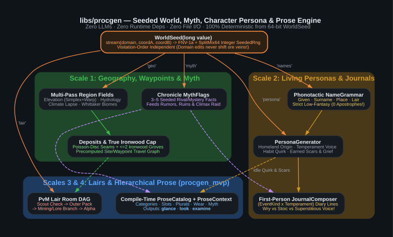

# 03 — Procedural Generation: Worlds, Myths, People & Low-Fantasy Prose

In `planning/olderplanning/procgen_mvp.md`, the core thesis was already clear: **Dwarf-Fortress-grade texture comes from compositional grammars, relational categories, material wear, and seeded state—never from calling an LLM.**

In **Ironwood Wilds**, `libs/procgen` (`com.kotharworks.procgen`, **zero external runtime dependencies, zero file I/O**) drives **four deterministic scales** from a single 64-bit `WorldSeed`:

1. **Macro Scale (Multi-Pass Geography, Myth & Waypoint Ecology):** Continents with hydrology, climate, Whittaker biomes, `≤2` mythic **True Ironwood Groves**, precomputed **Site/Waypoint travel graphs**, and seeded **Chronicle Myth Flags**.
2. **Meso Scale (PvM Lairs & First-Age Ruins):** Seeded multi-beat room DAGs with Scouting/Mining/Lore branch checks.
3. **Character Scale (`NameGrammar`, `PersonaGenerator` & `JournalComposer`):** Giving every patient settler a grounded low-fantasy name, Homeland origin, temperament, earned scars/bonds, and a first-person diary voice.
4. **Micro Scale (`procgen_mvp` Hierarchical Prose):** Compile-time Java 25 slot/template tables rendering `glance`, `look`, and `examine` text over live world state.



> *Graphviz artifacts:* [`05-procgen-pipeline.dot`](diagrams/05-procgen-pipeline.dot) · [`SVG`](diagrams/05-procgen-pipeline.svg) · [`PNG`](diagrams/05-procgen-pipeline.png)

---

## 1. Domain-Separated Coordinate Hashing (`WorldSeed` + `SeededRng`)

To guarantee **visitation-order independence** (whether Region `(3, -2)` is explored on Day 1 or Day 20, its rivers, hematite seams, and barrows are identical), every pass derives an isolated SplitMix64 stream from `(worldSeed, domainTag, a, b)`—never sharing a mutable global `Random`:

```java
package com.kotharworks.procgen;

public record WorldSeed(long value) {

    /** Produces an isolated, deterministic integer/permille RNG stream for a named domain. */
    public SeededRng stream(String domain, long a, long b) {
        long domainSalt = mix64(fnv1a64(domain));
        long seed = mix64(value ^ domainSalt)
                  ^ mix64(a * 0xBF58476D1CE4E5B9L)
                  ^ mix64(b * 0x94D049BB133111EBL);
        return new SeededRng(mix64(seed));
    }
    // Note: uses explicit FNV-1a UTF-8 bytes rather than String.hashCode() for clear cross-tool stability.
}
```
- **Domain Isolation:** `stream("elevation", rx, ry)`, `stream("deposits", rx, ry)`, `stream("persona", entitySeq, 0)`, and `stream("prose", siteId, 0)` are completely independent—expanding a prose adjective list or adding a character quirk **never shifts an ore vein**.
- **Integer-First `SeededRng`:** Exposes `nextInt(bound)`, `nextPermille()` (`0..999`), `pick(List<T>)`, and `weightedPick(...)` so `libs/wilds` never touches floats.

---

## 2. Scale 1: Multi-Pass Geography, Waypoint Navigation & Chronicle Myth

### 2.1 Layered Region Passes + Precomputed Site/Waypoint Graph
Each region (`48×48` underlying terrain cells for rich ASCII map rendering in `wilds-headless gallery` and `/atlas`) materialises lazily on first discovery through pure passes, then projects into a **Named Site & Waypoint Graph** so humans and bots navigate meaningful places (`site:4:1` *Hook-Ridge Hematite Outcrop*) rather than raw `(tileX, tileY)` A* grids:

| Pass | Technique | Gameplay & Narrative Payoff |
| :--- | :--- | :--- |
| **1. Elevation & Coast** | Integer-quantized OpenSimplex2S fBm + domain warp + radial Landing Envelope | Safe coastal/riverine Landing Ring (`depth < 200‰`); rugged interior ridges. |
| **2. Hydrology** | Steepest-descent flow accumulation -> rivers, fens, and natural fords | Feeds place-names (`Harrowford`, `Dunmere`) and shapes travel edge costs. |
| **3. Climate & Biomes** | Elevation lapse + rain shadow -> Whittaker lookup table (8–12 biomes) | *Landing Shelterwood*, *Peat & Reed Fen*, *Wind-Scoured Crags*, *Sunken Barrow-Downs*, *Wet-Temperate Basin*. |
| **4. Deposits & Ironwood** | Seeded Poisson-disc spacing coupled to geology + **True Ironwood Cap (`≤2` groves/world)** | Players read geology (peat fens = bog-iron; crags = hematite); **True Ironwood** spawns only in deep wet-temperate basins (`≥6` regions from any landing). |
| **5. Sites & Waypoint Edges** | Suitability scoring + planar neighbor links with terrain-weighted `travelDurationMs` | Real logistics hauling distance across fens/ridges **without** tile-collision A* headaches in Slice 0! |
| **6. Chronicle Myth (`MythFacts`)** | Single draw `stream("myth", 0, 0)` at Chronicle start fixes 3–5 world facts | Defines the unseen rival expedition's posture (*desperate*, *entrenched*, *dying*), signature interior ruin/atrocity, and end-of-Chronicle raid climax. |

---

## 3. Scale 2: Meso Generation — PvM Lairs & Ruins

When a Party delves a PvM Site (*Gnarl-Root Den*, *Split-King Barrow*), `LairGraphGenerator` builds a deterministic `3–4` beat encounter DAG from `stream("lair", siteIndex, delveCount)`:
1. **Threshold / Approach:** *Scouting / Ranging* check—spot sentry ambush (+1 opening volley) or hidden snare.
2. **Outer Guard Skirmish:** Pack encounter + common salvage.
3. **Optional Skill Branch:** e.g., *Collapsed Shaft* (`Mining Lv.20` pries bonus meteoric ore) or *Weathered Runestone* (`Lore Lv.15` reveals a Chronicle Myth fragment + blueprint).
4. **Heart Chamber:** Alpha threat + rare Tier III/IV Tech Catalyst.

---

## 4. Scale 3: Procedural People — Names, Personas, Scars & Journals

Even though settlers are mechanically **patient executors** (`IDLE_PATIENT` when their queue empties), `libs/procgen` gives every colonist unmistakable human texture—so your roster feels like a sworn frontier company rather than `Worker[0..3]`.

### 4.1 Phonotactic Low-Fantasy `NameGrammar` (Zero Apostrophes)
A ~200-line pure Java syllable & compound engine with a deterministic deduplication set:
- **Given Names:** Grounded Anglo-Norse / Celtic-border phonotactics (`Aldric`, `Mara`, `Pell`, `Brenna`, `Cedric`, `Jory`, `Doran`, `Tamsin`, `Halvar`, `Maren`). Apostrophes (`K'tharr`) are banned by house style.
- **Surnames & Bynames:** Trade/topographic compounds (`Ashford`, `Greywater`, `Vance`, `Fen-Born`, `Holt`, `Crag-Hand`).
- **Place & Lair Names:** Root + topographic/dread suffix (`Harrowford`, `Dunmere`, `Ravenbrook`, `Gnarl-Barrow`, `Split-Ridge`).

### 4.2 `PersonaGenerator` — Origin, Temperament & Mannerisms
When a settler is created at landing or steps off the Homeland Tithe Ship (`RecruitSettler`), `stream("persona", characterSeq, 0)` mints an immutable `CharacterPersona`:

| Dimension | Examples in `PersonaCatalog` | How It Surfaces |
| :--- | :--- | :--- |
| **Homeland Origin** | *Disgraced Watch-Sergeant*, *Debt-Bound Guild Sawyer*, *Conscripted Peat-Cutter*, *Widowed Quarry-Mason*, *Borderland Fletcher* | Sets arrival bio line on the Tithe Ship, +2 starting levels in 1 signature skill, and origin-specific nouns in Journal entries. |
| **Temperament (`Voice`)** | `STOIC` · `WRY` · `GRIM` · `SUPERSTITIOUS` · `EARNEST` · `METICULOUS` | Selects the **voice register** for their First-Person Journal and idle `look` posture. |
| **Habit Quirk** | *notches tally-marks on tool hafts* · *mistrusts barrow-stone* · *hums coastal rowing cadences* · *wipes blades twice before sheathing* | Woven into `look` / `examine` character descriptions and Hold hearth vignettes. |
| **Earned `LifeMark`s** | *Skill Calluses* (derived from top skill >= Lv.15) · *Named PvM Scars* (survived delve at `<15%` HP) · *Comrade Grief* (present when a party-mate died) | Appended deterministically during play; permanently visible on `examine` and in their Memorial Epitaph if they later fall. |

### 4.3 `JournalComposer` — First-Person Diaries Without LLMs
Whenever a character experiences a milestone `WorldEvent` (`ActionCompleted` milestone, `ActionFailed(DEPLETED)`, `LevelUp`, `RaidResolved`, `ExpeditionResolved`, `ColonistDied`, `ShipmentDeparted`), `libs/wilds` appends a tiny compact `JournalEntrySeed(day, eventKind, targetSiteOrItem, auxInt)` to the character's ring buffer (max 25 entries).

On read, `JournalComposer` renders that seed through **`(EventKind × Temperament)` template tables**:

```text
Event: ActionFailed(DEPLETED) at Hook-Ridge Crag (hematite_seam)
  • WRY:           "Day 10 — Hook-Ridge vein pinched out to barren quartz. Four miles uphill to chip wet gravel."
  • SUPERSTITIOUS: "Day 10 — The red seam bled dry before noon. Older picks than ours already took the heart of this hill."
  • METICULOUS:    "Day 10 — Logged final extraction on the upper Hook-Ridge shelf; seam exhausted after 14 stone."

Event: ColonistDied(Mara) witnessed by Party survivor Jory
  • STOIC:         "Day 14 — Left Mara beneath a grey cairn above Split-King Barrow. Brought her spear home to the Hall."
  • GRIM:          "Day 14 — The barrow-hounds took Mara at the threshold. Sixty Favor buys another pair of hands, not hers."
```
And when a settler sits `IDLE_PATIENT`, their tab's `look` prose uses their `HabitQuirk` + location to make waiting feel alive without moving a muscle:
> *"Brenna stands patiently beside the river-slate bloomery, soot-streaked gloves tucked under her belt while humming an old coastal rowing cadence."*

---

## 5. Scale 4: Hierarchical Slot/Template Prose (`procgen_mvp` in Java 25)

Porting `procgen_mvp.md` directly into **compile-time Java 25 record builders** (`ProseCatalog`) avoids custom YAML parsers while keeping every relational superpower:

1. **Relational Categories & Recursive Slots:** A `HoldYard` requests `1..3` fixtures of category `workshop_exterior`; a `Bloomery` requests `bellows_rig` + `fuel_clutter`.
2. **Proper English `Grammar` Engine:** Explicit `(singular, plural)` nouns, `a`/`an` article selection, cardinal words (`two woven charcoal-baskets`), and Oxford-comma `{slot_list}` / `{slot_desc}` aggregators.
3. **Seeded Static Traits + Live `ProseContext`:**
   - `SeededRng` fixes permanent construction details (*"dark river-slate"*, *"crooked boar-head windvane"*).
   - `ProseContext` injects live simulation state: `conditionPct` (`pristine` >= 80%, `soot-streaked` 40–79%, `raid-battered` < 40%), `weather`, `mythFlags`, and active worker names.
4. **Three Explicit Zoom Levels:**
   - **`glance`:** Compact badge/list line (*"dark river-slate bloomery (weathered)"*).
   - **`look`:** 1–2 sentence atmospheric banner shown on Character and Hold tabs.
   - **`examine`:** Deep on-demand inspection paragraph rendering nested fixtures, tool marks, scars, and Myth clues.

---

## 6. Package Layout Inside `libs/procgen`

```text
libs/procgen/src/main/java/com/kotharworks/procgen/
├── WorldSeed.java                 # FNV-1a + SplitMix64 domain/coordinate hashing
├── SeededRng.java                 # Deterministic ints, permilles, weighted picks, shuffles
├── noise/
│   ├── OpenSimplex2S.java         # Pure Java gradient noise (~250 LOC, quantized to int)
│   └── PoissonDisc.java           # Seeded blue-noise deposit & site spacing
├── geography/
│   ├── BiomeType.java             # Shelterwood, PeatFen, Crag, BarrowDowns, WetBasin...
│   ├── RegionPassPipeline.java    # Elevation -> Hydrology -> Climate -> Biomes -> Sites
│   ├── WaypointGraph.java         # Precomputed Site-to-Site travel costs + Ironwood cap
│   └── MythGenerator.java         # 3–5 Chronicle Myth flags fixed at season start
├── delves/
│   └── LairGraphGenerator.java    # Seeded room-DAG generator for PvM expeditions
├── persona/
│   ├── NameGrammar.java           # Phonotactic given/surname/place/lair names (no apostrophes)
│   ├── PersonaGenerator.java      # Origin, Temperament, HabitQuirk & LifeMark builders
│   └── JournalComposer.java       # (EventKind x Temperament) first-person diary renderer
└── prose/
    ├── ProseCatalog.java          # Compile-time Java 25 category/slot/table/wear registry
    ├── ProseContext.java          # Live state map (conditionPct, weather, mythFlags, worker)
    ├── Grammar.java               # Articles (a/an), plurals, counts, Oxford-comma joiner
    └── ProseComposer.java         # Deterministic `glance`, `look`, `examine` resolver
```
