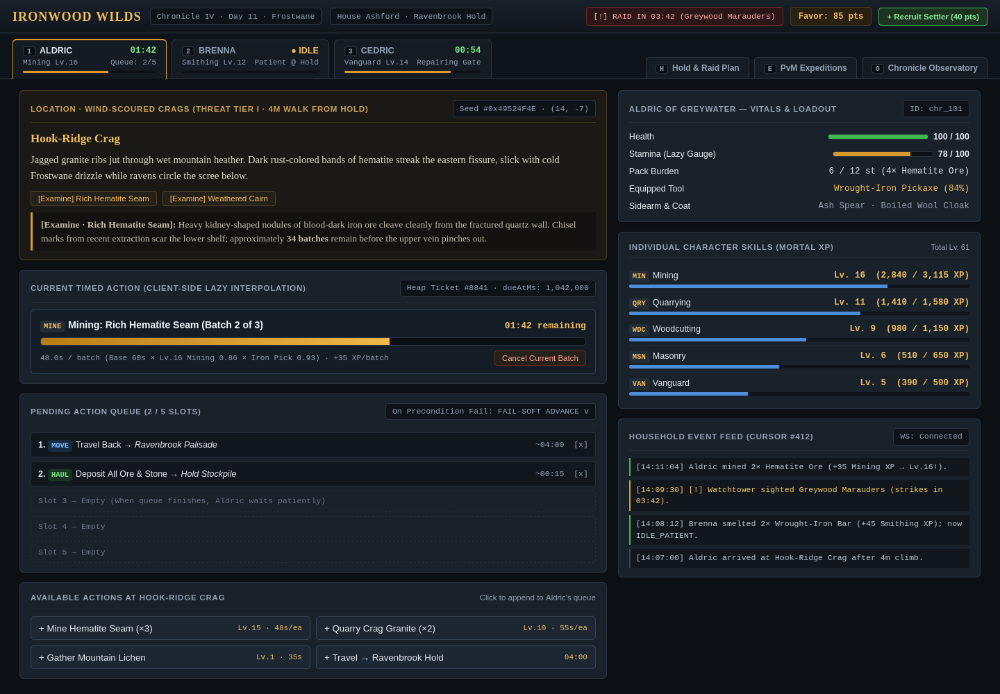
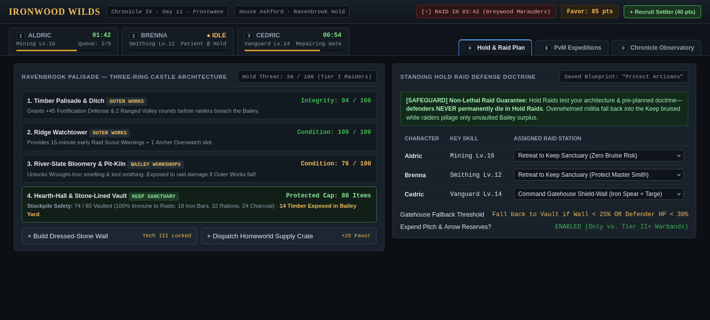
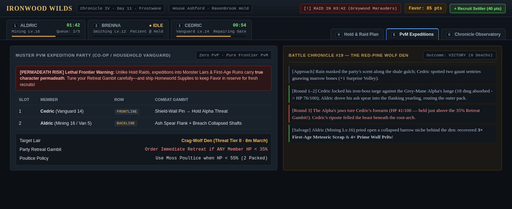
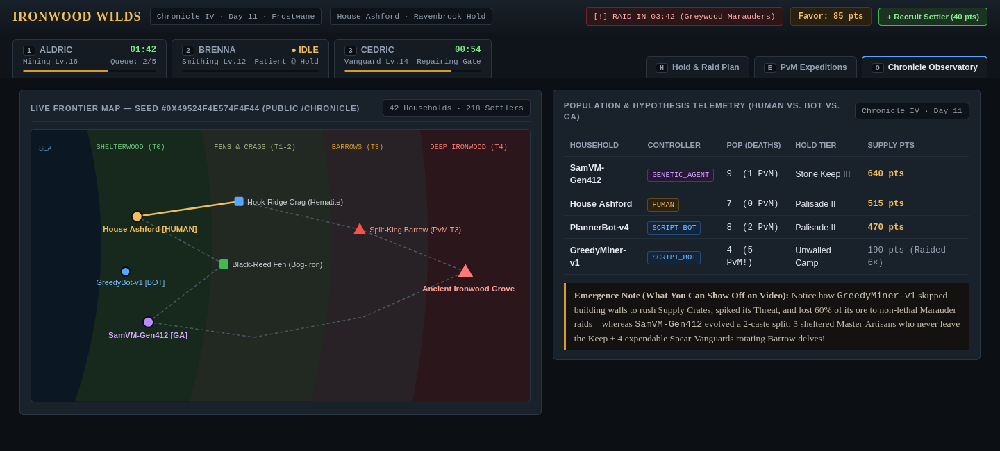

# 04 — Web Interface, Multi-Tab UX & Unified REST + SSE Protocol

> **Phase 0 reality note.** See the [engine noun mapping](README.md#engine-primitives-vs-gameplay-nouns) and [Current Status](README.md#current-status). **Implemented:** the REST + SSE contract ([Ticket 07](../../tickets/done/07-server-worldhost-rest-and-sse-inmemory.md)); the fog `ObservationProjector` ([Ticket 04](../../tickets/done/04-commands-task-queues-events-and-projections.md)); and minimal server-rendered `/play` and `/chronicle` consoles ([Ticket 09](../../tickets/done/09-minimal-ssr-console-and-end-to-end-system-tests.md)). **Planned:** the multi-tab Character Deck (Phase 1 Ticket 17) and the Observatory (M5b); see the [Phase 1 index](../../tickets/README.md). Note that the design's `(WorldView, HouseholdId) -> HouseholdObservation` is today `projectOwner(WorldView, OwnerId, …) -> OwnerObservation`, The routes that exist today differ from the endpoint tables below: `GET /api/v1/observation` replaces `/api/v1/household`; `POST /api/v1/seats` and `POST`/`DELETE /api/v1/seats/{seatId}/tokens[/{tokenId}]` replace the `/api/v1/houses` routes; `GET /api/v1/public/events` replaces `/api/v1/public/chronicle`; `/api/v1/atlas`, `/api/v1/public/leaderboard` and `/api/v1/public/battles/{id}` do not exist yet.

**Ironwood Wilds** serves three distinct audiences through **one canonical HTTP + SSE contract**—with zero UI-private endpoints and zero SPA build-chain bloat:

1. **Humans (Desktop & Phone Browser):** Server-rendered Multi-Tab Character Deck (`/play`) with smooth local countdown bars, Character Personas & Journals, and a **"While You Were Away"** digest.
2. **Scripted Bots & Genetic Agents (Any Language):** Self-describing JSON reads (`GET /api/v1/rules`, `GET /api/v1/household`), idempotent mutations (`POST /api/v1/commands`), and live SSE / cursor-polled events.
3. **Spectators & You as Experimenter (`/chronicle` Observatory):** Public fogged rumor wire, Frontier Map, Hall of Chronicles, and **`HUMAN` vs. `SCRIPT_BOT` vs. `GENETIC_AGENT`** telemetry.

---

## 1. Why REST + SSE Is the Ideal v1 Wire Contract

| Channel | Endpoint | Role | Why Chosen Over Alternatives |
| :--- | :--- | :--- | :--- |
| **REST Reads** | `GET /api/v1/*` | Rules catalog, fogged Household/Hold/Site views, cursor catch-up (`?since=cursor`) | Stateless, cacheable projections off immutable `WorldView`; trivial to test with `curl`. |
| **Polymorphic Mutations** | `POST /api/v1/commands` | All player & bot commands (`cmdId` UUIDv7 + optional `expectedRevision` + `sealed` payload) | One decoder, one rate-limiter, DB-enforced idempotency + ETag-equivalent optimistic concurrency (`409 STALE_STATE`); Web UI forms/fetch use the exact same envelope as bots. |
| **Live Event Push (SSE)** | `GET /api/v1/stream?since=cursor` | Live `action.*`, `level.up`, `raid.*`, `shipment.*`, `rumor.heard` | Mutations are infrequent while event watching is continuous. On JDK `HttpServer` + Virtual Threads, **SSE is ~25 lines of plain HTTP** (vs. hundreds of lines of RFC 6455 WebSocket frame-masking), auto-reconnects natively via browser `EventSource`, and works seamlessly behind nginx/Cloudflare. |

*(Optional Post-Slice Escape Hatch: Because `apps/wilds-server` is hexagonal, adding a 60-line raw NDJSON `ServerSocket` adapter on `:8124` later for zero-HTTP C bots requires zero changes to `WorldHost` or `libs/wilds`—keeping Slice 0 focused on one rock-solid REST + SSE contract.)*

---

## 2. Complete v1 HTTP API Surface

### 2.1 Auth (OIDC / Loopback Dev JWT) & Household Setup
*(See [`07-AuthAndSecurityArchitecture.md`](07-AuthAndSecurityArchitecture.md) for `libs/auth`, Keycloak OIDC + PKCE, BFF `__Host-kw_session` CSRF guards, and scoped Bot keys.)*

| Method & Path | Purpose |
| :--- | :--- |
| `GET  /auth/login` · `GET /auth/callback` · `POST /auth/logout` | OIDC Authorization Code + PKCE redirect (Keycloak in `oidc` mode; Persona Switcher at `/dev/login` on `127.0.0.1` in `dev-local` mode) -> `HttpOnly; SameSite=Lax` BFF cookie. |
| `GET  /api/v1/auth/me` | Caller's resolved `UserId`, display name, JWT `GlobalRole`s (`PLAYER` / `RESEARCHER` / `ADMIN`), and owned Houses. |
| `POST /api/v1/houses` | Charter a permanent House (`houseName`, `motto`, `controllerKind`) owned by caller's `UserId` and land it in the active Chronicle (`HUMAN_ONLY`; `controllerKind != HUMAN` requires `RESEARCHER`). |
| `POST /api/v1/houses/{id}/tokens` · `DELETE /api/v1/houses/{id}/tokens/{tokenId}` | Mint/revoke a House-scoped API token (`iw_bot_<prefix8>_<secret>`) for `SCRIPT_BOT` / `GENETIC_AGENT` automation (`ROLE_RESEARCHER` + House owner). |

### 2.2 Authenticated Game Reads & Mutations
| Method & Path | Purpose |
| :--- | :--- |
| `GET  /api/v1/meta` | `nowMs`, `chronicleId`, `rulesVersion`, `engineVersion`, `protocolVersion`, next Tithe Ship ETA. |
| `GET  /api/v1/rules` | Complete `RuleRegistry` (skills, items, recipes, 3-ring buildings, tech tree, action specs, error codes). |
| `GET  /api/v1/household` | Caller's fog-projected Household: Characters (personas, skills, queues, journals), Hold, Stockpile, Techs, Parties. |
| `GET  /api/v1/atlas` | Discovered Regions, Sites, Waypoint travel durations, known resource seams, and scouted Lairs. |
| `GET  /api/v1/examine?type=...&id=...` | On-demand `glance` + `look` + `examine` procedural prose for any discovered Site, Building, Character, or Relic. |
| `GET  /api/v1/events?since={cursor}` | Monotonic event tail for polling bots & **"While You Were Away"** catch-up. |
| `GET  /api/v1/stream?since={cursor}` | Live SSE event stream (`text/event-stream`, `: keepalive` comment every 25s—**zero 1 Hz heartbeat spam**). |
| `POST /api/v1/commands` | Submit any `WorldCommand` with UUIDv7 `cmdId` -> synchronous `200` receipt or `409` error envelope. |

### 2.3 Public Spectator & Observatory Surface (No Auth Required)
| Method & Path | Purpose |
| :--- | :--- |
| `GET /api/v1/public/chronicle?since={cursor}` | World wire: Tithe Ship dispatches, **fogged rumors** (*"an ironwood grove was sighted..."*, *"smoke past the ridge"*), monument completions, fallen veteran epitaphs. |
| `GET /api/v1/public/leaderboard` | Chronicle Supply Favor standings + `controllerKind` (`HUMAN` / `SCRIPT_BOT` / `GENETIC_AGENT`) telemetry. |
| `GET /api/v1/public/battles/{id}` | Shareable medieval prose & round-by-round breakdown of notable PvM delves and Hold raids. |

---

## 3. Fog-of-War & Rumor Projections

Clients **never** receive raw `WorldState`. `ObservationProjector` is a pure function `(WorldView, HouseholdId) -> HouseholdObservation`:
- **Strict Fog of Unmaterialised / Unscouted Space:** Unexplored regions and unscouted lairs are omitted entirely, preventing map-hack bots.
- **Atmospheric Fogged Rumors:** Major milestones in other Households project onto the public Chronicle as **partially fogged rumors**—e.g., *"A party from the western fens did not return from Split-King Barrow"*, or *"Heavy bloomery smoke rises somewhere along the northern crags."* Players feel a living, inhabited continent without exposing neighbor coordinates or enabling griefing.

---

## 4. The Multi-Tab Web Interface (`/play` — Zero SPA Bloat)

### Rendering Stack
- **Java 25 Escape-by-Default `Html` Builder:** Fast, compile-time-checked SSR HTML functions in `apps/wilds-server/adapters/web`. Zero React, zero Vite/npm, zero reflection template engines; forms even degrade gracefully if JS is disabled.
- **~250 Lines of Vanilla JS (`wilds-ui.js`):**
  1. Connects `EventSource('/api/v1/stream?since=' + cursor)` to prepend live Chronicle/Journal entries and refresh affected panels (and their `revision` tokens) when an action completes or a raid warning sounds.
  2. Sends `expectedRevision` (embedded on each Character/Hold form) on queue replace/cancel and doctrine/staging POSTs—catching `409 STALE_STATE` cleanly by refreshing the panel if an action transitioned milliseconds before the click.
  3. Interpolates **smooth 60fps progress bars & tab countdowns locally** from `{startedAtMs, dueAtMs, serverNowMs}` (`clockSkewMs = performance.now() - serverNowMs`)—consuming **zero network bandwidth** between discrete completions!
  4. Binds crisp keyboard shortcuts: **`1–9`** for Character Tabs, **`H`** for Hold & Raid Plan, **`T`** for Tech Tree, **`E`** for PvM Expeditions, **`O`** for Chronicle Observatory.

### Interactive Prototype & Rendered Views
Open **[`prototype/index.html`](prototype/index.html)** in any browser to test tab switching, `Examine` drawers, Character Personas & Journals, and queue appending:

#### 1. Character Tab (`[1] Aldric` — Location Prose, Lazy Countdown, Persona, Skills & Journal)

#### 2. Hold & Non-Lethal Raid Defense Plan (`[H]` — 3-Ring Castle & Standing Doctrine)

#### 3. PvM Expeditions & Battle Chronicle (`[E]` — Lethal Gambit Rules & Delve Prose)

#### 4. Public Chronicle Observatory (`[O]` — Frontier SVG Map & Human/Bot/GA Telemetry)

### Four Signature UX Details on `/play`
1. **"While You Were Away" Digest Card:** When you open `/play` after 45 minutes away, the UI queries `?since=lastSeenCursor` and renders a clean summary banner (*"While you were away (38m): Aldric finished Hematite ×3 (+105 XP -> Lv.16); Hook-Ridge seam #2 depleted; Tithe Ship embarked (+140 Favor)"*).
2. **Character Persona + First-Person Journal Pane:** Below each character's vitals and skills sits their seeded **Origin / Temperament / Scars** summary and their temperament-voiced **First-Person Journal**, plus a **[Memorial Cairn]** drawer honoring fallen household veterans.
3. **3-Ring Hold & Raid Doctrine Matrix (`[H]`):** Displays `Vault Protected Cap` vs. `Exposed Bailey Surplus` alongside simple per-character Raid Station dropdowns (`Retreat to Keep Sanctuary` vs. `Gatehouse Spear-Wall`).
4. **Chronicle Observatory (`/chronicle` / `[O]`):** Built-in showcase dashboard rendering the seeded Frontier SVG/ASCII map, active population task breakdown, and side-by-side `HUMAN` vs. `SCRIPT_BOT` vs. `GENETIC_AGENT` survival/supply curves for devlogs and hypothesis experiments.
