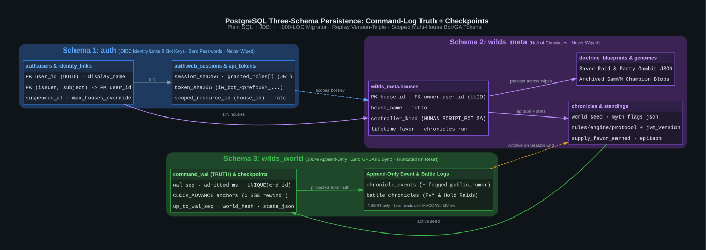

# 05 — Accounts, Scoped Bot Keys & Three-Schema Persistence

Persistence in **Ironwood Wilds** solves three distinct problems simultaneously:
1. **Replay-Grade World Truth:** `(world_seed, rules_version, command_wal)` is the mathematical definition of the timeline; snapshots and live SQL tables are fast-start caches and projections.
2. **Seamless Maintenance Restarts (`PAUSE_WHILE_DOWN`):** Deploying a Friday patch or surviving `kill -9` recovers to the exact logical millisecond with zero lost timers and zero unmonitored offline raids.
3. **Clean Chronicle Resets + Multi-Agent Research Accounts:** Wiping a finished 4-week world resets `wilds_world` while preserving accounts, scoped Bot/GA API keys (`auth`), permanent House charters, Doctrine Blueprints, and Hall of Chronicles standings/epitaphs (`wilds_meta`).

---

## 1. Three-Schema PostgreSQL Architecture



> *Graphviz artifacts:* [`06-postgres-three-schemas.dot`](diagrams/06-postgres-three-schemas.dot) · [`SVG`](diagrams/06-postgres-three-schemas.svg) · [`PNG`](diagrams/06-postgres-three-schemas.png)

```text
PostgreSQL Database: `kotharworks`  (JDBI 3 + HikariCP · Zero Hibernate/JPA · ~100-LOC SQL Migrator)
│
├── Schema 1: `auth`          (Game-Agnostic OIDC Identity Links & Bot Keys — Zero Passwords · NEVER wiped)
│   ├── users                 Internal KotharWorks `user_id` (UUID), display name & instant `suspended_at` fuse
│   ├── identity_links        Just-in-Time `(issuer, subject) -> user_id` OIDC mapping (Dev-Local & Keycloak)
│   ├── web_sessions          Browser `__Host-kw_session` BFF cookies (SHA-256 only + verified JWT roles)
│   └── api_tokens            House-scoped Bot/GA Bearer keys (`iw_bot_<prefix8>_...`, SHA-256 only)
│
├── Schema 2: `wilds_meta`    (Permanent Hall of Chronicles — NEVER wiped)
│   ├── houses                Permanent House charter (`owner_user_id` UUID), motto & `controller_kind`
│   ├── chronicles            Seed, replay version-triple, `jvm_version`, Myth flags, outcome
│   ├── chronicle_standings   Final Favor, peak pop, casualties, telemetry & generated epitaph
│   ├── doctrine_blueprints   Saved Hold Raid & PvM Party Gambit presets carried across seasons
│   └── champion_genomes      (Phase 2) Archived `SamVM` LGP genomes & lineage metadata
│
└── Schema 3: `wilds_world`   (Active Chronicle State — Archived & Truncated on Season Reset)
    ├── command_wal           THE SOURCE OF TRUTH: ordered admissible commands + `cmd_id` unique key
    ├── world_checkpoints     Tick-boundary `WorldState` snapshots (fast boot cache, NOT truth)
    ├── chronicle_events      Rebuildable public/household event & fogged-rumor projection
    ├── characters_live       Inspectable SQL projection of living/fallen settlers & personas
    ├── holds_live            Inspectable SQL projection of Holds, Vaults & Awareness
    └── battle_chronicles     Immutable PvM & Raid reports (powers `/api/v1/public/battles/{id}`)
```

---

## 2. Schema 1: `auth` — Zero-Password OIDC Identity Links & Scoped Bot Keys

> **Full AuthN/AuthZ Specification:** See [`07-AuthAndSecurityArchitecture.md`](07-AuthAndSecurityArchitecture.md) for `libs/auth` (`com.kotharworks:auth`), Keycloak JWT role extraction (`PLAYER`, `RESEARCHER`, `ADMIN`), the loopback-fused `dev-local` mode, BFF CSRF defenses, and `AuthSecurityGateTest`.

Ironwood stores **zero passwords and zero password hashes**. Human credentials, 2FA, and social logins live in **Keycloak** (or `DevLocalJwtIssuer` on `127.0.0.1` during local development). Global roles (`PLAYER`, `RESEARCHER`, `ADMIN`) come directly from verified JWT claims, while `auth.identity_links` maps `(issuer, subject)` Just-in-Time to an internal `user_id UUID` so swapping identity providers never breaks `wilds_meta.houses`:

```sql
CREATE SCHEMA IF NOT EXISTS auth;

CREATE TABLE auth.users (
    user_id             UUID PRIMARY KEY,                -- Minted Just-in-Time on first valid JWT
    display_name        TEXT NOT NULL,                   -- Initialized from JWT preferred_username
    max_houses_override INT,                             -- NULL = role default (PLAYER=1, RESEARCHER=25)
    suspended_at        TIMESTAMPTZ,                     -- Instant (<1s) emergency ban fuse across JWT & Bot keys
    suspended_reason    TEXT,
    created_at          TIMESTAMPTZ NOT NULL DEFAULT now(),
    last_seen_at        TIMESTAMPTZ NOT NULL DEFAULT now()
);

CREATE TABLE auth.identity_links (
    issuer          TEXT NOT NULL,                       -- Exact JWT `iss` URL (Keycloak realm or dev-local)
    subject         TEXT NOT NULL,                       -- Exact JWT `sub` identifier
    user_id         UUID NOT NULL REFERENCES auth.users(user_id) ON DELETE CASCADE,
    linked_at       TIMESTAMPTZ NOT NULL DEFAULT now(),
    PRIMARY KEY (issuer, subject)
);
CREATE INDEX idx_identity_links_user ON auth.identity_links(user_id);

CREATE TABLE auth.web_sessions (
    session_sha256      BYTEA PRIMARY KEY CHECK (octet_length(session_sha256) = 32),
    user_id             UUID NOT NULL REFERENCES auth.users(user_id) ON DELETE CASCADE,
    issuer              TEXT NOT NULL,
    subject             TEXT NOT NULL,
    granted_roles       TEXT[] NOT NULL,                 -- Verified from JWT: PLAYER, RESEARCHER, ADMIN
    active_house_id     BIGINT,
    csrf_token          TEXT NOT NULL,                   -- Guards HTML <form method="POST"> fallbacks
    roles_refreshed_at  TIMESTAMPTZ NOT NULL DEFAULT now(),
    created_at          TIMESTAMPTZ NOT NULL DEFAULT now(),
    expires_at          TIMESTAMPTZ NOT NULL,
    last_seen_at        TIMESTAMPTZ NOT NULL DEFAULT now()
);
CREATE INDEX idx_web_sessions_user ON auth.web_sessions(user_id);

CREATE TABLE auth.api_tokens (
    token_id            BIGINT GENERATED ALWAYS AS IDENTITY PRIMARY KEY,
    owner_user_id       UUID NOT NULL REFERENCES auth.users(user_id) ON DELETE CASCADE,
    resource_namespace  TEXT NOT NULL DEFAULT 'wilds:house',
    scoped_resource_id  BIGINT NOT NULL,                 -- Locks `iw_bot_...` token strictly to ONE House!
    token_prefix        CHAR(8) NOT NULL,                -- Displayed in UI for safe identification
    token_sha256        BYTEA NOT NULL UNIQUE CHECK (octet_length(token_sha256) = 32),
    label               TEXT NOT NULL,
    rate_per_sec        INT NOT NULL DEFAULT 10,
    created_at          TIMESTAMPTZ NOT NULL DEFAULT now(),
    last_used_at        TIMESTAMPTZ,
    revoked_at          TIMESTAMPTZ
);
CREATE INDEX idx_api_tokens_owner ON auth.api_tokens(owner_user_id);
CREATE INDEX idx_api_tokens_resource ON auth.api_tokens(resource_namespace, scoped_resource_id);
```

---

## 3. Schema 2: `wilds_meta` — Version-Triple Pinning & Cross-Chronicle Legacy

Notice how `wilds_meta.houses` binds ownership to `owner_user_id UUID` (completely decoupled from Keycloak internals), and `wilds_meta.chronicles` records the **exact replay version-triple** (`rules_version`, `engine_version`, `protocol_version`, plus `jvm_version`) alongside `world_seed` and `myth_flags_json` so `apps/wilds-headless replay` can verify compatibility before replaying an archived Chronicle:

```sql
CREATE SCHEMA IF NOT EXISTS wilds_meta;

CREATE TABLE wilds_meta.houses (
    house_id        BIGINT GENERATED ALWAYS AS IDENTITY PRIMARY KEY,
    owner_user_id   UUID NOT NULL REFERENCES auth.users(user_id) ON DELETE CASCADE,
    house_name      TEXT NOT NULL UNIQUE CHECK (char_length(house_name) BETWEEN 3 AND 40),
    motto           TEXT NOT NULL DEFAULT '',
    controller_kind TEXT NOT NULL DEFAULT 'HUMAN'
                    CHECK (controller_kind IN ('HUMAN', 'SCRIPT_BOT', 'GENETIC_AGENT')),
    lifetime_favor  BIGINT NOT NULL DEFAULT 0,
    chronicles_run  INT NOT NULL DEFAULT 0,
    created_at      TIMESTAMPTZ NOT NULL DEFAULT now()
);
CREATE INDEX idx_houses_owner ON wilds_meta.houses(owner_user_id);

CREATE TABLE wilds_meta.chronicles (
    chronicle_id     INT GENERATED ALWAYS AS IDENTITY PRIMARY KEY,
    title            TEXT NOT NULL,                      -- e.g. "Chronicle I: The Grey Crossing"
    world_seed       BIGINT NOT NULL,
    rules_version    INT NOT NULL,                       -- Replay Triple #1: WILDS_RULES_VERSION
    engine_version   INT NOT NULL,                       -- Replay Triple #2: WildsEngine.API_VERSION
    protocol_version INT NOT NULL,                       -- Replay Triple #3: WILDS_PROTOCOL_VERSION
    jvm_version      TEXT NOT NULL,                      -- Recorded runtime for bit-exact audit
    myth_flags_json  JSONB NOT NULL,                     -- Seeded rival/mystery facts
    config_json      JSONB NOT NULL DEFAULT '{}'::jsonb, -- Hypothesis overrides (e.g. raid rate)
    status           TEXT NOT NULL CHECK (status IN ('ACTIVE', 'ARCHIVED')),
    war_outcome      TEXT,
    started_at       TIMESTAMPTZ NOT NULL DEFAULT now(),
    ended_at         TIMESTAMPTZ
);

CREATE TABLE wilds_meta.chronicle_standings (
    chronicle_id        INT NOT NULL REFERENCES wilds_meta.chronicles(chronicle_id),
    house_id            BIGINT NOT NULL REFERENCES wilds_meta.houses(house_id),
    supply_favor_earned BIGINT NOT NULL,
    peak_population     INT NOT NULL,
    colonists_lost      INT NOT NULL,
    raids_repelled      INT NOT NULL,
    highest_tech_tier   INT NOT NULL,
    epitaph             TEXT NOT NULL,                   -- One generated memorial line for this House's run
    summary_stats_json  JSONB NOT NULL,
    PRIMARY KEY (chronicle_id, house_id)
);

CREATE TABLE wilds_meta.doctrine_blueprints (
    blueprint_id    BIGINT GENERATED ALWAYS AS IDENTITY PRIMARY KEY,
    house_id        BIGINT NOT NULL REFERENCES wilds_meta.houses(house_id) ON DELETE CASCADE,
    kind            TEXT NOT NULL CHECK (kind IN ('HOLD_RAID', 'PARTY_COMBAT')),
    name            TEXT NOT NULL,
    spec_json       JSONB NOT NULL,
    updated_at      TIMESTAMPTZ NOT NULL DEFAULT now()
);
```

---

## 4. Schema 3: `wilds_world` — Command Log as Truth + Snapshot Cache

Why **Command Log + Tick-Boundary Snapshots** beats both snapshot-only and full event-sourcing:
- **Snapshot-only** loses recent actions on crash and destroys bug reproducibility.
- **Event-sourcing** couples durability to high-churn `WorldEvent` schemas (which evolve frequently as UI/Chronicle prose improves).
- **Command-Log-as-Truth (`command_wal`)** stores compact, stable `WorldCommand` envelopes (`~300/house/day`). Because `WildsEngine` is a pure deterministic function of `(world_seed, rules_version, command_wal)`, any snapshot or projection can be rebuilt from `wal_seq = 1` at any time!

```sql
CREATE SCHEMA IF NOT EXISTS wilds_world;

-- 1. THE SOURCE OF TRUTH: Ordered Admissible Commands + Clock-Advance Anchors
CREATE TABLE wilds_world.command_wal (
    chronicle_id    INT NOT NULL,
    wal_seq         BIGINT GENERATED ALWAYS AS IDENTITY,
    admitted_ms     BIGINT NOT NULL,                     -- Exact logical ms when WorldHost applied it
    house_id        BIGINT,                              -- NULL for system clock-checkpoint markers
    cmd_id          UUID NOT NULL,                       -- Client UUIDv7 idempotency key
    cmd_type        TEXT NOT NULL,
    payload_json    JSONB NOT NULL,
    world_hash      BIGINT,                              -- Optional periodic inline WorldHash assertion!
    recorded_at     TIMESTAMPTZ NOT NULL DEFAULT now(),
    PRIMARY KEY (chronicle_id, wal_seq),
    UNIQUE (chronicle_id, cmd_id)                        -- Enforces exactly-once idempotency!
);

-- 2. FAST-BOOT CACHE: Written at Clean Tick Boundaries (Every 5m + SIGTERM)
CREATE TABLE wilds_world.world_checkpoints (
    chronicle_id    INT NOT NULL,
    checkpoint_id   BIGINT GENERATED ALWAYS AS IDENTITY,
    up_to_wal_seq   BIGINT NOT NULL,                     -- Subsumes command_wal <= up_to_wal_seq
    logical_ms      BIGINT NOT NULL,
    world_hash      BIGINT NOT NULL,                     -- Verified on load!
    state_json      JSONB NOT NULL,
    created_at      TIMESTAMPTZ NOT NULL DEFAULT now(),
    PRIMARY KEY (chronicle_id, checkpoint_id)
);

-- 3. REBUILDABLE PROJECTIONS: Chronicle Wire (with Fogged Rumors) & Live SQL Views
CREATE TABLE wilds_world.chronicle_events (
    chronicle_id    INT NOT NULL,
    event_cursor    BIGINT NOT NULL,
    occurred_ms     BIGINT NOT NULL,
    kind            TEXT NOT NULL,
    house_id        BIGINT,                              -- Private scope; NULL or fogged_text for public wire
    public_rumor    TEXT,                                -- Fogged spectator/world-wire line (nullable)
    private_prose   TEXT NOT NULL,                       -- Full household detail
    payload_json    JSONB NOT NULL,
    PRIMARY KEY (chronicle_id, event_cursor)
);

CREATE TABLE wilds_world.characters_live (
    character_ref   TEXT PRIMARY KEY,                    -- e.g. 'chr:0:1'
    house_id        BIGINT NOT NULL,
    full_name       TEXT NOT NULL,
    persona_json    JSONB NOT NULL,                      -- Origin, temperament, quirk, scars
    alive           BOOLEAN NOT NULL,
    location_desc   TEXT NOT NULL,
    active_action   TEXT,
    active_due_ms   BIGINT,
    skills_json     JSONB NOT NULL,
    updated_at      TIMESTAMPTZ NOT NULL DEFAULT now()
);

CREATE TABLE wilds_world.holds_live (
    hold_ref        TEXT PRIMARY KEY,
    house_id        BIGINT NOT NULL UNIQUE,
    hold_name       TEXT NOT NULL,
    awareness_milli BIGINT NOT NULL,
    vault_cap       INT NOT NULL,
    stockpile_json  JSONB NOT NULL,
    buildings_json  JSONB NOT NULL,
    updated_at      TIMESTAMPTZ NOT NULL DEFAULT now()
);

CREATE TABLE wilds_world.battle_chronicles (
    battle_id       BIGINT PRIMARY KEY,
    house_id        BIGINT NOT NULL,
    kind            TEXT NOT NULL CHECK (kind IN ('PVM_EXPEDITION', 'HOLD_RAID')),
    occurred_ms     BIGINT NOT NULL,
    title           TEXT NOT NULL,
    outcome         TEXT NOT NULL,
    prose_report    TEXT NOT NULL,
    structured_json JSONB NOT NULL,
    created_at      TIMESTAMPTZ NOT NULL DEFAULT now()
);
```

---

## 5. Migrations & Both Restart Lifecycles

### Zero-Framework Forward SQL Migrator (`~100 LOC`)
Plain SQL files live in `apps/wilds-server/src/main/resources/db/V001__auth.sql`, `V002__wilds_meta.sql`, `V003__wilds_world.sql`. On boot, a tiny JDBC runner checks `public.schema_migrations`, applies any unapplied `V###` scripts inside a transaction, and refuses to boot if an unknown future migration version is present. No Flyway or Liquibase dependencies required.

### Lifecycle A: Routine Restart / Crash Recovery (`PAUSE_WHILE_DOWN` Default)
1. **Graceful `SIGTERM`:** `WorldHost` halts the mailbox, drains `advanceTo(currentLogicalMs)`, writes a final `world_checkpoints` row (`up_to_wal_seq = K`, `world_hash = H`), and exits cleanly.
2. **Crash Recovery (`kill -9`):** On startup, `WorldHost` loads the latest `world_checkpoints` row, verifies `engine.worldHash() == checkpoint.worldHash()`, and replays `SELECT * FROM wilds_world.command_wal WHERE wal_seq > up_to_wal_seq ORDER BY wal_seq ASC`, advancing to each `admitted_ms` and re-applying each command.
3. **`PAUSE_WHILE_DOWN` Clock Rule:** The live 1 Hz clock pump tracks `logicalMs` as an offset from the last persisted tick—**server maintenance downtime never fast-forwards unmonitored raids or wastes buffs while the server process was offline**.

### Lifecycle B: Planned Chronicle Reset
1. Final snapshot + `wilds_world.command_wal` are exported to a compressed `.jsonl.zst` archive bundle (playable forever in `apps/wilds-headless replay`).
2. Final standings + procedurally generated House epitaphs write to `wilds_meta.chronicle_standings`.
3. `TRUNCATE wilds_world.*` clears the active tables, a new `wilds_meta.chronicles` row is minted with a fresh `WorldSeed`, and Houses land anew with their permanent names, API tokens, and saved Doctrine Blueprints intact.
