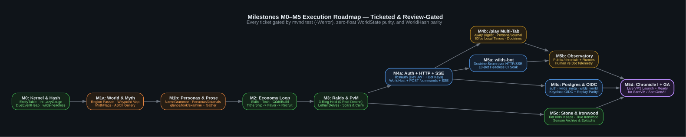

# 06 — Prototype Slice, Milestones (`st` Backlog), Review Gates & GA Bridge

This document turns the architecture into an **actionable project-management & implementation plan**:
1. **Slice 0 (*"Hearth, Iron, and the Palisade"*):** Thin horizontal content, 100% permanent vertical spine.
2. **Worked Session Transcript:** Ending in bit-for-bit `wilds-headless replay --hash` parity.
3. **Exact Java 25 Package Skeleton:** Zero guesswork on where files belong.
4. **Milestones `M0–M5` Execution Roadmap + `st` Ticket Backlog (`KOTHARWORKS`) + Post-Implementation Review Checklist.**
5. **Phase 2 Bridge (`SamVM` + `SamGenAI`):** How evolved genomes plug straight into `WildsEngine` and `Doctrine`.

---

## 1. Slice 0 Scope: *"Hearth, Iron, and the Palisade"*

Everything exotic (births/lineage, multi-biome roads, full 50-node tech tree) is deferred post-slice, while **every load-bearing seam ships cleanly once**:

| Seam Proven in Slice 0 | Included Scope | Deferred Post-Slice |
| :--- | :--- | :--- |
| **Household & Personas** | Start with **3 Settlers** generated via `NameGrammar` + `PersonaGenerator` (Origin, Temperament, Habit Quirk, First-Person Journal); zero idle autonomy (`IDLE_PATIENT`). | Births/lineage, roster > 6. |
| **Skills & Mini Tech Tree** | **5 Skills** (`Woodcutting`, `Mining`, `Carpentry`, `Smithing`, `Vanguard`, Lv. 1–50 XP curve) + **4 Tech Nodes** (`Charcoal Burning`, `Peat Bloomery`, `Timber Palisade`, `Signal Beacon`). | Remaining 5 skills, Tiers III–IV Stone/Ironwood keeps. |
| **Procedural World Ring** | Bounded `3×3` region neighborhood from `WorldSeed` (`RegionPassPipeline` + `WaypointGraph` + `headless gallery` ASCII map): Landing Clearing + Coppice + Peat Fen + Hematite Crag + Wolf/Barrow Lair + `glance`/`look`/`examine` prose. | Unbounded exploration, full 12-biome matrix, Myth climax raid. |
| **3-Ring Hold & Raid** | Build `Pit-Kiln`, `Bloomery`, `Vaulted Cellar` (`+40` protected stock), `Timber Palisade`. Foreshadowed **Greywood Marauder** rumor -> `WriteHoldDoctrine` -> deterministic **non-lethal** raid resolution (0 deaths; only unvaulted Bailey stock & wall condition at risk). | Multi-tier siege engines, regional awareness warmth. |
| **Lethal PvM Expedition** | Form `2–3` settler Party with `Frontline`/`Backline` + `CombatDoctrine` (Retreat HP%) -> delve *Gnarl-Root Barrow* -> turn-based Battle Chronicle, scars, **real permadeath**, and **Memorial Cairn** epitaph on death. | Multi-branch skill doors, poultice crafting chain. |
| **Tithe Ship & Recruit** | `StageShipment` at `Signal Beacon` -> scheduled **Homeland Tithe Ship** heartbeat converts crates to **Supply Favor** + emits public Chronicle line -> `RecruitSettler` brings Settler #4 ashore! | Dynamic Urgent War Requisitions. |
| **Server, Auth, UI, Persistence & Bot** | `libs/auth` (loopback-fused `dev-local` JWT -> drop-in Keycloak OIDC + scoped `iw_bot_...` keys), `WildsAuthorizer`, single-writer `WorldHost`, `POST /api/v1/commands` (`cmdId` idempotency), SSE `/api/v1/stream`, `/play` Multi-Tab UI (**"While You Were Away"** + Journal + Chronicle), 3-schema Postgres WAL + Snapshots, `apps/wilds-headless`, and `apps/wilds-bot` (`Doctrine` seam). | Public SVG Observatory charts (`M5b`), optional raw TCP `:8124`. |

---

## 2. Worked Slice 0 Session (How It Plays & Verifies)

*(In dev/demo mode `--time-scale=6` runs 3-minute actions in 30 real seconds; live Chronicles run `--time-scale=1`.)*

1. **`t = 0` — Landing & Personas:** You charter **House Ashford** at *Ravenbrook Clearing*. Three tabs appear:
   - **`[1] Mara Ashford`** (*Widowed Quarry-Mason · `SUPERSTITIOUS` · mistrusts barrow-stone · Mining Lv.3*)
   - **`[2] Pell Fen-Born`** (*Conscripted Peat-Cutter · `WRY` · notches tally-marks on tool hafts · Woodcutting Lv.3*)
   - **`[3] Cedric Vance`** (*Disgraced Watch-Sergeant · `STOIC` · wipes blades twice · Vanguard Lv.3*)  
   All three stand `IDLE_PATIENT`. You `POST /api/v1/commands` (`enqueue`) sending Mara to *Hook-Ridge Crag* (`TRAVEL -> GATHER hematite ×4 -> TRAVEL_HOLD -> DEPOSIT_ALL`), Pell to *Shelterwood Coppice* (`CHOP ash ×5`), and Cedric to research `Charcoal Burning`. You close your browser tab.
2. **`t + 35m` — Walk-Away Return & Fail-Soft Depletion:** You reopen `/play` on your phone.
   - The **"While You Were Away (35m · 8 events)"** card reports Pell hauled `10 Ash Timber` (+Lv.4 Woodcutting), while Mara's 4th hematite batch hit `ActionFailed(DEPLETED)`—because of fail-soft `ADVANCE`, she automatically walked home and deposited the 3 batches she already mined!
   - Mara's **Journal** reads: *"Day 1 — The red seam on Hook-Ridge bled dry before dusk. Older picks than ours already took the heart of this hill."*
3. **`t + 2h` — Bloomery, Tithe Ship & Raid Rumor:** With `Pit-Kiln`, `Bloomery`, `Vaulted Cellar`, and `Signal Beacon` built, you stage `20 Ash Timber + 4 Iron Spears`.
   - The **Homeland Tithe Ship** heartbeat fires -> `+95 Supply Favor`, and the public Chronicle wire broadcasts: *`SHIPMENT` · House Ashford shipped 20 timber and 4 spears; the Homeland breathes.*
   - Forging and shipping trip the raid threshold -> *`RUMOR` · Smoke seen past the eastern ridge — Greywood Marauders strike at dusk.*
   - On **`[H] Hold & Raid Plan`**, you finish `Timber Palisade` and set your **Defense Doctrine**: Cedric mans the Gatehouse; Mara and Pell retreat into the Keep Sanctuary. At impact, Cedric drops 2 raiders before falling back bruised (`HP 52/100`, **0 deaths**); raiders chip the palisade (`72/100`) and steal `4 unvaulted Timber` while all vaulted Iron Bars remain untouched.
4. **`t + 4h` — Lethal Barrow Delve, The Sting & Recovery:** Cedric, Mara, and Pell march on *Gnarl-Root Barrow*. When an alpha hound crits Mara past the retreat round, **Mara falls holding the threshold** (`ColonistDied`), while Cedric and Pell haul back *First-Age Iron Scrap*.
   - Mara's Journal seals into the Hold's **Memorial Cairn** with a generated epitaph; Cedric's Journal logs: *"Day 2 — Left Mara beneath a grey cairn above Gnarl-Root Barrow. Brought her hammer home to the Hall."*
   - You spend `60 Favor` (`RecruitSettler`) -> **Brenna Holt** (*Guild-Debt Apprentice · `EARNEST`*) steps off the next Tithe Ship into Tab 3.
5. **The Determinism Finish Line (Terminal):**
   ```bash
   mvnd -q -Dmvnd.rawStreams=true compile exec:java -pl apps/wilds-headless -am \
     -- replay --seed 0x49524F4E --wal chronicle0-wal.jsonl --to 14400000 --hash
   # WorldHash = 0x8f31c490a2d711be  (Matches live server checkpoint hash bit-for-bit!)
   ```

---

## 3. Exact Monorepo Package Skeleton

```text
kotharworks/
├── libs/
│   ├── procgen/                             (Zero external deps, zero I/O)
│   │   └── com.kotharworks.procgen
│   │       ├── WorldSeed, SeededRng
│   │       ├── noise/                       (OpenSimplex2S, PoissonDisc)
│   │       ├── geography/                   (BiomeType, RegionPassPipeline, WaypointGraph, MythGenerator)
│   │       ├── delves/                      (LairGraphGenerator)
│   │       ├── persona/                     (NameGrammar, PersonaGenerator, JournalComposer)
│   │       └── prose/                       (ProseCatalog, ProseContext, ProseComposer, Grammar)
│   │
│   ├── wilds/                               (Depends ONLY on procgen; zero I/O, zero floats, zero Auth)
│   │   └── com.kotharworks.wilds
│   │       ├── WildsEngine                  (Public facade: apply, advanceTo, advanceToNextEvent, worldHash)
│   │       ├── id/                          (HouseholdId, CharacterId, HoldId, BuildingId, SiteId, PartyId, RuleId)
│   │       ├── sim/                         (LazyGauge [integer milli], ScheduledEvent, DueEventHeap, EntityTable)
│   │       ├── state/                       (WorldState, CharacterRow, CharacterPersona, HoldRow, PartyRow, SiteDeltaRow)
│   │       ├── rules/                       (RuleRegistry, WILDS_RULES_VERSION, *Def records, SkillFormulaStrategy)
│   │       ├── command/                     (sealed WorldCommand, CommandDispatcher, CommandReceipt, ErrorCode)
│   │       ├── action/                      (ActionSpec, ActionMechanic<P> Strategy + Gather/Craft/Build/Travel/Research)
│   │       ├── combat/                      (HoldDefenseDoctrine, RaidResolver, CombatDoctrine, ExpeditionResolver)
│   │       ├── economy/                     (TitheShipSystem, FavorLedger)
│   │       ├── event/                       (sealed WorldEvent, EventOutbox)
│   │       ├── observe/                     (ObservationProjector -> HouseholdObservation & FoggedRumors)
│   │       └── replay/                      (WorldHash, SnapshotCodec)
│   │
│   └── auth/                                (Game-agnostic AuthN & HTTP security; depends ONLY on nimbus-jose-jwt)
│       └── com.kotharworks.auth
│           ├── principal/                   (UserId UUID, ExternalIdentity, GlobalRole, sealed Principal)
│           ├── jwt/                         (JwtClaimsVerifier [RS256/ES256/EdDSA], KeycloakRoleClaimExtractor)
│           ├── oidc/                        (OidcJwksAuthenticator, OidcAuthorizationCodeClient [PKCE S256])
│           ├── dev/                         (DevLocalJwtIssuer [/dev/login], LoopbackStartupFuse)
│           ├── token/                       (ApiTokenCodec [SecureRandom + SHA-256], ScopedApiTokenAuthenticator)
│           └── http/                        (AccessPolicy, AuthenticatedRouter, CookieCodec, CsrfGuard)
│
└── apps/
    ├── wilds-headless/                      (CLI determinism rig & future GA batch runner)
    │   └── com.kotharworks.wilds.headless
    │       └── HeadlessMain                 (subcommands: run, replay --hash, gallery --seed)
    │
    ├── wilds-server/                        (Hexagonal online host — Java 25 Virtual Threads)
    │   └── com.kotharworks.wilds.server
    │       ├── Main                         (--port, --time-scale, --storage=memory|postgres, --auth-mode=dev-local|oidc)
    │       ├── domain/                      (WorldHost single-writer mailbox, ChronicleService, WildsAuthorizer)
    │       ├── ports/                       (ClockPort, AuthStorePort, WorldStorePort, EventBusPort)
    │       └── adapters/
    │           ├── http/                    (AuthenticatedRouter: /auth/*, /api/v1/* + POST /api/v1/commands)
    │           ├── sse/                     (GET /api/v1/stream?since=cursor Virtual-Thread fan-out)
    │           ├── web/                     (Escape-by-default Html builder + /play, /hold, /expeditions, /chronicle)
    │           ├── memory/                  (InMemoryAuthStore, InMemoryWorldStore)
    │           └── postgres/                (SqlMigrator + JDBI adapters for auth, wilds_meta, wilds_world)
    │
    └── wilds-bot/                           (Pure HTTP+SSE client — NEVER links libs/wilds!)
        └── com.kotharworks.wilds.bot
            ├── BotMain
            └── Doctrine                     (@FunctionalInterface seam + GreedyFrontierDoctrine v0)
```

---

## 4. Milestones (`M0–M5`) & `st` Ticket Backlog



> *Graphviz artifacts:* [`07-milestone-roadmap.dot`](diagrams/07-milestone-roadmap.dot) · [`SVG`](diagrams/07-milestone-roadmap.svg) · [`PNG`](diagrams/07-milestone-roadmap.png)

### 4.1 Milestone Breakdown

| Milestone | Scope | Mechanically Verified Acceptance Gate |
| :---: | :--- | :--- |
| **M0: Deterministic Kernel & Headless Rig** | Generational IDs, `EntityTable`, integer `LazyGauge`, `DueEventHeap` (+ `heapTicket` cancel), `WorldCommand` switch, `WorldHash`, reflection purity/no-float arch test, `apps/wilds-headless` scaffold. | Equal-`dueAtMs` tiebreak test; purity/no-float reflection test green; double-run & snapshot-roundtrip `WorldHash` equality; `-DblessGolden=true` harness works. |
| **M1: Seeded World, Personas & Prose (`M1a–M1b`)** | **M1a:** `SeededRng`, `OpenSimplex2S`, `PoissonDisc`, `RegionPassPipeline` + `WaypointGraph`, `MythGenerator`, `headless gallery --seed`.<br>**M1b:** `NameGrammar`, `PersonaGenerator`, `JournalComposer`, `ProseComposer` (`glance`/`look`/`examine`), plus `Travel`/`Gather`/`Deposit` with fail-soft queues. | `headless gallery` prints coherent ASCII map; 0-apostrophe name tests; scripted story test: Mara & Pell gather, hit `DEPLETED`, fail-soft walk home, and emit distinct temperament-voiced Journal lines! |
| **M2: Skills, Tech, Hold & Tithe Economy** | 5 Skills + XP curve, `RuleRegistry` (`WILDS_RULES_VERSION`), `Craft`/`Construct`/`Research`, `Signal Beacon` staging, `TitheShipSystem` heartbeat -> Favor -> `RecruitSettler` (mints new `CharacterPersona`). | 10k-command randomized invariant fuzz (no negative items, conservation holds); headless story test: bare camp -> smelt iron -> ship crate -> recruit 4th settler. |
| **M3: Plannable Violence (Raids & PvM)** | 3-Ring Hold math (`Vault` protected floor), foreshadowed Raid rumor + non-lethal `RaidResolver`, Party lazy muster + lethal `ExpeditionResolver`, scars, Memorial Cairn epitaphs. | Combat golden test; hard property test proving **0 defender deaths across 1,000 Hold Raids** and `0` vaulted item losses; lethal PvM test verifying Cairn epitaph & survivor grief mark. |
| **M4: Modular Auth, Online Server, UI & Postgres (`M4a–M4c`)** | **M4a:** `libs/auth` (`Principal`, `JwtClaimsVerifier`, loopback-fused `DevLocalJwtIssuer`, `iw_bot_...` keys, `AuthenticatedRouter` + `CsrfGuard`, `AuthSecurityGateTest`) + `WildsAuthorizer` + `WorldHost` mailbox (Commit-Before-Mutate + `CLOCK_ADVANCE`) + REST `/api/v1/*` + `POST /api/v1/commands` (`cmdId` + `expectedRevision`) + SSE `/api/v1/stream` (in-memory stores).<br>**M4b:** SSR `/play` Multi-Tab UI (`1–9`/`H`/`E`), `expectedRevision` ETag forms, **"While You Were Away"** digest, Persona/Journal cards, 60fps local timers.<br>**M4c:** Keycloak OIDC (`OidcJwksAuthenticator` + PKCE + `deploy/keycloak/compose.yaml`), `SqlMigrator` + 3-schema Postgres (`auth`, `wilds_meta`, 100% append-only `wilds_world` — zero passwords, zero entity-sync `UPDATE`s!), `kill -9` WAL+Snapshot recovery. | All 12 `AuthSecurityGateTest` checks green; duplicate `cmdId` returns cached receipt; stale `expectedRevision` returns `409 STALE_STATE`; simulated `SQLException` on `command_wal` insert leaves `WorldState` untouched; passive SSE events followed by `kill -9` + restart experience **0 cursor rewind** and match `wilds-headless replay` `WorldHash`. |
| **M5: Reference Bot, Observatory & Launch (`M5a–M5d`)** | **M5a:** `apps/wilds-bot` (`GreedyFrontierDoctrine` over HTTP+SSE only) + 10-bot CI soak test.<br>**M5b:** Public `/chronicle` Observatory (SVG Frontier Map + `HUMAN` vs `SCRIPT_BOT` telemetry).<br>**M5c:** Tier III/IV Stone & True Ironwood content pass + Season Archive CLI.<br>**M5d:** VPS deploy & **Chronicle I** live! | `wilds-bot` plays 3 simulated days unattended at `20×` speed (achieves bloomery + palisade + shipment + recruit, 0 raid deaths); live session WAL replays in `wilds-headless` to identical `WorldHash`. |

### 4.2 Initial `st` Ticket Decomposition (`--project KOTHARWORKS`)
When kicking off implementation, we cut tickets strictly in dependency order under `tech-procgen`, `tech-auth`, and `tech-wilds`:

1. `tech-wilds` — **M0.1:** Reflection architecture gate in `libs/wilds` (ban I/O, wall-clock, unseeded RNG, `libs/auth`, and `float`/`double` in `WorldState`).
2. `tech-wilds` — **M0.2:** Generational typed IDs (`index, generation`), dense `EntityTable`, integer `LazyGauge`, and `DueEventHeap` with `heapTicket` O(1) cancel.
3. `tech-wilds` — **M0.3:** `WorldState` skeleton (`revision` counters on `CharacterRow`/`HoldRow`), pure `validatePhase1` (`409 STALE_STATE` on `expectedRevision` mismatch) + `sealed WorldCommand` applier, `EventOutbox`, `WorldHash` + Snapshot JSON codec, and `-DblessGolden` harness.
4. `tech-wilds` — **M0.4:** Scaffold `apps/wilds-headless` module (`run` and `replay --hash` CLI subcommands).
5. `tech-procgen` — **M1.1:** `WorldSeed` FNV-1a domain streams, integer-first `SeededRng`, `OpenSimplex2S`, and `PoissonDisc`.
6. `tech-procgen` — **M1.2:** `RegionPassPipeline` (elevation/hydrology/biomes/seams), `WaypointGraph` (with `≤2` Ironwood cap), `MythGenerator`, and `headless gallery` ASCII renderer.
7. `tech-procgen` — **M1.3:** `NameGrammar` (zero-apostrophe low-fantasy), `PersonaGenerator` (Origin/Temperament/Quirk/LifeMarks), and `JournalComposer`.
8. `tech-procgen` — **M1.4:** Compile-time `ProseCatalog`, `Grammar`, and `ProseComposer` (`glance`/`look`/`examine` + dynamic `ProseContext`).
9. `tech-wilds` — **M1.5:** Wire `procgen` regions/personas/journals into `libs/wilds` + implement `ActionMechanic` two-phase runner (`Travel`, `Gather`, `Deposit`, fail-soft `ADVANCE`/`HALT`).
10. `tech-wilds` — **M2.1:** `RuleRegistry` (`WILDS_RULES_VERSION`), 5 Skills + `XpCurve`, `Craft`/`Construct`/`Research` mechanics.
11. `tech-wilds` — **M2.2:** `Signal Beacon` staging, `TitheShipSystem` heartbeat, `FavorLedger`, and `RecruitSettler`.
12. `tech-wilds` — **M3.1:** 3-Ring Hold fortification/Vault math, foreshadowed Raid rumor, and non-lethal `RaidResolver`.
13. `tech-wilds` — **M3.2:** Lazy Party muster, `LairGraphGenerator` wiring, lethal `ExpeditionResolver`, scars, and Memorial Cairn epitaphs.
14. `tech-auth` — **M4.0:** Scaffold `libs/auth` (`sealed Principal`, Nimbus `JwtClaimsVerifier`, loopback-fused `DevLocalJwtIssuer`, `ScopedApiTokenAuthenticator`, deny-by-default `AuthenticatedRouter` + `CsrfGuard`, and 12-case `AuthSecurityGateTest`).
15. `tech-wilds` — **M4.1:** `WildsAuthorizer`, `WorldHost` single-writer mailbox (Commit-Before-Mutate + `CLOCK_ADVANCE`), `ObservationProjector` (fog + public rumors), in-memory stores, REST `/api/v1/*` + synchronous `POST /api/v1/commands` (`cmdId` + `expectedRevision`) + SSE `/api/v1/stream`.
16. `tech-wilds` — **M4.2:** SSR `/play`, `/hold`, and `/expeditions` Web UI (`Html` builder + ~250 LOC `wilds-ui.js` with `expectedRevision` forms + **"While You Were Away"** + Persona/Journal panes).
17. `tech-wilds` — **M4.3:** Keycloak OIDC adapter (`OidcJwksAuthenticator` + PKCE + `deploy/keycloak/compose.yaml`), `SqlMigrator` + JDBI Postgres adapters (`auth`, `wilds_meta`, append-only `wilds_world`), and `SQLException` + `kill -9` zero-rewind WAL+Snapshot recovery tests.
18. `tech-wilds` — **M5.1:** Scaffold `apps/wilds-bot` (`Doctrine` strategy seam + `GreedyFrontierDoctrine`) + multi-bot soak integration test.
19. `tech-wilds` — **M5.2:** Public `/chronicle` Observatory UI (Frontier SVG map + `HUMAN`/`SCRIPT_BOT`/`GENETIC_AGENT` telemetry).

### 4.3 Post-Implementation Code Review Checklist (Our Gate on Every Ticket)
Every ticket completed by the coding agent is reviewed against seven non-negotiable checks before closing:
1. **`mvnd test` passes with zero warnings (`-Werror`)** and every new `.java` / `pom.xml` file carries the **Apache 2.0 Samuel "Lord-Windy" Brown header**.
2. **Purity & Zero-Float Check:** Zero `float`/`double`, `HashMap` iteration, wall-clock calls, `libs/auth` imports, or I/O inside `libs/procgen` or `libs/wilds` state/mutation paths.
3. **No Cross-Entity Object Pointers:** Entities hold only generational value IDs (`CharacterId`, `HoldId`, `SiteId`).
4. **Single-Writer & Commit-Before-Mutate Discipline (Server/DB Tickets):** Pure read-only Phase-1 validation (including `expectedRevision` -> `409 STALE_STATE`) runs inside `WorldHost`; `command_wal` (`WorldCommand` and `CLOCK_ADVANCE`) commits synchronously **before** `WorldState` mutates or SSE emits; `wilds_world` contains zero mutable entity-sync `UPDATE` tables.
5. **Fog Security:** Client responses come exclusively through `ObservationProjector` DTOs, never serializing internal `*Row` records.
6. **Determinism Proof:** Any rule/mechanic change updates or adds a deterministic story/golden hash test and bumps `WILDS_RULES_VERSION` if intentional.
7. **AuthN/AuthZ & Crypto Safety (Auth/Server Tickets):** Zero password storage or hand-rolled JWT crypto (`nimbus-jose-jwt` asymmetric allowlist only); every route declares an explicit `AccessPolicy`; `dev-local` aborts boot on non-loopback addresses; all 12 `AuthSecurityGateTest` negative checks stay green.

---

## 5. Phase 2 Bridge: Plugging in `SamVM` & `SamGenAI`

Once Slice 0 + `apps/wilds-bot` stand, evolving Genetic Algorithm populations requires **zero architectural rewrites**:

1. **Port `libs/samvm` & `libs/samgenai`:** Fixed 8-byte register-VM instructions with deterministic integer/fixed-point registers and instruction budgets.
2. **Headless Evolution at 10,000× Real Time (`apps/wilds-arena`):**  
   Spawn 200 independent `WildsEngine` trials in parallel across Java 25 Virtual Threads, jumping straight from event to event via `engine.advanceToNextEvent()` (~2–5 ms per simulated week!) and scoring genomes by `(Supply Favor + Hold Tier + Surviving Skill XP)`.
3. **Live Deployment via `Doctrine`:**  
   Wrap any champion `.samvm` genome inside `apps/wilds-bot`'s `Doctrine` interface, charter a House with `controller_kind = 'GENETIC_AGENT'`, mint a House-scoped `iw_bot_...` token in `auth.api_tokens`, and watch it settle a Hold, write Raid Doctrines, and ship Tithe Crates live alongside human players on `/chronicle`!
