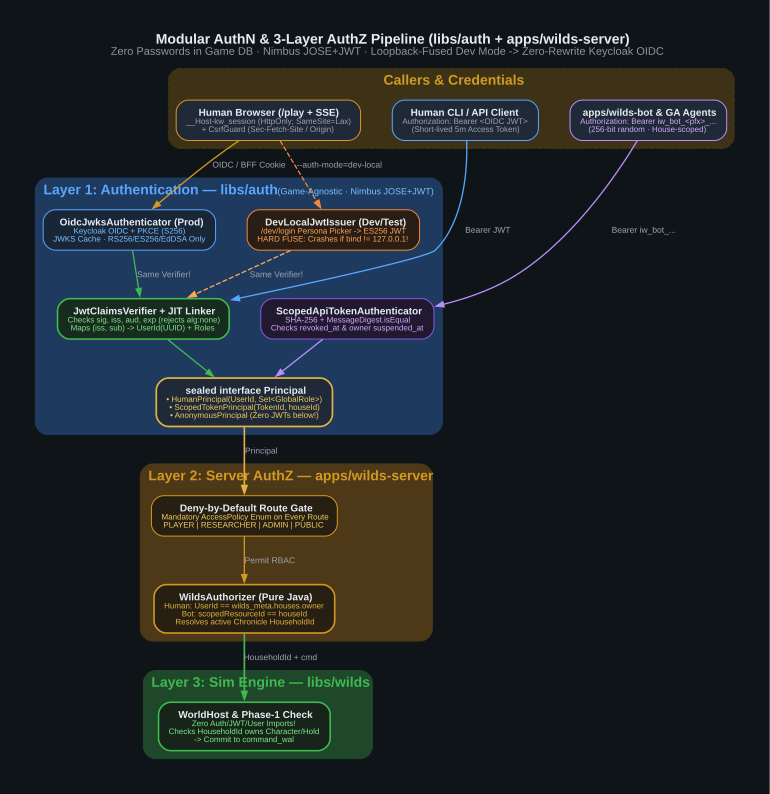

# 07 — Modular Authentication, Authorization & Keycloak Path (`libs/auth`)

This document defines **Authentication (`AuthN`)** and **Authorization (`AuthZ`)** across `kotharworks` and **Ironwood Wilds** with three non-negotiable goals:

1. **Clean Separation & Reusability (`libs/auth`):** Authentication (*"Who is calling, and how did we verify it?"*) lives in a standalone, game-agnostic module (`com.kotharworks:auth`) completely separated from Authorization (*"What is this caller allowed to touch?"*) and from the pure simulation engine (`libs/wilds`, which knows **zero** about JWTs, cookies, users, or Keycloak).
2. **Instant Local Dev Today $\rightarrow$ Drop-In Keycloak Tomorrow:** Local coding and `mvnd test` run in milliseconds with zero Docker containers via a loopback-fused local JWT persona issuer, while production (or local Docker testing) flips `--auth-mode=oidc` to use **Keycloak** with **zero code, API, or game-schema rewrites**.
3. **Boring, Well-Known, Mechanically Verifiable Security:** You never have to trust hand-rolled cryptography or guess whether an AI missed an edge case. Ironwood stores **zero passwords**, delegates JWT cryptography 100% to **Nimbus JOSE + JWT** (OpenID Foundation certified), enforces **deny-by-default** route registration, and gates every build on a plain-English negative security test suite (`AuthSecurityGateTest`).

---

## 1. End-to-End Pipeline at a Glance



> *Graphviz artifacts:* [`08-auth-and-security-pipeline.dot`](diagrams/08-auth-and-security-pipeline.dot) · [`SVG`](diagrams/08-auth-and-security-pipeline.svg) · [`PNG`](diagrams/08-auth-and-security-pipeline.png)

Every incoming request passes through **three strict, single-responsibility seams**:

1. **Layer 1 — Authentication (`libs/auth`):** Verifies the raw credential (OIDC BFF Cookie, `Bearer <JWT>`, or `Bearer iw_bot_...` key) and produces a strongly typed Java 25 `sealed interface Principal`. **No JWT strings, HTTP cookies, or Keycloak classes ever cross below this line.**
2. **Layer 2 — Server Authorization (`apps/wilds-server`):**
   - **Coarse Route Gate (`AccessPolicy`):** Checks global capabilities straight off the `Principal`'s JWT roles (`PLAYER`, `RESEARCHER`, `ADMIN`).
   - **Domain Ownership (`WildsAuthorizer`):** Checks `wilds_meta.houses` (`owner_user_id == principal.userId()`, or `scopedToken.scopedResourceId() == houseId`) and resolves the active Chronicle's generational `HouseholdId`.
3. **Layer 3 — Simulation Authority (`libs/wilds`):** Inside `WorldHost`, pure game logic verifies that `HouseholdId` owns the target `CharacterId`, `HoldId`, or `PartyId` (`ErrorCode.FORBIDDEN`).

---

## 2. Module Boundary & Dependencies (`libs/auth`)

```text
libs/procgen          (0 external deps · 0 I/O · 0 Auth knowledge)
  └── libs/wilds      (Depends ONLY on procgen · 0 I/O · 0 Auth knowledge)
libs/auth             (Standalone KotharWorks AuthN/HTTP security library · com.nimbusds:nimbus-jose-jwt)
  └── apps/wilds-server  (Wires libs/auth + libs/wilds + Postgres/InMemory stores)
```

### Why Only One Focused External Dependency (`nimbus-jose-jwt`)?
- **Never roll custom JWT parsing or signature math:** Hand-written JWT parsers routinely fall prey to `alg: "none"` bypasses, RSA/HMAC key-confusion (`HS256` signed with the public RSA key), invalid curve attacks, or `kid` injection.
- **Nimbus JOSE + JWT (`com.nimbusds:nimbus-jose-jwt`)** is maintained by Connect2id, is **OpenID Foundation certified**, has **zero Spring/Hibernate bloat**, and is the exact library Spring Security's OAuth2/OIDC resource server uses under the hood.
- **Deterministic Testability (`java.time.Clock`):** Unlike pure simulation code in `libs/wilds` (which uses integer logical milliseconds), `libs/auth` validates real-world token expirations (`exp`, `nbf`) via an injected **`java.time.Clock`**. Unit tests pass a controllable test clock to verify 5-minute token expiry and clock-skew tolerance instantaneously without `Thread.sleep()`.

### Package Structure of `libs/auth` (`com.kotharworks.auth`)
```text
libs/auth/src/main/java/com/kotharworks/auth/
├── principal/    UserId(UUID), ExternalIdentity(issuer, subject), TokenId,
│                 GlobalRole (PLAYER, RESEARCHER, ADMIN), sealed Principal
├── jwt/          JwtClaimsVerifier (Nimbus ConfigurableJWTProcessor), KeycloakRoleClaimExtractor
├── oidc/         OidcConfig, OidcJwksAuthenticator, OidcAuthorizationCodeClient (PKCE S256)
├── dev/          DevLocalJwtIssuer (ephemeral ES256 signer + /dev/login HTML), LoopbackStartupFuse
├── token/        ApiTokenCodec (SecureRandom 256-bit generator + SHA-256 + MessageDigest.isEqual),
│                 ScopedApiTokenAuthenticator
└── http/         AccessPolicy, AuthenticatedRouter (deny-by-default wrapper),
                  CookieCodec (__Host-kw_session), CsrfGuard (Sec-Fetch-Site + Origin + token)
```

---

## 3. Domain Principals, JWT Roles & Just-in-Time `UserId` Linking

### 3.1 `sealed interface Principal` (Human vs. Bot Separation)
Treating human users and automated bot scripts as distinct types in a `sealed` hierarchy makes privilege-escalation bugs impossible by construction:

```java
package com.kotharworks.auth.principal;

public record UserId(UUID value) {}
public record ExternalIdentity(String issuer, String subject) {}
public record TokenId(long value) {}

public enum GlobalRole { PLAYER, RESEARCHER, ADMIN }

public sealed interface Principal
    permits Principal.HumanPrincipal, Principal.ScopedTokenPrincipal, Principal.AnonymousPrincipal {

    /** Authenticated human via OIDC / JWT (Keycloak in prod, DevLocalJwtIssuer in local dev). */
    record HumanPrincipal(
        UserId userId,
        ExternalIdentity externalId,
        String displayName,
        Set<GlobalRole> roles
    ) implements Principal {
        public boolean hasRole(GlobalRole role) { return roles.contains(role); }
    }

    /**
     * Scoped automation key (`iw_bot_<prefix8>_<secret>`) bound to ONE owned resource (e.g. HouseId).
     * Carries ZERO GlobalRoles: a leaked bot token can never charter houses, mint tokens, or hit admin APIs.
     */
    record ScopedTokenPrincipal(
        TokenId tokenId,
        UserId ownerUserId,
        String resourceNamespace, // "wilds:house"
        long scopedResourceId     // wilds_meta.houses.house_id
    ) implements Principal {}

    record AnonymousPrincipal() implements Principal {}
}
```

### 3.2 Roles on the JWT + `UserId` in the Game DB (How Keycloak Claims Map)
Keycloak remains **100% game-agnostic**:
- **Coarse Global Roles live on the JWT:** `PLAYER`, `RESEARCHER`, `ADMIN`.
- **Dynamic Game Ownership lives in `wilds_meta.houses`:** `owner_user_id UUID` links a user's `UserId` to their chartered House(s). You **never** push character IDs or house IDs back into Keycloak claims—that keeps Keycloak clean so future KotharWorks games can share the exact same realm.

A standard Keycloak Access JWT (and an identical token minted by `DevLocalJwtIssuer` in tests!) carries:

```json
{
  "iss": "https://auth.kotharworks.com/realms/kotharworks",
  "sub": "f47ac10b-58cc-4372-a567-0e02b2c3d479",
  "aud": "ironwood-wilds",
  "exp": 1795302300,
  "iat": 1795302000,
  "preferred_username": "lord_windy",
  "realm_access": {
    "roles": ["PLAYER", "offline_access", "uma_authorization"]
  },
  "resource_access": {
    "ironwood-wilds": {
      "roles": ["RESEARCHER"]
    }
  }
}
```

`KeycloakRoleClaimExtractor` unions `realm_access.roles` and `resource_access[clientId].roles`, maps matching names (`PLAYER`, `RESEARCHER`, `ADMIN`) into an immutable `EnumSet<GlobalRole>`, and safely ignores Keycloak built-in roles (`offline_access`, `uma_authorization`, `default-roles-*`). Every valid human user implicitly receives at least `GlobalRole.PLAYER`.

### 3.3 Just-in-Time `(issuer, subject) -> UserId(UUID)` Provisioning (Zero Passwords!)
Why do we map `(iss, sub)` to an internal `UserId(UUID)` in `auth.identity_links` instead of putting Keycloak's raw `sub` string in game tables?
1. **OIDC Standard Rule (OpenID Connect Core §5.7):** `sub` is only guaranteed unique *within a given `iss` (issuer)*. The globally unique external key is always the pair `(issuer, subject)`.
2. **Zero-Migration Provider Swaps:** If you ever migrate from one Keycloak server to another (or link a backup OIDC provider), `wilds_meta.houses.owner_user_id` never changes—only `auth.identity_links` updates.
3. **Zero Registration Endpoints in Ironwood:** Registration, passwords, 2FA/Passkeys, password resets, and Discord/GitHub social logins happen entirely inside Keycloak. On the very first request with a valid JWT, Ironwood automatically inserts `auth.users` + `auth.identity_links` inside a single idempotent `INSERT ... ON CONFLICT` upsert (cached in memory so 99.9% of requests cost 0 SQL queries).

### 3.4 The Honest JWT Role Caveat (and Our Two-Line Fix)
Because signed JWTs are self-contained, revoking a role or banning a user in Keycloak does not magically erase a JWT already sitting in a client's memory until its `exp` passes. We close that gap completely:
1. **Short Access Token TTL (`5 minutes`, Keycloak's default):** Role promotions/demotions propagate within 5 minutes automatically.
2. **Instant `suspended_at` Kill-Switch on `auth.users`:** Setting `suspended_at = now()` on a `UserId` invalidates their in-memory user cache entry immediately, rejecting both JWTs and Bot Tokens with `403 ACCOUNT_SUSPENDED` in **under 1 second**.

---

## 4. Swappable Authentication Modes (`dev-local` Today $\rightarrow$ `oidc` Tomorrow)

### Mode 1: `--auth-mode=dev-local` (Instant Local Dev & CI Tests — Zero Docker)
When developing offline or running `mvnd test`:
- On startup, **`LoopbackStartupFuse`** inspects the HTTP bind address. **If `--auth-mode=dev-local` is combined with any non-loopback bind address (anything other than `127.0.0.1` or `::1`), `wilds-server` throws `IllegalStateException` and refuses to boot.** Fake login can never accidentally run on a public VPS.
- `DevLocalJwtIssuer` generates an ephemeral in-memory `ECKey` (`ES256`), wires its public JWK straight into the **exact same `JwtClaimsVerifier`** used for Keycloak, and mounts `GET /dev/login`—a crisp local Persona Switcher with one-click buttons:
  - **Sign in as Alice** (`sub = dev-alice`, `roles = [PLAYER]`)
  - **Sign in as Sam (Lab)** (`sub = dev-sam`, `roles = [PLAYER, RESEARCHER]`)
  - **Sign in as Steward** (`sub = dev-admin`, `roles = [PLAYER, RESEARCHER, ADMIN]`)
- Because `dev-local` signs real `ES256` JWTs with Keycloak's exact JSON claim structure, **every local dev session and every CI run tests the real production JWT verification pipeline**.

### Mode 2: `--auth-mode=oidc` (Keycloak in Local Docker or Production VPS)
Switching to Keycloak requires **zero code changes**—only environment/CLI configuration:

```properties
AUTH_MODE=oidc
OIDC_ISSUER_URL=https://auth.kotharworks.com/realms/kotharworks
OIDC_CLIENT_ID=ironwood-wilds
OIDC_CLIENT_SECRET=${IRONWOOD_OIDC_CLIENT_SECRET}
PUBLIC_ORIGIN=https://wilds.kotharworks.com
```

Under the hood, `libs/auth` enforces strict OIDC security defaults:
- **Authorization Code + PKCE (`S256`) + `state` + `nonce`:** Even as a confidential backend client, `OidcAuthorizationCodeClient` generates a 256-bit `state` (anti-login-CSRF), `nonce` (anti-replay), and PKCE `S256` challenge on every `/auth/login` redirect.
- **Strict Asymmetric Algorithm Allowlist:** `JwtClaimsVerifier` configures Nimbus `JWSVerificationKeySelector` to accept **only asymmetric `RS256`, `ES256`, or `EdDSA`** keys from Keycloak's JWKS endpoint—**hard-rejecting `alg: "none"` and `HS256`**.
- **Mandatory Claim Checks:** Rejects any JWT missing or mismatching `iss` (`OIDC_ISSUER_URL`), `aud` (`OIDC_CLIENT_ID`), `sub`, or `exp` (with a tight 30-second clock-skew allowance).

#### Turnkey Local Keycloak Verification (`deploy/keycloak/compose.yaml`)
Whenever you want to test against a **real Keycloak login screen** locally before VPS launch, a 25-line Compose file boots Keycloak with a pre-imported `kotharworks-realm.json` (containing the `ironwood-wilds` client, an **Audience Protocol Mapper** setting `"aud": "ironwood-wilds"`, and test users for `PLAYER`, `RESEARCHER`, and `ADMIN`):

```yaml
services:
  keycloak:
    image: quay.io/keycloak/keycloak:26.1
    command: ["start-dev", "--import-realm"]
    ports:
      - "127.0.0.1:8180:8080"
    environment:
      KC_BOOTSTRAP_ADMIN_USERNAME: admin
      KC_BOOTSTRAP_ADMIN_PASSWORD: admin-dev-only-loopback
    volumes:
      - ./kotharworks-realm.json:/opt/keycloak/data/import/kotharworks-realm.json:ro
```

### Mode 3: Scoped Bot & GA Tokens (`iw_bot_<prefix8>_<secret>`)
Always active alongside human auth so `apps/wilds-bot` and external researcher scripts authenticate cleanly via `Authorization: Bearer iw_bot_9f8a2c11_<43-char-base64url>`:
- Generated from `java.security.SecureRandom` (**32 bytes = 256 bits of entropy**).
- Shown **once** on creation; Postgres (`auth.api_tokens`) stores only `token_prefix` (`CHAR(8)` for safe UI listing) and `token_sha256` (`BYTEA` 32-byte `SHA-256` digest).
- Verified in constant time via `MessageDigest.isEqual(computedSha256, storedSha256)` while checking `revoked_at IS NULL` and `owner.suspended_at IS NULL`.
- *(Why `SHA-256` instead of Argon2 here? Argon2 protects low-entropy human-chosen passwords against GPU dictionary attacks. A server-generated 256-bit `SecureRandom` key has $2^{256}$ possibilities—brute-forcing is physically impossible, and `MessageDigest` is built into the JDK with zero external dependencies.)*

---

## 5. Browser SSR + SSE (`BFF Cookie` + CSRF) vs. Direct `Bearer` Clients

Because Ironwood's `/play` interface is **Server-Rendered HTML + native browser `EventSource('/api/v1/stream')`**, storing JWTs in `localStorage` is the wrong pattern:
1. Browsers do not attach `localStorage` headers when clicking `<a href="/play">` or opening `new EventSource('/api/v1/stream')` (and putting tokens in `?token=...` URLs leaks secrets into proxy logs and browser history).
2. Any token in `localStorage` can be stolen by JavaScript XSS.

Instead, `libs/auth` supports **two clean transport credentials** into Layer 1:

| Caller | Credential Transport | XSS & CSRF Protection |
| :--- | :--- | :--- |
| **Human Browser (`/play`, `/hold`, SSE)** | **`__Host-kw_session` Cookie** (`HttpOnly; Secure; Path=/; SameSite=Lax`; falls back to `kw_dev_session` on plain `http://127.0.0.1` dev) backed by `auth.web_sessions` (`SHA-256` digest at rest, `granted_roles` stamped from verified Keycloak JWT). | **XSS-immune** (`HttpOnly` hides cookie from JS). **CSRF-guarded** on every cookie-authenticated `POST`/`DELETE` via `CsrfGuard`: requires `Sec-Fetch-Site: same-origin` + `Origin == PUBLIC_ORIGIN`, plus `Content-Type: application/json` on API calls (or per-session `csrf_token` hidden field on `POST /auth/logout`). |
| **CLI, `curl`, & `apps/wilds-bot`** | **`Authorization: Bearer <oidc_jwt_or_iw_bot_token>`** header. | **CSRF-immune by browser spec** (browsers never auto-attach `Authorization` headers cross-site). |

---

## 6. Three-Layer Authorization Matrix

### Layer 1: Deny-by-Default Route Registration (`AuthenticatedRouter`)
Raw `HttpServer.createContext(...)` is **never** called directly by feature handlers. Every route registers through `AuthenticatedRouter.register(method, path, AccessPolicy, handler)` so forgetting an auth check is a compile error:

- `AccessPolicy.PUBLIC` — `/chronicle`, `/api/v1/public/*`, `/auth/login`, `/auth/callback`
- `AccessPolicy.AUTHENTICATED_ANY` — `/api/v1/meta`, `/api/v1/rules`, `/api/v1/household`, `/api/v1/atlas`, `/api/v1/events`, `/api/v1/stream`, `POST /api/v1/commands` *(accepts both `HumanPrincipal` and `ScopedTokenPrincipal`, then delegates resource ownership to `WildsAuthorizer`)*
- `AccessPolicy.HUMAN_ONLY` — `/play`, `GET /api/v1/auth/me`, `POST /api/v1/houses`, `POST /auth/logout` *(rejects `ScopedTokenPrincipal` so bots can never create houses or manage accounts)*
- `AccessPolicy.ROLE_RESEARCHER` — `POST /api/v1/houses/{id}/tokens`, `DELETE /api/v1/houses/{id}/tokens/{tokenId}` *(requires `RESEARCHER` or `ADMIN` on JWT)*
- `AccessPolicy.ROLE_ADMIN` — `/api/v1/admin/*` (Chronicle start/archive, user suspension, quota overrides)

### Layer 2: `WildsAuthorizer` Domain Ownership Matrix (Pure Java in `apps/wilds-server`)

| Operation | `Anonymous` | `Human` (`PLAYER`) | `Human` (`RESEARCHER`) | `Human` (`ADMIN`) | `ScopedToken` (`iw_bot_...`) |
| :--- | :---: | :---: | :---: | :---: | :---: |
| Read `/chronicle` & `/api/v1/public/*` | **Permit** | **Permit** | **Permit** | **Permit** | **Permit** |
| Charter `HUMAN` House (`POST /api/v1/houses`) | `401` | **Permit** *(if active houses `< 1`)* | **Permit** *(up to researcher quota, default `25`)* | **Permit** | `403` *(Bots cannot charter)* |
| Charter `SCRIPT_BOT` / `GENETIC_AGENT` House | `401` | `403 ROLE_REQUIRED` | **Permit** *(up to quota)* | **Permit** | `403` |
| Mint / Revoke `iw_bot_...` Token for `houseId` | `401` | `403 ROLE_REQUIRED` | **Permit** *(iff owns `houseId` & `controllerKind != HUMAN`)* | **Permit** *(iff owns `houseId`)* | `403` |
| Read `/api/v1/household`, `/events`, `/stream` for `houseId` | `401` | **Permit** *(iff `owner == userId`)* | **Permit** *(iff `owner == userId`)* | **Permit** *(iff `owner == userId`)* | **Permit** *(iff `scopedId == houseId`)* |
| `POST /api/v1/commands` for `houseId` | `401` | **Permit** *(iff `owner == userId`)* | **Permit** *(iff `owner == userId`)* | **Permit** *(iff `owner == userId`)* | **Permit** *(iff `scopedId == houseId`)* |
| Start / Archive Chronicle, Suspend User | `401` | `403` | `403` | **Permit** | `403` |

*(Note: Even an `ADMIN` only commands Houses they own through normal `/api/v1/commands`—preventing accidental admin clicks from polluting another player's deterministic House timeline!)*

### Layer 3: Simulation Ownership (`libs/wilds`)
Once `WildsAuthorizer` resolves the caller's single authorized `HouseholdId` in the active Chronicle, `WorldHost` passes `(HouseholdId, WorldCommand)` to `WildsEngine`, which enforces `character.householdId().equals(actor)` (`409 FORBIDDEN`).

---

## 7. "Don't Trust Me — Verify Mechanically" (`AuthSecurityGateTest`)

You never have to guess whether Auth was implemented safely. Every ticket touching `libs/auth` or `apps/wilds-server` is gated on these **12 automated JUnit security checks**:

| # | Attack / Failure Scenario Tested | Required Mechanical Outcome |
| :---: | :--- | :--- |
| **1** | **Unannotated Route Audit:** Inspect all registered routes in `AuthenticatedRouter`. | `0` routes lack an explicit `AccessPolicy`; every non-`PUBLIC` route returns `401` when called with no credentials. |
| **2** | **Public Bind Fuse (`LoopbackStartupFuseTest`):** Start `wilds-server` with `--auth-mode=dev-local --bind=0.0.0.0`. | Throws `IllegalStateException` immediately before opening the socket. |
| **3** | **Tampered JWT Payload (`role: ADMIN` edited in Base64):** Valid header/format, modified claims without IdP private key. | `401 INVALID_TOKEN` (Nimbus JWS signature check fails). |
| **4** | **`alg: "none"` & `HS256` Confusion Attack:** Unsigned JWT or symmetric-HMAC JWT signed using public JWKS bytes. | `401 INVALID_TOKEN` (rejected by asymmetric `RS256`/`ES256`/`EdDSA` selector). |
| **5** | **Expired JWT (`exp` in past):** Advance injected test `Clock` +6 minutes past `exp`. | `401 TOKEN_EXPIRED`. |
| **6** | **Wrong Issuer (`iss`) or Wrong Audience (`aud`):** Validly signed JWT meant for a different realm or client app. | `401 INVALID_TOKEN`. |
| **7** | **Role Escalation (`PLAYER` -> Researcher/Admin):** Valid `PLAYER` user tries to charter a 2nd House, create a `SCRIPT_BOT` House, mint a bot token, or hit `/api/v1/admin/*`. | `403 FORBIDDEN`. |
| **8** | **Cross-User House Spoofing:** User A (`HumanPrincipal`) queries or posts a command targeting User B's `houseId` / `CharacterId`. | `403 FORBIDDEN` (nothing reaches `command_wal`). |
| **9** | **Lateral Bot-Token Escape:** Researcher owns both House #1 (`HUMAN`) and House #2 (`SCRIPT_BOT`); uses House #2's `iw_bot_...` token to read or command House #1. | `403 FORBIDDEN` (`ScopedTokenPrincipal` is locked strictly to `houseId = 2`). |
| **10** | **Bot Privilege Escalation:** Valid `iw_bot_...` token attempts `POST /api/v1/houses` or `POST /api/v1/houses/2/tokens`. | `403 FORBIDDEN` (`HUMAN_ONLY` / `ROLE_RESEARCHER` policy blocks `ScopedTokenPrincipal`). |
| **11** | **Instant Revocation & Suspension:** Revoke `iw_bot_...` token (`revoked_at`) or suspend `UserId` (`suspended_at`), then immediately retry request. | `401` (revoked token) / `403 ACCOUNT_SUSPENDED` (suspended user). |
| **12** | **Cross-Site Cookie Forgery (CSRF):** Send cookie-authenticated `POST /api/v1/commands` with `Sec-Fetch-Site: cross-site` or `Origin: https://evil.example`. | `403 CSRF_REJECTED` before parsing command body. |
