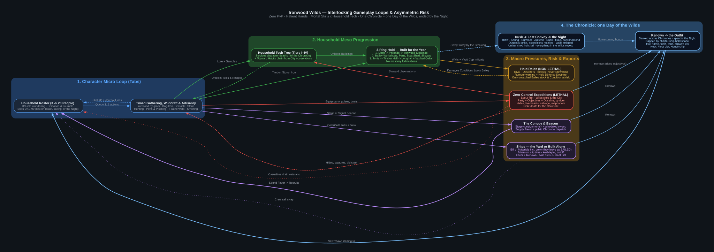

# Ironwood Wilds — Game, Worldbuilding & Simulation Brief

*Implementation status: see [Current Status](README.md#current-status) and the [engine noun mapping](README.md#engine-primitives-vs-gameplay-nouns). References to `libs/procgen` describe the planned module (returns in Phase 1 Ticket 14).*

## 1. High Concept & Worldbuilding

**Ironwood Wilds** is a persistent, online, text-based frontier colonization simulation played over an HTTP + SSE API by humans, scripted bots, and (in Phase 2) evolved genetic agents alike. Its aesthetic is **grounded, rain-soaked low fantasy**—mud, wet slate, hemlock palisades, charcoal pit-kilns, bog-iron, scarred men-at-arms, and half-sunken First-Age barrows beneath ancient trees.

### The Premise: The Besieged Homeland & The Unresolved Rival
> *The Homeland is losing a long war across the grey water. To survive it, the Crown charters Households like yours and puts them ashore on wild continents—to fell, quarry, smelt, and ship war materiel back on the Tithe Ships. Someone else was sent too. Across the fens and beyond the crags, another power's expeditions are stripping the same hills to save whatever they are trying to save. Nobody at the pier will tell you who they are.*

That mystery is **deliberately unresolved** and mechanically renewed every server cycle (**Chronicle**):
1. **Carve a Sovereign Hold out of the Wilderness:** Grow from a damp canvas landing camp into a 3-ring stone-and-ironwood fortress.
2. **Train Mortal Specialists & Climb the Household Tech Tree:** Individual settlers grind OSRS-style skills (1–99) while your Household permanently unlocks metallurgical, architectural, and martial technologies.
3. **Stage Goods for the Homeland Tithe Ship:** Ship timber, wrought iron, arms, and rare **True Ironwood** home for **Supply Favor**—the lifeline currency that recruits fresh settlers from Homeland transports when your veterans die in the deep wilds.
4. **Survive Foreshadowed Raids & Brave Lethal PvM Expeditions:** Defend your Hold via pre-planned non-lethal Defense Doctrines while sending organized Parties into monster lairs, blighted groves, and rival outposts for rare tech catalysts.

### Why Chronicles (Seasonal Resets) Belong to the Fiction
Persistent economy games stagnate if stockpiles inflate forever. Ironwood Wilds separates restarts into two distinct events:
- **Routine Maintenance Restarts** pause the logical clock cleanly (`PAUSE_WHILE_DOWN`) and resume mid-action from Postgres (`command_wal` + snapshots) without losing a single second of mining progress.
- **Chronicle Resets** (every ~3–6 weeks, or when a Chronicle's narrative climax concludes) close an expedition campaign. At Chronicle start, `libs/procgen` draws a fresh continent **plus 3–5 seeded Chronicle Myth Flags** (whether the unseen rival expedition is desperate, brazen, or dying; what signature ruin or atrocity marks the interior; what final push closes the season). Your permanent **House name, heraldry, saved Doctrine Blueprints, and Hall of Chronicles record/epitaphs** carry forward cosmetically—never carryover stats or gear—so every Chronicle is a fair race for humans, bots, and new players.

---

## 2. Core Design Pillars

| # | Pillar | What It Means in Practice |
| :---: | :--- | :--- |
| **P1** | **Patient Hands, Living People** | **Zero behavioral autonomy** (the explicit anti-*Sims* rule): when a settler's queue empties, they stand `IDLE_PATIENT` forever and never wander off or burn materials. **Full procedural character**: every settler has a seeded origin, temperament, quirks, scars, and a first-person auto-journal. |
| **P2** | **Multi-Character Clipboard Rhythm** | You play a **Household** (starting with 3–4 people, growing to 12–20), cycling tabs like a frontier steward scheduling a workshop. Each character holds `1 active + 5 pending` timed actions. |
| **P3** | **Real Offline Progress & Walk-Away Safety** | Actions take real/logical minutes and resolve whether you are logged in or asleep. Hunger/fatigue are speed/yield *modifiers*, **never** starvation death spirals—logging off for 8 hours is safe by design. |
| **P4** | **OSRS Mortal Skills × Household Tech Tree** | **Characters** hold individual Skill XP; **Households** hold Tech Tree unlocks and Buildings. If your Level 42 Master Smith dies in a barrow delve, you keep the Forge, but her hard-won mastery dies with her. |
| **P5** | **Asymmetric Violence — Zero PvP** | Players **never** attack or loot other players. **Hold Raids** are foreshadowed, doctrine-driven, and **strictly non-lethal** (costing only unvaulted goods and wall condition). **PvM Expeditions** are opt-in and **season-permanently lethal**. |
| **P6** | **Watchable Rumors & Shared Chronicle** | No global chat or moderation burden; the world speaks through a live **Chronicle Wire** carrying public milestones and **fogged rumors** (*"smoke seen past the ridge"*, *"an ironwood grove was sighted in the eastern fens"*). |
| **P7** | **The API Is the Game** | Humans in the SSR multi-tab UI, external bots, and future `SamVM` genetic agents all drive the exact same `POST /api/v1/commands` + SSE contract. |

---

## 3. Interlocking Gameplay Loops



> *Graphviz artifacts:* [`04-gameplay-loops-and-risk.dot`](diagrams/04-gameplay-loops-and-risk.dot) · [`SVG`](diagrams/04-gameplay-loops-and-risk.svg) · [`PNG`](diagrams/04-gameplay-loops-and-risk.png)

```text
   ┌──────────────────────────────────────────────────────────────────────┐
   │  MICRO LOOP (1–10 mins): Character Tabs, Queues & Skill Grinding     │
   │  Cycle character tabs -> queue gather/refine/craft -> gain Skill XP   │
   │  & read temperament-driven Character Journal lines                   │
   └───────────────────────────────────┬──────────────────────────────────┘
                                       ▼
   ┌──────────────────────────────────────────────────────────────────────┐
   │  MESO LOOP (30 mins – hours): Tech Tree & 3-Ring Hold Construction   │
   │  Refine tiers -> unlock Tech Nodes -> build Workshops, Vaults, Walls │
   └───────────────┬───────────────────────────────────┬──────────────────┘
                   ▼                                   ▼
   ┌───────────────────────────────┐   ┌──────────────────────────────────┐
   │  EXPEDITION LOOP (Lethal PvM) │   │  TITHE SHIP & RAID LOOP (Macro)  │
   │  Muster Party -> set Gambits  │   │  Stage goods at Signal Beacon -> │
   │  -> delve Lair -> rare relics │   │  Tithe Ship converts to Favor -> │
   │  (Risk: Season Permadeath!)   │   │  recruit settlers & repel Raids  │
   └───────────────┬───────────────┘   └───────────────┬──────────────────┘
                   └─────────────────┬─────────────────┘
                                     ▼
            [ Rare Ironwood Mastery, Great Hold, Hall of Chronicles ]
```

---

## 4. Characters: "Patient Hands, Living People"

A purely mechanical colonist (`Miner #2`) makes permadeath feel like losing a replaceable drill bit. Conversely, *The Sims*-style behavioral autonomy ruins API/bot predictability. Ironwood Wilds separates **control** from **character**:

- **100% Deterministic Obedience:** Characters execute only what you queue. They never refuse an order because of a mood roll, never eat reserved rations unprompted, and never wander away from their post.
- **100% Procedural Humanity:** Because `libs/procgen` already owns deterministic grammar and slot/template composition, every person stepping off a Homeland ship is generated as a distinct human being.

### 4.1 Procedural Character Persona (`CharacterPersona`)
Seeded deterministically from `(WorldSeed, entitySeq)` at creation:
1. **Low-Fantasy Name & Byname (`NameGrammar`):** Phonotactically grounded names with **zero high-fantasy apostrophes**—e.g., *Aldric of Greywater*, *Mara Ashford*, *Pell Fen-Born*, *Jory Vance*, *Brenna Holt*.
2. **Homeland Origin & Crossing Reason:** Why did the Homeland Quartermaster put them on the ship? Examples: *Disgraced Watch-Sergeant*, *Debt-Bound Guild Sawyer*, *Conscripted Peat-Cutter*, *Widowed Quarry-Mason*, *Third-Born Border Squire*. Grants a modest starting skill head-start (Lv. 2–4) and seeds personal vocabulary for their journal.
3. **Temperament & Quirks (2 Seeded Traits, Zero RNG Sabotage):**  
   Each settler draws a **Voice Archetype** (`STOIC`, `WRY`, `GRIM`, `SUPERSTITIOUS`, `EARNEST`, `METICULOUS`) plus a **Habit Facet** (*notches tally-marks into tool hafts*, *mistrusts First-Age barrow stone*, *hums coastal rowing cadences at the bellows*, *complains whenever fen-rain sets in*). Traits shape prose, idle descriptions, and journal voice—never secretly sabotaging deterministic durations.
4. **Visible Craft & Battle History (Dynamic Life Marks):**
   - **Skill Calluses:** Inspecting (`examine`) a character reflects their highest skill tier—a Lv. 35 Smith has *cinder-pocked forearms and a leather apron stiff with slag*; a Lv. 30 Ranger has *wind-narrowed eyes and peat-stained greaves*.
   - **Scars, Deeds & Grief:** Narrowly surviving a PvM delve (`HP < 15%`) leaves a permanent named scar (*"ragged wolf-jaw scar along the left forearm — Red-Pine Den, Day 9"*). Standing in a Party when a comrade falls records a permanent bond memory, while fallen settlers themselves have their portrait/persona and final Journal archived in the Hold's **Cairn / Memorial Roll** with a generated epitaph.
5. **First-Person Procedural Character Journal:**  
   Every character tab includes a compact **Journal** generated deterministically from their `WorldEvent` history + `CharacterPersona` (zero LLM calls). Notice how two miners react differently to the exact same `ActionFailed(DEPLETED)` event:
   - *Pell (`WRY`, Peat-Cutter):* `"Day 10 — Hook-Ridge hematite pinched out to barren quartz. Walked four miles uphill to chip wet gravel."`
   - *Mara (`SUPERSTITIOUS`, Quarry-Mason):* `"Day 10 — The red seam bled dry before noon. Older picks than ours already took the heart of this hill."`

### 4.2 Vitals, Needs & Equipment
- **`Health (0–100)`:** Damaged in PvM delves (or bruised during Hold raids). Restores via rest at the Hearth/Infirmary and herbal poultices. **`Health == 0` in PvM = permanent death** for the rest of the Chronicle; needs decay **never** reduces Health.
- **`Stamina / Satiety (LazyGauges, 0–100_000 milli-units)`:** Heavy labor and marches drain stamina; resting or eating rations restores it. Low stamina applies a clean integer duration multiplier (`×135%` duration when exhausted) rather than killing the character—preserving walk-away safety.
- **Loadout Slots:** `Tool` (Pickaxe, Felling Axe, Hammer—with durability), `Weapon`, `Armor`, and `Pack/Cloak` (sets stone-weight carry capacity for hauling from distant seams).
- **Action Queue:** `1 active` + up to `5 pending` actions (with per-slot batch count `1..10` so `Mine ×4` uses one slot rather than four).

### 4.3 Individual Skills (The OSRS Grind)
Characters level individual skills (`1–99`, exponential XP table via pluggable `SkillFormulaStrategy`; XP awarded **on batch completion only**):

| Category | Skills | Core Payoff of Higher Levels |
| :--- | :--- | :--- |
| **Gathering** | **Woodcutting**, **Mining**, **Quarrying**, **Foraging / Trapping** | Unlocks harder seams/groves (*Bog-Iron* Lv.1 -> *Crag Hematite* Lv.15 -> *Black-Ore* Lv.45; *True Ironwood* Lv.35+), shrinks batch duration, raises bonus yield permille chance. |
| **Artisanry** | **Carpentry**, **Masonry**, **Smithing**, **Craft & Leather**, **Cooking & Herbalism** | Unlocks higher-grade gear/building components, cuts fuel waste, improves crafted tool durability. |
| **Scholarship** | **Lore & Engineering** | Researches Household Tech Tree nodes, deciphers First-Age ruin salvage, builds advanced Hold traps. |
| **Martial** | **Vanguard (Melee/Shield)**, **Ranging & Scouting**, **Command** | Raises hit/defense in PvM & Hold defense; *Scouting* reveals region sites/lairs; *Command* expands Party size and Gambit slots. |

---

## 5. The Household Tech Tree & True Ironwood Scarcity

While Skills live inside mortal heads, **Tech Unlocks** belong permanently to your **Household** for the entire Chronicle:

1. **Tier I — Camp & Timber (Landing Hour):** *Lean-To Bunks, Stone Tools, Charcoal Pit-Kiln, Ditch & Stakes, Camp Rations, Signal Beacon (enables Tithe Ship staging).*
2. **Tier II — Hearth & Bloomery (Early Hold):** *Timber Palisade, Ridge Watchtower, Peat/Charcoal Bloomery, Wrought-Iron Tools & Spears, Vaulted Cellar, Militia Drill.*
3. **Tier III — Stone & Crucible (Fortified Manor):** *Dressed-Stone Curtain Wall, Gatehouse, Blast Furnace & Steel, Crossbows, Apothecary Poultices, Deep-Shaft Shoring.*
4. **Tier IV — True Ironwood & First-Age Salvage (The Great Hold):** *Seasoned Ironwood Beams (rot-proof, fire-proof), Relic-Tempered Arms (requires PvM barrow catalysts), Stone Keep.*

### Why "Ironwood" Is the Title Resource
Ordinary woods (*ash*, *hemlock*, *grey-pine*) are plentiful around Landing Wards. **True Ironwood Groves** are geographically scarce (**at most `2` groves per entire continent**, spawning only in deep, wet-temperate interior basins far from every Landing Pier). Ironwood requires high Woodcutting, sits in high-threat territory, builds virtually indestructible Tier IV defenses, and commands an extraordinary **Supply Favor** multiplier on the Homeland Tithe Ship. Even *sighting* an Ironwood grove emits an unverified world rumor onto the public Chronicle!

---

## 6. Economy: The Signal Beacon, Tithe Ship & Roster Growth

- **Zero Player-to-Player Trading (v1):** Prevents multi-account funneling and keeps every Household's grind and bot benchmark honest.
- **Staging & The Scheduled Homeland Tithe Ship:**  
  Once your Household builds a **Signal Beacon**, characters haul surplus goods (`stageShipment`) into the Beacon Stockpile. On a scheduled world heartbeat (e.g., every **3 game-days**, or accelerated in Slice 0 demo mode), the **Homeland Tithe Ship** makes landfall, sweeps staged crates aboard, awards **Supply Favor** according to the Chronicle's rate table + rotating **Urgent War Requisitions** (`1.5×–2×` bonus for specific war gear), and posts a public Chronicle dispatch:
  > *`SHIPMENT` · House Ashford shipped 30 ash timber and 12 wrought-iron spears; the Homeland breathes. (+140 Favor)*
- **Roster Growth Valves (Cap: Beds + Favor Tier, up to 12–20):**
  1. **Homeland Recruits (Primary Valve):** Spend Supply Favor to summon a fresh settler on the next ship. Replacement recruits up to your base charter size (`3–4`) are cheap so a PvM wipe isn't an unrecoverable death spiral; expansion slots scale upward in Favor cost and require built Beds.
  2. **Household Lineage / Births (Post-Slice Expansion):** Paired colonists with spare Hearth-Hall quarters can raise heirs carrying household surnames and slight inherited skill aptitudes (ported from `samvillage`).

---

## 7. PvM Expeditions (Deterministic Autobattler, Lethal Stakes)

Beyond the safe Landing Ring lie **Monster Lairs, Blighted Groves, Deserter Camps, and First-Age Barrows**—all **instanced per delve** so players never grief or kill-steal each other.

1. **Muster & Loadout:** Form a Party of `2–5` characters at your Hold, assign `Frontline` / `Backline` rows, pack rations/poultices, and attach a **Combat Doctrine** (Standing Order).
2. **Pre-Planned Combat Doctrine (Optimizable Data, Zero Twitch Clicking):**
   - *Retreat Gambit:* e.g., `"Retreat immediately if ANY member falls below 35% Health OR Frontline collapses"` (retreating suffers 1 parting-blow round—greedy doctrines risk permadeath; cautious doctrines come home scarred but alive).
   - *Target Focus:* `"Pin Alpha Threat"` / `"Cull Weakest First"` / `"Guard Backline"`.
   - *Poultice Threshold:* `"Apply Moss Poultice when HP < 50%"`.
3. **Deterministic Resolution & Battle Chronicle:**  
   `MARCH_OUT -> DELVE_BEATS -> SALVAGE -> MARCH_HOME` resolves deterministically from `(Party, Loadout, CombatDoctrine, SeededLair)`—meaning bots and future GAs can genuinely optimize doctrines—and emits a rich, turn-by-turn medieval **Battle Chronicle**.

---

## 8. The 3-Ring Hold, Awareness Dial & Non-Lethal Raids

### 8.1 Three-Ring Castle Architecture
Buildings inside your Hold occupy three functional rings that directly govern Raid math:
1. **Outer Works (Defense):** *Ditch & Stakes -> Timber Palisade -> Stone Curtain Wall -> Gatehouse -> Watchtower.* Sets **Fortification Integrity** and ranged volley rounds before raiders breach the yard.
2. **Bailey & Workshops (Industry):** *Pit-Kiln, Sawpit, Bloomery, Forge, Study, Beacon.* Exposed to condition damage and unvaulted resource pillage if Outer Works are breached.
3. **Keep & Vault (Sanctuary):** *Hearth-Hall / Stone Keep + Vaulted Cellar.* Guarantees a **100% raid-immune Stockpile Floor** (`vaultProtectedCap`) and serves as the fallback sanctuary for unarmed artisans.

### 8.2 Awareness Scaling & Strict Non-Lethal Raid Rule
- **Personal-First Awareness Dial (Anti-Newcomer-Gank):** Raid frequency and severity scale primarily with **your own Household's profile** (forges burning, Beacon shipments, Ironwood felled, Tech Tier) plus a mild regional warmth factor—so a player joining mid-Chronicle gets gentle scout probes rather than endgame warbands.
- **Foreshadowed Rumor Warnings:** Watchtowers and regional rumors warn you well ahead of impact (*"smoke seen past the eastern ridge — greywood marauders strike in 2 hours"*), turning raid prep into dramatic narrative content.
- **Standing Hold Defense Doctrine:** Assign each character's raid role in advance (*Cedric -> Gatehouse Spear-Wall*; *Brenna [Master Smith] -> Retreat Immediately to Keep Sanctuary*) plus wall fallback thresholds.
- **Hard Rule — Goods & Walls, Never Lives:**  
  Hold raids **never kill colonists**. Overwhelmed militia retreat into the Keep with temporary `Bruised` work-speed debuffs; raiders steal up to `X%` of **unvaulted** Bailey stock and chip building `Condition` (repaired via `REPAIR` actions), then withdraw. Permadeath belongs strictly to opt-in expeditions where *you* chose to march into the dark.
