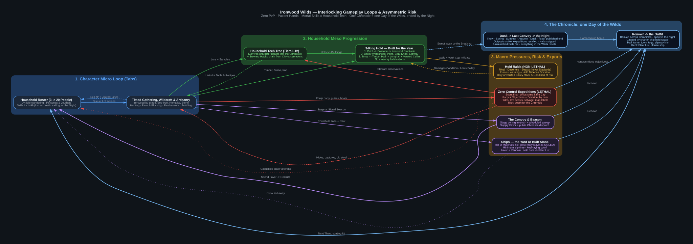

# Ironwood Wilds — Gameplay Mechanics

*Implementation status: see [Current Status](README.md#current-status) and the [engine noun mapping](README.md#engine-primitives-vs-gameplay-nouns). References to `libs/procgen` describe the planned module (returns in Phase 1 Ticket 14).*

*Companion to [IronwoodWildsFlavour.md](IronwoodWildsFlavour.md). This document holds **rules, states and numbers**. The setting, tone and the reasons things are the way they are live in the flavour bible. Nouns marked † are working names (see the [Names Register](IronwoodWildsFlavour.md#11-names-register)). Sections tagged **[NEW]** or **[CHANGED]** came out of the 2026-11 setting rework and are proposals; untagged sections carry over from the original brief.*

**Version:** V1 (tagged 2026-11-24). Review notes for V1: [workingQuestions.md](workingQuestions.md).

---

## 1. Game Shape

A persistent, online, text-based colonisation simulation played over `POST /api/v1/commands` + SSE by humans, scripted bots, and (Phase 2) evolved genetic agents. A player runs one **Household**: a roster of mortal characters working a Hold on a procedurally generated continent, exporting goods and ships to an off-map Homeland in return for **Supply Favor**, and earning **Renown†** that carries into the next season. A season (**Chronicle**) is one **Day** of the Wilds, a habitable year from Thaw to the Dusk, and it ends on a fixed date when **the Night** falls ([§4](#4-season-structure-chronicles-changed)).

## 2. Design Pillars

| # | Pillar | Rule |
| :---: | :--- | :--- |
| **P1** | **Patient Hands, Living People** | **Zero behavioural autonomy.** When a queue empties the character is `IDLE_PATIENT` forever: no wandering, no consuming stock. Personality affects **prose only**, never durations, yields or obedience. *Standing orders the player sets (repeat orders, the ration order) are orders, not autonomy* **[NEW]**. |
| **P2** | **Multi-Character Clipboard Rhythm** | A Household starts with 3–4 characters and grows to 12–20. Each holds `1 active + 5 pending` timed actions. |
| **P3** | **Real Offline Progress & Walk-Away Safety** | Actions resolve in logical time whether or not the player is connected. Needs are speed/yield **modifiers only**; nothing dies from neglect: not characters, and not penned beasts **[NEW]**. |
| **P4** | **Mortal Skills × Household Tech** | Skill XP lives on characters; Tech unlocks and Buildings live on the Household. A character's death (or departure) loses their skills, never the Household's tech. |
| **P5** | **Asymmetric Violence, Zero PvP** | Players never attack, steal from or trade with each other. Hold and **outpost** raids are NPC, foreshadowed and **non-lethal**: they drive people off and ruin things, nothing more. Expeditions are opt-in and **lethal for the season**. |
| **P6** | **Watchable Rumours & Shared Chronicle** | No chat. The world speaks through the public **Chronicle Wire**: milestones, launches, and fogged rumours. |
| **P7** | **The API Is the Game** | Humans, bots and GAs drive the identical command + SSE contract. |
| **P8** | **Deeper Is Richer, Riskier** **[NEW]** | Resource quality, beast size, salvage value and threat all scale with depth: **band** in the Wilds, **district depth** in the City. |
| **P9** | **Shared Ships, Separate Holds** **[NEW]** | The only cooperation between players is contributing to shared **Yard** builds. Contributions are one-way and never transfer goods between Households. |
| **P10** | **Set It and Watch It** **[NEW]** | Expeditions are **zero-control** once they leave: you choose the party, the objectives and the doctrine, then read what happened. |

## 3. Gameplay Loops



> *Graphviz artifacts:* [`04-gameplay-loops-and-risk.dot`](diagrams/04-gameplay-loops-and-risk.dot) · [`SVG`](diagrams/04-gameplay-loops-and-risk.svg) · [`PNG`](diagrams/04-gameplay-loops-and-risk.png) — *updated for the 2026-11 rework (Yard and solo ships, beasts, City, Day/Night, Outfit).*

```text
   MICRO (1–10 min)     Cycle character tabs → queue gather/refine/craft/hunt → Skill XP + journal lines
          │
   MESO (30 min–hours)  Refine tiers → unlock Tech → tents → timber hall → Workshops, Pens, Boat Sheds, Palisade
          │
          ├── EXPEDITION     Assign party + objectives (+ beasts) → river travel → hunt / capture / delve the City
          │                  → hides, down, live beasts, salvage, map labels, outpost ground
          │                                                                     (risk: season permadeath)
          │
          ├── OUTPOSTS [NEW] Claim scouted ground → raise a camp → work it on repeat orders → haul home
          │                  → Notice climbs → hold it, or pull out before it is burned    (risk: goods, never lives)
          │
          ├── CONVOY         Stage consignments at the Beacon → Convoy heartbeat → Favor
          │
          └── SHIPS [NEW]    Contribute to a shared Yard hull, or attempt a solo hull → launch → Favor + Renown
                              │
                     Favor → recruits → train → (work | garrison | expedition | sail as crew)
                     Food  → the Table → work-speed bonus; provisions for hulls [NEW]
                     Renown → banked → spent in the Night on next Chronicle's Outfit
                              (starting kit, slipway kits, House ship fittings)

   SEASON (~4 weeks)    Thaw → Spring → Summer → Autumn → Dusk (last Convoy) → the Night (reset)
```

### 3.1 The check-in rhythm [NEW]
The game is played in **check-ins**, not sessions. Every system should hand the player a **decision** at a check-in, never a chore.

| Timescale | Unit | What happens |
| :--- | :--- | :--- |
| Minutes–hours | **Action** | A batch completes → yield, XP, journal line. |
| Hours (≤ 36 h) | **Repeat order** | Runs while the player is away and stops on its condition ([§5.6](#56-queues--repeat-orders-new)). Stopping raises an idle alert. |
| 5–15 min, 2–4× a day | **Check-in** | **Read:** journals, raid reports, expedition chronicles, idle alerts. **Fix:** restock, swap tools, set the Table. **Decide:** hold or pull each outpost? Supply run? Expedition? Stage the Convoy? Contribute to the Yard? **Set** repeat orders and walk away. |
| Days | **Outpost lifecycle** | Found → work → Notice climbs → pull out or lose it ([§12.5](#125-outposts-new)). |
| ~7 days | **Season** | Plumage, channel states, crop timing, keel cutoffs. |
| ~4 weeks | **Chronicle** | The Dusk → last Convoy → the Night → Outfit. |

Repeat orders should be tuned (mostly by tool durability and input stock) to run for **roughly a night's sleep**, so an evening check-in carries the House to the morning one.

---

## 4. Season Structure (Chronicles) **[CHANGED]**

- **A Chronicle is one Day of the Wilds**: the habitable year from Thaw to the end of the Dusk ([flavour §4.1](IronwoodWildsFlavour.md#41-the-day-and-the-night)). It ends when **the Night** falls, on a **fixed date published at Chronicle start**. Nothing ends a Chronicle early, and bots can plan against the deadline from tick zero. Target length is **~4 real weeks** (range 3–6, set per Chronicle).
- **Maintenance restarts** pause the logical clock (`PAUSE_WHILE_DOWN`) and resume from `command_wal` + snapshots with no lost progress.
- **Chronicle resets happen during the Night.** The finished world is archived, and the next Chronicle boots at Thaw with a fresh continent (a fresh stretch of coast) and a fresh **City quarter** from `libs/procgen`, plus **3–5 Myth Flags**.
- **Myth Flags**: seeded season parameters describing the war's state:
  - *Rival posture* (`DESPERATE` / `BRAZEN` / `FAILING`): scales NPC raid pressure and the Rival's public launch count (bragging rights only).
  - *Homeland shortage*: which export categories carry standing requisition bonuses this season.
  - *Interior signature*: a beast migration, a bitter Dusk, a City quarter that is unusually active, and so on.
  - *Calendar* **[NEW]**: *Late Thaw*, *Long Summer*, *Early Night* and so on. Shifts season boundaries and the Night date. Drawn at Chronicle start, so the published end date already includes it.
  - *Dusk event* **[CHANGED]** (was *Season climax*): the final push during the Dusk ([§4.2](#42-the-dusk--the-night-new)), e.g. a Rival fleet in the strait, an early freeze closing the upper rivers, a Council demand for one more hull. It no longer ends the Chronicle; the Night does.

### 4.1 The Wilds year [NEW]
Five playable seasons, then the Night. **There is no Winter** **[CHANGED]**: the cold season is the Dusk, and the Night follows it ([flavour §4.1](IronwoodWildsFlavour.md#41-the-day-and-the-night)). Season boundaries are a pure function of `(clock, Chronicle calendar)`: deterministic, replay-safe, and readable by bots.

| Season | Share | At 4 weeks | Plumage ([§8.2](#82-plumage-seasons-replaces-torpor)) | Rivers ([§7.2](#72-rivers-shifting-channels)) | Pressure |
| :--- | :---: | :---: | :--- | :--- | :--- |
| **Thaw** | 20% | ~5.5 days | Winter plumage, starting to turn | High water after the Breaking; `SNAGGED` / `BRAIDED` common | Arrival. Tents up, first scouting runs, fields sown. Raids rare. |
| **Spring** **[NEW]** | 20% | ~5.5 days | Turning; moult begins late | Falling; snags clearing, `BRAIDED` at depth | First galley keels. Heart-ironwood runs. **Carrack keel cutoff at the end of Spring.** |
| **Summer** | 20% | ~5.5 days | **Moult**: pens can be plucked, wild hides low grade | Glacier melt; mostly `OPEN`, braiding at depth | Long days. Expeditions push deep. **Cog keel cutoff.** |
| **Autumn** | 20% | ~5.5 days | Plumage coming in thick | Falling and clearing; best travel of the year | Rival grows brazen; raids rising. **Galley keel cutoff.** |
| **the Dusk** **[CHANGED]** | 20% | ~5.5 days | **Full winter plumage**: prime hides and down, but **the dens empty** as it wears on ([§8.2](#82-plumage-seasons-replaces-torpor)) | `ICED` common; `CLOSED` in bands 3–4 late in the season | **Raids peak** (the Rival's last push, deserters after food). No keels laid. Walls come down ([§12.1](#121-rings)). Outposts strike, expeditions recalled. Ends with the **last Convoy**. |
| **the Night** | — | 2–4 days downtime | — | — | Not played. Rollover, Hall of Chronicles, Outfit spending. |

- **Calendar granularity (proposal):** 1 real day ≈ 1 Wilds week, so a 4-week Chronicle is ~28 Wilds weeks (~5–6 per season). Channel states re-roll each Wilds week (once a real day), and the Convoy heartbeat (every 3 game-days) comes round roughly every 10 real hours. In the fiction the Night lasts months. In play it is a few real days with the clock stopped.

### 4.2 The Dusk & the Night [NEW]
- **The Dusk** **[CHANGED]** is the fifth and last season of the Day (was the last stretch of Winter). The Dusk-event Myth Flag fires here. It is the endgame: raids peak, the dens empty, walls are stripped for timber ([§12.1](#121-rings)), and everyone makes for the Landing.
- **The last Convoy** sails on Night-eve, at the end of the Dusk. It sweeps staged goods as usual, then **embarks the roster**. Characters at the Hold go home: this isn't a roster exit, and the Hall of Chronicles records them as having served the year.
- **Everyone comes home by default** **[CHANGED]**. Missing the last Convoy is flavour, not a trap: nobody is lost to the Night because the player was asleep.
  - **Outposts strike.** Each outpost's posted characters drop their orders at the last moment that still lets them walk home before the last Convoy (worked out from the river-graph distance; everyone knows the date). They carry what their packs hold; the rest of the outpost stock is left. Haul trips and anyone else away from the Hold do the same.
  - **Expeditions are recalled.** Every expedition carries an automatic **Convoy recall**: at the last beat that still lets the march home make the last Convoy, the party abandons its remaining objectives and turns for home. This is part of the deterministic resolution at departure, like the Retreat Gambit.
- **Left to the Night:** only by choice. An expedition mustered so late that even the march out and back can't make the last Convoy shows a plain warning at muster (*"they will not be back before the last Convoy"*) and needs confirming. Those characters leave the roster as `LEFT_TO_THE_NIGHT` ([§5.5](#55-leaving-the-roster-changed)).
- **Homecoming:** a House whose whole roster is aboard the last Convoy earns a small, **flat** Renown bonus ([§4.3](#43-renown--the-outfit-new)). With automatic strikes and recalls nearly every House earns it, **on purpose**: it is a kindness, so a House that had a bad year still banks something toward its next Outfit. It doesn't scale with performance, so it matters most to the Houses that earned least. Only a confirmed late muster ([Left to the Night](#42-the-dusk--the-night-new)) forfeits it.
- **Hulls:** a hull of any kind launches only if its keel was laid in time ([§10.1](#101-bill-of-materials)). An unlaunched solo hull fails at the Night ([§10.3](#103-solo-builds-challenge)); an unlaunched Yard hull is broken up ([§10.2](#102-the-yard-shared)).
- **P3 still holds.** An offline player loses nothing at the Night that the reset wasn't going to take anyway. `LEFT_TO_THE_NIGHT` changes only the record (Memorial Roll instead of homecoming) and forfeits the homecoming bonus.
- **During the Night:** the world is archived, the Hall of Chronicles is published, and Houses spend Renown on their next **Outfit**. The new Chronicle boots at Thaw.

### 4.3 Renown & the Outfit [NEW]
> **Principle agreed (2026-11):** Renown is banked across Chronicles and spent on what the House brings to the next one. Costs, sizes and the full catalogue are still placeholders.

Doing well should matter beyond one season.
- **Renown†** is a per-House **currency earned during a Chronicle**, **banked** across resets and **spent** during the Night. Proposed sources: ship launches (solo launches especially), Convoy Favor totals, deep City objectives completed, heart ironwood felled, mossbacks taken, the flat **homecoming** bonus (a floor for Houses that had a poor year, [§4.2](#42-the-dusk--the-night-new)), and a small, **capped** **well-kept House** bonus for days spent at *Good table* or better ([§5.7](#57-food--the-table-new)). Food never converts to Renown in any other way.
- **Lifetime Renown** (total ever earned, never reduced by spending) is the House's standing with the Council. It grows the charter hold by small, capped steps.
- **The Outfit.** Each House sails out at Thaw on a charter ship whose **hold has fixed capacity** (*hold space*). Every Outfit item costs **Renown + hold space**. The hold is the fairness cap: a veteran House starts *better equipped*, not *out of reach*. Bots are benchmarked from a zero-Renown, base-hold start.
- **Outfit items are consumed by the Chronicle** and lost to the Night like everything else, unless they are fitted to a House ship ([§10.7](#107-the-house-ship-stretch-new)).

| Outfit item (examples) | Effect | Hold space |
| :--- | :--- | :---: |
| Pre-cut hall frame | Start with a Timber Hall instead of charter-issue tents. | Large |
| Arsenal tools | Starting tools one tier up. | Small |
| Teg clutch | 2–3 eggs ready to imprint. | Small |
| River pilot | One starting settler gets a Rivercraft head start (an otherwise normal character). | Medium |
| Extra settler | +1 starting character (needs a bed). | Medium |
| Council papers | One Tier I Tech node pre-researched. | Small |
| Boat in frame | A punt or keelboat ready to assemble at Thaw. | Medium / Large |
| **Slipway kit** | Master shipwright's chest, launching ways and the Arsenal's warrant. Lets the House build a **Slipway** and declare solo galleys and cogs ([§10.3](#103-solo-builds-challenge)). | **Very large** |
| **Great Slipway kit** | As above, for carracks. | **Most of the hold** |

- **Solo building is a multi-Chronicle goal.** A slipway kit costs more Renown than a single good season earns, and it crowds the rest of the hold. A House saves up, then spends a lean year building alone.
- **Carried over:** House name, heraldry, saved Doctrine blueprints, Hall of Chronicles records and epitaphs, **banked and lifetime Renown**, the **Fleet List** ([§10.3](#103-solo-builds-challenge)), and the **House ship** with its fittings ([§10.7](#107-the-house-ship-stretch-new)).
- **Never carried over:** characters, skills, goods, buildings, beasts, Tech, unused Outfit items.

---

## 5. Characters

### 5.1 Control
Characters execute only queued actions. No refusals, no mood rolls, no autonomous consumption. Repeat orders ([§5.6](#56-queues--repeat-orders-new)) and the ration order ([§5.7](#57-food--the-table-new)) are player orders and don't break this.

### 5.2 Persona (`CharacterPersona`)
Seeded from `(WorldSeed, entitySeq)` at creation. Mechanical effects are limited to:

| Field | Mechanical effect |
| :--- | :--- |
| Name & byname | None (prose). |
| Origin | +Lv. 2–4 head start in **one** signature skill; origin nouns in journal. |
| Voice archetype (`STOIC`, `WRY`, `GRIM`, `SUPERSTITIOUS`, `EARNEST`, `METICULOUS`) | None on outcomes. Drives prose, rumour belief, and **City map labels** ([§11.4](#114-scouting--map-labels)). |
| Habit facet | None (prose). |
| Life marks | Written by events: **skill callus** (highest skill tier, shown on `examine`); **named scar** when a character survives an expedition at `HP < 15%`; **bond memory** when a party-mate dies. |

### 5.3 Journal
Deterministic first-person journal composed from the character's `WorldEvent` history + persona. Zero LLM calls. The same event produces different lines per voice archetype.

### 5.4 Vitals, Needs & Equipment
- **Health (0–100):** lost in expeditions (and bruised in raids). Restored by rest at the Hearth/Infirmary and poultices. **Health 0 on an expedition = dead for the Chronicle.** Needs decay never reduces Health.
- **Stamina:** a `LazyGauge`, `0–100_000` milli-units. Low stamina applies an integer duration multiplier (`×135%` when exhausted). Never lethal.
- **Satiety [CHANGED]:** removed as a per-character gauge. Food is a House-level, **bonus-only** system: [the Table](#57-food--the-table-new).
- **Loadout slots:** `Tool` (with durability), `Weapon`, `Armor`, `Pack/Cloak` (carry capacity, or a **Beast Guise** for City delves).
- **Queue:** `1 active + 5 pending`, each slot with a batch count `1..10` **or a repeat order** ([§5.6](#56-queues--repeat-orders-new)).

### 5.5 Leaving the Roster **[CHANGED]**
| Exit | Cause | Record |
| :--- | :--- | :--- |
| `DIED` | Health 0 on an expedition. | **Cairn / Memorial Roll** with persona, final journal and generated epitaph. |
| `SAILED` **[NEW]** | Berthed as crew on a launched hull ([§10](#10-ships-new)). | **Muster Roll**: hull name, berth (e.g. *crossbowman, starboard castle*), final journal line. |
| `LEFT_TO_THE_NIGHT` **[NEW]** | On an expedition knowingly mustered too late to make the last Convoy ([§4.2](#42-the-dusk--the-night-new)). Outposts and ordinary expeditions come home automatically. | **Memorial Roll**, like `DIED`, with a Night epitaph (*"Last seen poling upriver, three days before the ice"*). |

Any exit frees a bed and loses the character's skills (P4). Going home on the last Convoy at Chronicle end is not an exit; everyone's skills are lost at the reset anyway.

### 5.6 Queues & Repeat Orders [NEW]
A queue slot holds either a **batch count** (`1..10`) or a **repeat order**: the same action, run again and again.

- **Every repeat order ends.** It carries one or more **stop conditions**, and stops at the first one met:
  - `UNTIL_INPUTS_OUT`: an input stock runs dry (charcoal, ore, rations).
  - `UNTIL_TOOL_BREAKS`: the equipped tool reaches 0 durability.
  - `UNTIL_STOCK ≥ N`: a named stock reaches a target (e.g. *young ironwood ≥ 200*).
  - `UNTIL_SEASON_CHANGES`: the Wilds season turns ([§4.1](#41-the-wilds-year-new)).
  - `UNTIL_OUTPOST_FULL`: the outpost's stock cap is reached ([§12.5](#125-outposts-new)).
- **Hard cap: 36 hours.** A repeat order with no condition (`OPEN`), or whose conditions haven't fired, stops **36 hours** after it starts. The 36 h is measured on the logical clock, so it pauses during maintenance (`PAUSE_WHILE_DOWN`) and is replay-safe. Re-arming a repeat order restarts the 36 h.
- **The Night stops everything.** No repeat order runs past the last Convoy.
- **Stopping is an event.** When a repeat order stops, the character goes `IDLE_PATIENT` and the House gets an SSE idle alert naming the reason (*"Pell is idle: out of charcoal"*). That alert is the main reason to come back.
- A repeat order sits in a queue slot like any other; pending slots behind it run only after it stops.
- XP is still awarded per completed batch.
- *Why a cap at all:* the game is played in check-ins ([§3.1](#31-the-check-in-rhythm-new)). A loop that runs forever removes the reason to look, and the interesting decisions (outposts, Notice, the Table) never get made.

### 5.7 Food & the Table [NEW]
**Nobody ever starves.** Food is a **bonus, never a penalty**.

- **Ship's biscuit** (charter-issue stores) is unlimited **at the Hold**. It is the floor: `×100%` work speed, no penalty, ever. An offline or careless House eats biscuit and loses nothing but the bonus (P3).
- **The Table** is a **House-level** tier, set by the player's standing **ration order** (e.g. *"serve Good table while stocks last, then fall back to biscuit"*). The ration order draws food from the Hold's stores at a fixed rate per character per day. When the stock for that tier runs out, the House drops a tier silently.

| Tier | Needs (placeholder) | Work speed (placeholder) | Journal tone |
| :--- | :--- | :--- | :--- |
| **Biscuit** | Nothing | `×100%` | Complaints about the biscuit |
| **Fresh fare** | Any one fresh food (meat, fish, eels, eggs, grain) | `−5%` duration | Neutral |
| **Good table** | Three food groups (grain + meat/fish + greens/roots/eggs) and a Cooking-made dish | `−10%` duration | Content |
| **Feast** | Good table plus fat, honey-equivalent or a prized beast; costly per day | `−15%` duration | Warm |

- **One House, one Table.** There is no per-character morale. Personality only changes how each character *writes about* the Table (P1).
- The Table **never** affects obedience, health or survival. It only shortens durations.
- **Away from the Hold, biscuit has to be carried.** Outposts and expeditions run on **rations** they take with them (biscuit or better). **When rations run out, the people come home**: an outpost's workers walk back to the Hold, and an expedition turns for home at its next beat. Nobody starves. *Biscuit is free; carrying it isn't.*
- **Food as an export:** every hull's BoM has a **Provisions** line ([§10.1](#101-bill-of-materials)), so food also builds ships. That, plus the capped well-kept House bonus ([§4.3](#43-renown--the-outfit-new)), is the only way food reaches Renown.

---

## 6. Skills **[CHANGED]**

Levels 1–99 on an exponential curve (pluggable `SkillFormulaStrategy`). XP is awarded **on batch completion only**. Higher levels unlock harder sources, shorten batches, and raise the bonus-yield permille.

| Category | Skills | Notes |
| :--- | :--- | :--- |
| **Gathering** | Woodcutting, Mining, Quarrying, **Foraging & Tillage** **[CHANGED]** | Woodcutting gates ironwood grades ([§7.3](#73-ironwood-grades)). Tillage runs farmsteads ([§12.5](#125-outposts-new)). |
| **Wildcraft** **[NEW]** | **Hunting & Trapping** (split out of Foraging), **Husbandry** | Hunting gates quarry size and capture attempts; Husbandry runs pens, plucking, breeding, hatchling imprinting and taming. |
| **Artisanry** | Carpentry (incl. **shipwrighting** at high levels), Masonry, Smithing, **Hide & Featherwork** (was Craft & Leather), Cooking & Herbalism | Featherwork makes feathered-hide armour, down garments and **Beast Guises**; Smithing refashions old steel. |
| **Seamanship** **[NEW]** | **Rivercraft** | Piloting and boat handling: lowers river-edge hazard and travel time, raises boat capacity utilisation. |
| **Scholarship** | **Lore & Engineering** **[CHANGED]** | Researches Tech nodes (including the **Steward Habits** chain), appraises salvage, builds Hold traps. Lore **identifies uses and value, never true function**. |
| **Martial** | Vanguard (melee/shield), Ranging & Scouting, Command | Scouting drives City stealth and scouting objectives; Command expands party size and objective slots. Vanguard/Ranging also set a character's **crew value**. |

**Slice 0 is unaffected:** its five skills (Woodcutting, Mining, Carpentry, Smithing, Vanguard) all survive.

---

## 7. Geography, Rivers & Depth **[NEW]**

### 7.1 Depth bands
Every Wilds Site carries a **depth band** `0–4` from the river-graph distance to the nearest Landing:

| Band | Region | Typical content |
| :---: | :--- | :--- |
| 0 | Landing coast | Young ironwood, bog-iron, slatebacks; safe. |
| 1 | Lower rivers | Hematite, fen-skinks, teg dens. |
| 2 | Middle reaches | Old-growth ironwood, striders, shellbacks, Rival activity, **City outskirts**. |
| 3 | Upper reaches | Black-ore, saltpetre caves, mossback range, City inner districts. |
| 4 | Deep interior / ice margin | Heart ironwood stands, mossback dens, **City core**. |

Yields, beast tier and encounter threat are looked up by band (P8). The City spans bands 2–4: its outskirts start in the middle reaches and its core lies by the ice, so City district depth tracks band.

### 7.2 Rivers (shifting channels)
- Site-to-Site travel runs over the precomputed `WaypointGraph`. Most interior edges are **river edges** that need a boat; land edges are slower and lower-capacity (faster with striders).
- Each river edge has a **channel state** (`OPEN` / `BRAIDED` / `SNAGGED` / `ICED` / `CLOSED`) that sets travel time, hazard and boat-size limits.
- **Channel states re-roll weekly** on a world heartbeat, drawn from `stream("river", edgeIndex, weekIndex)`. They are deterministic, visitation-order independent, and replay-safe.
- **The roll table is weighted by season and band** ([§4.1](#41-the-wilds-year-new)): snags after the Breaking in Thaw and clearing through Spring, open water in Summer and Autumn, `ICED` in the Dusk, and `CLOSED` in bands 3–4 late in the Dusk. The season is a pure function of the clock, so this adds no ordering dependence.
- **Trips lock the channel state at departure.** An in-progress trip finishes under the state it started with, so there is no mid-trip rerouting and no dependence on heartbeat ordering.
- Scouting publishes the current week's channel states to the Household (fogged). Stale knowledge is a real cost.
- **Rivercraft** lowers hazard rolls and travel time. **Boats** (punt → keelboat → barge, built at a Boat Shed) set party/cargo capacity on river edges.

### 7.3 Ironwood grades
Ironwood is common across the forest; size and quality rise with depth.

| Grade | Bands | Woodcutting | Scarcity | Main use |
| :--- | :---: | :---: | :--- | :--- |
| **Young ironwood** | 0–1 | Lv. 10 | Plentiful | Tier II–III construction, boats, repairs. |
| **Old-growth ironwood** | 2–3 | Lv. 35 | Common at depth | Tier IV builds; **galleys and cogs**. |
| **Heart ironwood** | 4 | Lv. 60 | **≤2 stands per continent** | **Carrack** mainmasts (keels are old-growth, [§10.1](#101-bill-of-materials)); top Convoy multiplier; sighting one posts a public rumour. |

Ordinary softwoods (ash, hemlock, grey-pine) remain for early fuel and timber. Ironwood dulls tools: each batch costs extra tool durability, reduced by tool tier.

---

## 8. Beasts, Hunting & Husbandry **[NEW]**

### 8.1 Beast roles
| Role | Examples | What you do with them |
| :--- | :--- | :--- |
| **Quarry** | slateback†, mossback | Kill for feathered hide, down, meat, fat, bone-plate. |
| **Capture target** | any quarry, plus tegs, striders†, shellbacks† | Take alive → pen → breed, pluck, tame, or ship home live (worth more than the carcass). |
| **Companion** | teg | Joins a party without using a character slot. Grants tracking/Scouting bonuses, raid-guard value, and ore detection in streams (reveals a hidden deposit at a Site). **Ignored by Stewards**, which makes tegs useful City scouts. |
| **Mount / pack** | strider†, shellback† | Land-edge travel speed (strider) or carry capacity (shellback). |
| **Livestock** | slateback, fen-skink†, river-turtle | Eggs, meat, and **moulted feathers/down** per production cycle. |

### 8.2 Plumage seasons (replaces torpor)
The beasts are warm-blooded, so there are no cold/warm activity windows. Instead, plumage follows the Wilds year ([§4.1](#41-the-wilds-year-new)):
- **Winter plumage** (the Dusk, lingering into early Thaw; settlers keep the Homeland word): hides and down taken now are a higher grade. Hunting yields more value, and beasts are at full strength.
- **Moult** (Summer, starting late Spring): wild hides are lower grade, but **penned beasts can be plucked** (Husbandry action), a renewable down/feather yield with no kill.
- **Turning** (late Thaw, Spring, Autumn): grades between the two.
- The plumage phase is fully deterministic from `(clock, band, species)`, so bots and GAs can plan around it. Deeper bands run colder and come into winter plumage earlier.

**The dens empty in the Dusk [NEW].** Each wild species has a **den occupancy** that falls through the Dusk toward zero at the last Convoy, starting earliest in the deepest bands. Occupancy scales how much quarry a `HUNT`, `CAPTURE` or `TAKE_CLUTCH` objective can find; an empty den costs beats and yields nothing. So prime hides are a **window**, not a season: late Autumn into early Dusk, shallow bands last. Occupancy is deterministic from `(clock, band, species)` like plumage. **Penned beasts are unaffected** (P3). Where the wild beasts go is never Stated ([flavour §4.1](IronwoodWildsFlavour.md#41-the-day-and-the-night)).

### 8.3 Capture loop
`TRACK → TRAP or SUBDUE → TRANSPORT → PEN → (BREED | PLUCK | IMPRINT | TAME) → USE or SHIP`
- *Subdue* uses a non-lethal hunt objective. A capture that fails can turn into a lethal fight.
- *Transport* needs cage capacity (boat or shellback).
- *Pens* are Hold buildings with a size class. A mossback needs a Tier IV pen.
- *Imprinting* only works on hatchlings (eggs from wild clutches or from breeding).
- **P3 applies:** a neglected pen **stops producing** and growth pauses. Animals never starve or die from neglect.

---

## 9. Household Tech Tree **[CHANGED]**

Tech unlocks belong to the Household for the whole Chronicle (some Tier I nodes may be pre-bought as Council papers in the Outfit, [§4.3](#43-renown--the-outfit-new)).

**Build for the year.** Every Hold is gone after the Night, so there are **no masonry fortifications**: no curtain walls, no gatehouses, no keeps. Stone is used only for hearths, kilns, forges, footings and cellars. Walls top out at an ironwood stockade. Shelter goes **tents → timber hall → ironwood longhall**.

1. **Tier I — Camp & Timber:** **Charter Tents** (issued; the starting beds) **[CHANGED]** (was Lean-To Bunks), Stone Tools, Charcoal Pit-Kiln, Ditch & Stakes, Camp Rations, **Signal Beacon** (enables Convoy staging), **Drying Racks**, **Field Camps** **[NEW]** (felling camps, diggings and weirs; [§12.5](#125-outposts-new)).
2. **Tier II — Hearth & Bloomery:** **Timber Hall** (beds, replaces tents), Timber Palisade, Ridge Watchtower, Bloomery, Wrought-Iron Tools & Spears, Vaulted Cellar (stone-lined, sunk below the hall), Militia Drill, **Tannery & Down-House**, **Small Pens**, **Boat Shed (punt, keelboat)**, **Silt Tillage** **[NEW]** (farmsteads and grazing runs).
3. **Tier III — Iron & Crucible:** **Stone Footings** (building `Condition` resists raid damage and fire), **Timber Gate & Fighting Platform**, Blast Furnace & Steel, Crossbows, Apothecary Poultices, Deep-Shaft Shoring, **Ropewalk**, **Feathered-Hide Armour**, **Large Pens & Hatchery**, **Boat Shed (barge)**, **Saltpetre Works**.
4. **Tier IV — Ironwood & Salvage:** Seasoned Ironwood Beams (rot- and fire-proof), **Ironwood Stockade** (replaces the palisade; won't burn and shrugs off shot, but costs young ironwood that could have gone home, unless it is stripped in the Dusk, [§12.1](#121-rings)), **Ironwood Longhall**, **Old-Steel Plate** (refashioned City cookware), **Mossback-Plate**, **Great Pens**.

**Removed [CHANGED]:** Dressed-Stone Curtain Wall, stone Gatehouse and Stone Keep (build-for-the-year rule). **Slipway** and **Great Slipway** are no longer Tech nodes. Each is built from a Renown-bought **Outfit kit** ([§4.3](#43-renown--the-outfit-new)), or from a House ship's shipwright's loft ([§10.7](#107-the-house-ship-stretch-new)).

**Steward Habits [NEW]**, a research chain unlocked by **observations**. Each City delve report that records a Steward ignoring a beast, following a fixed route, and so on adds observation points; Lore research converts them into nodes:
- **I — "They Keep to Paths":** Stewards patrol fixed routes, giving a stealth bonus on mapped streets.
- **II — "Blind to Beasts":** unlocks **Beast Guise** crafting (Featherwork; needs feathers of the **district's local species**).
- **III — "Like Beasts Move":** guise training. Disguised characters move at beast pace, for a larger stealth bonus and a slower objective rate.
- *(More nodes TBD; each should feel like discovering that the Stewards are dumber than they look.)*

---

## 10. Ships **[NEW]**

**No player-to-player trading.** Goods never move between Households. Ships are the headline export, with consignments ([§10.4](#104-consignments-the-convoy)) alongside.

### 10.1 Bill of Materials
Every hull class has a **Bill of Materials** (BoM) made of **lines**:

| Line | Galley | Cog | Carrack |
| :--- | :--- | :--- | :--- |
| **Keel** **[NEW]** | old-growth | old-growth | old-growth |
| Hull timber | old-growth | old-growth | old-growth + **heart** mainmast |
| Fittings | iron | iron | iron + anchors |
| Propulsion | oars, benches | cordage, sailcloth | cordage, sailcloth (more) |
| Sealing | pitch, tallow | pitch, tallow | pitch, tallow |
| Provisions | crew × days rations | ″ (+ live shellbacks) | ″ |
| Arms | per marine | per marine | per marine + guns? |
| **Crew** | many characters, low skill floor | fewer, Vanguard/Ranging floor | fewer, higher floor + Rivercraft/Command officers |
| **Minimum slip time** **[NEW]** (fitting-out included) | 1 season | 2 seasons | 3 seasons |
| **Keel cutoff** **[NEW]** | end of Autumn | end of Summer | end of Spring |

Crew value scales with relevant skills, so trained marines are worth more than fresh recruits. **Arbitrage guard:** the value of an untrained recruit berthed as crew must stay below the recruit's Favor cost.

**Slip time [NEW].** A hull launches at `max(every line filled + fitting-out, keel laid + minimum slip time)`.
- **The keel is laid when the Keel line is filled** **[CHANGED]**, not when a hull is opened or declared. Opening a Yard hull or declaring a solo build is free and starts no clock, so "keel down in time" is a **gathering race** for old-growth, not a button pressed at tick zero.
- **Keel cutoff:** a Keel line can only be completed while `keel laid + minimum slip time ≤ last Convoy`. After its class's cutoff, a hull's Keel line takes no more contributions, and that hull can't launch this Chronicle. In the Dusk no keel of any class can be laid.
- With five equal seasons ([§4.1](#41-the-wilds-year-new)): a galley keel laid by the end of Autumn, a cog by the end of Summer, and a carrack by the **end of Spring**. A carrack laid on the last day of Spring launches on Night-eve, with the last Convoy waiting.
- Gathering materials is still the real limit; slip time makes **when to commit** a decision. Historical anchor: large round ships took about a year on the slip and galleys a few months, though the Arsenal's pre-cut parts could go together very fast.
- **The keel is old-growth for every class.** Only the carrack's **mainmast** needs heart ironwood, and that line can be filled any time before launch. This keeps a carrack keel reachable by the end of Spring without a band-4 expedition in the first week.
- *Seasoning (proposal):* heart ironwood counts toward a carrack's mainmast line only after it has seasoned for a set time from felling. That pushes heart-ironwood expeditions into the first half of the year (Spring to early Summer) without gating the keel.

### 10.2 The Yard (shared)
- A **world-level shared build** at the main Landing. Any Household may contribute to any open line with a `contributeToYard` command.
- Contributions are **irrevocable** and recorded per Household. Overfill **rolls to the next hull** of the same class (no waste, and no griefing by hoarding a line).
- Berthed crew leave the roster as `SAILED` at launch.
- **No slipway limit at the Yard [CHANGED].** The Yard is where everyone builds ships, so it has no slipway to occupy: it keeps one open hull per class at a time, and opening one costs nothing. Slip time starts only when that hull's Keel line is filled ([§10.1](#101-bill-of-materials)).
- **Keel cutoff [NEW]:** past a class's cutoff the Yard's open hull of that class stops taking Keel contributions. Late in the year only galley keels can go down, and in the Dusk none can. A Yard hull still unlaunched at the Night is broken up. *(Open: partial credit to contributors? See [§13](#13-open-mechanical-questions).)*
- **Launch:** when every line is filled and the slip time has passed, the hull launches after a short fitting-out delay. Each contributing House gets Favor and Renown in proportion to its share, plus a completion bonus to whichever House filled the final line. A public Chronicle `LAUNCH` entry names the hull and lists the muster roll and contributing Houses.

### 10.3 Solo builds (challenge)
- **The slipway comes from Renown [CHANGED].** A House must arrive with a **Slipway kit** (galley, cog) or a **Great Slipway kit** (carrack) in its Outfit ([§4.3](#43-renown--the-outfit-new)), or own a House ship with a shipwright's loft ([§10.7](#107-the-house-ship-stretch-new)). It then builds the Slipway in its Bailey and may **declare a solo build** of a hull class. Shipwrighting still needs high Carpentry. The build uses the same BoM, crew included, and only that House can contribute.
- **All or nothing:** a launch pays a **premium** over an equivalent Yard share (Favor + substantially more Renown) and posts a `LAUNCH — built alone` Chronicle entry and a Hall of Chronicles record. **Failure pays nothing**, and committed materials are lost.
- **One hull on the ways [NEW].** A Slipway (galleys, cogs) or Great Slipway (any class) holds **one solo hull at a time**. The expert line is two hulls in one Day: a galley laid early in Thaw and launched by the end of Spring, then a carrack keel laid on the freed ways before the Spring cutoff.
  - *Proposal:* until its keel is laid, a declared solo hull can be struck from the ways to free them; goods already committed to it are lost.
- **Deadline:** the hull must launch before **the Night**, so its keel must be laid by its class's cutoff ([§10.1](#101-bill-of-materials)). An unlaunched solo hull at the Night is a failure.
- **Crew on failure (proposal):** characters berthed on a failed solo hull return to the roster. Only materials are forfeit.
- **The Fleet List [NEW]:** every hull a House launches alone goes on its permanent **Fleet List**: hull name (from the constrained name builder, [§11.5](#115-first-discovery-naming-new)), class, Chronicle and muster roll. It carries across Chronicles and shows on the House's public page.
  - *Stretch:* later Chronicles' war dispatches mention Fleet List ships by name (*"the Grey Heron, built alone by House Ashford, took a Rival cog off the Narrows"*). This is deterministic prose from `stream("dispatch", …)`, with no mechanical effect.

### 10.4 Consignments (the Convoy)
- Characters `stageShipment` into the **Beacon stockpile** (raid-exposed unless vaulted; see [§12](#12-the-3-ring-hold--raids)).
- On a scheduled world heartbeat (e.g. every **3 game-days**; accelerated in the Slice 0 demo), the Convoy sweeps the staged goods, awards Favor from the season's **rate table** plus rotating **Urgent Requisitions** (`1.5×–2×`), and posts a public Chronicle dispatch.
- **The last Convoy** sails on Night-eve: a final sweep, then it embarks the roster ([§4.2](#42-the-dusk--the-night-new)).
- Consignment categories: **materials** (timber by grade, iron, saltpetre), **arms & armour** (incl. feathered-hide, mossback and old-steel plate), **down & hides**, **medicine** (poultices), **live beasts** (need a staged cage), **salvage** (glass-stones, curios).

### 10.5 Rival race
The Rival's launch count (paced by its Myth Flag) is shown publicly next to the Households' combined count. **Bragging rights only**, with no mechanical effect.

### 10.6 Roster growth
- **Recruits:** spend Favor to receive a fresh character on the next Convoy. Replacements up to charter size (`3–4`) are cheap, so an expedition wipe is never a death spiral. Expansion slots scale up in cost and need Beds. Cap: Beds + Favor tier, up to 12–20.
- **Lineage / births:** post-slice expansion.

### 10.7 The House ship (stretch) [NEW]
The one thing that legitimately survives the Night: it sails home before the Night falls and comes back at Thaw. The Wilds still reset completely.
- **What it is:** a large merchant round-ship (working name **great cog†**, or *holk*, the period word, though modern readers hear "hulk" as a wreck). It is a **merchantman class**, not a warship, with its own BoM and a slip time of ~2 seasons.
- **How you get one:** a House's **first solo merchantman launch** gives it a House ship instead of a Yard credit. That launch pays Renown but no Favor, because the hull stays with the House. It goes on the Fleet List like any solo hull.
- **What it does at Thaw:** it anchors off the House's coast in band 0. It **can't go upriver**.
  - Its hold counts as the Hall and the **Vaulted Cellar** from day one (beds plus a raid-immune stockpile up to a fixed cap), so the House skips the tent phase.
  - It **adds hold space** to the Outfit: the House ship carries the Outfit, so a bigger ship means more starting kit.
- **Fittings:** a few permanent slots, bought with Renown during the Night and kept across Chronicles. Examples:
  - **Shipwright's loft**: a permanent Slipway kit (no need to rebuy it in the Outfit).
  - **Forge deck**: a working smithy before any Bloomery is built.
  - **Pen deck**: carries live beasts home without a staged cage.
  - **Deep hold**: extra Convoy capacity for staged consignments.
- **Guardrails:**
  - Fittings **save time and add convenience** but never multiply yields or Favor rates.
  - The crew are **Homeland sailors (NPCs)**, not characters, so P4 and the character reset are untouched.
  - The arbitrage guard applies: no fitting turns Renown into Favor faster than playing.
  - Bots are benchmarked without a House ship.
- **Never at risk:** raids can't touch it and it is never lost. It is a long-term trophy, not a stake.

---

## 11. Expeditions **[CHANGED]**

All expedition sites are **instanced per delve**: no kill-stealing, no griefing. All expeditions, in the Wilds and in the City, are **zero-control** (P10) and use the same objective model.

**Scouting comes first.** Wilds Sites (dens, groves, camps, felling sites) and City buildings are **unknown until a `SCOUT` objective reveals them**. A House's first expeditions are scouting runs, and everything else is built on what they find.

### 11.1 Common flow
1. **Muster:** a party of `2–5` characters (+ companion beasts), `Frontline`/`Backline` rows, a loadout (rations, poultices, guises), a boat if the route has river edges, and:
2. **Objectives:** an ordered list of `1..N` objectives (N capped by the leader's Command). The party attempts them **in order** and moves on only after each succeeds or is abandoned.
3. **Doctrine** (standing orders, data not twitch):
   - *Retreat Gambit:* e.g. `retreat if ANY member < 35% HP OR Frontline collapses OR Alert ≥ EVICT`. Retreating costs one parting-blow round.
   - *Target Focus:* `Pin Alpha` / `Cull Weakest` / `Guard Backline`.
   - *Poultice Threshold:* e.g. `apply at HP < 50%`.
   - *Hunt Intent:* `KILL` / `CAPTURE` / `CAPTURE_ELSE_KILL`.
4. **Resolution:** `MARCH_OUT (river legs) → BEATS → SALVAGE → MARCH_HOME` resolves deterministically from `(Party, Loadout, Objectives, Doctrine, SeededSite, channel states at departure)` and emits a turn-by-turn **Expedition Chronicle**.
5. **Diminishing returns by design:** each objective consumes beats, and risk accumulates per beat. **The first objective is likely; each further one is progressively less likely.**

### 11.2 Wilds site types
| Type | Opponent | Objectives | Reward |
| :--- | :--- | :--- | :--- |
| **Unscouted ground** | Terrain, chance encounters | `SCOUT(area)` | Reveals Sites and current channel states; [first-discovery naming](#115-first-discovery-naming-new). |
| **Hunting grounds / dens** | Beasts | `HUNT`, `CAPTURE`, `TAKE_CLUTCH` | Hides, down, meat, live captures, eggs. |
| **Rival outposts / deserter camps** | Human NPCs | `RAID_STORES`, `SPY` | Arms, stores, intelligence (Rival raid plans). |
| **Deep groves** | Beasts + terrain | `CLAIM_SITE` **[CHANGED]** (was `CLAIM_FELLING_SITE`) | A claimed old-growth or heart-ironwood grove, ready for a felling camp ([§12.5](#125-outposts-new)). |
| **Outpost ground** **[NEW]** | Terrain, beasts | `CLAIM_SITE` | Silt flats, gravel bars, fen diggings, weir reaches, saltpetre caves: claimed ground for an outpost. |

### 11.3 The City [NEW]
**One per world**, generated at Chronicle start from `stream("city", 0, 0)`. In the fiction the City is vast, and each Chronicle's charters face a **different quarter** of it. The generated City is that quarter.

**Structure:** districts → blocks → buildings, each with a **depth** (distance in from the City edge). Outskirts sit in band 2 and the core in band 4 ([§7.1](#71-depth-bands)). Each building has:
- a **hidden `trueArchetype`** (office, flats, school, car park, laundromat…), **designer/engine-only: never serialised to any client, API field, ID, or log a client can read** (fog rule; P7 means bots must not be able to cheat it);
- an **observable feature list** in period terms (what scouts describe);
- a **salvage table** keyed by `trueArchetype × depth`;
- the **district's local fauna** (which Beast Guise works there).

**The map:** every Household receives the City's **street plan** at Chronicle start. Buildings start **unlabelled**.

**Stewards (indestructible, escalating):**
- An **Alert** level per delve: `UNAWARE → NOTICED → SHOO → EVICT → EXTERMINATE`. Alert rises per beat by `base × depth multiplier × party noise × (1 − stealth)`.
- Stealth inputs: Ranging & Scouting, **party size** (smaller is quieter), loadout noise (plate is loud), **Beast Guise** matching the district's fauna, Steward Habits nodes, teg companions.
- When Stewards engage, the party may **repel** them (a fight; costs HP and beats, **raises Alert**) or **flee**. **Stewards cannot be destroyed**: a repelled wave **returns larger** after a delay, growing each time.
- `EXTERMINATE` adds area hazards (fumigation fog, the sound "felt in the teeth").
- **Depth is the danger:** a deep party must cross more blocks to get out, under pursuit.
- **Edge rule:** Stewards never pursue beyond the City edge. Reaching it always ends pursuit (after the parting-blow round).
- **Tidy-up rule:** characters who die in the City leave **no body and no dropped gear**.
- **Lingering alert:** each Household keeps its **own** per-district alert residue. It persists across that House's delves and **decays over days**, so hammering the same district makes each delve start hotter. Other Houses' delves never affect it.
- Stewards **never leave the City** and **never raid Holds**.

**City objectives:** `SCOUT(block)`, `REACH(building)`, `SALVAGE(building)`, `MAP_ROUTE(a→b)`, `OBSERVE` (Steward Habits research points).

**Salvage:** old steel (→ Old-Steel Plate), glass-stones (high Convoy value, no other use), curios (Convoy value only). **No salvage item ever has a weapon or tool function.**

### 11.4 Scouting & map labels
- A completed `SCOUT` reveals each building's **observable features** to the Household and writes a **label** onto the Household's map.
- `label = LabelGrammar(features, scout.voiceArchetype, scout.origin, seed)`. It is deterministic, sincere, and frequently wrong ([flavour §7.4](IronwoodWildsFlavour.md#74-reading-the-city-the-map-labels)). **Labels have no mechanical effect**; players learn to read the *features*.
- Re-scouting by a different character may add a second label ("*The Prison* — or *A Counting-House*, says Mara").
- Labels may leak as public Chronicle rumours ("*House Ashford reports a torture house in the eastern quarter*").
- **No free-form player notes.** The map holds only scout labels and discovery names.
- **Rival traces [NEW].** The Rival delves the City too, but is never met there and leaves **no bodies** (tidy-up rule). A scout report may list Rival traces among a building's observable features: a half-scrubbed chalk mark in a Rival hand, a scrap of Rival-cut feathered cloak somewhere the Stewards haven't reached yet. Rival **labels** for City buildings reach the Chronicle as rumours, like other Houses' labels. Traces are drawn from `stream("rival-trace", …)` and have **no mechanical effect**.

### 11.5 First-discovery naming [NEW]
- The **first House to discover** a City building or a Wilds Site (grove, den, river reach, crag, City landmark) earns **naming rights** over it.
- **First** is decided by commit order of the revealing event in `command_wal`: deterministic, with no ties.
- The House names it with a `nameDiscovery` command within a window (e.g. 1 game-day). Otherwise the procgen default name stands.
- The chosen name becomes the **public name for every House** and is announced on the Chronicle (`DISCOVERY · House Ashford names it the Hall of Round Altars`). Each House's own scout labels still show beneath it, so a building can be publicly *the Ramp Fortress* while another House's scout has it down as *a granary*.
- **Moderation (proposal):** to keep P6's zero-moderation promise, names are built from a **constrained name builder**: procgen-offered roots, descriptive and topographic suffixes, and optionally the discovering character's or House's name (*Pell's Ramp Fortress*, *Ashford Reach*). No free text.

---

## 12. The 3-Ring Hold & Raids

### 12.1 Rings
*Build for the year **[CHANGED]**: no masonry fortifications ([§9](#9-household-tech-tree-changed)).*
1. **Outer Works:** Ditch & Stakes → Timber Palisade → Ironwood Stockade, plus Timber Gate & Fighting Platform and Watchtower. Sets **Fortification Integrity** and the number of ranged volley rounds before a breach. Stockade trunks are young ironwood that wasn't exported: a real trade-off.
   - **Stripping the walls [NEW].** Any ironwood structure (the Ironwood Stockade, Ironwood Longhall, Seasoned Ironwood Beams) can be taken down with a `DISMANTLE` action that returns a share of its ironwood (placeholder ~75%, less for damaged `Condition`) as stock ready to stage. Each section stripped lowers Fortification Integrity at once. Softwood palisades return nothing worth shipping.
   - It is allowed any time, but it is a **Dusk decision**: raids peak in the Dusk ([§4.1](#41-the-wilds-year-new)), so a House strips its wall while the torches are coming. Strip early and the Hold is open; strip late and the trunks miss the last Convoy. The lost share stops a wall being used as a raid-proof timber store.
2. **Bailey & Workshops:** Pit-Kiln, Sawpit, Bloomery, Forge, Tannery, Pens, Boat Shed, Slipway, Study, Beacon. Exposed to condition damage and pillage on a breach (less with Stone Footings).
3. **Hall & Cellar [CHANGED]** (was Keep & Vault): Charter Tents → Timber Hall → Ironwood Longhall, plus the Vaulted Cellar. A **100% raid-immune stockpile floor** (`vaultProtectedCap`) and sanctuary for non-combatants. A House ship's hold counts as this ring from day one ([§10.7](#107-the-house-ship-stretch-new)).

### 12.2 Awareness & foreshadowing
- Raid frequency and severity scale mainly with **your own Household's profile** (forges lit, shipments, ironwood felled, ship contributions, Tech tier) plus a mild regional factor, so newcomers get probes, not warbands.
- Watchtowers and rumours warn ahead of impact (e.g. *2 hours*).
- **Hold Defense Doctrine** assigns each character a raid role in advance, plus wall fallback thresholds.

### 12.3 Raiders **[CHANGED]**
| Source | Wants | Notes |
| :--- | :--- | :--- |
| **Rival raiding parties** | Ironwood stock, staged consignments, slipway timber | Scaled by the Rival-posture Myth Flag. |
| **Deserters / free companies** | Food, arms | Low-tier, frequent. |
| **Beasts** | Pens, smokehouses, drying racks | Drawn by stocked pens and meat; teg companions improve warning and defense. |
| **Stewards** | — | **Never raid.** |

### 12.4 Hard rule: goods and walls, never lives
Raids **never kill characters**, beast raids included, at the Hold and at outposts. Overwhelmed defenders retreat to the Keep with a temporary `Bruised` work-speed debuff. Raiders take up to `X%` of **unvaulted** Bailey stock (penned beasts may **escape**, counting as stock) and chip building `Condition` (repaired with `REPAIR` actions), then withdraw. Is a solo hull on the slipway raidable stock? See open questions.

### 12.5 Outposts [NEW]
*Phase: after rivers. Outposts need river edges, boats and hauling, so they don't enter until the river system does ([§13](#13-open-mechanical-questions) Q5).*

An **outpost** is a **claimed Site with a camp on it**: the Hold's reach into the Wilds. Expeditions find the ground; outposts work it.

**Founding:** a `SCOUT` objective reveals the Site, a `CLAIM_SITE` objective claims it ([§11.2](#112-wilds-site-types)), and a party carrying a **camp kit** (timber, tools, rations) raises the camp. Claiming a Site counts as a discovery for [first-discovery naming](#115-first-discovery-naming-new).

| Outpost | Ground | Produces | Tech | Timing |
| :--- | :--- | :--- | :--- | :--- |
| **Felling camp** | Groves (any band) | Ironwood by grade, softwoods | Field Camps | Ironwood dulls tools: tool supply sets the pace. |
| **Diggings** | Fens, crags | Bog-iron, hematite, stone | Field Camps | — |
| **Weir** | River reaches | Eels, fish, fat | Field Camps | Channel state affects the catch. |
| **Farmstead** | **Silt flats** | Barley, oats, roots, greens | Silt Tillage | **Sow in Thaw or Spring, reap late Summer–Autumn, once a year.** Sowing after Spring gives nothing; this is a commitment decision like slip time. |
| **Grazing run** | Gravel bars | Slateback meat, down (plucked in moult) | Silt Tillage + Small Pens | Plumage seasons ([§8.2](#82-plumage-seasons-replaces-torpor)). |
| **Saltpetre works** | Den caves (band 3) | Saltpetre | Saltpetre Works | Beasts nearby. |

**Working an outpost:**
- Characters **posted** to an outpost run their queues there. Repeat orders are the normal way to work one.
- **Stock cap.** An outpost holds at most `outpostStockCap` goods. Work stops (`UNTIL_OUTPOST_FULL`) until goods are **hauled** home. Hauling is a river trip (boat capacity), usually a repeat order. The cap bounds how much a raid, or an absent player, can lose.
- **Rations.** Posted characters eat carried rations ([§5.7](#57-food--the-table-new)). When the rations run out they **walk home**, and the outpost stands empty until it is resupplied. Farmsteads and weirs can feed other outposts directly.
- **Defence.** Camp works (Ditch & Stakes → Timber Palisade; never better), a **garrison** of posted characters with a defence role, and tegs. Every guard is a pair of hands not working, and **the roster is the real limit** on how many outposts a House can hold.

**Notice (escalating pressure):** each outpost has a **Notice** level that works like the City's Alert ([§11.3](#113-the-city-new)):

`QUIET → WATCHED → PROBED → RAIDED → BURNED`

- Notice rises per day by `base × age factor × output factor × band multiplier × Rival-posture factor`. **The longer it stands and the more it yields, the worse it gets.**
- While the outpost is unmanned, Notice **decays slowly**, but anything left there can be taken unopposed.
- **Raid outcomes** (rolled from `stream("outpost", siteIndex, heartbeat)`, foreshadowed by watchtower or rumour like Hold raids):
  - **PROBED:** a small share of outpost stock lost.
  - **RAIDED:** stock lost and camp `Condition` damaged. If defence fails, the people are **driven off** and walk home `Bruised`.
  - **BURNED:** the camp is destroyed and all its stock lost. Everyone walks home `Bruised`.
- **No one is ever killed at an outpost** (P5). Raids only drive people off and ruin things.
- **Lingering Notice:** each House keeps a per-Site Notice residue. Abandoning an outpost and re-founding on the same ground starts it hotter. The same Site claimed by another House is unaffected.
- **The decision:** hold it another day at PROBED, or haul out and abandon it? Pulling out on time is good play. Like everything else, outposts are gone after the Night.
- **The Dusk strike:** if the player hasn't pulled out, every outpost strikes automatically in time for its people to walk home for the last Convoy ([§4.2](#42-the-dusk--the-night-new)).

---

## 13. Open Mechanical Questions

**Parked:** Renown: name, earning formula, Outfit catalogue costs, hold-space sizes and lifetime-Renown hold growth ([§4.3](#43-renown--the-outfit-new)).

1. **Solo build failure:** do characters berthed on a failed solo hull return to the roster (current proposal), and can raiders damage a hull on the slipway?
2. **Discovery names:** constrained name builder (current proposal) or free text with some filter? How long is the naming window?
3. **What counts as a discovery?** Every building and Site, or only notable ones (landmarks, heart-ironwood stands, mossback dens, river reaches)?
4. **Cannon:** a Homeland-only good the Yard requests (saltpetre being the Wilds' contribution), or a late-tier Hold tech?
5. **Rivers vs. Slice 0:** Slice 0's `3×3` region ring has no boats. Do river edges and channel states enter in Phase 1, or later? **Outposts come after rivers either way** (decided 2026-11).
6. **Calendar granularity:** is 1 real day ≈ 1 Wilds week right? It sets the channel re-roll cadence, the Convoy period and slip times in real hours ([§4.1](#41-the-wilds-year-new)).
7. **Unfinished Yard hulls at the Night:** broken up with nothing paid (current proposal), or partial Renown to contributors? The keel-laying cutoff should make this rare.
8. **Returning hands:** settlers go home every year, so players will ask why theirs never come back. Either (a) contracts run one year and settlers are paid off and scattered, or (b) an Outfit item re-hires a named settler: same persona, journal and life marks, skills reset to the origin baseline. That gives continuity in the prose and no extra power.
9. *(Resolved 2026-11: outposts strike and expeditions are recalled automatically; Left to the Night only by a confirmed late muster, [§4.2](#42-the-dusk--the-night-new).)*
10. **House ship:** name (great cog / holk / nef), fitting catalogue, and whether a House can ever own more than one.
11. **Heart-ironwood seasoning:** adopt the seasoning delay on the carrack mainmast line ([§10.1](#101-bill-of-materials)) or keep slip time as the only clock?
12. **Outpost numbers:** Notice rates and thresholds, `outpostStockCap`, Notice decay while unmanned, and whether a House has a hard cap on outposts or only the roster limit.
13. **The Table numbers:** tier bonuses, ration cost per character per day, and the well-kept House Renown cap ([§5.7](#57-food--the-table-new)).
14. **Repeat-order cap:** is 36 h right against the real check-in cadence? Should a House get an idle-alert digest rather than one alert per character?

**Decided (2026-11):** ironwood grades; feathered warm-blooded beasts (no torpor); indestructible, escalating Stewards; one City, outskirts in band 2; zero-control objective expeditions everywhere, scouting first; per-House lingering alert; solo builds all-or-nothing with a deadline at the Night; Rival race is bragging rights only; no free-form map notes; first discoverer names things; **a Chronicle is one Day (Thaw–the Dusk) ending at a fixed, published Night**; **Holds are built for the year (no masonry fortifications)**; **Renown is banked and spent on the Outfit, capped by hold space**; **solo builds need a Renown-bought slipway kit**; **solo hulls go on a permanent Fleet List**; **the House ship is the one thing that survives the Night (stretch)**; **outposts are claimed Sites with escalating Notice, raided non-lethally, and arrive after rivers**; **food is a House-level, bonus-only Table with ship's biscuit as an unlimited floor at the Hold; running out of rations away from home sends people home**; **every repeat order has a stop condition or stops after 36 h**; **five seasons (Thaw, Spring, Summer, Autumn, the Dusk) and no Winter**; **the keel is laid when the Keel line is filled, with per-class keel cutoffs; keels are old-growth, only the carrack mainmast is heart ironwood**; **one solo hull on a slipway at a time; no slipway limit at the Yard**; **outposts strike and expeditions are recalled for the last Convoy automatically**; **ironwood structures can be stripped for export**; **wild dens empty through the Dusk**; **the Rival in the City is traces only**; **the homecoming bonus stays, flat and near-universal, as a kindness to Houses that had a poor year**.
