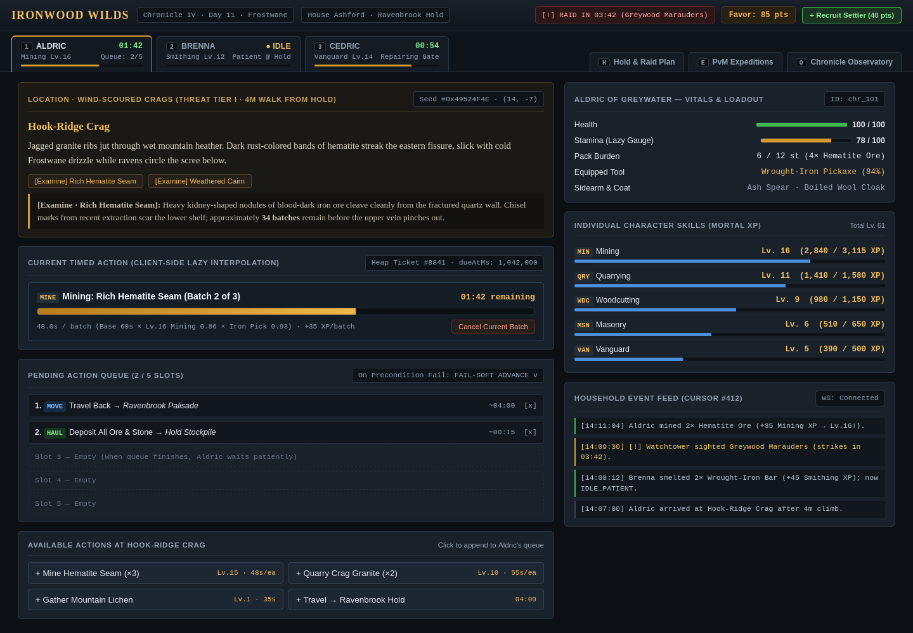

# Ironwood Wilds — Master Architecture & Implementation Suite

> **Planning & Review Lead:** Gemini 4 Carbon (`google/gemini-4-carbon`)  
> **Target Repository:** `kotharworks` (Pure Java 25 LTS modular monorepo)  
> **Role of This Suite:** Normative specification of design intent for `st` ticket decomposition (`KOTHARWORKS`), implementation handoffs, deterministic golden tests, and post-implementation code reviews. For what *exists today*, the code, [`tickets/README.md`](../../tickets/README.md) and the SQL migration files are authoritative; see [Current Status](#current-status).

---

## Current Status

- **Phase 0 — "The Bare Engine Spine": complete.** Tickets and index live in [`tickets/done/`](../../tickets/done/) ([`PHASE0-README.md`](../../tickets/done/PHASE0-README.md)).
- **Phase 1 — "Slice 0 Gameplay": in progress.** See the Phase 1 index in [`tickets/README.md`](../../tickets/README.md). Execution order is M0 -> M4 -> (M1-M3).
- **Definition-of-done gate:** the one-command `./systest.sh` (Docker; black-box bot + emulated-human live suites over HTTP/SSE). See [`systest/README.md`](../../systest/README.md).
- Planning prose below describes design intent. Where it disagrees with the code or the migrations, the code and migrations win.

---

## Engine Primitives vs. Gameplay Nouns

The design docs speak in gameplay nouns; the code uses neutral engine primitives.

| Gameplay noun (design docs) | Engine primitive (code) | Notes |
| :--- | :--- | :--- |
| Household / House | `Owner` (`OwnerId`, `OwnerRow`) | One permanent seat (`wilds_meta.seats`) charters exactly one Owner per world. |
| Settler / Character | `Actor` (`ActorId`, `ActorRow`) | Generational ID; a dead settler's slot generation is retired, stale IDs reject. |
| Site / Waypoint / Region node | `Place` (`PlaceId`, `PlaceRow`, `PlaceEdge`) | Travel graph edges carry `travelDurationMs`. |
| Hold, Party, Stockpile, Tech unlocks | *(new tables keyed by `OwnerId` / `ActorId`)* | Added in Phase 1 tickets; never as object references. |
| Item / Skill / Tech / Building kinds | `RuleRegistry` families keyed by `RuleId` | Added in Phase 1; versioned by `WILDS_RULES_VERSION` (Ticket `11`). |
| `CharacterId`, `HouseholdId`, `SiteId`, `HoldId` | — | **Historical names only.** Do not introduce these types. |

Neutral engine IDs are permanent. `OwnerId`, `ActorId` and `PlaceId` (generational `(index, generation)` records in `com.kotharworks.wilds.id`) are baked into the WAL, the wire format, `EventPayloadCodec` and SQL, and are never renamed. Gameplay concepts are layered on as state tables, `RuleRegistry` families and DTO fields keyed by those IDs. `CharacterId`, `HouseholdId`, `SiteId` and `HoldId` are historical names only.

---

## 1. Why This Architecture Looks the Way It Does

Every boundary in this suite is anchored directly to **three core project constraints**:

1. **Focused Momentum & Reviewable Vertical Bricks:**  
   Iterative, agent-friendly development demands small, high-leverage vertical bricks with **zero framework yak-shaving** (no Spring, no Hibernate, no React/npm toolchain, no custom YAML parser bugs, no hand-rolled WebSocket frame-masking boilerplate). Every ticket cut from this plan compiles cleanly under `-Werror` and ends in a deterministic, mechanically verifiable acceptance test.
2. **Emergence Needs Friction, Scarcity, Goals, and Human Texture:**  
   Pure sandboxes where agents wander around aimlessly look busy for five minutes and then flatten into noise. **Ironwood Wilds** pairs **OSRS-style mortal character skills**, a **Household Tech Tree**, **3-Ring Hold fortification against non-lethal raids**, **lethal PvM expeditions**, **True Ironwood scarcity**, and a **Homeland Tithe Ship economy**—while giving every patient settler a **procedurally generated persona, voice, scars, and first-person journal** so losing a veteran in a barrow delve actually stings.
3. **Replay-Grade Determinism Now = Effortless Genetic Algorithms Later:**  
   If game rules leak into HTTP handlers, floating-point drift, `HashMap` iteration order, or `Instant.now()` wall-clock calls, you can neither replay production bugs nor fast-forward genetic algorithms. By isolating the entire simulation inside a **pure, integer-only, logical-millisecond Java 25 engine** backed by **lazy gauges + a deterministic `(dueAtMs, seq)` min-heap** and **Command-Log-as-Truth persistence**, any live Chronicle replays bit-for-bit (`WorldHash`)—and a future GA harness (`libs/samvm` + `libs/samgenai`) can evaluate 7 simulated days in **milliseconds** on Virtual Threads.

---

## 2. The Modular Banner (`kotharworks` & `sam*` Ecosystem)

**Ironwood Wilds** is the game; `kotharworks` (`com.kotharworks`) houses both the reusable `sam*`/core libraries and the Ironwood Wilds modules in pure Java 25 LTS (`-XX:+UseCompactObjectHeaders`, Virtual Threads, `record`s, `sealed` interfaces):

```text
kotharworks/  (Maven reactor: com.kotharworks)
├── libs/
│   ├── wilds/        Pure deterministic Ironwood Wilds engine (zero I/O, zero floats, zero Auth)
│   └── auth/         Modular AuthN & HTTP security (OIDC code + Dev-Local JWT + Scoped Keys)
├── apps/
│   ├── wilds-headless/   CLI rig: run, replay (--hash), inspect
│   └── wilds-server/     Hexagonal host: Virtual-Thread HTTP/SSE + SeatAuthorizer + SSR UI + Postgres
└── systest/          (opt-in: -Psystest) Black-box bot + emulated-human live suites; run via ./systest.sh
```

**Planned modules (not yet in the reactor):**

| Module | Status | Introduced by |
| :--- | :--- | :--- |
| `libs/procgen` | *planned* | Phase 1 Ticket 14 (`NameGrammar` + `PersonaGenerator`) |
| `apps/wilds-bot` | *planned* | Phase 1 Ticket 24 (M5a) |
| `libs/samsim` | *planned, optional later* | No ticket |
| `libs/samvm` | *planned* | Phase 2 (GA) |
| `libs/samgenai` | *planned* | Phase 2 (GA) |
| `apps/wilds-arena` | *planned* | Phase 2 (GA) |

> **Module Discipline:** `libs/procgen` returns when the first real generator lands (planned: Phase 1 Ticket 14, `NameGrammar` + `PersonaGenerator`), absorbing `WorldSeed`/`SeededRng` from `com.kotharworks.wilds.seed`. Until then the `com.kotharworks.wilds.worldgen` seams (`WorldTopologyBootstrap`, `DescriptionComposer`) are the only procgen surface; the seed primitives live in `libs/wilds` only temporarily. Keep `com.kotharworks.wilds.sim` as a clean internal package inside `libs/wilds` until a second simulation project warrants extracting `libs/samsim`.

---

## 3. Architectural Map at a Glance


> *Diagram artifacts:* [`01-system-architecture.dot`](diagrams/01-system-architecture.dot) · [`SVG`](diagrams/01-system-architecture.svg) · [`PNG`](diagrams/01-system-architecture.png)

### Interactive Webpage Prototype Preview
Open [`prototype/index.html`](prototype/index.html) in any browser to click through the live tabs (`1`, `2`, `3`, `H`, `E`, `O`), inspect procedural character personas & journals, or view the rendered screenshots in [`04-WebInterfaceAndProtocols.md`](04-WebInterfaceAndProtocols.md):



### ASCII Reference Topology

```text
  HUMANS (Browser / Phone)         BOTS (Any Language)                CLI REPLAY & PHASE 2 GA
  Multi-Tab SSR HTML + SSE         REST + SSE (or optional TCP)       wilds-headless / wilds-arena
             │                                  │                                  │
             └────────────────┬─────────────────┘                                  │
                              ▼  HTTPS: POST /api/v1/commands + GET /api/v1/stream │
┌─────────────────────────────────────────────────────────────────────────┐        │
│ apps/wilds-server  (Hexagonal Application Layer — Java 25 Virtual VTs)  │        │
│                                                                         │        │
│  ┌──────────────────┐   ┌──────────────────┐   ┌─────────────────────┐  │        │
│  │ Web UI Adapter   │   │ REST JSON Routes │   │ SSE Event Stream    │  │        │
│  │ (SSR Tabs + 250  │   │ (/api/v1/* +     │   │ (/api/v1/stream     │  │        │
│  │  LOC Vanilla JS) │   │  POST /commands) │   │  ?since=cursor)     │  │        │
│  └────────┬─────────┘   └────────┬─────────┘   └──────────┬──────────┘  │        │
│           └──────────────────────┼───────────┬────────────┘             │        │
│                                  ▼           │ Lock-Free WorldView      │        │
│                   ┌──────────────────────────┴──┐                       │        │
│                   │ libs/auth + SeatAuthorizer  │───► Postgres: `auth`  │        │
│                   │ (OIDC/Dev JWT + iw_bot_ Key)│     (0 Passwords!)    │        │
│                   └──────────────┬──────────────┘                       │        │
│                                  ▼                                      │        │
│                   ┌─────────────────────────────┐                       │        │
│                   │ WorldHost (Single-Writer    │───► Postgres:         │        │
│                   │ Mailbox + 1 Hz Live Pump +  │     `wilds_world`     │        │
│                   │ Synchronous cmdId WAL)      │     (WAL + Snapshots) │        │
│                   └──────────────┬──────────────┘     & `wilds_meta`    │        │
└──────────────────────────────────┼──────────────────────────────────────┘        │
                                   │ Pure Java Calls (Zero I/O Below This Line)    │
                                   ▼                                               ▼
┌─────────────────────────────────────────────────────────────────────────────────────────┐
│ libs/wilds  (100% Pure Deterministic Simulation Core — Zero I/O, Zero Wall-Clock)       │
│                                                                                         │
│  • Dense Array Entity Tables + Generational IDs `(index, generation)` · Zero Floats!    │
│  • Integer `LazyGauge` + `DueEventHeap(dueAtMs, seq)` + O(1) `heapTicket` Cancellation  │
│  • Compile-Time `RuleRegistry` + `ActionMechanic<P>` + Raid/PvM Autobattler Strategies  │
│  • `WorldHash` Structural Hashing + Golden Replay Gate (`-DblessGolden=true`)           │
└──────────────────────────────────┬──────────────────────────────────────────────────────┘
                                   │
                                   ▼
┌─────────────────────────────────────────────────────────────────────────────────────────┐
│ libs/procgen  *planned (Phase 1)* — Pure Seeded World, Persona & Prose Engine           │
│ (today the seed primitives live in libs/wilds: com.kotharworks.wilds.seed)              │
│  • Domain-Separated `WorldSeed` Streams -> Elevation, Hydrology, Biomes & Waypoint Map  │
│  • Chronicle Myth Flags + True Ironwood Scarcity (`<= 2` Groves per Continent)          │
│  • Phonotactic `NameGrammar` + `PersonaGenerator` + First-Person `JournalComposer`      │
│  • Hierarchical Category/Slot/Template Prose (`glance` / `look` / `examine`)            │
└─────────────────────────────────────────────────────────────────────────────────────────┘
```

`systest/` (`./systest.sh`) sits outside this diagram as the definition-of-done gate: black-box bot + emulated-human live suites driving `apps/wilds-server` over HTTP/SSE.

---

## 4. Key Architectural Decisions Digest

| ID | Area | Normative Decision | Why It Fits |
| :--- | :--- | :--- | :--- |
| **AR-1** | **Determinism & State** | **Dense Array Entity Tables** keyed by the generational `ActorId` / `OwnerId` / `PlaceId` records (`index, generation`; see [Engine Primitives vs. Gameplay Nouns](#engine-primitives-vs-gameplay-nouns)), **100% integer/permille math** (zero `float`/`double` in `WorldState`), verified by `WorldHash` golden replays. | Eliminates pointer spaghetti, stale-handle bugs, hash-order nondeterminism, and float drift across replays and GA forks. |
| **AR-2** | **Lazy Time & Heap** | **Integer `LazyGauge` interpolation + `(dueAtMs, seq)` Min-Heap + 1 Hz live pump** (`PAUSE_WHILE_DOWN` on server maintenance). | O(1) idle world cost, instant headless fast-forward (`advanceToNextEvent`), exact shared-resource causality, and 4-line O(1) `heapTicket` cancellation. |
| **GP-1** | **"Patient Hands, Living People"** | **Zero behavioral idle autonomy** (`IDLE_PATIENT` when queue empties), **rich procedural `CharacterPersona`** (origins, temperaments, scars, first-person journals). | Humans, bots, and GAs stay 100% in command of workshop scheduling, while settlers feel like memorable mortal people rather than numbered drones. |
| **GP-2** | **World & Stakes** | **Unresolved Rival Mystery + Chronicle Myth Flags**, **True Ironwood scarcity (`≤2` groves)**, **Scheduled Homeland Tithe Ship**, **non-lethal 3-Ring Hold Raids**, and **lethal PvM Party Expeditions**. **Zero PvP.** | Creates interlocking economic/military trade-offs, dramatic public/fogged Chronicle rumors, and walk-away safety. |
| **CM-1** | **Unified Wire API** | **Single mutation endpoint (`POST /api/v1/commands`)** with UUIDv7 `cmdId` idempotency + optional **`expectedRevision` (`409 STALE_STATE`)**, validated synchronously inside `WorldHost`, paired with **SSE (`GET /api/v1/stream?since=cursor`)**. | Zero UI-private endpoints, safe bot retries, ETag-equivalent lost-update protection across tabs, and ~25-line Virtual-Thread SSE push. |
| **AU-1** | **Modular Auth (`libs/auth`)** | **Zero passwords in game DB:** **Nimbus JOSE+JWT** OIDC verification (**Roles on JWT + JIT `(iss, sub) -> UserId` UUID**), loopback-fused `dev-local` -> drop-in **Keycloak** (`--auth-mode=oidc`), BFF cookie + CSRF, and seat-scoped `iw_bot_...` keys. | Separates AuthN from AuthZ, tests the exact Keycloak JWT path from Day 1 with zero Docker, and is enforced by the mechanical `AuthSecurityGateTest` suites. |
| **PS-1** | **Persistence** | **100% Append-Only `wilds_world` (`command_wal` + `CLOCK_ADVANCE` + Snapshots, zero `UPDATE` tables)** with **Commit-Before-Mutate** discipline across **3 Postgres schemas** (`auth`, `wilds_meta`, `wilds_world`) via JDBI + ~100-line SQL migrator. | Eliminates async entity-sync races, split-brain RAM/DB drift on `SQLException`, and SSE cursor time-rewinds on `kill -9`. |

---

## 5. Document Guide

1. **[IronwoodWildsFlavour.md](IronwoodWildsFlavour.md)** · **[IronwoodWildsMechanics.md](IronwoodWildsMechanics.md)**  
   The game brief, split in two. **Flavour:** the setting bible: the unnamed island Homeland, the century-long naval war between two Noble Republics, the cold ironwood continent and its shifting rivers, reptilian beasts, the ruins and their Wardens (with canon levels for what is stated, rumoured, or hidden). **Mechanics:** pillars, **"Patient Hands, Living People"** personas and journals, skills × Household Tech Tree, depth bands and weekly river channels, hunting and husbandry, Convoy consignments and the shared **Yard** shipbuilding, lethal PvM expeditions, and non-lethal 3-Ring Hold raids.
2. **[01-ServerArchitectureAndPatterns.md](01-ServerArchitectureAndPatterns.md)**  
   Dense flat entity schemas with generational IDs, bridging classic GoF patterns (`Command`, `Strategy`, `Prototype`, `Observer`) with Data-Oriented Java 25, compile-time `RuleRegistry`, single-writer Virtual-Thread concurrency, and strict `WorldHash` determinism gates.
3. **[02-CommandsAndLazySimulation.md](02-CommandsAndLazySimulation.md)**  
   The `POST /api/v1/commands` envelope, UUIDv7 `cmdId` idempotency, optional `expectedRevision` (`409 STALE_STATE`), Commit-Before-Mutate `WorldHost` admission + `CLOCK_ADVANCE` markers, integer `LazyGauge` + `DueEventHeap`, Two-Phase fail-soft validation, O(1) `heapTicket` cancellation, and lazy Party muster sync.
4. **[03-ProceduralGeneration.md](03-ProceduralGeneration.md)**  
   Four deterministic scales in `libs/procgen`: multi-pass geography & precomputed Site/Waypoint travel graphs, Chronicle Myth flags, PvM Lair room grammars, **Character Personas & First-Person Journals (`NameGrammar`, `PersonaGenerator`, `JournalComposer`)**, and `procgen_mvp` hierarchical `glance`/`look`/`examine` prose.
5. **[04-WebInterfaceAndProtocols.md](04-WebInterfaceAndProtocols.md)**  
   Unified REST + SSE client contract, fog-of-war projections & fogged public rumors, the server-rendered Multi-Tab Character Deck (`prototype/index.html`, **"While You Were Away"** digest, Character Journal pane, client-side 60fps countdowns), and the public **`/chronicle` Observatory**.
6. **[05-AccountsAndPersistenceSchemas.md](05-AccountsAndPersistenceSchemas.md)**  
   Three-schema PostgreSQL DDL (`auth` zero-password OIDC links & scoped `iw_bot_...` keys, seat-centric `wilds_meta` (one permanent seat charters one Owner per world) & replay version-triple, 100% append-only `wilds_world` `command_wal` + `CLOCK_ADVANCE` + snapshots), forward SQL migrations, and zero-rewind `PAUSE_WHILE_DOWN` restart semantics. The `db/V*.sql` migration files are authoritative where the DDL differs.
7. **[06-VerticalSliceAndRoadmap.md](06-VerticalSliceAndRoadmap.md)**  
   Slice 0 (*"Hearth, Iron, and the Palisade"*), worked transcript ending in `wilds-headless replay --hash`, the actual Phase 0 package skeleton plus planned Phase 1 additions, Milestones **M0–M5** with a Status column, a pointer to the ticket backlog in [`tickets/README.md`](../../tickets/README.md), **post-implementation code-review checklist**, Phase 2 `SamVM` + `SamGenAI` integration, and `systest/` + `./systest.sh` as the definition-of-done gate.
8. **[07-AuthAndSecurityArchitecture.md](07-AuthAndSecurityArchitecture.md)**  
   Standalone **`libs/auth`** (`com.kotharworks:auth`), 3-layer AuthN vs. AuthZ boundary, JWT roles + JIT `UserId` linking, loopback-fused `dev-local` -> drop-in **Keycloak** OIDC, BFF `__Host-kw_session` CSRF guards, seat-scoped Bot keys, and the **`AuthSecurityGateTest`** verification suites.

### Visual Artifacts Index
- **Graphviz `.dot` Sources + Compiled `.svg` & `.png` Graphs (`diagrams/`):**
  - `01-system-architecture` ([`.dot`](diagrams/01-system-architecture.dot) · [`.svg`](diagrams/01-system-architecture.svg) · [`.png`](diagrams/01-system-architecture.png))
  - `02-entity-schema-and-patterns` ([`.dot`](diagrams/02-entity-schema-and-patterns.dot) · [`.svg`](diagrams/02-entity-schema-and-patterns.svg) · [`.png`](diagrams/02-entity-schema-and-patterns.png))
  - `03-command-and-lazy-heap-flow` ([`.dot`](diagrams/03-command-and-lazy-heap-flow.dot) · [`.svg`](diagrams/03-command-and-lazy-heap-flow.svg) · [`.png`](diagrams/03-command-and-lazy-heap-flow.png))
  - `04-gameplay-loops-and-risk` ([`.dot`](diagrams/04-gameplay-loops-and-risk.dot) · [`.svg`](diagrams/04-gameplay-loops-and-risk.svg) · [`.png`](diagrams/04-gameplay-loops-and-risk.png))
  - `05-procgen-pipeline` ([`.dot`](diagrams/05-procgen-pipeline.dot) · [`.svg`](diagrams/05-procgen-pipeline.svg) · [`.png`](diagrams/05-procgen-pipeline.png))
  - `06-postgres-three-schemas` ([`.dot`](diagrams/06-postgres-three-schemas.dot) · [`.svg`](diagrams/06-postgres-three-schemas.svg) · [`.png`](diagrams/06-postgres-three-schemas.png))
  - `07-milestone-roadmap` ([`.dot`](diagrams/07-milestone-roadmap.dot) · [`.svg`](diagrams/07-milestone-roadmap.svg) · [`.png`](diagrams/07-milestone-roadmap.png))
  - `08-auth-and-security-pipeline` ([`.dot`](diagrams/08-auth-and-security-pipeline.dot) · [`.svg`](diagrams/08-auth-and-security-pipeline.svg) · [`.png`](diagrams/08-auth-and-security-pipeline.png))
- **Interactive HTML Webpage Prototype & Views (`prototype/`):**
  - [`prototype/index.html`](prototype/index.html) *(Interactive prototype — press `1`, `2`, `3`, `H`, `E`, `O`)*
  - [`prototype/ui-01-character-deck.png`](prototype/ui-01-character-deck.png) · [`prototype/ui-02-hold-raid-defense.png`](prototype/ui-02-hold-raid-defense.png) · [`prototype/ui-03-expeditions-and-chronicle.png`](prototype/ui-03-expeditions-and-chronicle.png) · [`prototype/ui-04-observatory-showoff.png`](prototype/ui-04-observatory-showoff.png) · [`prototype/ui-frontier-map.svg`](prototype/ui-frontier-map.svg)
